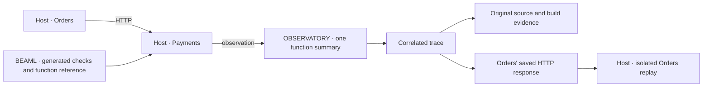
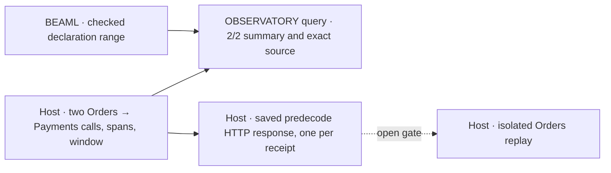

# EXPERIMENT 0003 — Source-linked replay

**[Proposal]** Can one function's operational summary take a reader from an actual call to the exact source that ran, then to an isolated REPLAY RUN?

**[Verified]** [EXPERIMENT 0002](../0002-http-correlation/README.md#retained-results) correlated traces and logs across two loopback releases.
The host supplies the existing function names, paths and hashes. [Observation helper](../0002-http-correlation/apps/probe_support/lib/probe_support.ex)

**[Proposal]** For two successful synthetic Orders requests in one recorded window, a single entry for `payments.authorize` can account for both calls.
It can link one call to its trace and exact compiled source. Orders can reproduce that call's decision using its saved HTTP response with zero outbound attempts.
A source revision with the same function name and a different build must not satisfy the link.



## Fixed inputs and ownership

- **LANGUAGE/COMPILATION.** Use the existing Orders and Payments BEAML fixtures and checks. Emit the Payments function reference from the checked declaration in the same compiler invocation as the Elixir output. Use the qualified function name and exact BEAML input SHA-256 as the SOURCE ID. Resolve that name to its one declaration in the archived input.
- **EXECUTION.** Reuse the two separate releases, ports and HTTP path from 0002. Run two sequential `POST /orders` calls with `{"order_id":"order-1"}`. Expect HTTP 200 and `{"order_id":"order-1","status":"authorized"}`. Use a fresh release pair with fixed code for the window.
- **EXECUTION.** The build records the generated reference, source snapshot and hashes of the generated Elixir and compiled BEAM module. Use the Payments BEAM hash as this probe's Payments artifact ID. The manual host wrapper attaches the generated reference and artifact ID to the Payments span. Use the existing runtime BEAM hash check to match the running release with the retained artifact.
- **EXECUTION.** For the first call, retain the prepared request, observed HTTP status and bounded body bytes at the Orders client before JSON decoding. Bind the record to the trace, Orders artifact, operation and attempt. Retain the original Orders artifact for replay.
- **OBSERVATORY.** Use one local CLI entry as the hover prototype. Select `payments.authorize` by Payments artifact ID and SOURCE ID within the run window. Read the original declaration from the retained source snapshot. Keep the trace and build evidence links in the same entry.

## Acceptance cases in order

1. **Account for the calls.** Record the UTC window from before the first request to the final flush. Flush observations after each sequential call. Match the runner's receipt for each call to the one new Orders root trace since the preceding snapshot. Check the expected HTTP status and body for both calls. Use the two completed Orders calls as the denominator. Confirm that the Payments request counter increased by two. Count calls with exactly one completed `payments.authorize` span for the selected artifact and SOURCE ID. Expect coverage **2/2** and **2 successful function outcomes**. Fail on capture loss, missing or duplicate matches, or unknown outcomes.
2. **Find the executed declaration.** Open the first call's trace from the entry. Verify that the Payments server span has the Orders client span as its remote parent. Follow the Payments function span to the archived declaration and verify the source and artifact hashes against the run evidence. The generated function reference supplies the source link.
3. **Reject the other build.** Use a labeled fixture for a second build with the same function name and a different artifact ID and SOURCE ID. Put its source in the lookup context as the current local revision. The original trace must still resolve to the original source. If that original source is removed from a derivative copy, resolution must report missing evidence even when the fixture is present. The fixture adds no live calls or observations.
4. **Replay one response.** Stop both releases. Verify the Orders artifact against the run record and run its preparation and finish logic in isolation. Substitute the recorded status and body at the outbound boundary and use the same decode and validation path. Assert the same authorized result and one matching requested operation and attempt. Count entry to the live transport before the first socket operation. Verify one outbound attempt per live call and zero during replay.
5. **Reject invalid replay records.** In derivative copies, remove the saved response and change its operation or attempt identity. Each case must fail with a specific evidence error before the Orders finish step. The live transport counter must stay at zero in both cases.

## Evidence and limits

**[Proposal]** Reserve `python3 experiments/0003-source-linked-replay/run.py` as the repeatable command. Retain the command, toolchain versions, hashes, trace and source evidence, replay records and assertions under a new `results/<UTC-id>/` per run. Preserve failed runs. Record the use case start, steps and result in `.beaml/actions.jsonl` without source text or paths.

**[Unknown]** `run.py` does not exist yet. Each gate uses its own test command. The counts are acceptance targets for local loopback calls from a synthetic driver. Only the two successful requests contribute to the coverage result. The negative controls use derivative evidence.

### Gate status

| Gate | Acceptance cases | State | Evidence |
| --- | --- | --- | --- |
| Compiler reference | Function reference from the checked declaration | **[Verified]** RED, GREEN, independent TEST and review passed | [Notes](workflow/2026-11-05/notes.md), [verification](workflow/2026-11-05/result.json), [GREEN run](results/20261105T225807421990Z/result.json) |
| Live evidence and exact source lookup, with repair | 1–3 | **[Verified]** RED, GREEN, independent TEST and review passed. The repair adds receipt order and window checks | [Notes](workflow/2026-11-05/lookup/notes.md), [lookup TEST run](results/20261105T232448420501Z/result.json), [repair TEST record](workflow/2026-11-05/lookup/repair-test-result.json), [repair review](workflow/2026-11-05/lookup/repair-review.md) |
| Predecode response capture and transport observer | 4 (live part) | **[Verified]** RED, owner RED review, GREEN, independent TEST (10/10 checks) and review passed. One response record per live receipt | [Notes](workflow/2026-11-05/capture/notes.md), [TEST record](workflow/2026-11-05/capture/test-result.json), [TEST run](results/20261106T063936223444Z/result.json), [review](workflow/2026-11-05/capture/review.md) |
| Isolated replay and invalid-record controls | 4–5 | RED confirmed (revision 3), agent RED review | [Notes](workflow/2026-11-05/replay/notes.md#red-revision-3-status-and-request-checks), [RED run](results/20261106T075903031507Z/result.json) |



**[Requirement]** Repeat the lookup gate with two commands. Run the live test first. Then run the repair test with `--source-run` on its new result directory. The owner chose this on 2026-11-06. The retained archive without wall-clock span times stays as `missing_clock` evidence. [Decision record](workflow/2026-11-05/lookup/notes.md#lookup-repair-test-review-and-owner-decision)

```sh
python3 -B experiments/0003-source-linked-replay/tests/trace_lookup_test.py
python3 -B experiments/0003-source-linked-replay/tests/trace_lookup_repair_test.py \
  --source-run experiments/0003-source-linked-replay/results/<fresh live result dir>
```

**[Unknown]** The verified gates cover the synthetic two-call lookup, CAPTURE and transport observation on one host. They do not show a REPLAY RUN or invalid replay records. Partial windows were checked only in scratch derivatives. The malformed `service` parser crash stays open. A passed gate does not establish production readiness.

**[Verified]** The CAPTURE gate changed only [`OrdersApi.PaymentHttp`](../0002-http-correlation/apps/orders_api/lib/orders_api/payment_http.ex), 22 lines added. The owner chose one response record per live receipt, for both calls. This replaces "for the first call" in the EXECUTION input above. The transport counter counts `[1, 2]` for the two live calls and `[0, 1]` for the invalid order and the refused connect. Fresh Claude Opus 5.5 workers ran this gate by owner choice. [Notes](workflow/2026-11-05/capture/notes.md#capture-test)

**[Unknown]** Review advisories limit the CAPTURE evidence. None blocks the gate. [Review](workflow/2026-11-05/capture/review.md#advisory-items)

- **A1.** **[Unknown]** The test cannot show that the record bytes are raw. Re-encoded compact JSON gives the same 44 bytes. Only the code order shows predecode. **[Requirement]** The owner put the check into the gate 4 RED on 2026-11-06. A loopback stub returns a non-canonical body. The test compares the record bytes exactly.
- **A2.** **[Proposal]** `authorize/2` joins transport and decode. The REPLAY RUN gate needs one shared decode function for the live path and replay.
- **A3.** **[Unknown]** The Orders artifact ID covers only `OrdersBeamlSpike`. It does not cover the host decode or `valid_payment!` validation. **[Requirement]** The owner keeps this open and does not solve it now. See [D002](../../wiki/planning/decisions-to-be-made.md#d002--scope-of-the-replay-artifact-identity).

**[Requirement]** The response record has no timestamp. The owner chose this on 2026-11-06 for data economy at large volume. The time comes from the span through `trace_id` and `client_span_id`. Trace sampling is open in [D003](../../wiki/planning/decisions-to-be-made.md#d003--trace-sampling-and-retained-response-records). [Owner decisions](workflow/2026-11-05/capture/notes.md#owner-decisions-after-review)

**[Proposal]** Zed/LSP hover, production ingestion and dashboards, and comparative benchmarks are later targets. The [distributed order proposal](../../wiki/planning/distributed-order-probe.md) also covers Inventory and timeout uncertainty. This probe exercises one successful HTTP response and the Orders decision that consumes it.
