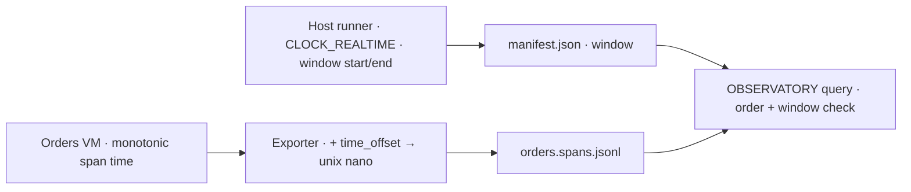

# Review lookup repair (0003)

**[Verified]** Verdict: pass. This review found no defect that needs a repair before the gate. Findings 1 and 2 of the [lookup review](review.md) are closed for fresh archives. The reviewer was a fresh Claude Opus 5.5 subagent, by owner choice.

## Checks

**[Verified]** Receipt order. The query sorts the Orders roots by VM monotonic start and compares the ordered trace IDs with the ordered receipts. Adjacent roots must not overlap. The graph check already requires one `orders.request` per trace from the `orders` service. Extra, missing or swapped roots cannot pass. [query.py:53](../../../../0002-http-correlation/query.py#L53)

**[Verified]** A correct sequential run cannot fail the overlap check. The runner queries the first trace as complete, with ended spans, before it sends call 2. [trace_lookup_test.py:172](../../../tests/trace_lookup_test.py#L172)

**[Verified]** Window check. Scratch derivatives of the fresh archive `20261106T061910678622Z` gave these results through `check_run`:

| Derivative | Result |
| --- | --- |
| Unchanged | no gaps |
| Window end between the two roots | `outside_window` |
| Window start 1 µs after the first root start | `outside_window` |
| Start and end reversed | `outside_window` |
| Naive timestamp without offset | `invalid_evidence` |

**[Verified]** In that archive, `*_unix_nano − start/end_time` is the same value for all four root timestamps. The two clock fields agree.

**[Verified]** Callers. `summarize_payments` has one caller, `check_run` with `function_lookup` present. [query.py:199](../../../../0002-http-correlation/query.py#L199). `check_run` callers are `query.py main`, 0002 `run.py` and the 0002 unit tests. Manifests without `function_lookup` skip the new checks. The ledger shows four legacy 0002 runs complete and eight unit tests pass. The two new span fields are additive. No reader checks an exact span key set.

## Clock basis

**[Verified]** The release ERTS 15.2.7 starts with no `+C` flag in `vm.args`. In a clean environment it runs `multi_time_warp` with time correction on. Its OS system time source is `CLOCK_REALTIME`. Its monotonic source is `CLOCK_UPTIME_RAW`.

**[Verified]** Converted BEAM time minus `os:system_time` drifted from +0.4 µs to −19.6 µs over 6 s on this host. That is about 4 ppm. The recorded start margins are 400 µs and 704 µs.

**[Inference]** Python `datetime.now(timezone.utc)` reads the same `CLOCK_REALTIME`. The runner records the window start before it opens the request. The root span starts after the server parses it. Under a steady clock, a false `outside_window` needs about 100 s of drift at the measured rate. This is not plausible in this runner.

**[Inference]** A false `outside_window` is possible only if the OS steps or slews the realtime clock strongly between VM start and the first request. `opentelemetry:timestamp_to_nano/1` reads `erlang:time_offset()` at export, not at span start. [opentelemetry.erl:343](../../../../0002-http-correlation/deps/opentelemetry_api/src/opentelemetry.erl#L343). The failure is then a conservative gap, not a wrong pass. No repair needed.

## Notes (no repair required)

1. **Low · [Verified] Default repair command fails on the retained archive.** `BASELINE` points to `20261105T232448420501Z`, which has no unix nano fields. [trace_lookup_repair_test.py:15](../../../tests/trace_lookup_repair_test.py#L15). The `missing_clock` gap is the correct query result for that evidence. It is not a code defect. The repeatable command for this gate needs `--source-run <fresh archive>`. Owner decision: record that command in the ledger, or change the default in a new test step.
2. **Info · [Inference] Partial window cases are not in the acceptance test.** The test uses only a window in 2000. The scratch checks above cover partial windows. Add them only if the owner wants them retained.
3. **Info · [Verified] 0002 input hashes change.** 0002 `run.py` hashes `query.py` and `apps/**/*.ex`. Retained 0002 results keep the old hashes. New 0002 runs record new ones. [run.py:55](../../../../0002-http-correlation/run.py#L55)

## Limits

**[Unknown]** This review started no release. The clock measurement used the release ERTS with `start_clean`, not the `orders` release. An OS clock step during a run was not tested. The malformed `service` crash, CAPTURE, transport and REPLAY RUN are out of scope.
