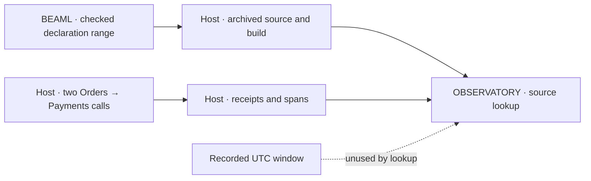

# Review live trace lookup (0003)

**[Verified]** The tested path uses the original archived source even with a same-name revision present. The shared checker preserves the Orders client to Payments server remote-parent edge. The selected Payments BEAM hash matches the archived bytes, the startup control and both live function spans. The span name and the hash of the fixed release fixture supply the SOURCE ID. The generated reference supplies the declaration range. This check assumes fixed release files and the runner's build record.

## Findings

1. **[Verified] First trace can point to the second call.** Swapping only the two receipt `trace_id` values in a derivative of the independent TEST archive preserves `complete=true`, the 2/2 summary and an empty gap list. `first_trace_id` changes to the second call. The query sorts receipt IDs before comparison, which discards their order. This can also select the wrong trace for the later first-call REPLAY RUN. Compare receipt order with the start order of the two Orders root spans from the same VM. Require valid times and sequential roots for this lookup. [Query receipt check](../../../../0002-http-correlation/query.py#L44), [runner receipt binding](../../../tests/trace_lookup_test.py#L157)
2. **[Verified] Coverage accepts missing or incompatible window evidence.** Removing `window` from the derivative manifest or replacing it with a one-hour window in 2000 preserves `complete=true` and the 2/2 summary. The runner records UTC bounds and performs a flush after each call. The lookup never reads those bounds. Require UTC bounds and bind the observed Orders roots or per-call receipt and flush evidence to them. Use a recorded wall-clock conversion if comparing span times directly. The existing raw span times are VM-local monotonic values. [Runner window](../../../tests/trace_lookup_test.py#L158), [span exporter](../../../../0002-http-correlation/apps/probe_support/lib/probe_support/exporter.ex#L19)
3. **[Verified] A malformed span service can crash the shared query.** Set a retained Payments span's `service` to `[]` and update the capture byte count. The query adds `service_file`, then raises `TypeError` while building a set of services. The same code predates this gate. Reject a non-string `service` inside record validation, where the reader already reports invalid evidence. [Reader and graph check](../../../../0002-http-correlation/query.py#L115), [earlier query snapshot](../../../../0002-http-correlation/results/20261105T221309471389Z/inputs/query.py#L60)

## Evidence checks

**[Verified]** The retained RED exercised the public query after two real HTTP 200 responses, complete correlation, clean release exits and a separately compiled alternate. It reached the three expected behavior failures. The summary was absent, the missing-source control returned `invalid_evidence`, and both Payments spans lacked artifact IDs. The ledger records the owner's GREEN approval after those failures. The unchanged test passed in GREEN and in independent TEST. All three records match the current test SHA-256 and all listed output hashes. [RED](../../../results/20261105T230852203515Z/result.json), [approval and GREEN notes](notes.md), [GREEN](../../../results/20261105T232308384268Z/result.json), [independent TEST](../../../results/20261105T232448420501Z/result.json)

**[Verified]** Scratch checks reused the independent TEST archive through `check_run`. The original resolved. Substituting the alternate source yielded `source_hash`. Substituting the alternate BEAM yielded `beam_hash`. Deleting the original source yielded `missing_source`. Malformed receipt elements yielded `invalid_evidence`. The eight existing 0002 Python unit tests passed. Legacy manifests omit `function_lookup` and continue through the existing graph checker. [0002 unit tests](../../../../0002-http-correlation/tests/test_query.py)

**[Proposal]** Repair the first two findings as lookup acceptance checks. Use separate derivative inputs for swapped receipt trace IDs, absent bounds and a disjoint window. Exercise the existing query entry point and require a gap with no function summary. Use one malformed service derivative for the shared parser case if it is included in the repair.

**[Unknown]** This review did not start new releases. The separate capture, transport and REPLAY RUN gates were outside this review.
