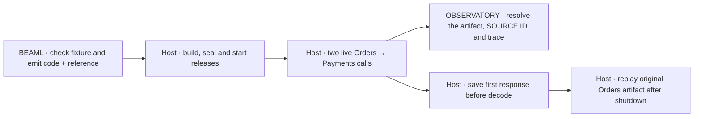

# Plan the source-linked replay EXPERIMENT (0003)

**[Requirement]** Follow the [authorized acceptance contract](spec.md). Treat the compiler reference, the real call, the OBSERVATORY query and the REPLAY RUN as one evidence chain.

## Evidence flow

## Connected code

| Owner | Existing entry point | Small change to evaluate |
| --- | --- | --- |
| LANGUAGE/COMPILATION | [Compiler parser, checker, emitter and CLI](../../../0001-syntax-to-beam/src/main.rs) | Retain the parsed declaration's exact UTF-8 byte range. Emit the selected reference only after validation in the same invocation as Elixir. Keep existing CLI use and invalid-input behavior. |
| EXECUTION | [0002 runner](../../../0002-http-correlation/run.py), [Mix releases](../../../0002-http-correlation/mix.exs), [Payments router](../../../0002-http-correlation/apps/payments_api/lib/payments_api/router.ex) | Build in an isolated EXPERIMENT 0003 stage. Reuse pinned fixture, release, trace and capture code. Attach the checked reference and running Payments BEAM hash to the existing span. |
| EXECUTION | [Orders router](../../../0002-http-correlation/apps/orders_api/lib/orders_api/router.ex), [Orders HTTP transport](../../../0002-http-correlation/apps/orders_api/lib/orders_api/payment_http.ex) | Keep one Orders preparation and finish path. Insert a raw response boundary before decode and a counter before live connect. Run the original compiled Orders modules in a clean VM after both listeners stop. |
| OBSERVATORY | [0002 graph checker](../../../0002-http-correlation/query.py) | Reuse correlation checks where possible. Add a scoped artifact and SOURCE ID query and source resolution for this run. |

The 0002 parser caller expects generated Elixir on standard output and renames its module for each release. Keep that invocation usable. The parser already records token byte positions. The existing checked program permits multiple clauses, so explicitly constrain the selected reference to one declaration in this probe. Do not use a source regex, a guessed line, or a fabricated descriptor.

## RED checkpoint

Add `payments_cli_emits_checked_authorize_reference` to the [existing CLI tests](../../../0001-syntax-to-beam/tests/cli.rs), or an equivalent test in 0003. Invoke the existing one-source CLI on the actual Payments fixture. Check exit success and a generated authorize implementation first. Then assert that its emitted artifact exposes a compiler-derived reference to the exact `fn authorize` declaration.

Expected baseline failure is a missing descriptor in otherwise successful compiler output. An unknown option, failed build, missing module or missing fixture does not qualify. A new optional output mode may still preserve the existing valid baseline contract in the test. Record the command, test name, expected assertion, actual output and cause.

Before production edits, also stage failing assertions for the other planned behavioral contracts against working baselines. The current 0002 checker can already correlate two complete traces. It has no function summary keyed by artifact and SOURCE ID. The current live Orders path reaches Payments successfully. It has no predecode replay record or replay-boundary validation. Use those capabilities as setup controls and assert missing observable behavior. If a later behavioral step needs a new RED checkpoint, keep it separate from any reviewed step.

## Build and query checks

1. Archive the exact compiler input before invoking the compiler. Retain the generated code and reference from that invocation. Seal the qualified name, source SHA-256 and declaration range to the exact compiler output and actual compiled BEAM. Check that the deployed module's hash equals the archived BEAM hash. Verify the reference bytes against the original archived source and exact selector. Record which fields LANGUAGE/COMPILATION emits and which host build fields bind the artifact.
2. Start fresh, separate loopback releases. Record the UTC window, start counters and empty observations. Send two sequential requests. Verify both HTTP status and body. Flush after each request and match each receipt to exactly one newly observed Orders root. Check the Payments request count delta is two and check capture loss, duplicates, unknown outcomes and artifact mismatches before reporting coverage.
3. Select the function by qualified name, Payments BEAM hash and SOURCE ID. Count exactly one ended successful matching span per receipt. Check both traces with the existing remote-parent shape. Return 2/2 and two successes only after all checks pass. Link the first trace to the archived declaration, generated reference and build evidence.
4. Compile a labeled changed source with the same qualified function name and different behavior in a second build. Confirm different source and BEAM hashes. Add it to the lookup context as the current revision. It contributes no live calls. Confirm the original still resolves. Remove the original source only from a derivative and require a specific missing-source gap with the alternate still present.

## Replay checks

1. Capture the first live call's prepared request, actual HTTP status and bounded response bytes before JSON decoding. Record the run, trace, client span, Orders artifact, operation, attempt and capture version. Keep it in dedicated evidence. Check status, bounds and hash, and bind it to the corresponding live receipt and trace. Keep response bytes byte-exact, for example as Base64. Capture only the fixed synthetic fields.
2. Retain the actual compiled Orders workflow and its decode, transport and validation modules, with a manifest and file hashes from the same live build. Verify required bytes before loading the original modules. Stop both releases and confirm exit. Do not rebuild to replay. Load only the needed Orders modules without starting a release or listeners.
3. Replay the original preparation. Compare the requested operation, attempt and prepared request with the saved record before substituting the raw response. Use the original decode, finish and validation functions. Compare the final authorized result and operation sequence. Assert one live connect entry per live call and zero during the REPLAY RUN.
4. Check the observer at the same live transport entry before the first socket operation. The two actual connects must increment it. Add a bounded control outside the two-call coverage window that forces entry to the same transport, even on a failed connect. Require a nonzero attempt delta. This can use a temporary local socket fixture or controlled failure in a separate process. Use the same observer in replay and start with a known zero.
5. Remove the response, change the operation and change the attempt in separate derivatives. Keep original artifacts immutable. Require specific gap or divergence codes before Orders finish, and assert zero live transport attempts in each case.

## Run and review

- Run `python3 experiments/0003-source-linked-replay/run.py` from the repository root.
- Use a new `results/<UTC-id>/` for each attempt. Retain toolchain versions, commands, archived inputs, hashes, live receipts, query and replay evidence, control mutations, and actual assertions. Retain failure output. Use bounded process cleanup.
- Keep compiler, runner and query action events enabled. Log use-case start, steps, and outcome using fixed identifiers. Keep source bytes, paths and request or response bodies out of the action log.
- Run compiler tests and formatting, experiment-focused tests, the staged strict Mix compile and format checks, one complete 0003 run, and wiki link checks after the later evidence update. Run connected 0002 regression checks if its shared behavior changes.
- Keep the implementation local to this probe. Defer LSP, UI, Cloud, LLM, Ecto, LiveView, Inventory, production trust and generalized capture.

**[Unknown]** The planner inspected the linked code. No new test or release ran in this phase. The compiler output and staging design remain proposal decisions.
