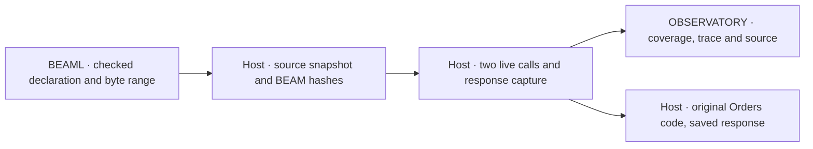

# Propose the smallest source-linked REPLAY RUN (0003)

**[Proposal]** Prove one join from a live `payments.authorize` span to its compiled declaration, then replay the first Orders call. Use the same two HTTP calls for both claims. A UI, a generic REPLAY CAPSULE API and a second live build add no evidence for this question. A mocked transport alone cannot establish the attempt count.

**[Verified]** The [0002 final run](../../../0002-http-correlation/results/20261105T221134010042Z/result.json) retained two correlated requests. Its [checker](../../../0002-http-correlation/query.py) already checks parent IDs, remote propagation, span completion, capture loss and linked logs. Its [HTTP client](../../../0002-http-correlation/apps/orders_api/lib/orders_api/payment_http.ex) currently reads bounded response bytes and decodes them in the same function.

## Files and contracts

| Location | Smallest complete change |
| --- | --- |
| `0001-syntax-to-beam/src/main.rs`, `tests/cli.rs` | Keep the one-source CLI and Elixir on stdout. Emit inert, machine-readable Elixir comments for checked declarations with function name and exact `[start,end)` byte range. Keep the lexed token end so the range stops after the last body token. Reject multiple matching declarations in the probe's selector. |
| `0002-http-correlation/apps/{orders_api,payments_api,probe_support}` | Put the raw status and body boundary in `OrdersApi.PaymentHttp`. Observe entry immediately before `:gen_tcp.connect`. Keep one Orders preparation and finish path, including the existing JSON decoder, generated calls and `valid_payment!`. Add probe-only capture and Payments attributes while preserving 0002 defaults and evidence fields. |
| `0003-source-linked-replay/run.py`, `query.py`, `replay.exs`, focused tests | Stage the existing Mix project and locked dependencies outside the 0002 build tree. Reuse the 0002 HTTP/control and evidence-checking helpers. Build and run one release pair, resolve one summary, and invoke the original Orders BEAM files in a clean VM. |

The language has no service namespace. The compiler supplies the name and range. The stage supplies the fixed `payments` qualifier and SHA-256 of the archived compiler input. Together they form the SOURCE ID for `payments.authorize`. Retain compiler stdout and hash the exact renamed/formatted Elixir input to Mix and its release BEAM. Seal the generated reference with those hashes. Package the sealed reference as Payments probe data and attach it to the live function span after checking its deployed source and BEAM hashes. Preserve the earlier span attributes for the 0002 checker.

Start with empty observations and retain the UTC window. After each successful HTTP receipt, flush and bind it to exactly one new Orders root. Verify both expected bodies and the Payments request delta of two. Require one ended successful span with the selected artifact and SOURCE ID for each receipt. Reuse the remote-parent check. Link the first trace, archived declaration byte slice and build evidence from the summary. Compile one changed Payments fixture with the same name and distinct source and BEAM hashes. Make it the current local revision for lookup. Resolve by the original identities and report `missing_source` after removing the original snapshot from a derivative.

Capture the actual prepared request and `{status, bytes}` before decode. Keep the fixed synthetic record in the bounded capture store, separate from logs. Bind it to the run, Orders root and client span, Orders build, operation and attempt. Save the exact bytes as Base64 with their length and digest. Use a versioned record. At run setup retain the original generated Orders module, the extracted Orders decision path, `PaymentHttp` and the validation helper. Verify their hashes against the live release before archiving. Verify them again before loading replay modules. After both listeners exit, use the original preparation and compare its request and operation identity before passing the saved response to the shared decoder and finish path. Compare the result to the first receipt.

Count one entry per live receipt and zero in the isolated REPLAY RUN. Exercise the same original transport and observer in a separate control VM outside the live window. A bounded loopback peer that accepts and closes suffices. Verify that the counter increments even when reading a response fails. In three derivatives, remove the response, change the operation and change the attempt separately. Require `missing_response`, `operation_mismatch` and `attempt_mismatch` before decode or finish. Record which steps ran and require zero attempts. If a derivative uses a local integrity digest, update that digest only in the derivative so the test reaches the intended semantic check.

## RED and review sequence

1. **Compiler reference.** Run `payments_cli_emits_checked_authorize_reference` on the existing valid Payments fixture. Require exit success and a generated `authorize` implementation before asserting the exact declaration range. Expected RED is the missing compiler marker in successful stdout. Keep the existing invalid-input test. Add a multibyte prefix and a trailing comment to exercise byte bounds if the existing fixture lacks those controls.
2. **Live evidence and lookup.** Use the working 0002 runner and checker as baseline controls. Verify two receipts, two traces and the remote edge first. Apply the same summary assertion to its normal evidence and to new 0003 evidence. Expected RED is the absent artifact-and-SOURCE-ID projection after successful correlation. Drive source-revision cases through that projection contract. Keep the retained 0002 files immutable.
3. **Capture and observer.** Start with a working HTTP call and the existing checked Orders result. Assert its predecode record and one transport entry in its snapshot. Expected RED is missing boundary evidence after the live request succeeds. The control must enter the actual transport, including when the HTTP exchange fails.
4. **Replay.** Start with a valid captured response and prove the original Orders decoder and finish path accept it. Assert a replay receipt with one requested operation and zero live attempts, then assert semantic failures for the three derivative records. Establish RED through the previous working boundary and its evidence before adding replay behavior. A missing script, module or VM setup failure does not qualify.

For each behavior step retain the test command, successful baseline, failing assertion, actual output and cause. Stop for user review of that RED before implementing the corresponding behavior. Preserve the later GREEN and independent verification with the EXPERIMENT. The [specification](spec.md) records authorization and the pending checkpoints.

## Cost and limits

**[Proposal]** Budget about 35–60 lines in Rust, 60–100 in the shared Elixir seam and 180–260 in the 0003 runner, query and replay script, plus focused tests. The host namespace and fixture-specific stage keep the compiler small. Reusing 0002 code requires its regression checks. Keep the one-command run, exact build evidence, failed runs and action events with fixed IDs. Use the retained result and toolchain data for verification. This local evidence covers two successful synthetic calls and one client-side reproduction.

**[Unknown]** This proposal is based on code and retained evidence inspection. No tests, builds or new calls ran in this phase.
