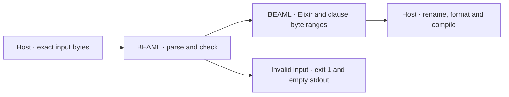

# Review the compiler reference (EXPERIMENT 0003)

**[Verified]** The compiler reference passes independent review. No repair is required for this gate.

## Test-first evidence

| Same test and command | RED | GREEN |
| --- | --- | --- |
| `payments_cli_emits_checked_authorize_reference` | Exit 101. Expected `["91 193"]`. Received `[]`. Both inputs had compiled and emitted the expected functions. | Exit 0. Original bytes `[91, 193)`. Comment control bytes `[103, 205)`. Both select the same declaration bytes. |

**[Verified]** The reviewer compared the command arguments and test SHA-256 across RED, GREEN and the independent TEST run. They match the current test. The RED compiler hash matches `HEAD`. The GREEN compiler hash matches the current file. The ledger records explicit owner review of this RED before GREEN. The approval applies to this test. [RED](red-output.log), [owner review and GREEN](notes.md), [independent test](test-result.json)

## Connected checks

| Area | Result |
| --- | --- |
| Parser and checker | Token ranges come from UTF-8 byte indices. The parser uses the first `fn` token and the end of the last consumed body token. The complete program must pass checking before emission. |
| Output and test scope | The output carries one versioned Elixir comment per checked clause. Removing the comments from both GREEN and TEST variants gives the exact RED Elixir bytes. The retained Elixir control returned the expected authorized payment. Cargo tests passed 9 unit and 2 CLI tests. Rust formatting and `git diff --check` passed. |
| Multiple clauses | A separate CLI check used two clauses for the same function. Both references selected their own bytes in clause order with CRLF, a UTF-8 prefix, and an escaped UTF-8 body. |
| Invalid CLI inputs | A valid declaration followed by a declaration with an unknown return type exited 1 with empty stdout. The compiler also rejected a spaced call and a missing source file. The existing invalid-source and action-log test passed. |
| Existing caller | The reviewer applied the [0002 runner's](../../../0002-http-correlation/run.py) module renaming to both fixtures in a temporary directory. Both generated modules passed `mix format --check-formatted` after formatting, retained their references and compiled without warnings. |

**[Inference]** The compiler change uses the existing lexer, checked clause list and Elixir emitter. The format adds a local name and range. The host still needs to bind the qualified name, archived input digest and BEAM hash. The 0003 selector must require exactly one reference for `authorize`; multiple clauses remain valid compiler output. [Compiler](../../../0001-syntax-to-beam/src/main.rs), [implementation decision](notes.md), [acceptance contract](spec.md)

**[Unknown]** The review covers the compiler gate and the existing generated-code seam in isolation. The live calls, artifact lookup, response capture and REPLAY RUN remain unverified. The next gate starts with the working two-call baseline and a failing assertion for the artifact and SOURCE ID summary. It requires separate owner review. [EXPERIMENT](../../README.md)
