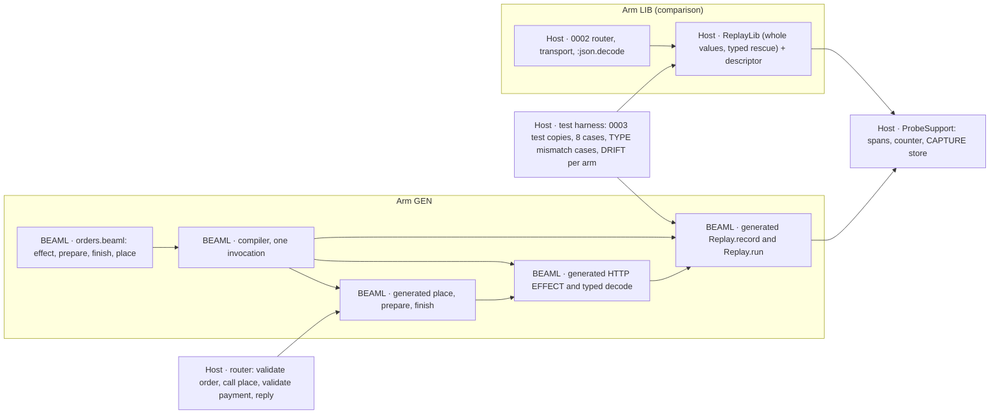

# EXPERIMENT 0004 — Generated REPLAY RUN

**[Requirement]** Can the BEAML compiler generate the flow, the HTTP EFFECT, the decode, the CAPTURE and the REPLAY RUN runner from one BEAML source, so that the host writes no replay code and no transport? Does the generated arm do more than a shared Elixir replay library with a hand-written descriptor? The section [Owner decisions (2026-11-06)](#owner-decisions-2026-11-06) is the authority. It overrides older plan text.

**[Verified]** [EXPERIMENT 0003](../0003-source-linked-replay/README.md#gate-status) passed with a hand-written runner, [`OrdersApi.Replay.run/3`](../0002-http-correlation/apps/orders_api/lib/orders_api/replay.ex), and a hand-written CAPTURE, `capture/3` in [`payment_http.ex`](../0002-http-correlation/apps/orders_api/lib/orders_api/payment_http.ex). The host [router](../0002-http-correlation/apps/orders_api/lib/orders_api/router.ex) owns the order prepare → `authorize/2` → finish. The [0001 compiler](../0001-syntax-to-beam/src/main.rs) parses `interface`, `enum` and `fn` only. Its interfaces are structural and exact.

**[Verified]** The 0003 live tests check the 0002 trace contract in [`query.py`](../0002-http-correlation/query.py): spans `orders.request`, `orders.prepare`, `orders.payment_http`, `orders.finish` and the log `payment_request_prepared`. `ProbeSupport.span/5` sets `outcome: "error"` only when the wrapped function raises.

**[Proposal]** Hypothesis: with the flow, the EFFECT and its failure type in BEAML, a BEAML-only TYPE change (DRIFT) needs fewer manual change sites in the generated arm (GEN) than in the library arm (LIB). GEN also catches a DRIFT that LIB misses.

## Plan history

- **Revision 1.** Generated runner next to a host flow. Plan review: BLOCK (1 critical, 2 high). [plan-review.md](workflow/2026-11-06/plan-review.md)
- **Revision 2.** LIB arm first as a kill switch, typed record fields, DRIFT R/N/Q, pass and reject rule, three syntax options (A, B, C) with owner questions Q1–Q5.
- **Revision 3.** The owner chose option B with `effect`, `!` and `|>`, a generated decode, no kill switch and LIB in parallel. Q1, Q2 and Q5 are answered. Syntax options A and C are closed; [syntax-options.beaml](syntax-options.beaml) stays as history. Use git history for the full revision 2 text. Plan review: BLOCK (1 critical, 2 high).
- **Revision 4.** Repairs the three objections of the revision 3 review: one strongest LIB form, frozen before any GEN result is judged; a complete 0003 change table, checked by a diff test on test copies; asserted TYPE mismatch cases, live and in a REPLAY RUN. [Disposition](workflow/2026-11-06/plan-review.md#disposition-main-agent-2026-11-06-1).
- **Revision 5.** Adds the [slice 1 verdict](#slice-1-verdict-2026-11-06) and the [slice 2 plan](#slice-2). Slice 1 text above stays unchanged. The slice 1 pass and reject rule does not apply to slice 2.
- **Revision 6.** Applies the OWNER answers O1–O4 to [slice 2](#slice-2): a MIGRATE CHAIN replaces the RENAME ALIAS options S1, S2 and S3; the record carries the TYPE version number; the build fails only when a stored TYPE VERSION has no path through the chain; C5 (DRIFT R without a chain) is now a compile error. Only the slice 2 section changes.
- **Revision 7.** Adds the [slice 3 plan](#slice-3): `add` with a constant and `drop` with a TYPE in the MIGRATE CHAIN (DL-042). The slice 1 and slice 2 text stays unchanged.
- **Revision 7.1.** Repairs the slice 3 plan after its fresh check: the `add` constant always wins in a REPLAY RUN (DL-048, D8, new D11b); K checks run before the EFFECT output check, so K2 and K4 are reachable; `drop` takes `String` only (K6, D7, D5c); new help cases D2b and D5b; `unknown_keys == []` stated for D11 and D14. Only the slice 3 section changes.
- **Revision 7.2.** Slice 3 final review repair (DL-054): a REPLAY RUN types the stored body by its own TYPE VERSION before any MIGRATE STEP. Every other key goes to `unknown_keys`. This supersedes the slice 2 rule "the current name wins" (C12) and changes D11b and D11c. New cases D17 and D18. Superseded text stays, struck through.
- **Revision 8.** Adds the [slice 4 plan](#slice-4): the RETIRE LINE for a deleted EFFECT with stored records (DL-055), DEAD LINE warnings and the removal command (DL-056), a chain start above version 1, and OWNER question O6. The slice 1 to slice 3 text stays unchanged.
- **Revision 8.1.** Repairs the slice 4 plan after its fresh check: new cases E1d, E3b, E9c, E11c, E11d, E12c, E15c, E15d and a harness check; a Q4 layout that tests byte preservation (comments, blank line, multi-line block, no final newline, CRLF); the claim holds only with a RECORD SNAPSHOT; the T5 lexer message; the diff and count rules of the removal command. Only the slice 4 section changes.
- **Revision 8.2.** Hardens the removal command after the slice 4 final review (DL-069, Repair): the completeness rule with the flag `--assume-complete` (contract step 2a), a symlinked or read-only SOURCE (contract step 5), and a unit test for the recheck guard (step 4). New cases E21 to E22b and U1; E18 now passes `--assume-complete`. Only the slice 4 section changes.
- **Revision 9.** Adds the [slice 5 plan](#slice-5): `type` replaces `interface` (DL-061), `v` on every version number (DL-072), the VERSION MARK on the type line and the SQUASH by `--remove-dead` (DL-070, DL-071; DL-058 superseded). Mechanical rewrite of the slice 1 to slice 4 sources and tests with an audit. OWNER question O7 is open. The slice 1 to slice 4 text stays unchanged.
- **Revision 9.1.** Repairs the slice 5 plan after its fresh check: F12b uses `type Payment v3` with v4 records (no O7 dependence); two new T23 layouts (`type PaymentError {` above `type Payment {`, and a `// type Payment {` comment); the `help` line of a TYPE with a VERSION MARK also names the new mark (F11b); W3, W4 and the stderr normaliser S are closed lists of exact strings; A1 audits every changed file; an allowed row for the fallback text in `cli.rs`; the PENDING O7 list. Found while writing RED: E13 needs a tag on the C2 step, E21b gives three refusals, and random version numbers go only to sources with a VERSION MARK. Only the slice 5 section changes.
- **Revision 9.2.** Repairs the slice 5 RED tests after their fresh check: A1 also audits the test code (base: the slice 5 RED commit; the `mod tests` block of `main.rs` against `721e7eea`) and requires that no test code keeps an old form, except a closed list of deliberate negatives; the slice 4 expectation changes are RED tests now, in the old syntax, so the allowed rows shrink to three; W1 also matches directly after a format placeholder; F2 asserts the exact `help` line; the N1 cases assert `TYPE VERSION v<n>` as a whole token. Only the slice 5 section changes.
- **Revision 9.3 (this page).** O7 is answered (DL-080): the compiler accepts option (a), every VERSION MARK that agrees with the MIGRATE CHAIN, and a chain without a mark. Option (b) is the default form; the formatter `beaml fmt` writes it, no warning (DL-081, not built). The PENDING O7 list becomes the O7 list: F6, F13 and F14 compile, F8c stays a gap error, and controls check M1 (F6) and N1 (F13). Only the slice 5 section changes.

## Slice 1 scope

- **In [Requirement].** `effect` declarations with `http.post`. One `!` failure type. Pipe `|>` that passes a failure on, with the compile check against the `!` list. A decode generated from the declared TYPE. A generated `record` (CAPTURE) and a generated REPLAY RUN runner. The flow `place` in BEAML. The router calls only generated code.
- **Later [Requirement] (slice 2+).** `with ... else`, the Elixir `name`/`name!` pair, the formatter alignment rule, other EFFECT kinds (db, queue, mail), a second EFFECT, the old-record policy (Q4), the artifact check in the runner (Q3).



**[Verified]** After slice 6b step 6a the harness has no LIB arm and no 0003 test copies in its check list. DRIFT has GEN rows only (DL-110, DL-118). See [slice 6b step 6a](#slice-6b-step-6a-response-record-version-2).

## Slice 1 BEAML source (orders)

**[Proposal]** The fixture `orders.beaml` for GEN. The syntax follows the owner example [order-flow.beaml](examples/order-flow.beaml). `payments.beaml` stays unchanged.

```beaml
interface Order { order_id: String }
interface Payment { order_id: String status: String }
interface PaymentError { reason: String }

// Leaves the module. Recorded live, substituted in a REPLAY RUN.
effect payments.authorize Order -> Payment ! PaymentError = http.post("payments/authorize")

fn prepare Order { order_id } -> Order = Order { order_id: order_id + "" }
fn finish Payment { order_id, status } -> Payment = Payment { order_id: order_id + "", status: status }

// The flow lives in BEAML. A failed step stops the pipe and passes PaymentError on.
fn place order: Order -> Payment ! PaymentError =
  order
  |> prepare
  |> payments.authorize
  |> finish
```

**[Proposal]** Generated Elixir, in the one module that 0002 `run.py` renames to `OrdersBeamlSpike`:

- `prepare/1`, `finish/1` as today. `place/1` returns `{:ok, payment}` or `{:error, %OrdersBeamlSpike.PaymentError{reason: r}}`. The `place!/1` half of the pair is slice 2.
- `payments_authorize/1`: the HTTP EFFECT. POST to `/payments/authorize` on `127.0.0.1` and the port from `ProbeSupport.config(:payments_port)`. Trace context injection, `ProbeSupport.increment/0`, Content-Length framing as in 0002. Then `Replay.record/3` with the actual status (revision 4: the record comes before the status check). Then status 200 only, then the typed decode.
- Typed decode of `Payment`: `:json.decode/1`, then an exact key set with String values. A missing key or a non-String value gives `reason: "decode"`. An extra key is accepted and recorded as `unknown_keys` (owner decision: tolerant with a hint). Transport failure gives `reason: "transport"`, another status gives `reason: "status"`.
- Spans through `ProbeSupport.span/5`: `orders.prepare`, `orders.payments.authorize` (client), `orders.finish`. A failure raises inside the span and becomes `{:error, ...}` outside it, so `outcome: "error"` stays. A failed step stops the pipe: no later step and no later span runs.
- One Orders log, revision 4 [Proposal]: inside the span of the pure step directly before an EFFECT, the generated code calls `ProbeSupport.event("<output TYPE, lower case>_request_prepared", "<step>")`. For `place` this is the existing `payment_request_prepared` under `orders.prepare`. So the 0002 `LOGS` contract and the log counts stay unchanged.
- `Replay.record/3` writes the 0003 RESPONSE RECORD format version 1 to `ProbeSupport.Capture.write/2`. `Replay.run/3` takes `(order, trace_id, records)` and returns only `{:ok, payment}` or `{:error, reason}`; the `unknown_keys` hint goes to the replay EFFECT span and the replay report, not to the return value. It runs `place` with the EFFECT step replaced by the record checks, then the same typed decode and `finish`. It returns `{:ok, payment}`, one of the six 0003 atoms, or `{:error, %PaymentError{}}`.

## Fixed inputs and ownership

- **LANGUAGE/COMPILATION.** The 0001 compiler gets `effect`, `!`, `|>` and the emit above. One invocation, one stdout. `payments.beaml` output stays byte-identical.
- **EXECUTION.** Reuse the two 0002 releases, the ports, the HTTP path, RESPONSE RECORD format version 1 and `ProbeSupport` (unchanged SHA-256). The router keeps `orders.request`, `valid_order!/1`, `valid_payment!/2` and the reply. It calls `OrdersBeamlSpike.place/1` and nothing else of the flow.
- **EXECUTION.** Each arm is an overlay, applied by `0004/run.py` to a temporary tree with the repository layout: `experiments/0001-syntax-to-beam` (current compiler), `experiments/0002-http-correlation` (copy plus overlay) and `experiments/0003-source-linked-replay` (`run.py` and copies of `tests/*.py`). The path constants of the copies (`EXPERIMENT`, `REPO`, `HTTP`, `COMPILER`) then need no edit. The overlay holds the edited copies of `query.py` and the 0003 tests. `0003/run.py` runs unchanged in that tree.
- **EXECUTION, control.** The 0002 tree, `0003/run.py` and the original 0003 tests stay unchanged in the repository. They run at their default root as the control. An arm run does not change their SHA-256 values.
- **R&D process.** Follow [implement-step](../../skills/implement-step/SKILL.md). Devil's Advocate at the plan, the RED review and the final review, in the gate ledger only.

## Comparison arm LIB

**[Requirement]** No kill switch. LIB is built in parallel with GEN, as the comparison.

**[Proposal] Revision 4: LIB is the strongest fair library.** The plan fixes its form. The LIB worker does not choose a weaker form.

- **Descriptor.** One Elixir map per EFFECT: operation, attempt, expected status, request function (`&OrdersBeamlSpike.prepare/1`), decode function, finish function. No request or response key list, no field name, no other TYPE fact. Budget: about 10 lines.
- **Whole values.** `ReplayLib.record(descriptor, request, status, bytes)` records the whole request value and the whole body bytes. `run` compares the whole recorded request with the request function result (`request_mismatch`), as 0003 does.
- **Typed rescue (mandatory).** `ReplayLib.run(descriptor, order, trace_id, records)` wraps decode and finish in one `rescue`. It returns `{:error, %ReplayLib.Error{step: "decode" | "finish", reason: <exception module name>}}`, never a raise. The six 0003 atoms and their check order stay. Budget: maximum 60 lines.
- **Live path.** The 0002 router, transport and `payment_request_prepared` log stay. The CAPTURE body in `payment_http.ex` becomes one `ReplayLib.record` call. `replay.ex` is deleted.
- **Fairness.** A fresh worker writes LIB without access to the GEN emitter, the 0004 BEAML fixture or any GEN result. LIB may call the public generated `prepare` and `finish`. It may not read BEAML source or metadata that 0004 adds to the generated module.
- **Freeze.** LIB passes (e) before any GEN result of (d2) or (f) is judged. `0004/run.py` records the SHA-256 of `replay_lib.ex` and the descriptor. DRIFT (f) runs only against that frozen LIB. A repair of LIB after the freeze counts as manual change sites.
- **No weak form.** The plan builds no LIB with a key list or without the `rescue`. The pass and reject rule uses only this LIB.
- **[Inference]** This LIB has no stale descriptor. It probably gives a typed reject for an old record after DRIFT-R and DRIFT-N, and `request_mismatch` after DRIFT-Q. Then the reject rule may apply. That is a valid result of slice 1.

## Slice 1: acceptance cases in order

1. **(a) Parse and check.** The compiler accepts the slice 1 source above, exit 0. Each bad declaration fails with exit ≠ 0, a clear message and no stdout:
   - unknown fn in a pipe (`|> charge`);
   - TYPE mismatch in a pipe (`|> finish` directly after `|> prepare`: `Order` is not `Payment`);
   - undeclared failure in a pipe (`place` without `! PaymentError`); the message names the step `payments.authorize` and the type `PaymentError`;
   - field not in TYPE (`finish` reads `amount`, which `Payment` does not have);
   - unsupported EFFECT kind (`db.get`) in slice 1.
2. **(b) Emit.** One compiler run writes the Elixir module with `place/1`, `payments_authorize/1`, the typed decode, `Replay.record/3` and `Replay.run/3`, the `PaymentError` struct and one `beaml-declaration-v1` comment per declaration. The module compiles with warnings as errors. Template control: compile DRIFT-R; the generated decode must contain `reference`. The 0003 gate 1 test `payments_cli_emits_checked_authorize_reference` still passes.
3. **(c) Live.** The GEN router calls only `OrdersBeamlSpike.place/1`. `payment_http.ex` and `replay.ex` are deleted. `0003/run.py` passes in the GEN tree, all five default steps (compiler reference, trace lookup, trace lookup repair, response capture, replay run). The test `tests/overlay_diff_test.py` passes first: per arm, the line diff of each copy against its original equals `arms/<arm>/assertion-changes.json`, which equals the table below. No other line changes. **[Verified]** After slice 6b step 6a (DL-110): this case keeps only the GEN structure check (`GenStructure`). The 0003 runner in the GEN tree and the overlay diff are retained evidence of slices 1 to 5.
4. **(d) Replay.** The 0003 8-case matrix passes against `OrdersBeamlSpike.Replay.run/3`: valid, A1 non-canonical, missing, operation, attempt, request, status, digest. Expected values stay as in 0003. Router, transport and `:gen_tcp.connect/4` count zero in all 8 cases. Live and replay use the same generated decode.
5. **(d2) TYPE mismatch, live and in a REPLAY RUN [Requirement].** In `tests/arms_test.py`, not in the 0003 copies. Replay cases use the 0003 harness with the arm's runner. Live cases use one Orders release against the 0003 loopback stub (`http.server`, Content-Length framing). Cases R1, R2, L1, L2, P1 below.
6. **(e) LIB.** The LIB form above passes the same 8 cases with the same counts, in the LIB tree, with the LIB rows of the table only. Before the freeze, LIB R1 must return `%ReplayLib.Error{step, reason}` with step "decode" or "finish" (asserted). It then runs R2, L1, L2, L3; those outcomes are recorded, not asserted. Then the freeze.
7. **(f) DRIFT.** Starts after the freeze. Per arm, change only BEAML TYPES or signatures; do not touch the LIB descriptor or host replay code. Regenerate and rebuild. Derivatives:
   - **DRIFT-R.** Add `reference: String` to `Payment` in both BEAML files.
   - **DRIFT-N.** Rename the `Payment` field `status` to `state` in both BEAML files.
   - **DRIFT-Q.** Add a field with a literal value to the request TYPE that `prepare` returns, and the matching Payments input.
   For each derivative and arm, record the outcome at build, on a new live record and on the pre-change record. Outcome classes: compile error with a clear message, typed reject, correct accept, false reject, wrong accept, crash without a typed reason. Then repair each arm until (d) or (e) passes again. Count manual change sites per arm.
   **[Verified]** After slice 6b step 6a (DL-118, D6B-96): GEN rows only. The repair check is the GEN REPLAY RUN of the repaired tree, after a rebuild of every release that the repair touches. Each row needs a version 2 record with status 200, `ok` and host validation `ok`. See [slice 6b step 6a](#slice-6b-step-6a-response-record-version-2).
   **[Verified]** Since 2026-11-07 (DL-135, D6B-189): the outcome classes are asserted, not only recorded. The DRIFT status is `pass` only with a freeze `pass`, `repaired_all` true and each GEN row equal to the pin. See [DRIFT status](#drift-status-dl-135).

### Case (d2): TYPE mismatch cases

**[Proposal]** Each case asserts the result, the counts and, live, the spans and records. "finish 0" is the runtime half of the pipe rule: a failed step stops the pipe.

- **R1 Replay, missing key.** Record of the first live call with body `{"order_id":"order-1"}`, `body_length` and `body_sha256` recomputed, status 200 (**[Verified]** after slice 6b step 6a: `value` `{"order_id":"order-1"}` with `value_sha256` recomputed; version 2 records have no `body_length` and no `body_sha256`). Expect `{:error, %OrdersBeamlSpike.PaymentError{reason: "decode"}}`, `:json.decode/1` 1, `finish/1` 0, `valid_payment!/2` 0, transport 0.
- **R2 Replay, extra key.** The RESPONSE RECORD from L1. Expect the same success as L1 and the same `unknown_keys` hint. Live and replay use the same decode.
- **R3 Replay, wrong field TYPE.** A declared field with the wrong TYPE (`status: 7`). Expect `PaymentError` with reason "decode" and zero `finish` calls.
- **L3 Live, missing key.** The stub returns 200 with a body without `status`. Expect HTTP 502 `downstream_failure`, span `orders.payments.authorize` with `outcome: "error"` and `reason: "decode"`, one RESPONSE RECORD byte-exact, zero `orders.finish`, transport count 1.
- **L1 Live, extra key [Requirement: accept with hint].** The stub returns 200 with an extra key `fraud_score`. Expect HTTP 200, one `orders.finish`, one RESPONSE RECORD with the bytes byte-exact and `unknown_keys == ["fraud_score"]`, and the same attribute on the `orders.payments.authorize` span.
- **L2 Live, status 503.** The stub returns 503 with a valid `Payment` body. Expect HTTP 502, client span `outcome: "error"`, one RESPONSE RECORD with status 503, no `orders.finish` span, transport count 1.
- **P1 Pipe stop.** In an eval VM (0003 harness), `OrdersBeamlSpike.place/1` with a refused port. Expect `{:error, %OrdersBeamlSpike.PaymentError{reason: "transport"}}`, `prepare/1` 1, `finish/1` 0.

**[Unknown]** A recorded live 503 replays as the 0003 `status_mismatch` atom, not as `PaymentError{reason: "status"}`. The 0003 matrix keeps this. Slice 2 can revisit it with D001.

### 0003 lines that change in the arm copies

**[Proposal]** Each GEN change follows from "the router calls only generated code". The copies live in the overlay; the originals stay the control. `overlay_diff_test.py` compares each copy line by line with its original and requires the result to equal this table. Line numbers refer to the original files at the plan commit.

| Arm | File | Line | Original | Copy | Reason |
| --- | --- | --- | --- | --- | --- |
| GEN | 0002 `query.py` | 12 | `CONTRACT` key `orders.payment_http` | `orders.payments.authorize` | Generated span name `<service>.<step>` |
| GEN | 0002 `query.py` | 13 | parent of `payments.request`: `orders.payment_http` | `orders.payments.authorize` | Same rename |
| GEN | 0003 `response_capture_test.py` | 175 | client span filter `orders.payment_http` | `orders.payments.authorize` | Same rename |
| GEN | 0003 `response_capture_test.py` | 213 | observer control span `orders.payment_http` (twice) | `orders.payments.authorize` | Same rename; `outcome: "error"` stays |
| GEN | 0003 `replay_run_test.py` | 32 | `WATCHED` key `OrdersApi.PaymentHttp.authorize/2` | `OrdersBeamlSpike.payments_authorize/1` | The transport is generated |
| GEN | 0003 `replay_run_test.py` | 48 | `HARNESS` watched `{OrdersApi.PaymentHttp, :authorize, 2}` | `{OrdersBeamlSpike, :payments_authorize, 1}` | Same |
| GEN | 0003 `replay_run_test.py` | 56 | `HARNESS` control `OrdersApi.PaymentHttp.authorize(prepare(order), [])` | `OrdersBeamlSpike.payments_authorize(prepare(order))` | Same |
| GEN | 0003 `replay_run_test.py` | 57 | `HARNESS` replay `OrdersApi.Replay.run(order, trace_id, responses)` | `with {:ok, p} <- OrdersBeamlSpike.Replay.run(ProbeSupport.valid_order!(order), ...), do: {:ok, ProbeSupport.valid_payment!(p, order)}` | Domain validation stays host code, as in the router |
| GEN | 0003 `replay_run_test.py` | 292 | control result `{"raised": "MatchError"}` | `{"error": "%OrdersBeamlSpike.PaymentError{reason: \"transport\"}"}` | The EFFECT returns a typed failure; counts stay |
| GEN | 0003 `replay_run_test.py` | 293 | control key `OrdersApi.PaymentHttp.authorize/2` | `OrdersBeamlSpike.payments_authorize/1` | Same as line 32 |
| GEN | 0003 `replay_run_test.py` | 301 | `isolated` key `OrdersApi.PaymentHttp.authorize/2` | `OrdersBeamlSpike.payments_authorize/1` | Same as line 32 |
| GEN | 0003 `replay_run_test.py` | 141 | compiler call `"--", archived]` | `"--", archived, "--stored", <copy dir>/stored-empty.jsonl]` | Slice 2 (C10): a source with an `effect` needs a RECORD SNAPSHOT; the copy passes the empty one |
| GEN | 0003 `response_capture_test.py` | 92 | compiler call `"--", archived]` | `"--", archived, "--stored", <copy dir>/stored-empty.jsonl]` | Same as `replay_run_test.py` line 141 |
| GEN | 0003 `trace_lookup_test.py` | 51 | compiler call `"--", source]` | `"--", source, "--stored", <copy dir>/stored-empty.jsonl]` | Same as `replay_run_test.py` line 141 |
| LIB | 0003 `replay_run_test.py` | 57 | `HARNESS` replay `OrdersApi.Replay.run(order, trace_id, responses)` | `with {:ok, p} <- ReplayLib.run(OrdersApi.ReplayDescriptor.authorize(), ProbeSupport.valid_order!(order), ...), do: {:ok, ProbeSupport.valid_payment!(p, order)}` | `replay.ex` is deleted; same host validation as GEN |

**[Proposal]** Unchanged in both arms, because the Orders log stays (line text **[Verified]** at the plan commit): `query.py` line 17 (`LOGS`), `trace_lookup_test.py` line 175 (`len(checked["logs"]) == 2 * call`) and line 184 (`"logs": 4`). `trace_lookup_repair_test.py` and `run_test.py` have no changed line. The comment lines 38–39 of `replay_run_test.py` stay as history.

**[Inference]** If GEN cannot emit the log, lines 17, 175 and 184 change. That is a table change: it needs a new plan revision, and the verdict records "no Orders log" as a lost check.

All counts in the 8-case matrix stay as in 0003. The revision 2 SHA-256 check of `router.ex` is removed: the router changes by owner decision.

### Replay lines and manual change sites

- **Replay line.** A host line that exists only for replay: CAPTURE, the `record` call, hook wiring, the runner call site, caller-side validation or artifact checks, the LIB descriptor and library. Count them in both arms. Generated and compiler lines are not host lines; report compiler size as a one-time cost.
- **Manual change site.** One contiguous edited hunk in a hand-written file that an arm needs to pass (d) or (e) after a DRIFT. Exclude the BEAML DRIFT edit. Count domain validation edits (`valid_payment!/2`) and test expectation edits apart; they are equal in both arms.

### Pass and reject rule

**[Verified] Cut at slice 6b step 6a (DL-110, OWNER, Q6B-10 option B).** LIB comparison up to slice 6b step 5; evidence retained. From 6a on GEN stores RESPONSE RECORD version 2 (the projection, DL-105) and LIB keeps the raw body. The 0003 copy run (cases (c) runner, (d), (e)) and `tests/overlay_diff_test.py` leave the check list of `run.py` and `tests/arms_test.py`. The slice 1 to 5 result directories stay as evidence. This rule is not checked again after 6a. See [slice 6b step 6a](#slice-6b-step-6a-response-record-version-2).

- **Comparison arm [Proposal].** Judge every clause below only against the frozen LIB of [Comparison arm LIB](#comparison-arm-lib). No other LIB form enters the verdict.
- **Pass [Proposal].** The language claim holds for slice 1 only if both are true: (1) summed over the DRIFT derivatives, GEN needs fewer manual change sites than LIB; (2) for at least one derivative, GEN gives a compile error, a typed reject or a correct accept, while LIB gives a wrong accept or a crash without a typed reason. GEN has no wrong accept in any derivative.
- **Reject [Proposal].** Reject the claim for this slice if LIB needs the same number or fewer manual change sites, if LIB misses no DRIFT that GEN catches, or if GEN gives a wrong accept. Record the reject in the register.
- **Miss [Requirement].** A crash without a typed reason counts as a missed DRIFT (owner decision).
- **No verdict.** If GEN fails (a)–(d2), or LIB fails (e) or is not frozen before (f), slice 1 fails as an implementation and gives no verdict on the claim.

## Decisions (Decision4)

| Decision | Class | Choice and reason |
| --- | --- | --- |
| Failure TYPE as an interface `PaymentError { reason: String }` with the values `transport`, `status`, `decode` | Repair | The smallest typed struct with a named field. No enum payload rules needed. Q6 can replace it |
| `place/1` returns `{:ok, v}` or `{:error, struct}` only | Repair | It is the `name/n` half of the owner pair; `name!/n` is slice 2 and adds, not changes |
| Generated span names `<service>.<step>` | Repair | Derived, not a literal from 0002. Commits us to the listed assertion changes |
| Keep `payment_request_prepared`: emit `<output TYPE>_request_prepared` in the span of the pure step before an EFFECT (revision 4) | Undo | A local emit rule with no new syntax. Keeps the 0002 `LOGS` contract and the log counts. A BEAML log statement can replace it later |
| Generated code calls `ProbeSupport` for spans, counter, config and CAPTURE store | Repair | The existing 0002 adapter, unchanged. A language runtime contract replaces it later |
| Target from `<namespace>_port` config, host `127.0.0.1` | Repair | Matches 0002 configuration. Real addressing waits for Q7 |
| Transport with `:gen_tcp` and 0002 framing | Repair | Keeps the `:gen_tcp.connect/4` and transport counters of the 0003 observer |
| Host keeps `valid_order!/1` and `valid_payment!/2`; harness calls them around `Replay.run/3` | Repair | Domain validation is host code; keeps the 0003 counts |
| Replay evidence errors stay the six 0003 atoms; flow failures are `PaymentError` | Repair | Keeps the 0003 matrix unchanged. Revisit with D001 |
| Copies of the 0003 tests and `query.py` in the overlay, in a temporary tree with the repository layout; diff checked against the table (revision 4) | Undo | Originals stay the control; no arm switch in the 0003 files; no path edits in the copies |
| Typed decode accepts an extra key and records it as a hint (owner decision, replaces revision 4 reject) | Requirement | Matches the exact 0001 interfaces and the generated `finish` pattern. Relaxing it later is one emit change |
| `Replay.record/3` before the status check; the record holds the actual status (revision 4) | Repair | Case L2 needs one record for a 503. The 0003 matrix still expects status 200 in a valid record |
| LIB form fixed: no key list, mandatory typed `rescue`, frozen before (d2) and (f) are judged; no weak LIB (revision 4) | Repair | The verdict must not depend on a free choice of the LIB worker |
| LIB error shape `%ReplayLib.Error{step, reason}` (revision 4) | Undo | Local to the LIB arm; any typed shape counts |
| Elixir name `payments_authorize/1`, nested `Replay` and `PaymentError` modules | Undo | Local naming inside one generated module |
| Reject non-`http` EFFECT kinds at compile time in slice 1 | Undo | Keeps the slice boundary visible; slice 2 removes the reject |
| LIB worker runs in parallel with GEN, in its own directory; tests serialized | Undo | Owner decision overrides the one-writer rule; no shared build output |
| `http.post("payments/authorize")` as the slice 1 call form | Migrate | Taken from the owner example; source files depend on it. Q7 confirms |

**[Verified]** No decision is Answer: 0004 publishes nothing and makes no external claim.

### Owner questions

- **Q1, Q2, Q5.** Answered by the owner decisions: option B with `effect` and `|>`; BEAML owns the decode; a crash without a typed reason is a miss.
- **Q3. Artifact check (slice 2).** (i) The generated runner rejects a record with another `artifact_id` (`artifact_mismatch`). (ii) The caller keeps the check; it counts as replay lines. Slice 1 uses (ii). Depends on [D002](../../wiki/planning/decisions-to-be-made.md#d002--scope-of-the-replay-artifact-identity).
- **Q4. Old record after a SCHEMA change (slice 2).** (i) Typed reject from a SCHEMA version in the record. (ii) Typed reject from `artifact_id` (needs Q3 (i)). (iii) The generated decode rejects it with `PaymentError` (slice 1 behavior).
- **Q6. Shape of an EFFECT failure TYPE (Migrate, before slice 2).** (i) User-declared interface with `reason: String` (slice 1 default). (ii) User-declared `enum` with fixed variant names per EFFECT kind, for example `Transport`, `Status`, `Decode`. (iii) A built-in `HttpError` TYPE that the user names after `!`.
- **Q7. HTTP call form and target (Migrate, before slice 2).** (i) `http.post("payments/authorize")` with the target from configuration by namespace (slice 1 default). (ii) A named target declaration in BEAML, for example `target payments = env("PAYMENTS_URL")`. (iii) Another form from the owner.

## Evidence and limits

**[Unknown]** No run exists. This page is a plan.

**[Inference]** DRIFT-R and DRIFT-N need a `valid_payment!/2` edit in both arms. It counts apart, not as a replay site.

**[Unknown]** Limits carried from 0003: the body digest is integrity, not tamper protection (R2). The RESPONSE RECORD has no timestamp (D003). The check order of the six reasons is not tested. Two records for one trace give `missing_response` without a test.

**[Unknown]** One EFFECT and three DRIFT derivatives are a small sample. A pass shows an advantage for this slice only.

**[Inference]** An extra key is accepted with a hint, so a Payments service may add a field without breaking Orders. The hint makes such a change visible to observation.

**[Unknown]** Revision 4: the generated client span and `Replay.record/3` in an eval VM without the OpenTelemetry application (case P1 and the observer control) are not tested yet. RED shows whether the harness needs a change; such a change is a table change.

### Out of scope

- Everything in "Later" above.
- Retries, attempts > 1, timeouts, uncertain outcomes (round 3, objection 3).
- A REPLAY CAPSULE format, durable storage, trace sampling (D003).
- Zed/LSP support for the new syntax.
- A BAML comparison and the operator-time value gate. [BAML v1](../../wiki/sources/baml-v1.md#observability) has no replay on its default branch at the pin.

**[Proposal]** Smallest next test after slice 1: a second EFFECT in both arms, with change sites counted the same way.

## Owner decisions (2026-11-06)

- **[Requirement]** BEAML owns the call order. Syntax option B: the flow `place` is written in BEAML. The host router only calls generated code.
- **[Requirement]** BEAML makes the HTTP call itself. No hand-written host transport.
- **[Requirement]** BEAML generates the response decode from the declared type. A response that does not match the type gives a typed error, live and in a REPLAY RUN.
- **[Requirement]** In the comparison, a runtime crash without a typed reason counts as a missed DRIFT.
- **[Requirement]** No kill switch. Start the generated arm directly. Build the library arm in parallel as the comparison.
- **[Requirement]** Long-term direction: applications are written in BEAML. Only a pure interface layer (for example LiveView) stays in Elixir and uses generated event handlers.
- **[Proposal]** Main agent: the generated HTTP code may use a socket or an HTTP library inside. The 0003 live tests run again against the changed router.
- **[Unknown]** Open: the BEAML syntax of the HTTP call itself.
- **[Requirement]** BEAML has a pipe operator `|>`. The flow `place` uses it instead of nested calls.
- **[Requirement]** Formatter rule: consecutive `effect` lines (no blank line between them) align three columns: the input type after the longest name, `->` after the longest input type, `=` after the longest output type. A blank line starts a new block.
- **[Proposal]** `effect` marks every call that leaves the function: HTTP, other apps (also over BEAM messages), database, queue, file, time, randomness. Every `effect` result is recorded; a REPLAY RUN substitutes it. The keyword name is still open.
- **[Requirement]** BEAML allows `with ... do ... else ... end`. `<-` binds the success value of a step that can fail; `=` binds a pure step.
- **[Requirement]** An `effect` or `fn` declares its failure type with `!` after the success type, for example `String -> Order ! LoadError`. `<-` binds only the success type. A failure goes to `else`.
- **[Requirement]** The compiler collects the failure types of all `<-` steps. The `else` branch must cover each of them, or compilation fails.
- **[Requirement]** A function may pass failures on with `!` in its own signature, for example `-> Payment ! LoadError | StockError | PaymentError`.
- **[Requirement]** A pipe step may fail. The pipe stops and passes the failure on. The compiler rejects a pipe step whose failure type is not in the `!` list of the enclosing function, with a message that names the step and the missing type.
- **[Requirement]** `!` in a type stays, although Elixir uses `!` in names for "raises". The owner accepts this.
- **[Requirement]** For each BEAML function that can fail, the Elixir output has two functions: `name/n` returns `{:ok, value}` or `{:error, error}`; `name!/n` returns the value or raises an exception generated from the failure type.
- **[Requirement]** Generated Elixir errors are typed structs with named fields, for example `%Orders.LoadError.NotFound{id: "order-1"}`. Not plain tuples.
- **[Requirement]** Generated decode is tolerant with a hint, as in BAML v1 (`ExtraKey` flag in `coerce_class.rs` at pin `989676dd`). An unknown key is accepted when every declared field is present with its TYPE. Each unknown key name is recorded in the response record and on the EFFECT span. A missing or wrong declared field stays a typed error. This replaces the earlier strict default (same day). A strict `exact interface` form may come later.

## Slice 1 verdict (2026-11-06)

**[Verified]** Final review of slice 1: the implementation passes with notes. The claim is REJECTED under the [slice 1 pass and reject rule](#pass-and-reject-rule). Evidence: the GREEN-2 DRIFT table in [notes.md](workflow/2026-11-06/notes.md#green-2).

- Manual change sites: GEN 0, LIB 0. The rule needs GEN < LIB.
- The build passed in all 6 DRIFT rows (R, N, Q per arm). No compile error caught a DRIFT.
- The only arm difference is DRIFT-Q `new_live`: GEN gives a typed reject, LIB an untyped crash. The cause is the old 0002 transport that LIB keeps (`payment_http.ex:31` matches status 200). The cause is not the TYPE.
- Note 1: the host check raise is labelled typed in rows R and N (`run.py:410-411`).
- Note 2: the LIB freeze was committed only after the runs. The timestamps show a consistent order.

**[Requirement]** OWNER statement: the slice 1 rule measured the wrong thing. The goal is [vertical integration](../../wiki/concepts/vertical-integration.md): the compiler knows the TYPE of stored records, so a breaking TYPE change fails at compile time.

**[Inference]** Why the slice 1 rule is superseded for slice 2. A LIB with no TYPE facts needs no edit after a field change, so a count of manual change sites cannot favor GEN. The count also cannot show a failed build, because no arm had TYPE facts about stored records. Slice 2 therefore uses an absolute rule against stored TYPE VERSIONS. LIB stays as a control.

## Slice 2

### Question and claim

**[Requirement]** Can the compiler refuse a rename of a response field (DRIFT N, `status` → `state`) without a `rename` step in its MIGRATE CHAIN, because stored RESPONSE RECORDS hold the old TYPE VERSION? With the `rename` step, the source compiles and the old RESPONSE RECORDS replay as `correct_accept` through the generated decode.

### How the compiler learns the stored TYPE VERSIONS

**[Verified]** Slice 1 facts in the [0001 compiler](../0001-syntax-to-beam/src/main.rs): the generated `Replay.record/3` writes RESPONSE RECORD format version 1 to `ProbeSupport.Capture.write("responses", …)`, which appends to `<output>/responses.jsonl`. The record holds `artifact_id` (the BEAM hash of the build), not a TYPE fact. The compiler CLI takes exactly one argument, the source path.

**[Verified]** The 0003 test `response_capture_test.py` compares a fixed subset of record keys. Slice 1 added `unknown_keys` and kept format version 1.

**Common part of both options [Proposal], revision 6.** The generated `record/3` writes one more key, `type`: `{"name": "Payment", "version": 1, "fields": [["order_id", "String"], ["status", "String"]], "fingerprint": "<64 hex>"}`. This is the TYPE VERSION of the EFFECT output TYPE at the time of the write. `version` is the newest version number of the MIGRATE CHAIN of the build (1 without a chain). `fields` is sorted by field name. The fingerprint is the lower-case hex SHA-256 of the compact JSON text of `fields`, for example `[["order_id","String"],["status","String"]]` (no spaces, sorted by field name). The TYPE name is not part of the fingerprint. The format version stays 1, as with `unknown_keys`. The record names the full field list, so the compiler can name the old field in its message.

**Option A, RECORD SNAPSHOT input [Proposal].** The compiler takes a second input, `--stored PATH`, a RECORD SNAPSHOT (a copy of `responses.jsonl`). It reads the distinct `type` values per `operation`. It reads no body bytes. **[Verified]** After slice 6b step 6a the DL-102 checks read the record `value` (the projection, DL-105); a record has no body bytes.

- For: the compiler checks against observed stored data. The case "no stored records" is an empty file.
- For: one source of truth. Nothing can claim a TYPE VERSION that no record holds.
- Against: the build reads environment data. A build is reproducible only with the same RECORD SNAPSHOT (`run.py` records its SHA-256).
- Against: a large store needs an index or an export later.

**Option B, TYPE lock file [Proposal].** A file `orders.types.lock` next to the source lists the known TYPE VERSIONS per TYPE. A separate step writes it from the store. The compiler reads only the lock file.

- For: a reviewable file in git. The build reads no environment data.
- Against: a second source that can go stale or lie. The lock can list a TYPE VERSION that no record holds, or miss one that a record holds.
- Against: the case "no stored records" needs a count per TYPE VERSION in the lock.

**[Proposal] Recommendation for slice 2: Option A.** The claim is "the compiler knows the stored records". Option A reads them directly; Option B adds a claim between the store and the compiler. Rejected alternative: infer the stored TYPE from body keys. That mixes a Payments change (an extra key) with a TYPE VERSION of Orders.

**[Proposal]** A source with an `effect` and no `--stored` input fails with `stored TYPE VERSIONS unknown`. An unknown store is not an empty store. A source without an `effect` (`payments.beaml`) needs no input; its output stays byte-identical.

**Migrate [OWNER].** The production source of truth for stored TYPE VERSIONS (RECORD SNAPSHOT, lock file, or a live query of the deployed nodes). It fixes the record format and the deploy workflow of every later environment. Slice 2 uses a fixture file and does not decide it.

### MIGRATE CHAIN syntax (OWNER answer O1, revision 6)

**[Requirement]** OWNER answer O1. The `interface` is always the newest TYPE VERSION. The TYPE history is a MIGRATE CHAIN in the same source. Each step names the TYPE, two explicit version numbers and its changes. Slice 2 implements the step `rename` only. The DRIFT N source of `orders.beaml` with its chain:

```beaml
interface Payment { order_id: String state: String }
migrate Payment 1 -> 2 { rename status -> state }
```

- The newest version number is the target of the last `migrate` step of the TYPE. Without a chain it is 1.
- The compiler derives each old TYPE VERSION backwards from the newest one. Here: version 2 is `Payment { order_id: String state: String }`; version 1 is `Payment { order_id: String status: String }`.
- The RENAME ALIAS of the plan is now the `rename` step. The options S1, S2 and S3 are closed. The S3 sketch `Payment@1` is not used.
- `payments.beaml` stores no records and needs no chain.

### Check rule and generated decode

**[Requirement] Path check (OWNER answer 2).** For each `operation` in the RECORD SNAPSHOT, take its EFFECT output TYPE. For each stored TYPE VERSION (name, `version`, fingerprint) of that TYPE: it must equal the derived version with the same number. Equal means the same fingerprint, computed by the compiler from the derived field list. Then the chain gives a path from it to the newest version. A stored TYPE VERSION without such a path is a compile error. The build fails only for this reason; an empty RECORD SNAPSHOT gives no error.

**[Proposal]** The compiler reads the field list from the record only for its message. It compares fingerprints.

**[Requirement] Rename step check (OWNER answer O3).** A `rename old -> new` step whose old field is in no stored TYPE VERSION and in no derived version is a compile error. **[Inference]** With the backwards derivation, the old field is always in the derived version before the step. In slice 2 the observable case is C4: a wrong old name (`statuz`) gives a derived version 1 that no stored record has, so the path check fails and names `statuz`.

**[Verified] Decode (revised after the final review).** The generated decode goes by TYPE VERSION. A REPLAY RUN of a record of version n applies the `rename` steps n → newest in order. A live body is the newest version and gets no rename. The record body and its digest stay unchanged. The first form (fall back to an old name when the current name is missing) decoded wrong when a chain reuses a field name; see notes.md, "Slice 2 final review repair".

**[Proposal] Compile error text** (case C1). Exit ≠ 0, no stdout:

```text
error: TYPE Payment cannot read 1 stored RESPONSE RECORD of operation payments.authorize
  stored TYPE VERSION: Payment 1 { order_id: String status: String } (fingerprint <first 12 hex>)
  newest TYPE VERSION: Payment 1 { order_id: String state: String }
  record source: <the --stored path>
  no path from the stored TYPE VERSION to the newest TYPE VERSION
  field status: String is in the stored TYPE VERSION, not in the newest TYPE VERSION
  field state: String is in the newest TYPE VERSION, not in the stored TYPE VERSION
  help: if state is status renamed, declare: migrate Payment 1 -> 2 { rename status -> state }
```

The tests assert these tokens, not the full text: `Payment`, the old field, the new field, the `--stored` path, and the `help` form `migrate Payment <stored> -> <next> { rename <old> -> <new> }`. `<stored>` is the version number of the stored record. `<next>` is the newest version number plus 1. Compiler action events do not record the path (AGENTS rule).

**[Proposal] CLI form.** `beaml-spike SOURCE.beaml --stored SNAPSHOT.jsonl`. The `--stored` input comes after the source path.

### Cases with expected outcomes

**[Proposal]** `run.py` builds the slice 2 GEN tree with the `type` key, runs one live call per order, and retains the result as the RECORD SNAPSHOT fixture `v1` (TYPE VERSION `Payment 1 { order_id status }`). DRIFT edits follow slice 1 (both BEAML files). The domain edit of `valid_payment!/2` counts apart, as in slice 1.

**[Proposal] Revision 6, RED fixtures.** Until GREEN writes the `type` key, RED uses hand-built fixtures in `stored/`: `v1.jsonl` (one slice 1 L0 record plus the `type` key of `Payment 1 { order_id status }`), `v1-v2.jsonl` (C3: the `v1` record and one record of `Payment 2 { order_id state }`) and `empty.jsonl`. The case sources are in `slice2/<derivative>/orders.beaml` (the file stem is the service name). The compile tests also build each case from a template with other TYPE and field names, so that no fixture name in the compiler can pass them.

| ID | Source | RECORD SNAPSHOT | Build | Old record (REPLAY RUN) | New live call |
| --- | --- | --- | --- | --- | --- |
| C1 | N, no chain | `v1` | compile error, text above | not run | not run |
| C2 | N, `migrate Payment 1 -> 2 { rename status -> state }` | `v1` | exit 0 | `correct_accept`: `{:ok, %{order_id, state: <stored status value>}}`, decode 1, `finish/1` 1, transport 0 | `correct_accept`; the new record holds `Payment 2 { order_id state }` with its fingerprint |
| C3 | C2 source | `v1` plus a version 2 record (two TYPE VERSIONS) | exit 0 | both versions `correct_accept` | not run |
| C4 | N, `migrate Payment 1 -> 2 { rename statuz -> state }` | `v1` | compile error (no path) that names `Payment`, `statuz`, `status` and the `--stored` path | not run | not run |
| C5 | R (add `reference`), no chain | `v1` | compile error (no path) that names `Payment`, `reference` and the `--stored` path | not run | not run |
| C6 | N, no chain | empty file | exit 0 | none stored | `correct_accept` |
| C7 | slice 1 source (revision 6: `v1` has a path, so the missing key is the only fault) | `v1` plus one record without the `type` key (slice 1 format), at line 2 | compile error `stored RESPONSE RECORD has no TYPE VERSION`, names the `--stored` path and the line number | not run | not run |
| C8 | slice 1 source | no `--stored` input | compile error `stored TYPE VERSIONS unknown` | not run | not run |
| C9 | C6 build (empty snapshot, no chain) | `v1` record replayed against it (stale snapshot) | exit 0 | `typed_reject`: `PaymentError{reason: "decode"}`, `finish/1` 0, no crash | not run |
| C10 | slice 1 source (no chain, newest version 1) | `v1` for the build; empty file for the slice 1 tests (list below) | exit 0 | slice 1 (a)–(d2) pass again; `payments.beaml` output byte-identical; 0003 record key subset passes | as slice 1 |
| C11 | C2 build | `v1` | exit 0 | hand-built old record, body `{"order_id":"order-1","status":"<status value>","fraud_score":"0.9"}`, `type` key of `v1`, digest recomputed: `correct_accept` with `state: <status value>`, not `"0.9"`; `unknown_keys == ["fraud_score"]` | not run |
| C12 | C2 build | `v1` | exit 0 | hand-built old record with both names, `"state":"settled"` and `"status":"authorized"`: ~~`correct_accept` with `state: "settled"` (the current name wins); `unknown_keys == ["status"]`~~ Superseded by DL-054 (revision 7.2): `correct_accept` with `state: "authorized"` (the version 1 field `status` through the `rename`); `unknown_keys == ["state"]` (`state` is not a field of version 1) | not run |
| C13 | C2 build | `v1` | exit 0 | hand-built old record with neither `state` nor `status`, plus `"fraud_score":"0.9"`: `typed_reject`, `PaymentError{reason: "decode"}`, `finish/1` 0 | not run |
| C14 | N2: `Payment` field `order_id` renamed `order_ref`, `migrate Payment 1 -> 2 { rename order_id -> order_ref }`, `status` unchanged | `v1` | exit 0 | `correct_accept`: `{:ok, %{order_ref: <stored order_id value>, status}}`, `finish/1` 1 | not run |
| C15 | N2, no chain | `v1` | compile error with the C1 tokens for `order_id` and `order_ref` | not run | not run |
| C16 | `bad/unknown_pipe_step.beaml` | no `--stored` input | compile error that names `charge`, not `stored TYPE VERSIONS unknown` | not run | not run |

**[Requirement]** The cases use the MIGRATE CHAIN of OWNER answer O1. The C2 new call runs the generated `place/1` in an eval VM against the Payments stub, not through the router: the host `valid_payment!/2` checks `status` (slice 1 DRIFT N, domain site).

**[Inference]** C11 and C13 kill a decode that falls back to any unknown String key: `fraud_score` sorts before `status`, and C13 must not accept `fraud_score` as `state`. ~~C12 kills a decode that prefers the old name.~~ Revision 7.2 (DL-054): C12 kills a decode that reads the raw body, where the stray new name wins over the typed old field. C14 and C15 kill a check or decode with the names `status` and `state` written into the compiler: the field names must come from the RECORD SNAPSHOT and the MIGRATE CHAIN. The template compile tests with other names do the same for the TYPE name.

**[Proposal] Artifact check for old records.** An old record comes from another build, so its `artifact_id` (BEAM hash) differs from the replay build. The generated runner has no artifact check (slice 1 uses Q3 (ii)). For the cross-build cases C2, C3, C9, C11–C14, the harness skips only the caller artifact check. It asserts that the record `artifact_id` differs from the build `artifact_id` and writes both to the result. The other caller checks stay. C10 and the 0003 8-case matrix keep the artifact check. Q3 and D002 decide artifact identity across builds later.

**[Proposal] Order of the `--stored` check.** The compiler reports parse and TYPE errors first. It reports `stored TYPE VERSIONS unknown` only for a source without such errors (C16).

**[Proposal] Slice 1 tests that change (C10).** Each one passes `--stored` with an empty snapshot file, so the slice 1 outcomes stay:

- `0001-syntax-to-beam/tests/cli.rs`: `orders_cli_accepts_effect_pipe_place`, `orders_cli_emits_flow_effect_decode_and_replay`, `orders_cli_template_control_drift_r_decode_names_reference`, `orders_cli_template_control_drift_n_decode_follows_field_rename`.
- `tests/arms_test.py` (the GEN `generate-orders` build) and `run.py` (the GEN `generate-orders` step, also used by the (f) DRIFT rows of `tests/drift_test.py`).
- Unchanged: the five `bad/*` tests in `cli.rs` (parse and TYPE errors come first), all `payments_cli_*` tests, and the LIB `generate-orders` step (the LIB `orders.beaml` has no `effect`).
- **[Verified] Gap found in RED (revision 6).** Three GEN 0003 copies call the compiler on the GEN `orders.beaml` without `--stored`: `arms/gen/overlay/.../tests/replay_run_test.py:140`, `response_capture_test.py:91`, `trace_lookup_test.py:50`. They pass today. After GREEN (OWNER answer O2) they fail, and with them the arms tests (c) and (d) and the DRIFT repair check. GREEN must add the empty snapshot there. That changes the 0003 change table of slice 1 and the overlay diff test; the RED worker did not change them. **[Verified] GREEN closed the gap.** The changed lines are 141, 92 and 51 (the second line of each call). Each copy passes `--stored` with the empty file `stored-empty.jsonl` of the GEN overlay. The change table above and `overlay_diff_test.py` have the three rows.

**[Proposal] Slice 2 test files (revision 6).** `tests/stored_types_test.py`: compile cases C1–C8, C10, C14, C15, each with the fixture names and with random TYPE and field names. `tests/slice2_replay_test.py`: replay cases C2, C3, C9, C11–C14 and the C2 new call. `tests/cli.rs`: C8 and C16. C3 replays both records on the C2 build; the C3 build with `v1-v2.jsonl` is checked in `stored_types_test.py`.

**[Requirement]** OWNER answer O4 (revision 6). An added field without `migrate ... { add <field>: <TYPE> = <constant> }` leaves the stored records without a path, so C5 is a compile error. With the `add` step the source compiles and old records decode with the constant. Slice 2 implements only `rename`; C5 is the one control for this rule. The old C5 gap is closed.

**[Inference]** C6 against C1 is the key control. The source is the same; only the stored records differ. The compile error must come from the stored TYPE VERSION, not from the source.

### LIB comparison and pass and reject rule

**[Verified] Cut at slice 6b step 6a (DL-110, OWNER, Q6B-10 option B).** LIB comparison up to slice 6b step 5; evidence retained. From 6a on GEN stores RESPONSE RECORD version 2 (the projection, DL-105) and LIB keeps the raw body. The 0003 copy run (cases (c) runner, (d), (e)) and `tests/overlay_diff_test.py` leave the check list of `run.py` and `tests/arms_test.py`. The slice 1 to 5 result directories stay as evidence. This rule is not checked again after 6a. See [slice 6b step 6a](#slice-6b-step-6a-response-record-version-2).

**[Inference] What a fair LIB can do.** LIB holds no TYPE facts (revision 4 form: no key list, no field name). It cannot fail a build on a TYPE change. It can give a typed reject of the old record in a REPLAY RUN (slice 1: `ReplayLib.Error finish`). A host test that replays all stored records after each build can find the break, but only after the build, as a test failure, with no TYPE name and no alias proposal. A hand-written key fallback in the LIB decode can accept the old record; that is a manual change site.

**[Proposal] LIB run.** Run the frozen LIB of slice 1 on DRIFT N with the `v1` RECORD SNAPSHOT copied into its tree. Expected: build exit 0, old record `typed_reject`. Record the result as a control. LIB is not part of the pass clause.

**[Proposal] Pass.** The claim holds for slice 2 only if all are true:

1. C1 fails at compile time with exit ≠ 0, no stdout, and all asserted tokens.
2. C6 compiles. So the C1 error comes from the stored records.
3. C2, C3, C11, C12 and C14 give `correct_accept` for every old record with the expected values, and C2 gives `correct_accept` for a new call with the version 2 record.
4. C4, C5, C7, C8, C15 and C16 fail at compile time with the expected message. C9 and C13 give a typed reject.
5. C10 passes. GEN gives no `wrong_accept` and no untyped crash in any case.

**[Proposal] Reject.** Any unmet pass clause rejects the claim for slice 2. The one exception is a failed C10: it gives no verdict (below). Record the reject in the register. Examples of a reject:

- C1 compiles (exit 0) with old TYPE VERSIONS in the RECORD SNAPSHOT.
- C6 also fails. Then the error comes from the source, not from the stored records.
- C2 or C3 gives anything other than `correct_accept` for an old record.
- Any case gives a `wrong_accept`, for example C2 with `state` empty or taken from the wrong field.
- C5 compiles. Then a stored TYPE VERSION without a path does not block.

**No verdict.** If C10 fails, slice 2 fails as an implementation and gives no verdict on the claim.

### Out of scope

- Every `migrate` step other than `rename`: `add <field>: <TYPE> = <constant>`, `drop`, a changed field TYPE. C5 shows only that an added field without a step is a compile error.
- A record whose `version` and fingerprint disagree with each other, and a chain with gaps or repeated version numbers.
- Per-environment levels (an environment with lower priority that does not block).
- More than one environment, mixed-version live traffic and a live query of deployed nodes.
- The lifetime of a `rename` step after no stored record needs it.
- Everything in slice 1 "Later", except the old-record policy (Q4), which slice 2 answers for renames only.

### Decisions (Decision4, slice 2 plan)

| Decision | Class | Choice and reason |
| --- | --- | --- |
| Slice 1 rule superseded for slice 2 by an absolute rule; LIB is a control | Repair | OWNER statement. Commits slice 2 to the cases above, not to a count |
| `type` key (name, version, fields, fingerprint) in the RESPONSE RECORD, format version 1 kept | Repair | Over a new format version: `unknown_keys` set the precedent, the 0003 key subset still passes. Commits every later record to the key |
| Recommend Option A (RECORD SNAPSHOT via `--stored`) | Repair | Over Option B: one source of truth, no stale lock. Slice 2 only; production choice is Migrate |
| Production source of truth for stored TYPE VERSIONS | Migrate | OWNER chooses between snapshot, lock file and live query |
| MIGRATE CHAIN `migrate T a -> b { rename old -> new }`, `interface` = newest version | OWNER (O1) | Answered 2026-11-06. S1, S2, S3 closed |
| No `--stored` input for a source with an `effect` is a compile error | Repair | Over "treat as empty": an unknown store is not an empty store. Commits slice 1 CLI tests to pass an empty snapshot |
| Build fails only when a stored TYPE VERSION has no path; R without a chain is a compile error | OWNER (answer 2, O4) | Answered 2026-11-06. `add` is out of scope for slice 2 |
| `rename` with an old field in no stored and no derived version is a compile error | OWNER (O3) | Answered 2026-11-06, as planned |
| ~~Decode reads the old name of a `rename` step as a fallback, live and replay~~ Superseded: decode by record version (final review, DL-043) | Repair | The fallback form swapped values when a chain reuses a field name |
| Fingerprint = SHA-256 of the compact JSON of the field list sorted by name, TYPE name not included | Undo | Local to generated code and the compiler until GREEN writes records |
| `--stored` after the source path | Undo | One CLI form in the tests |
| C2 new call through the eval `place/1`, not the router | Repair | Over the slice 1 DRIFT N domain repair of `valid_payment!/2`: the host check is not the TYPE claim. Commits C2 to an eval VM run |
| C6 against C1 as the main control | Undo | Same source, different store; shows the error comes from records |
| Harness skips only the caller artifact check for cross-build old records; asserts the `artifact_id` differs | Repair | Over re-recording `v1` per build: an old record must come from an old build. Commits slice 2 to no artifact identity across builds; Q3 and D002 decide later |
| `--stored` check after parse and TYPE errors | Undo | Keeps the five slice 1 `bad/*` tests unchanged. One check order to change later |
| ~~With a `rename` step, the current name wins; an old name next to it is an unknown key (C12)~~ Superseded by DL-054: the body is typed by its TYPE VERSION first; a key outside that version is an unknown key | Undo, superseded by DL-054 (Repair) | Local to the generated decode. Keeps one hint rule for every unread key |

### OWNER questions (slice 2)

- **O1. Answered 2026-11-06.** A MIGRATE CHAIN in the same source: `migrate Payment 1 -> 2 { rename status -> state }`. The `interface` is the newest version; old versions are derived backwards. S1, S2 and S3 are closed.
- **O2. Answered 2026-11-06.** A source with an `effect` and no RECORD SNAPSHOT is a compile error. An unknown store is not an empty store.
- **O3. Answered 2026-11-06.** A `rename` whose old field is in no stored and no derived version is a compile error.
- **O4. Answered 2026-11-06.** DRIFT R with old records and no `add` step is a compile error (no path). With `migrate ... { add <field>: <TYPE> = <constant> }` it compiles. Slice 2 implements only `rename`.
- **O5. Answered 2026-11-07 (DL-094).** Start with a live query of the deployed nodes; a registry service and exports follow later.

## Slice 3

**[Requirement]** DL-042 fixes the content: `add` with a constant and `drop` with a TYPE in the MIGRATE CHAIN. The slice 2 text above stays unchanged. Its pass and reject rule does not apply to slice 3. The slice 2 tests must stay green.

### Question and claim (slice 3)

**[Requirement]** Can the compiler refuse an added or a removed response field without an `add` or `drop` MIGRATE CHANGE, because stored RESPONSE RECORDS hold the old TYPE VERSION? With the MIGRATE CHANGE, the source compiles. Old RESPONSE RECORDS then replay as `correct_accept`: an `add` fills its constant, a `drop` removes the field. The decode goes by TYPE VERSION (DL-043), also in a chain that mixes `rename`, `add` and `drop` and reuses a field name.

**[Requirement]** OWNER decisions for slice 3:

- `add <field>: <TYPE> = <constant>`. The constant is an explicit statement about old data (DL-028). A REPLAY RUN of an older record fills the constant.
- `drop <field>: <TYPE>`. The TYPE makes every old TYPE VERSION fully typed (DL-023). A REPLAY RUN of an older record removes the field. The dropped value is not used. In slice 3 the TYPE is `String` (revision 7.1, DL-044).
- The MIGRATE CHANGES of one MIGRATE STEP are separated by commas. Slice 3 implements `rename`, `add` and `drop` only.
- The build fails only when a stored TYPE VERSION has no path (DL-031). A field added without `add` or removed without `drop` leaves no path. The error has a `help` line with the missing MIGRATE CHANGE.

### Syntax (slice 3)

**[Requirement]** Example with all three MIGRATE CHANGES:

```beaml
interface Payment { order_id: String state: String status: String }
migrate Payment 1 -> 2 { rename status -> state, add channel: String = "web" }
migrate Payment 2 -> 3 { drop channel: String, add status: String = "migrated" }
```

**[Proposal]** Grammar of a MIGRATE STEP:

```text
migrate  = "migrate" TYPE NUMBER "->" NUMBER "{" change ( "," change )* "}"
change   = "rename" FIELD "->" FIELD
         | "add" FIELD ":" TYPE "=" constant
         | "drop" FIELD ":" TYPE
constant = STRING_LITERAL
```

- **[Proposal]** A comma is necessary between two MIGRATE CHANGES. A trailing comma is a parse error. The slice 2 parser accepts a missing comma; no slice 2 source or test uses two MIGRATE CHANGES in one step, so this change breaks no slice 2 case.
- **[Proposal]** `add` needs `=` and a constant. There is no default value (DL-028).
- **[Proposal]** In slice 3 the constant is a string literal, and the field of an `add` has the TYPE `String`. The compiler has no `Int` TYPE and no literal form for a record or an `enum` value.
- **[Proposal]** The TYPE of a `drop` is `String` (revision 7.1, DL-044). Any other TYPE, declared (for example `PaymentError`) or unknown (for example `Int`), is a compile error (K6). The generated decode checks `String` values only, so a `drop` of a declared TYPE has no replay case in slice 3.
- **[Proposal]** Any other word in a MIGRATE STEP is an error. A computed assignment such as `amount = Money(amount_cents, currency)` is not supported.

### Derivation backwards (slice 3)

**[Requirement]** The `interface` is the newest TYPE VERSION. The compiler derives version a from version b for each MIGRATE STEP `a -> b`, from the newest step to the oldest:

- `rename old -> new`: the field `new` of version b has the name `old` in version a (slice 2).
- `add f: T = c`: version a is version b without the field `f`.
- `drop f: String`: version a is version b with the field `f: String`.

**[Inference]** Example above: version 3 is `{ order_id state status }`. Version 2 is `{ order_id state channel }`. Version 1 is `{ order_id status }`. The name `status` leaves in step 1 -> 2 and comes back with another meaning in step 2 -> 3. The field `channel` lives only in version 2.

### Consistency checks (slice 3)

**[Proposal]** The compiler checks each MIGRATE STEP against the source alone. It reports these errors before the `--stored` check (as C16). They fail also with an empty RECORD SNAPSHOT.

**[Proposal] Check order (revision 7.1).** The K checks run where the MIGRATE CHAIN is derived (`derive_versions`). The compiler calls it before the EFFECT check that allows `String` output fields only (`main.rs`, `Checker::new` calls `derive_versions` before `effects()`). So K2 and K4 report their own message for the EFFECT output TYPE, not the EFFECT message. In one MIGRATE STEP, K7 and K8 run before the checks of the single MIGRATE CHANGES (K1–K6).

| ID | Source fault | Error, asserted tokens |
| --- | --- | --- |
| K1 | `add f` where `f` is not in version b | `migrate T a -> b`, `add f`, `not in T b` |
| K2 | `add f: X` where `f` has another TYPE Y in version b | `add f`, `X`, `Y` |
| K3 | `add f: String = 5` (the constant is not a string literal) | `add f`, `5`, `String` |
| K4 | `add f: X = "c"` where `X` is not `String` (and `f: X` in version b). Reachable only by the check order above | `add f`, `X`, `String fields only` |
| K5 | `drop f` where `f` is in version b | `drop f`, `still in T b` |
| K6 | `drop f: X` where `X` is not `String`, for example `Int` (unknown) or `PaymentError` (declared) | `drop f`, `X`, `String fields only` |
| K7 | One field name two times in one MIGRATE STEP, for example `{ drop f: String, add f: String = "c" }` or `{ rename f -> g, add f: String = "c" }` | `migrate T a -> b`, `f`, `two times` |
| K8 | Empty MIGRATE STEP `{ }` | `migrate T a -> b`, `at least one rename, add or drop` |
| K9 | Missing comma: `{ add f: String = "c" drop g: String }` | `expected ','` |
| K10 | Trailing comma: `{ drop g: String, }` | `expected rename, add or drop` |
| K11 | `add f: String` without `= constant` | `expected '='` |
| K12 | Computed assignment `{ f = Money(g, h) }` | `unsupported migrate step`, `rename`, `add`, `drop` |

**[Proposal]** K7 counts the old and the new name of a `rename`. With K7 the MIGRATE CHANGES of one step do not depend on their order. A field that leaves and comes back needs two MIGRATE STEPS (case D11, D14).

**[Inference]** Two faults are not visible in the source alone. They fail through the path check, as the misspelled `rename` of slice 2 (DL-036):

- An `add f` for a field that old records already hold. The derived old version lacks `f`; a stored record with `f` has no path (case D15).
- Revision 7.1: a `drop f: X` with a TYPE other than `String` is now a source error (K6, case D7), not a path error.

**[Proposal]** `add` of a field in one step and `drop` of the same field in a later step is legal (field `channel` above). Each MIGRATE STEP is a statement about one pair of versions, and records of the middle version can exist. `drop` and a later `add` of the same name is also legal (name reuse, case D14).

### Generated decode (slice 3)

**[Requirement]** The decode goes by TYPE VERSION (DL-043). A body of version v gets the MIGRATE STEPS v -> v+1 -> ... -> newest in chain order. A live body is the newest version and gets no MIGRATE CHANGE.

**[Proposal]** Each MIGRATE CHANGE of a step, applied to the body:

**[Proposal] Revision 7.2 (DL-054).** Before any MIGRATE STEP, the REPLAY RUN checks the stored body against its own TYPE VERSION. Every field of that version must be present with its TYPE; a missing field or a wrong TYPE gives `PaymentError{reason: "decode"}`. Every other key goes to `unknown_keys`, sorted. The MIGRATE CHANGES below then work on typed data only, so no stray key can reach a step. A live body is the newest version, gets no steps, and keeps the current rule for unknown keys.

- ~~`rename old -> new`: `old` is read as `new` only when the body has no `new` (slice 2, F4 and C12). The `rename` always removes `old` from the working body (DL-048). When the body also holds `new`, the value of `old` is not read, and `old` goes into `unknown_keys`.~~ Superseded by DL-054: `rename old -> new` moves the typed value of `old` to `new`. A stray `new` in the stored body is already in `unknown_keys`.
- `add f: String = c`: the decode always puts `c` (DL-048). ~~When the working body holds a key `f`, its value is not read, and `f` goes into `unknown_keys`.~~ Revision 7.2 (DL-054): a stray key `f` in the stored body is already in `unknown_keys`. A body value never wins over the constant.
- `drop f: String`: the body must hold `f` with a `String` value (revision 7.2: checked by the TYPE VERSION check before the steps). Otherwise the decode gives `PaymentError{reason: "decode"}`. Then the decode removes `f`. A dropped key is consumed; it is not an unknown key.

**[Proposal]** `unknown_keys` holds, sorted and each key once, every key of the stored body that the decode does not read: ~~a key that a `rename` or an `add` removes unread, and every key outside the declared fields at the end. This keeps the slice 2 cases C11 and C12 unchanged.~~ Revision 7.2 (DL-054): in a REPLAY RUN, every key outside the stored TYPE VERSION; for a live body, every key outside the declared fields. C11 stays unchanged; C12 changes.

**[Proposal]** The record body and its digest stay unchanged. The live path never puts a constant. A TYPE without a MIGRATE CHAIN keeps the slice 1 decode (payments output byte-identical).

### Path errors and help lines (slice 3)

**[Proposal]** The path check of slice 2 stays: equal means the same fingerprint as the derived version with the same number. Only the `help` lines change. `<stored>` is the stored version; `<next>` is the newest version plus 1 (slice 2 rule). `<constant>` stays a placeholder: the compiler does not guess a value (DL-028).

| Difference between stored and newest TYPE VERSION | `help` line, asserted |
| --- | --- |
| Only added fields `a: String`, `b: String` | `migrate T <stored> -> <next> { add a: String = <constant>, add b: String = <constant> }` |
| Only removed fields `x: String`, `y: String` | `migrate T <stored> -> <next> { drop x: String, drop y: String }` |
| One removed `x: String`, one added `a: String` (slice 2 rename case) | first line unchanged (`rename x -> a`); second line `migrate T <stored> -> <next> { drop x: String, add a: String = <constant> }` |
| Removed and added fields in other counts | one line with all `drop` MIGRATE CHANGES, then all `add` MIGRATE CHANGES, each group sorted by field name |
| A removed field with a TYPE other than `String` (revision 7.1) | no `drop` form; the line says `drop supports String fields only` |
| The same field name with another TYPE | no `help` line (a changed field TYPE is out of scope) |
| A stored version older than the newest without a path | `help: the MIGRATE CHAIN of T must derive version <stored> with the fields of the stored TYPE VERSION; check its rename, add and drop steps` |

Example (case D5):

```text
error: TYPE Payment cannot read 1 stored RESPONSE RECORD of operation payments.authorize
  stored TYPE VERSION: Payment 1 { order_id: String status: String } (fingerprint <first 12 hex>)
  newest TYPE VERSION: Payment 1 { order_id: String }
  record source: <the --stored path>
  no path from the stored TYPE VERSION to the newest TYPE VERSION
  field status: String is in the stored TYPE VERSION, not in the newest TYPE VERSION
  help: if status is removed, declare: migrate Payment 1 -> 2 { drop status: String }
```

**[Inference] Revision 7.1.** The row "an added field with a TYPE other than `String`" is removed. An added field is in the newest TYPE VERSION, and the EFFECT check rejects a newest field other than `String` before the `--stored` check. No source can reach that row.

**[Proposal]** The tests assert tokens, not the full text: the TYPE name, each named field, the `--stored` path and the asserted `help` form. Compiler action events do not record the path (AGENTS rule).

### Cases (slice 3)

**[Proposal]** Fixture names follow slice 2: TYPE `Payment`, fields `order_id`, `status`, added field `reference`, constant `"pre-v2"`. Sources are in `slice3/<case>/orders.beaml`. `stored/v1.jsonl` is reused; other snapshots are written per test (pattern S15). Every compile and replay case also runs from a template with random TYPE names, field names and constants. A random constant holds a quote, a backslash and a non-ASCII letter, so that a constant written into the compiler or a wrong escape fails. Replay cases use the slice 2 harness mode `replay_plain`. Live calls run the generated `place/1` in an eval VM against the unchanged Payments stub (slice 2, S5). The stub body is `{order_id, status}`.

Sources:

- **R+add.** `interface Payment { order_id: String status: String reference: String }`, `migrate Payment 1 -> 2 { add reference: String = "pre-v2" }`.
- **R2.** `interface Payment { order_id: String status: String reference: String channel: String }` without a chain (two added fields).
- **R.** The R+add interface without a chain (slice 2 C5 source).
- **D+drop.** `interface Payment { order_id: String }`, `migrate Payment 1 -> 2 { drop status: String }`.
- **D.** The D+drop interface without a chain.
- **M.** The example of the syntax section (three versions, `rename`, `add` and `drop`, name reuse of `status`, `channel` only in version 2).
- **Z.** `interface Payment { order_id: String status: String }`, `migrate Payment 1 -> 2 { drop status: String }`, `migrate Payment 2 -> 3 { add status: String = "new" }`. Version 1 and version 3 have the same fields and the same fingerprint.

| ID | Source | RECORD SNAPSHOT | Build | Old record (REPLAY RUN) | Live call |
| --- | --- | --- | --- | --- | --- |
| D1 | R+add | `v1` | exit 0 | `correct_accept` `{order_id, reference: "pre-v2", status}`, `unknown_keys == []`, `finish/1` 1 | not run |
| D2 | R | `v1` | compile error: `Payment`, `reference`, path, help `migrate Payment 1 -> 2 { add reference: String = <constant> }` | not run | not run |
| D2b | R2 | `v1` | compile error: `Payment`, `channel`, `reference`, path, help `migrate Payment 1 -> 2 { add channel: String = <constant>, add reference: String = <constant> }` (sorted by field name) | not run | not run |
| D2c | `interface Payment { order_id: String reference: String }` without a chain (test template) | hand-built `v1` record with `Payment 1 { order_id status channel }` | compile error: `Payment`, `status`, `channel`, `reference`, path, help `migrate Payment 1 -> 2 { drop channel: String, drop status: String, add reference: String = <constant> }` (the "other counts" row: all `drop`, then all `add`, each group sorted) | not run | not run |
| D3 | R | empty | exit 0 | none | not run |
| D4 | D+drop | `v1` | exit 0 | `correct_accept` `{order_id}`, `unknown_keys == []` (`status` consumed), `finish/1` 1 | `correct_accept` `{order_id}`, `unknown_keys == ["status"]`; new record holds `Payment 2 { order_id }` and its fingerprint |
| D5 | D | `v1` | compile error: `Payment`, `status`, `String`, path, help `migrate Payment 1 -> 2 { drop status: String }` | not run | not run |
| D5b | DRIFT N (`interface Payment { order_id: String state: String }`, slice 2 C1 source) | `v1` | compile error: `Payment`, path, help `migrate Payment 1 -> 2 { rename status -> state }` and help `migrate Payment 1 -> 2 { drop status: String, add state: String = <constant> }` | not run | not run |
| D5c | D | hand-built `v1` record with `status: PaymentError` in the TYPE VERSION | compile error: `Payment`, `status`, `PaymentError`, path, `drop supports String fields only`; no `drop status: PaymentError` form | not run | not run |
| D6 | D | empty | exit 0 | none | `correct_accept` |
| D7 | D+drop with `drop status: PaymentError` | `v1` | compile error K6: `drop status`, `PaymentError`, `String fields only`, no stdout | not run | not run |
| D7b | D7 source | empty | the same compile error: a source error, independent of the records | none | not run |
| D8 | R+add build | `v1` | exit 0 | hand-built `v1` record with `"reference":"r-9"` in the body: `correct_accept` with `reference: "pre-v2"`, `unknown_keys == ["reference"]` (DL-048) | not run |
| D9 | D+drop build | `v1` | exit 0 | hand-built `v1` record without `status`: `typed_reject` `decode`, `finish/1` 0. Second record with `"status":7`: the same | not run |
| D10 | R+add build | `v1` | exit 0 | not run | `typed_reject` `decode`, `finish/1` 0: the stub body has no `reference`, and a live body gets no constant. The new record holds version 2 |
| D11 | M | records of version 1, 2 and 3 | exit 0 | v1 `{status: "authorized"}` → `{state: "authorized", status: "migrated"}`, `unknown_keys == []`; v2 `{state: "settled", channel: "app"}` → `{state: "settled", status: "migrated"}`, `unknown_keys == []`; v3 body unchanged, `unknown_keys == []` | not run |
| D11b | M build | records of version 1, 2 and 3 | exit 0 | hand-built v1 record with both keys `{state: "settled", status: "authorized"}` → ~~`{state: "settled", status: "migrated"}`, `unknown_keys == ["status"]`. The old `status` value is only in `unknown_keys` (DL-048)~~ Superseded by DL-054 (revision 7.2): `{state: "authorized", status: "migrated"}`, `unknown_keys == ["state"]`: `state` is not a field of version 1 | not run |
| D11c | RR: `interface Payment { order_id: String state: String status: String }`, `migrate Payment 1 -> 2 { rename status -> state }`, `migrate Payment 2 -> 3 { rename reference -> status }` | records of version 1 `{order_id, status, reference}` | exit 0 | hand-built v1 record `{status: "o-old", state: "t-kept", reference: "x-new"}` ~~→ `{state: "t-kept", status: "x-new"}`, `unknown_keys == ["status"]`: the `rename` removes the old key before a later `rename` to it (DL-048)~~ Superseded by DL-054 (revision 7.2): → `{state: "o-old", status: "x-new"}`, `unknown_keys == ["state"]`: `state` is not a field of version 1, and the typed `status` moves to `state` | not run |
| D17 | SAR: `interface Payment { order_id: String reference: String }`, `migrate Payment 1 -> 2 { drop channel: String }`, `migrate Payment 2 -> 3 { add channel: String = "pre-v2" }`, `migrate Payment 3 -> 4 { rename channel -> reference }` (DL-054) | records of version 1 `{order_id, channel}`, 2 `{order_id}` and 3 `{order_id, channel}` | exit 0 | v1 `{channel: "c-one"}` → `{reference: "pre-v2"}`, `unknown_keys == []`; v1 plus `"reference":"STRAY"` → `{reference: "pre-v2"}`, `unknown_keys == ["reference"]`; v2 plus `"reference":"STRAY"` → the same; v3 `{channel: "c-three", reference: "STRAY"}` → `{reference: "c-three"}`, `unknown_keys == ["reference"]` | not run |
| D18 | RD: `interface Payment { order_id: String }`, `migrate Payment 1 -> 2 { rename status -> state }`, `migrate Payment 2 -> 3 { drop state: String }` (DL-054) | records of version 1 `{order_id, status}` and 2 `{order_id, state}` | exit 0 | v1 `{status: "o-one"}` → `{order_id}`, `unknown_keys == []`; v1 plus `"state":7` → `{order_id}`, `unknown_keys == ["state"]`; v1 `{status: 7, state: "t-stray"}` → `typed_reject` `decode`; v2 plus `"status":"o-stray"` → `{order_id}`, `unknown_keys == ["status"]`; v2 `{state: 7}` → `typed_reject` `decode` | not run |
| D12 | M without `drop channel: String` in step 2 -> 3 | empty | compile error K1: `migrate Payment 1 -> 2`, `add channel`, `not in Payment 2` | not run | not run |
| D13 | M | a version 2 record without `channel` | compile error (no path): `Payment`, `channel`, `derived TYPE VERSION 2`, path | not run | not run |
| D14 | Z | `v1` | exit 0 | `correct_accept` with `status: "new"`, not the stored value, `unknown_keys == []` | live body `{order_id, status}` keeps its `status` value, `unknown_keys == []`; new record holds version 3 |
| D14-v3 | Z build | records of version 1 and 3 (one fingerprint) | exit 0 | hand-built v3 record `{order_id, status: "done"}` → `status: "done"`, `unknown_keys == []`: only the version number picks the MIGRATE STEPS | not run |
| D15 | `interface Payment { order_id: String status: String }`, `migrate Payment 1 -> 2 { add status: String = "x" }` | `v1` | compile error (no path): `Payment`, `status`, `derived TYPE VERSION 1`, path | not run | not run |
| D15b | D15 source | empty | exit 0 | none | not run |
| K1–K12 | per the consistency table, built on the R+add or D+drop source | empty | compile error with the K tokens, no stdout | not run | not run |
| D16 | all slice 1 and slice 2 tests | as before | as before | as before | as before |

**[Inference]** What each control kills:

- D3, D6 and D15b against D2, D5 and D15: the error must come from the stored records, not from the source (as C6 against C1). D7b against D7 shows the opposite: K6 is a source error.
- D10: a decode that puts the constant also into live bodies (a guess on new data).
- D11 v1 and D14: a decode by key presence or by body shape. Both keep the stored `status` value. D14 has the same fingerprint for versions 1 and 3, so only the record version tells the decode which steps to apply.
- D11 v2: a decode that applies the steps of version 1 to a version 2 body, or that does not consume a dropped key.
- D9: a `drop` that removes a field without its TYPE check (DL-023).
- D8 and D11b: a decode that keeps a body value over the constant (decode by key presence, rejected in DL-048). ~~In D11b the stray value comes through a `rename` step with both keys in the body.~~ Revision 7.2 (DL-054): in D11b and D11c the stray new name must not beat the typed old field.
- D17 and D18 (DL-054): a decode that runs the steps on the raw body. In D17 a stray key beats the `add` constant or the typed field that a later `rename` moves. In D18 the old field is not type-checked, and a stray key with a wrong TYPE rejects a valid record.
- D2b and D5b: help lines with one MIGRATE CHANGE only, or in another order.
- D5c: a `drop` help form for a TYPE that `drop` does not take.
- The template runs: a compiler with the fixture names or the fixture constant in it.

**[Proposal] Test files.** `tests/slice3_types_test.py` holds the compile cases D2, D2b, D2c, D3, D5–D7b, D12, D13, D15, D15b, K1–K12 and the builds of D1, D4, D11, D11c, D14, D17 and D18. `tests/slice3_replay_test.py` holds the replay and live cases D1, D4, D8–D11c, D14, D14-v3, D17 and D18. D2c, D11c and D14-v3 are test cases for rules that this section already states (RED repair). New files keep the SHA-256 of all slice 2 test files unchanged; D16 runs them unchanged. Revision 7.2: `tests/slice2_replay_test.py` changes only in C12 (DL-054).

**[Proposal] Compiler change sites.** `Migration` holds a list of MIGRATE CHANGES. The parser reads `rename`, `add` and `drop` with comma separators. `derive_versions` applies the three backward rules and checks K1–K8. The decode generator emits one block per MIGRATE CHANGE. `no_path` emits the new `help` lines.

### Pass and reject rule (slice 3)

**[Verified] Cut at slice 6b step 6a (DL-110, OWNER, Q6B-10 option B).** LIB comparison up to slice 6b step 5; evidence retained. From 6a on GEN stores RESPONSE RECORD version 2 (the projection, DL-105) and LIB keeps the raw body. The 0003 copy run (cases (c) runner, (d), (e)) and `tests/overlay_diff_test.py` leave the check list of `run.py` and `tests/arms_test.py`. The slice 1 to 5 result directories stay as evidence. This rule is not checked again after 6a. See [slice 6b step 6a](#slice-6b-step-6a-response-record-version-2).

**[Proposal] Pass.** The claim holds for slice 3 only if all are true:

1. D2, D2b, D5, D5b and D5c fail at compile time with exit ≠ 0, no stdout and all asserted tokens, with fixture names and with random names.
2. D3 and D6 compile. So the D2 and D5 errors come from the stored records.
3. D1, D4, D8, D11, D11b, D11c, D14, D17 and D18 (accept rows) give `correct_accept` for every old record with exactly the expected values and `unknown_keys`.
4. D7, D7b, D12, D13, D15 and K1–K12 fail at compile time with their tokens. D15b compiles. D9, D10 and the D18 reject rows give `typed_reject` `decode`.
5. D16 passes: every slice 1 and slice 2 test, unchanged.
6. GEN gives no `wrong_accept` and no untyped crash in any case.

**[Proposal] Reject.** Any unmet pass clause rejects the claim for slice 3, except a failed D16 (below). Record the reject in the register. Examples:

- D2 or D5 compiles with the `v1` RECORD SNAPSHOT.
- D3 or D6 also fails.
- D10 accepts: the constant filled a live body.
- D11, D11b or D14 accepts with the stored `status` value instead of the constant (`wrong_accept`).
- D8 accepts with `reference: "r-9"` (`wrong_accept`).
- D9 accepts a version 1 body without the dropped field.
- D17 accepts with `reference: "STRAY"`, or D18 accepts a version 1 body with `status: 7` (DL-054).

**No verdict.** If D16 fails, slice 3 fails as an implementation and gives no verdict on the claim.

### Out of scope (slice 3)

- Computed MIGRATE CHANGES (`amount = Money(...)`), `Unknown`, `enum` matching in a step, PII.
- An `Int` TYPE and constants other than a string literal. `add` or `drop` for a field of a record or `enum` TYPE (revision 7.1: `drop` takes `String` only).
- A changed field TYPE under the same name in one step (K7 rejects `drop f` with `add f` in one step).
- The run of migrations over stored values (DL-027) and rollback windows for a lossy `drop`.
- The lifetime of a MIGRATE STEP after no stored record needs it.
- The LIB arm. Slice 2 shows that LIB holds no TYPE facts; slice 3 adds no LIB run.
- The production source of stored TYPE VERSIONS (O5, open).

### Decisions (Decision4, slice 3 plan)

| Decision | Class | Choice and reason |
| --- | --- | --- |
| `add` with constant, `drop` with TYPE, commas, `rename`/`add`/`drop` only, path rule unchanged, decode by version | OWNER (DL-022, DL-023, DL-028, DL-031, DL-042, DL-043) | Given for slice 3 |
| Comma necessary between MIGRATE CHANGES; trailing comma is an error | Undo | Over optional commas: a missing comma becomes visible (K9, K10). No slice 2 source has two changes in a step |
| `add` only for `String` fields with a string literal constant | Repair | Over adding `Int` and record or `enum` literals: the compiler has only `String` and declared TYPES. Commits slice 3 sources to `String` constants |
| ~~`drop` TYPE is `String` or a declared TYPE~~ Superseded in revision 7.1: `drop` TYPE is `String` only (DL-044) | Repair | Chose `String` only. Over a declared TYPE: the generated decode checks `String` values only, and no case replays a dropped value of a declared TYPE, so the claim would be untested. Because a fresh check found that gap. Commits a record or `enum` `drop` to a later slice with a nested decode |
| One field name at most once per MIGRATE STEP (K7) | Undo | Over order-dependent changes in one step. A field that leaves and comes back takes two steps. A later relaxation breaks no source |
| `add` then a later `drop` of the same field, and `drop` then a later `add`, are legal | Repair | Over a reject: each step is a statement about one version pair, and middle-version records can exist. Commits the decode to version dispatch (D11, D14) |
| `add` of a field that old records hold fails through the path check | Repair | Same reason as DL-036: the source alone cannot show it; with an empty snapshot it compiles. Revision 7.1: a `drop` TYPE other than `String` is a source error (K6) |
| ~~`add` in the decode: the body value wins when the body has the field~~ Superseded by DL-048: the `add` constant always wins in a REPLAY RUN; the body key goes into `unknown_keys`; ~~a `rename` removes the old key from the working body~~ refined by DL-054: the stored body is typed by its TYPE VERSION before any step | Repair (DL-048, DL-054) | Over a body value that wins: a body value read as typed data is decode by key presence (rejected in DL-043), and it overrides the constant, which DL-028 makes a statement about all old records. Commits D8 and D11b |
| A REPLAY RUN types the stored body by its own TYPE VERSION before any MIGRATE STEP; other keys go to `unknown_keys` (revision 7.2) | Repair (DL-054) | Over running the steps on the raw body (C12, DL-048): a stray key could beat an `add` constant that a later `rename` moves, and old fields were not fully typed (DL-023). Commits C12, D11b, D11c, D17 and D18 |
| K checks run before the EFFECT output check; K2 and K4 stay; the help row for an added field with a TYPE other than `String` is removed (revision 7.1) | Repair | Chose the check order that `Checker::new` already has (`derive_versions` before `effects()`). Over dropping K2 and K4: the order costs no extra compiler code and keeps a precise message. Because no source can reach the removed help row. Commits GREEN to keep that order |
| New help cases D2b, D5b, D5c (revision 7.1) | Undo | Test cases for planned help rows; no new rule |
| `drop` in the decode checks the dropped value against its TYPE; a missing or wrong value is a typed `decode` reject | Repair | Over removing without a check: DL-023 says old versions are fully typed. Commits every old body to its full TYPE VERSION (D9) |
| A live body never gets a constant | Repair | DL-028: the constant is a statement about old data only. Commits live traffic to the newest TYPE (D10) |
| `help` lines name the missing `add` or `drop` with a `<constant>` placeholder | Undo | Message text only. The compiler does not guess a constant |
| New test files for slice 3; slice 2 test files unchanged | Undo | Keeps the slice 2 SHA-256 as regression evidence |
| No LIB run in slice 3 | Repair | Over a LIB control per slice: LIB holds no TYPE facts (slice 2). Commits the slice 3 verdict to GEN cases only |
| New GLOSSARY terms MIGRATE STEP and MIGRATE CHANGE | Undo | One name for the `migrate` line and one for its entries; slice 2 text used "step" for both |

### OWNER questions (slice 3)

**[Inference]** No new Migrate question. Every syntax that slice 3 uses is decided (DL-022, DL-023, DL-028). O5 stays open from slice 2.

## Slice 4

**[Requirement]** DL-055 and DL-056 fix the content: a RETIRE LINE for a deleted EFFECT with stored records, and warnings for DEAD LINES with a removal command. The slice 1 to slice 3 text above stays unchanged. Their pass and reject rules do not apply to slice 4. The slice 1 to slice 3 tests must stay green.

### Question and claim (slice 4)

**[Requirement]** When the build gets a RECORD SNAPSHOT (`--stored`), can the compiler refuse a deleted EFFECT while the RECORD SNAPSHOT holds RESPONSE RECORDS of its operation, and accept it with an explicit RETIRE LINE, so that no stored record becomes unreadable without a statement in the source? Can it name each DEAD LINE as a warning, and remove exactly those lines on request, so that the MIGRATE CHAIN does not grow forever and a removed line that a record needs again blocks the build again?

**[Requirement]** OWNER decisions for slice 4:

- DL-055. An `effect` absent from the source while the RECORD SNAPSHOT holds records of its operation blocks the build. The error has a `help` line with `retire <operation> keep <n> days`. With the RETIRE LINE, the build passes. RETIRED RECORDS are not replayable: a REPLAY RUN of one gives a typed reject that names the retirement. `keep 0 days` is allowed.
- DL-056. Warnings, not errors, for DEAD LINES: a RETIRE LINE whose operation has no records in the RECORD SNAPSHOT, and a MIGRATE STEP that no stored version needs. A command removes exactly those lines on request. A removed line that a later record needs blocks the build again (path rule of slice 2).
- A RETIRE LINE for an operation that still has an `effect` in the source is a compile error.
- Deletion after the retention window needs a managed store (O5 open). Slice 4 parses and checks `keep <n> days`, writes it into the generated metadata, and deletes nothing.

**[Verified]** Current rule (DL-040, `check_stored` in [`main.rs`](../0001-syntax-to-beam/src/main.rs)): a stored record of an operation with no `effect` in the source fails with `error: stored RESPONSE RECORD of operation <op> has no effect in the source` and the record line. There is no way out. No test asserts this message today. The compiler accepts one `effect` per source (`slice 1 supports one effect`). A MIGRATE CHAIN must count `1 -> 2 -> 3` without gaps (`derive_versions`). The compiler writes no warnings today; a successful build writes only the Elixir source to stdout. No slice 1 to slice 3 test asserts an empty stderr on success.

### Syntax (slice 4)

**[Requirement]** Example. The source replaced the EFFECT `payments.authorize` with `payments.charge`:

```beaml
effect payments.charge Order -> Payment ! PaymentError = http.post("payments/authorize")
retire payments.authorize keep 30 days
```

**[Proposal]** Grammar of a RETIRE LINE (Repair: slice 4 only, see the decisions table):

```text
retire    = "retire" OPERATION "keep" NUMBER "days"
OPERATION = the form of an EFFECT name: two lowercase segments, namespace.operation
NUMBER    = the NUMBER token of the MIGRATE STEP: digits only, 0 to 4294967295
```

- **[Proposal]** `n` is a non-negative integer literal. `keep 0 days` is allowed. A sign, a decimal point, a missing number or a number above the `u32` range is an error.
- **[Proposal]** The unit is `days` only in slice 4. Any other word (`weeks`, `day`, `hours`) is an error that names `days`.
- **[Proposal]** A RETIRE LINE is a top-level declaration, as `migrate`. Its position in the file has no meaning.
- **[Proposal]** The RETIRE LINE names the operation (the `operation` key of the RESPONSE RECORD), not a TYPE. The TYPE of a retired operation may also leave the source.

### Check rules (slice 4)

**[Proposal] Source checks.** They run with the other source checks, before the `--stored` check (as C16 and the K checks). They fail also with an empty RECORD SNAPSHOT.

| ID | Source fault | Error, asserted tokens |
| --- | --- | --- |
| T1 | RETIRE LINE for an operation that has an `effect` in the source | `retire <op>`, `still declares effect <op>` |
| T2 | Two RETIRE LINES for the same operation | `retire <op>`, `two times` |
| T3 | Invalid operation name, for example `retire Payments.Authorize keep 1 days` or `retire authorize keep 1 days` | `invalid operation name`, `namespace.operation` |
| T4 | Missing `keep`: `retire payments.authorize 30 days` | `expected keep` |
| T5 | Missing or invalid number: `keep days`, `keep -1 days`, `keep 1.5 days` | `keep days`: `expected number of days`. `-1` and `1.5`: the lexer rejects `-` and `.` before the parser; the test asserts exit 1, no stdout and `unsupported token` (revision 8.1: the lexer text has no `keep`, observed) |
| T6 | Number above the `u32` range: `keep 4294967296 days` | `number too large` |
| T7 | Other unit: `keep 3 weeks`, `keep 1 day` | `keep supports days only` |

**[Proposal] `--stored` input.** A source with an `effect` or a RETIRE LINE needs `--stored`. Without it the error stays `stored TYPE VERSIONS unknown`. A source with neither keeps the slice 2 rule: no input needed, output byte-identical (`payments.beaml`).

**[Requirement] Record check (DL-055, supersedes the DL-040 rule).** For each line of the RECORD SNAPSHOT:

1. The line must parse with its `type` key, as in slice 2 (C7). This holds also for RETIRED RECORDS.
2. The operation has an `effect`: the slice 2 and slice 3 path check runs, unchanged.
3. The operation has a RETIRE LINE: the record is a RETIRED RECORD. The path check does not run for it. Its TYPE may be absent from the source.
4. Neither: compile error (R1 below). All records of the operation are counted in one message.

**[Proposal] Error text R1** (case E1). Exit 1, no stdout. The first line keeps the DL-040 text:

```text
error: stored RESPONSE RECORD of operation payments.authorize has no effect in the source
  record source: <the --stored path>:<line> (line <line>)
  stored RESPONSE RECORDS of operation payments.authorize: 1
  help: if the effect is deleted on purpose, declare: retire payments.authorize keep <n> days
```

Asserted tokens: the first line as above, the operation name, `has no effect in the source`, the `--stored` path, `help:`, the form `retire <op> keep <n> days` with the literal placeholder `<n>`, and the count line `stored RESPONSE RECORDS of operation <op>: <count>` (revision 8.1: E1 asserts `1`, E1d asserts `2` and one message). The compiler does not guess a retention window (as `<constant>`, DL-028).

**[Requirement] DEAD LINE rules (DL-056).**

- **W1, dead RETIRE LINE.** A RETIRE LINE whose operation has no record in the RECORD SNAPSHOT.
- **W2, dead MIGRATE STEP.** A MIGRATE STEP `T a -> b` is dead when no stored record of an operation whose `effect` outputs T has a version ≤ a. RETIRED RECORDS do not count: no REPLAY RUN reads them through a chain.

**[Proposal] W2 exception: the last MIGRATE STEP of a TYPE is never dead.** It carries the newest version number of the TYPE (slice 2 rule: the target of the last step). Without it the newest number would fall back to 1, and the next live record would write version 1 with the fingerprint of another version. The source has no other place for that number. This is OWNER question O6 below. Without O6, a chain shrinks to at least one MIGRATE STEP, which is bounded.

**[Inference]** Dead MIGRATE STEPS are always a prefix of the chain: if no record has a version ≤ a, then no record has a version ≤ a' for every earlier step a' < a. So the removal leaves a chain without gaps.

**[Proposal] Chain start (changes the slice 2 rule).** A MIGRATE CHAIN may start at any version k ≥ 1: its first MIGRATE STEP is `k -> k+1`, and the steps then count without gaps. The derived versions are k to the newest. A stored version below k has no derived version, so the slice 2 path check fails for it (case E17). The error for a chain with a gap in the middle stays. Its text changes from `must count 1 -> 2 -> 3 without gaps` to `must count without gaps from its first MIGRATE STEP`. No test asserts the old text (verified by search).

**[Proposal] Help line for a version below the chain start** (new row of the slice 3 help table):

```text
  help: the MIGRATE CHAIN of Payment starts at version 3; the stored TYPE VERSION 1 is older. Restore the removed MIGRATE STEPS from version control
```

Asserted tokens: the TYPE name, `starts at version <k>`, `TYPE VERSION <stored>`, `version control`.

### Warning texts (slice 4)

**[Proposal]** A warning goes to stderr. It never changes the exit code and never empties stdout. One warning per DEAD LINE, in source line order, after the build succeeds. An error build writes no warnings.

W1 (case E9):

```text
warning: DEAD LINE: retire payments.authorize keep 30 days
  at <SOURCE>:<line>
  record source: <the --stored path>: no stored RESPONSE RECORD of operation payments.authorize
  help: remove DEAD LINES with: beaml-spike <SOURCE> --stored <the --stored path> --remove-dead
```

W2 (case E12):

```text
warning: DEAD LINE: migrate Payment 1 -> 2
  at <SOURCE>:<line>
  record source: <the --stored path>: no stored RESPONSE RECORD of TYPE Payment has version 1 or older
  help: remove DEAD LINES with: beaml-spike <SOURCE> --stored <the --stored path> --remove-dead
```

Asserted tokens, W1: `warning: DEAD LINE`, `retire <op> keep <n> days`, `<SOURCE>:<line>`, the `--stored` path, `no stored RESPONSE RECORD of operation <op>`, `--remove-dead`. W2: `warning: DEAD LINE`, `migrate <T> <a> -> <b>`, `<SOURCE>:<line>`, the `--stored` path, `version <a> or older`, `--remove-dead`. The test also asserts the number of `warning:` lines.

**[Proposal] Warning against error.** A warning: exit 0, stdout holds the Elixir source, stderr starts with `warning:`. An error: exit 1, empty stdout, stderr starts with `error:`. There is no flag that turns warnings into errors in slice 4. The compiler action event records `warnings: <count>` on every successful build, also `warnings: 0`, not the source path or the text (AGENTS rule).

### Removal command (slice 4)

**[Proposal] CLI form.** `beaml-spike SOURCE.beaml --stored SNAPSHOT.jsonl --remove-dead [--assume-complete]`. `--remove-dead` comes after the `--stored` input. `--assume-complete` comes only directly after `--remove-dead` (revision 8.2). Any other order, a `--remove-dead` without `--stored`, or an `--assume-complete` without `--remove-dead` is a usage error. The usage text names `--remove-dead` and `--assume-complete`.

**[Proposal] Contract.**

1. The command first runs the full build check (parse, TYPE, source checks, `--stored`). On any error it writes nothing, prints the error to stderr, prints nothing to stdout, and exits 1. The source file stays byte-identical.
2. It finds the DEAD LINES (W1, W2). A DEAD LINE is the range from its keyword to its end (`days` or the closing `}`), with its line ends. Each line in that range must hold only the DEAD LINE and white space. Otherwise it writes nothing and exits 1 with `error: cannot remove <line form>: line <n> holds other text`.
2a. **Completeness rule (revision 8.2, DL-069).** An empty or partial RECORD SNAPSHOT makes needed lines look dead (O5). Without `--assume-complete` the command refuses a DEAD LINE when the snapshot gives no evidence for it:
    - a dead MIGRATE STEP `T a -> b` is refused when the snapshot holds no record of an operation whose `effect` outputs T (the records that W2 counts; RETIRED RECORDS do not count);
    - a dead RETIRE LINE is refused when the snapshot holds no record at all (no non-blank line). A RETIRE LINE is dead exactly when its operation has no record, so only an empty snapshot is suspect.

   The check runs after step 1 and before step 2. One refused DEAD LINE stops the whole command: it writes nothing, prints nothing to stdout, and exits 1. stderr holds one message per refused DEAD LINE, in source order:

   ```text
   error: removal refused: migrate Payment 1 -> 2
     record source: <the --stored path>: no stored RESPONSE RECORD of TYPE Payment; an empty or partial RECORD SNAPSHOT makes needed lines look dead
     help: if the --stored file holds every stored RESPONSE RECORD, run again with --assume-complete
   error: removal refused: retire payments.authorize keep 30 days
     record source: <the --stored path>: no stored RESPONSE RECORD of any operation (operation payments.authorize); an empty or partial RECORD SNAPSHOT makes needed lines look dead
     help: if the --stored file holds every stored RESPONSE RECORD, run again with --assume-complete
   ```

   Asserted tokens: `error: removal refused: <line form>` once per refused DEAD LINE, `TYPE <T>` (MIGRATE STEP) or `operation <op>` (RETIRE LINE), the `--stored` path, `--assume-complete`; no `warning:`. With `--assume-complete` the command skips this check and continues as before. The plain build and its W1 and W2 warnings do not change: a warning is not an edit.
3. It removes exactly those lines. Every other byte of the file stays unchanged, including comments, blank lines and the line end style.
4. It builds the new text against the same RECORD SNAPSHOT. The build must pass with zero warnings. Otherwise it writes nothing and exits 1 with `error: removal check failed` and the build error. **[Inference]** By the prefix rule this is unreachable; the check guards the rewrite. **Revision 8.2:** the Rust unit test U1 forces both failures (a build error and a remaining DEAD LINE) through a recheck parameter of the removal function, and asserts the error, the same bytes, inode and modification time, and no temporary file.
5. It writes the new text through a temporary file in the same directory and a rename. Test proxy (revision 8.1): after a removal the file has a new inode and the directory holds no other new file; after a run that writes nothing the inode and the modification time stay the same. **Revision 8.2 (DL-069):** the command first resolves SOURCE to the real file (all symbolic links). The temporary file goes into the directory of the real file, and the rename replaces the real file. A symbolic link stays a link to the same target. When the process cannot open the real file for writing, the command writes nothing and exits 1 with `error: cannot write <SOURCE>: the file is not writable`. The file mode stays. Only a run that removes lines needs a writable file; step 7 does not.
6. stdout: exactly the zero-context unified diff of the old and the new text, both labelled with SOURCE as given on the command line. The test compares it to Python `"".join(difflib.unified_diff(old.splitlines(keepends=True), new.splitlines(keepends=True), SOURCE, SOURCE, n=0))`: the header lines end with LF, and each removed line keeps its own line end (CRLF in a CRLF file). stdout is read as bytes, with no newline translation. stderr: `removed <count> DEAD LINES from <SOURCE>` (`DEAD LINE` for one). `<count>` is the number of DEAD LINE declarations, not of text lines: a multi-line `migrate { }` block counts one. Exit 0.
7. Idempotence: when the build has no DEAD LINE, the command writes nothing, stdout is empty, stderr is `no DEAD LINE in <SOURCE>`, exit 0. A second run after a removal is this case.
8. The command writes no Elixir source. The action event records `action: "remove-dead"`, `result`, and `removed: <count>` (DEAD LINE declarations). It does not record the path or the line text.

Example (case E15, Q4 layout of revision 8.1). Source line 5 and the block on lines 7 to 9 are the dead steps. The comments on lines 4 and 10 and the blank line 6 stay:

```text
--- slice4/Q4/orders.beaml
+++ slice4/Q4/orders.beaml
@@ -5 +4,0 @@
-migrate Payment 1 -> 2 { rename status -> state }
@@ -7,3 +5,0 @@
-migrate Payment 2 -> 3 {
-  add channel: String = "web"
-}
```

### Generated code (slice 4)

**[Proposal]** With at least one RETIRE LINE, the generated `Replay` module gains:

- `retired/0`: the list `[%{operation: "<op>", keep_days: <n>}]`, sorted by operation. This is the generated metadata for a later deploy step. Nothing reads it in slice 4 except the tests.
- `Retired`: a typed struct with the fields `operation` and `keep_days`.
- In `run/3`, directly after `select(records, trace_id)` and before the operation check: a record of a retired operation gives `{:error, %<Module>.Replay.Retired{operation: "<op>", keep_days: <n>}}`. No body digest check, no decode, no transport, no `finish/1`.

**[Proposal]** A source with a RETIRE LINE and no `effect` gets a `Replay` module with `retired/0`, `Retired` and `run(_a0, trace_id, records)`. That `run/3` gives the `Retired` reject for a RETIRED RECORD, `{:error, :missing_response}` for no record, and `{:error, :operation_mismatch}` otherwise. A source without a RETIRE LINE keeps its output byte-identical.

**[Proposal]** `keep_days` is metadata only. No generated code deletes or filters stored records.

### Cases (slice 4)

**[Proposal]** Fixture names follow slices 2 and 3: TYPE `Payment`, fields `order_id`, `status`, `state`, `channel`, `reference`; the retired operation `payments.authorize`, the new operation `payments.charge`, `keep 30 days`. Sources are in `slice4/<case>/orders.beaml`. `stored/v1.jsonl` (operation `payments.authorize`) is reused; other snapshots are written per test. Every case also runs from a template with random names: random operation names (two lowercase segments), a random `n` (including 0 and 4294967295), random TYPE and field names and random constants (slice 3 rule: a quote, a backslash and a non-ASCII letter). Replay cases use the harness mode `replay_plain` and the eval VM of slices 2 and 3. The harness passes the record unchanged to `Replay.run/3`.

Sources:

- **B.** The slice 1 source (`effect payments.authorize`, no chain).
- **G.** B with the EFFECT renamed to `payments.charge` (the HTTP path stays `payments/authorize`, so the stub still answers).
- **G+r.** G plus `retire payments.authorize keep 30 days`. **G+r0.** The same with `keep 0 days`.
- **B+r.** B plus `retire payments.authorize keep 30 days`.
- **P.** No `effect`, no flow: the interfaces `Order`, `Payment` and `fn finish` only. **P+r.** P plus `retire payments.authorize keep 30 days`.
- **Q4.** `interface Payment { order_id: String state: String reference: String }`, `migrate Payment 1 -> 2 { rename status -> state }`, `migrate Payment 2 -> 3 { add channel: String = "web" }`, `migrate Payment 3 -> 4 { drop channel: String, add reference: String = "pre-v4" }`. Versions: v1 `{order_id status}`, v2 `{order_id state}`, v3 `{order_id state channel}`, v4 `{order_id state reference}`. **Layout (revision 8.1):** a `//` comment directly above `1 -> 2`, a blank line between `1 -> 2` and `2 -> 3`, `2 -> 3` as a multi-line block (`{`, the change, `}` on three lines), a `//` comment directly below that block and above `3 -> 4`, and no newline at the end of the file.
- **Q4-crlf.** Q4 with CRLF line ends (no final line end). **Q4s-crlf.** The expected file after E15d.
- **Q4-oneline.** Q4 with `2 -> 3` and `3 -> 4` on one line (E19b).
- **Q4g+r.** Q4 with the EFFECT renamed to `payments.charge` (as G) plus `retire payments.authorize keep 30 days`.
- **Q4s.** Q4 without the line `1 -> 2` and the block `2 -> 3` (the expected file after E15). Chain start 3.
- **[Proposal] Template rule (revision 8.1).** Every source is a list of segments. A fixture file in `slice4/` equals the template with the fixture names byte for byte (guard test). The expected file after a removal is the join of the segments without the removed DEAD LINES; it does not come from the compiler.
- **C2.** The slice 2 source with `migrate Payment 1 -> 2 { rename status -> state }`.

| ID | Source | RECORD SNAPSHOT | Build or command | Expected |
| --- | --- | --- | --- | --- |
| E1 | G | `v1` | build | exit 1, no stdout, R1 tokens with `payments.authorize` and `retire payments.authorize keep <n> days` |
| E1b | P | `v1` | build | the same R1 error: no `effect` at all |
| E1c | G | empty | build | exit 0, no warning: the error of E1 comes from the records (control, as C6) |
| E1d | G | `v1` two times (two records, other trace ids) | build | exit 1, one R1 message with the count line `stored RESPONSE RECORDS of operation payments.authorize: 2` (revision 8.1) |
| E2 | G+r | `v1` | build | exit 0, stderr has no `warning:`; `Replay.retired/0 == [%{operation: "payments.authorize", keep_days: 30}]` |
| E3 | G+r build | `v1` | REPLAY RUN of the `v1` record | `typed_reject` `Retired{operation: "payments.authorize", keep_days: 30}`; decode 0, transport 0, `finish/1` 0, no crash |
| E3b | G+r build | `v1` | REPLAY RUN of a `payments.charge` record of `Payment 1` | `correct_accept` `{order_id, status}`; decode 1, transport 0, `finish/1` 1: a live-operation record beside a RETIRE LINE replays (revision 8.1) |
| E4 | G+r build | `v1` | live call through the eval `place/1` | `correct_accept`; the new record has `operation: "payments.charge"` and `Payment 1` |
| E5 | G+r | `v1` plus a `payments.charge` record of `Payment 1` | build | exit 0, no warning |
| E5b | G+r | `v1` plus a `payments.charge` record of `Payment 1 { order_id state }` (another fingerprint) | build | exit 1, slice 2 no-path error for `payments.charge`: the path check still runs beside a RETIRE LINE |
| E5c | G+r | `v1` plus a `payments.authorize` record whose TYPE `Ghost` is in no source | build | exit 0: a RETIRED RECORD is not path-checked |
| E5d | G+r | `v1` plus one `payments.authorize` line without the `type` key | build | exit 1, `stored RESPONSE RECORD has no TYPE VERSION`, line number: the C7 rule holds for RETIRED RECORDS |
| E6 | B+r | `v1` | build | exit 1, T1 tokens |
| E6b | B+r | empty | build | the same T1 error: a source error, independent of the records |
| E7 | G+r0 | `v1` | build, then REPLAY RUN | exit 0; `retired/0` has `keep_days: 0`; replay gives `Retired{keep_days: 0}`; nothing deleted, the snapshot file byte-identical |
| E8 | T2–T7 sources on G+r | empty | build | exit 1, no stdout, the T tokens |
| E9 | G+r | empty | build | exit 0, stdout non-empty, exactly one W1 warning with its tokens |
| E9b | G+r | `v1` | build | exit 0, no warning (negative control for E9) |
| E9c | G+r | only a `payments.charge` record of `Payment 1` | build | exit 0, exactly one W1 warning: a non-empty snapshot without records of the retired operation (revision 8.1) |
| E10 | P+r | `v1` | build, then REPLAY RUN | exit 0, no warning; replay gives `Retired`; a record of another operation gives `operation_mismatch` |
| E10b | P+r | no `--stored` | build | exit 1, `stored TYPE VERSIONS unknown` |
| E10c | P | no `--stored` | build | exit 0; the output has no `Replay` module and no `retired/0` (control: no RETIRE LINE, no new rule) |
| E11 | Q4 | records of v1 only | build | exit 0, no warning (every step needed) |
| E11b | Q4 | records of v2 only | build | exit 0, exactly one W2 warning, for `migrate Payment 1 -> 2` |
| E11c | Q4 | `[v3, v1]`, the v1 record last | build | exit 0, no warning (revision 8.1) |
| E11d | Q4 | `[v3, v2]` | build | exit 0, exactly one W2 warning, for `1 -> 2` (revision 8.1) |
| E12 | Q4 | records of v3 only | build | exit 0, exactly two W2 warnings, for `1 -> 2` and `2 -> 3`, in source order; no warning for `3 -> 4` (chain shortening) |
| E12b | Q4 | empty | build | exit 0, exactly two W2 warnings (`1 -> 2`, `2 -> 3`); `3 -> 4` is the last step |
| E12c | Q4 | records of v4 only (the newest version) | build | exit 0, exactly two W2 warnings (`1 -> 2`, `2 -> 3`); none for `3 -> 4` (revision 8.1) |
| E13 | C2 | records of v2 only | build | exit 0, no warning: `1 -> 2` is the last step (W2 exception) |
| E14 | Q4g+r | `payments.charge` records of v3 plus one `payments.authorize` record of v1 | build | the E12 warnings: RETIRED RECORDS do not keep a step alive |
| E15 | Q4 | records of v3 only | `--remove-dead` | exit 0; stdout equals the difflib diff (example above); stderr `removed 2 DEAD LINES`; the file equals Q4s byte for byte; comments, blank line and the missing final newline stay |
| E15c | Q4g+r | only `payments.charge` records of v3 | `--remove-dead`, then build the result | W1 and W2 in one run: exit 0, `removed 3 DEAD LINES`, the RETIRE LINE and both dead steps removed, every other byte unchanged; the result builds with no warning (revision 8.1) |
| E15d | Q4-crlf | records of v3 only | `--remove-dead` | as E15; the file equals Q4s-crlf byte for byte; the diff lines keep CRLF (revision 8.1) |
| E15b | Q4s | records of v3 only | build, then REPLAY RUN of each v3 record on the Q4 build and on the Q4s build | exit 0, no warning; both builds give the same `correct_accept` value `{order_id, state, reference: "pre-v4"}` and the same `unknown_keys` |
| E16 | Q4s (after E15) | records of v3 only | `--remove-dead` again | exit 0, stdout empty, stderr `no DEAD LINE`, file byte-identical (idempotence) |
| E17 | Q4s | records of v3 plus one v1 record (for example from a backup) | build | exit 1, no-path error with `Payment`, `starts at version 3`, `TYPE VERSION 1`, `version control`, the `--stored` path: the removed line blocks again. Control: Q4s with records of v3 only compiles with no warning |
| E17b | Q4s build | records of v3 | REPLAY RUN of a hand-built v1 record (stale snapshot, as C9) | `typed_reject` `decode`, `finish/1` 0, no crash |
| E18 | G+r (E9 setup) | empty | `--remove-dead --assume-complete` (revision 8.2), then build the result with `v1` | removal: exit 0, the RETIRE LINE removed, the file equals G byte for byte. Build with `v1`: the E1 error again |
| E19 | G | `v1` | `--remove-dead` | exit 1, the R1 error, no stdout, file byte-identical |
| E19b | Q4 with a dead step and a needed step on one line | records of v3 | `--remove-dead` | exit 1, `cannot remove`, `holds other text`, file byte-identical |
| E19c | Q4 | none | `--remove-dead` without `--stored`, and `--remove-dead` before `--stored` | exit 1, usage text names `--remove-dead`; file byte-identical |
| E21 | Q4 | empty | `--remove-dead` | exit 1, no stdout, two `error: removal refused` messages (`1 -> 2`, `2 -> 3`) in source order with `TYPE Payment`, the `--stored` path and `--assume-complete`; file byte-identical, same inode and modification time (revision 8.2) |
| E21b | Q4g+r | one `payments.authorize` record of v1 (RETIRED RECORDS only) | `--remove-dead` | as E21: a non-empty snapshot without a record of TYPE `Payment` from its `effect` is refused; the RETIRE LINE is not dead (revision 8.2) |
| E21c | G+r | empty | `--remove-dead` | exit 1, one `error: removal refused: retire payments.authorize keep 30 days` with `operation payments.authorize`, the `--stored` path and `--assume-complete`; file unchanged (revision 8.2) |
| E21d | Q4 | empty | `--remove-dead --assume-complete` | exit 0, the E15 contract, the file equals Q4s byte for byte (revision 8.2) |
| E21e | Q4 | `v3` | `--assume-complete` without `--remove-dead`, and `--assume-complete` before `--remove-dead` | exit 1, usage text names `--assume-complete`; file unchanged (revision 8.2) |
| E22 | Q4 through a relative symbolic link in another directory | records of v3 only | `--remove-dead` on the link | exit 0, the E15 diff with the link path as label; the link stays a link with the same target; the real file equals Q4s and has a new inode; no new file in either directory (revision 8.2) |
| E22b | Q4, mode 0444 | records of v3 only | `--remove-dead` | exit 1, no stdout, `not writable` and SOURCE; file byte-identical, same inode, modification time and mode (revision 8.2) |
| U1 | Rust unit test in `0001/src/main.rs` | empty, `--assume-complete` | the removal function with a recheck that fails (an error, then a remaining DEAD LINE) | `error: removal check failed` with the forced text; file byte-identical, same inode and modification time; no temporary file (revision 8.2) |
| E20 | all slice 1 to slice 3 tests | as before | as before | as before (regression) |
| H1 | every GEN tree of the harness | — | harness check | every GEN tree has a RECORD SNAPSHOT, and every Orders build of the run passed `--stored` (revision 8.1; E1b shows why) |

**[Inference]** What each control kills:

- E1c against E1, and E9b against E9: the error and the warning must come from the records, not from the source.
- E6b: a T1 check that runs only with records.
- E5b: a RETIRE LINE that switches off the path check for the whole snapshot. E5c: a path check that still runs for RETIRED RECORDS. E5d: a RETIRE LINE that skips the record format check.
- E3 and E10: a RETIRED RECORD that reaches the decode or the transport, or that gives `operation_mismatch` instead of the typed `Retired` reject. E3b: a `run/3` that rejects every record as `Retired` when `retired/0` is not empty.
- E9c: a W1 rule that warns only when the RECORD SNAPSHOT is empty. E11c: a W2 rule that reads the first record or only the newest stored version. E11d: a W2 rule that takes the newest stored version. E12c: a W2 rule without the last-step exception when only the newest version is stored.
- E1d: an R1 message per record, or a count that is not counted.
- E12 and E14 against E11 and E11b: a W2 rule that counts the wrong versions, or that counts RETIRED RECORDS. E12b and E13: a W2 rule without the last-step exception.
- E15 and E16: a removal that touches other bytes, or that is not idempotent. E15 (layout) and E15d: a removal that drops an adjacent comment or blank line, adds a final newline, or rewrites CRLF as LF. E15c: a removal that handles W1 and W2 in separate runs only. E15b: a removal that changes the replay result of a needed record. E17: a removal that hides a version that a record needs again.
- E19 to E19c: a removal that writes on an error or on an unknown store.
- E21 to E21c: a removal that trusts an empty snapshot (E21, E21c) or a snapshot of RETIRED RECORDS only (E21b). E21d and E15c are the controls: the flag and a snapshot with records still remove. E22: a rename that replaces a link, or that leaves the target with its DEAD LINES. E22b: a rename that rewrites a read-only file. U1: a recheck that only logs, or that runs after the write.
- The template runs: a compiler with the fixture operation names, `30`, or the fixture TYPE names in it.

**[Proposal] Test files.** `tests/slice4_retire_test.py` holds the build and command cases E1–E1d, E2 (build), E5–E9c, E10b, E10c, E11–E16, E17, E18–E19c, E21–E22b (revision 8.2). `tests/slice4_replay_test.py` holds the replay and live cases E2 (`retired/0`), E3, E3b, E4, E7, E10, E15b, E17b and H1. New files keep the SHA-256 of every slice 1 to slice 3 test file unchanged; E20 runs them unchanged.

**[Proposal] Compiler change sites.** The parser reads `retire`. The `Program` holds RETIRE LINES with their source ranges; `Migration` gains its source range. `derive_versions` accepts a chain start k ≥ 1. `check_stored` splits records by `effect`, RETIRE LINE or neither, and counts versions per TYPE for W1 and W2. `no_path` gains the chain start help row. `main` reads `--remove-dead`. The emitter writes `retired/0`, `Retired` and the retired clause in `run/3`.

### Pass and reject rule (slice 4)

**[Verified] Cut at slice 6b step 6a (DL-110, OWNER, Q6B-10 option B).** LIB comparison up to slice 6b step 5; evidence retained. From 6a on GEN stores RESPONSE RECORD version 2 (the projection, DL-105) and LIB keeps the raw body. The 0003 copy run (cases (c) runner, (d), (e)) and `tests/overlay_diff_test.py` leave the check list of `run.py` and `tests/arms_test.py`. The slice 1 to 5 result directories stay as evidence. This rule is not checked again after 6a. See [slice 6b step 6a](#slice-6b-step-6a-response-record-version-2).

**[Proposal] Pass.** The claim holds for slice 4 only if all are true, with fixture names and with random names:

1. E1, E1b and E1d fail at compile time with exit 1, no stdout and all R1 tokens, with the right count. E1c compiles.
2. E2, E5, E5c, E7, E9b, E10, E10c and E13 compile without a warning.
3. E3, E7 and E10 give the typed `Retired` reject with the right operation and `keep_days`, with decode, transport and `finish/1` at 0. E3b and E4 give `correct_accept`. E17b gives the typed `decode` reject with `finish/1` at 0.
4. E6, E6b, E8, E5b, E5d, E10b and E17 fail at compile time with their tokens.
5. E9, E9c, E11b, E11d, E12, E12b, E12c and E14 give exactly the expected warnings with exit 0 and a non-empty stdout. E11 and E11c give none.
6. E15, E15c, E15d, E16, E18, E21d and E22 meet the removal contract byte for byte. E15b gives the same value on both builds. E19 to E19c, E21 to E21c, E21e and E22b leave the file byte-identical (revision 8.2). U1 passes.
7. E20 and H1 pass. GEN gives no `wrong_accept` and no untyped crash in any case.

**[Proposal] Reject.** Any unmet pass clause rejects the claim for slice 4, except a failed E20 (below). Record the reject in the register. Examples:

- E1 compiles: a deleted EFFECT with stored records does not block.
- E1c fails: the block comes from the source, not from the records.
- E3 accepts the RETIRED RECORD, or rejects it with `operation_mismatch` or a crash.
- E12 has no warning for `2 -> 3`, or warns about `3 -> 4`.
- E15 changes a byte outside the two dead lines, or E16 changes the file.
- E17 compiles: a removed MIGRATE STEP that a record needs again does not block.

**No verdict.** If E20 fails, slice 4 fails as an implementation and gives no verdict on the claim.

### Out of scope (slice 4)

- Deletion of RETIRED RECORDS after the retention window, and the deploy report for `keep 0 days` (needs a managed store, O5 open).
- Units other than `days`, and a retention window per environment.
- A flag that turns warnings into errors.
- A RETIRE LINE for a single TYPE VERSION (only whole operations retire).
- More than one `effect` per source (slice 1 limit). A retired and a live operation together are tested with one `effect` and one RETIRE LINE.
- A removal command that restores removed lines. Version control does that.
- The LIB arm (as slice 3).

**[Inference] Limit.** A source with no `effect` and no RETIRE LINE needs no `--stored` input (slice 2 rule). A build that deletes the last EFFECT and also omits `--stored` therefore compiles (E10c). Only the harness and a later deploy check (DL-031: the deploy repeats the check) close this. Slice 4 does not change it, because `payments.beaml` must stay byte-identical without the input. **Revision 8.1:** the slice 4 claim therefore holds only for a build with a RECORD SNAPSHOT. The harness check H1 asserts that every GEN build of the tests passes `--stored`; E1b shows that a source with no `effect` blocks only with it.

### Decisions (Decision4, slice 4 plan)

| Decision | Class | Choice and reason |
| --- | --- | --- |
| Block a deleted EFFECT with stored records until a RETIRE LINE; RETIRED RECORDS give a typed reject; `keep 0 days` allowed; deletion out of scope | OWNER (DL-055) | Given for slice 4 |
| DEAD LINE warnings and a removal command; a needed removed line blocks again | OWNER (DL-056) | Given for slice 4 |
| A RETIRE LINE for an operation with an `effect` is an error | OWNER | Given for slice 4 |
| Grammar `retire <operation> keep <n> days`, `n` a `u32` NUMBER token, unit `days` only | Repair | Chose the NUMBER token of the MIGRATE STEP and one unit. Over more units now: deletion is out of scope, so a unit has no tested meaning yet. Commits every slice 4 source to `days`; a later unit adds a form, no source breaks |
| RETIRE LINE names the operation, not the EFFECT signature or a TYPE | Repair | Chose the record key `operation`. Over a TYPE name: records are grouped by operation, and the TYPE may leave the source. Commits RETIRED RECORDS to their operation name |
| R1 keeps the DL-040 first line and adds a `help` line with `<n>` | Undo | Message text only. The compiler does not guess a retention window |
| RETIRED RECORDS must still parse with a `type` key (E5d) | Undo | Over skipping the line: one record format rule. Local to `check_stored` |
| RETIRED RECORDS are not path-checked and do not keep a MIGRATE STEP alive | Repair | Chose "not replayable means not read". Over counting them for W2: no REPLAY RUN reads them through a chain. Commits a later un-retire to restore steps from version control |
| The last MIGRATE STEP of a TYPE is never dead (W2 exception) | Repair | Chose a bounded chain of at least one step. Over removing it: the newest version number would fall back to 1, and a live record would write a wrong version. Commits slice 4 to O6 below |
| A MIGRATE CHAIN may start at any version k ≥ 1 | Repair | Chose a chain start rule. Over a new anchor line: no new syntax, and dead steps are always a prefix. Relaxes the slice 2 source check; the path check still blocks every version below k (E17). Commits the version index in the compiler to an offset |
| Removal CLI `--remove-dead` after `--stored`; stdout is the zero-context unified diff; stderr the count; exit 0 or 1; file unchanged on any error; atomic rename; recheck before write | Repair | Over a separate tool or a dry-run flag: one binary, the plain build already lists the warnings. Commits tests to the difflib format |
| A DEAD LINE that shares a line with other text is not removed (exit 1) | Undo | Over editing inside a line: "never touch other lines". Local to the command |
| Warnings to stderr, exit 0, no warnings-as-errors flag | Repair | Over an error: DL-056 says warning. Commits CI to read stderr if it wants to fail on DEAD LINES |
| Generated `retired/0`, `Retired` struct, retired clause first in `run/3`; a no-EFFECT source with a RETIRE LINE gets a small `Replay` module | Repair | Over `operation_mismatch`: DL-055 needs a reject that names the retirement. Commits the generated `Replay` API to `retired/0` |
| `--stored` needed for a source with an `effect` or a RETIRE LINE; a source with neither keeps the slice 2 rule (limit stated) | Repair | Over requiring `--stored` for every source: `payments.beaml` must stay byte-identical without the input |
| New GLOSSARY terms RETIRE LINE, RETIRED RECORD, DEAD LINE | Undo | One name each; added before use |
| New test files for slice 4; slice 1 to slice 3 tests unchanged | Undo | Keeps their SHA-256 as regression evidence |
| Rev 8.1: new cases E1d, E3b, E9c, E11c, E11d, E12c, E15c, E15d, the E17 control, H1; E10c and E17b in the pass rule | Undo | Test cases only; they kill the shortcuts of the fresh plan check |
| Rev 8.1: Q4 layout with comments, a blank line, a multi-line block, no final newline; CRLF and one-line variants | Undo | Fixtures only; byte preservation is now tested, not assumed |
| Rev 8.1: the claim holds only with a RECORD SNAPSHOT; H1 checks that every GEN build passes `--stored` | Repair | Chose to narrow the claim. Over requiring `--stored` for every source: `payments.beaml` must stay byte-identical. Commits the deploy check (DL-031) to close the gap later |
| Rev 8.1: diff over `splitlines(keepends=True)`, stdout as bytes; removed lines keep CRLF; `<count>` counts declarations; event field `removed` | Repair | Chose the Python reference form. Over a normalised LF diff: the file keeps CRLF, so the diff shows it. Commits GREEN to write the original line ends to stdout |
| Rev 8.1: T5 for `-1` and `1.5` asserts the lexer text `unsupported token`, not `keep` | Undo | Observed: the lexer runs first and its text has no `keep`. No lexer change in slice 4 |
| Rev 8.1: the action event records `warnings: 0` on a clean build | Undo | One event shape for every successful build; local to `action` |
| Rev 8.2: `--remove-dead` refuses a dead MIGRATE STEP with no record of its TYPE, and a dead RETIRE LINE with an empty snapshot, unless `--assume-complete` (DL-069) | Repair | Chose evidence per DEAD LINE. Over a refusal for any partial snapshot: the compiler cannot see a partial snapshot. Because an empty snapshot removed two needed steps with exit 0. Commits an agent with a full store export to pass the flag; a partial snapshot with one record of the TYPE still removes (O5) |
| Rev 8.2: resolve SOURCE to the real file before the rename; refuse a SOURCE that the process cannot open for writing | Repair | Chose the real file and an open test. Over a mode-bit test: the open test also covers files of other owners. Because a link was replaced and a 0444 file rewritten. Commits the command to edit the link target |
| Rev 8.2: a recheck parameter on the removal function, for unit test U1 only | Undo | Smallest seam; `main` passes the normal build |

### OWNER questions (slice 4)

- **O6 (Migrate), new syntax.** When only the newest TYPE VERSION is stored, the last MIGRATE STEP is dead in its changes but carries the newest version number. Options: (a) keep the W2 exception: a chain never shrinks below one MIGRATE STEP (slice 4 default, no new syntax); (b) a version anchor line, for example `migrate Payment 3` without changes, that the removal command writes in place of the last dead step; (c) a version number on the `interface` line, for example `interface Payment 4 { ... }`, which changes every existing source. (b) and (c) change the grammar and the removal contract ("never touch other lines"). Which form?
- **O5 (Migrate), open.** Production source of truth for stored TYPE VERSIONS. Slice 4 W1 and W2 trust the RECORD SNAPSHOT: an incomplete snapshot makes needed lines look dead. E17 is the guard after a removal; revision 8.2 adds the completeness rule before a removal (step 2a). A partial snapshot that holds at least one record of the TYPE still passes step 2a.

## Slice 5

**[Requirement]** DL-061, DL-070, DL-071 and DL-072 fix the content: `type` declares a record and replaces `interface`; every version number has a `v`; the newest version can sit on the type line as a VERSION MARK; `--remove-dead` writes that mark when it removes MIGRATE STEPS. DL-070 supersedes DL-058: the last MIGRATE STEP can now be a DEAD LINE. The slice 1 to slice 4 text above stays unchanged. Their pass and reject rules do not apply to slice 5. The slice 1 to slice 4 tests stay green after the mechanical rewrite below.

### Question and claim (slice 5)

**[Requirement]** After a SQUASH, can the source keep the newest TYPE VERSION number on the type line, so that every DEAD LINE of a MIGRATE CHAIN can go, the number never falls back, and a stored record older than the squash still blocks the build with a `help` line that names the missing MIGRATE STEPS? Can the language change from `interface` to `type` and from `1 -> 2` to `v1 -> v2` without a change of any generated behaviour?

**[Requirement]** OWNER decisions for slice 5 (fixed):

- DL-061. `type Name { field: Type ... }` declares a record and replaces `interface`. `enum` stays for variants. `interface` stays free for behaviour contracts later.
- DL-072. Every version number is written with `v`: `migrate Payment v1 -> v2 { ... }`, `type Payment v3 { ... }`.
- DL-070 and DL-071. The newest version may sit on the type line as `type Payment v3 { ... }`. The mark appears only after a SQUASH. While the MIGRATE CHAIN is complete, the newest number follows from the chain. If a mark and a chain exist, they must agree. `--remove-dead` writes `vN` onto the type line when it removes MIGRATE STEPS. The last MIGRATE STEP may be dead.
- Version numbers only grow. They never reset.

**[Verified]** Facts at HEAD `f29e3f12` ([`main.rs`](../0001-syntax-to-beam/src/main.rs)):

- The lexer reads `v3` as one `Word` token (a letter, then letters or digits). A plain `3` is a `Number` token (`u32`). So `type Payment v3 {` and `migrate Payment v1 -> v2` need no lexer change.
- The parser accepts `interface`, `enum`, `fn`, `effect`, `migrate`, `retire`. Its fallback error says `expected interface, enum, or fn`. `cli.rs` line 208 asserts only that a stderr does not contain this text.
- `newest_version` is the `to` of the last MIGRATE STEP, else 1. `chain_start` is the `from` of the first step, else 1. `dead_lines` skips the last step (DL-058).
- The generated Elixir holds `# beaml-declaration-v1 <name> <start> <end>`: byte offsets into the source. `tests/payments.generated.snapshot` holds `authorize 91 193`. The two `interface` lines of `payments.beaml` are 37 and 54 bytes. With `type` they are 32 and 49 bytes, so the offsets become `81 183`.
- Tracked `.beaml` files outside `results/`: 51 hold `interface`, 23 hold a `migrate` line with plain numbers. Test code with inline sources or version tokens: `0001/src/main.rs` (unit tests), `0001/tests/cli.rs`, `run.py`, `tests/drift_test.py`, `tests/stored_types_test.py`, `tests/slice2_replay_test.py`, `tests/slice3_types_test.py`, `tests/slice4_retire_test.py`, and the grammar tests in `integrations/zed-beaml/test/`.

### Syntax (slice 5)

**[Requirement]** Example after a SQUASH of the slice 4 source Q4 with records of v3 only:

```beaml
type Order { order_id: String }
type Payment v4 { order_id: String state: String reference: String }
migrate Payment v3 -> v4 { drop channel: String, add reference: String = "pre-v4" }
type PaymentError { reason: String }
```

**[Proposal]** Grammar changes:

```text
record   = "type" TYPE [ VERSION ] "{" field* "}"
migrate  = "migrate" TYPE VERSION "->" VERSION "{" change ( "," change )* "}"
VERSION  = a Word token "v" DIGITS, DIGITS = "0" | [1-9][0-9]*, value 1 to 4294967295
```

- **[Proposal]** The VERSION MARK comes directly after the TYPE name, before `{`. A comment or white space between them is allowed, as elsewhere.
- **[Proposal]** A VERSION has no leading zero (`v03` is an error with `write v3`). `v0` is an error (`versions start at v1`). `V3`, `v`, `v3x` are errors that name the form `v<number>`. `v4294967296` is `version number too large`. `v-1` stops in the lexer (`unsupported token`, unchanged).
- **[Proposal]** A field name may look like a version (`v1: String`). Inside `{ }` and in a MIGRATE CHANGE a word is a field name, as before. Only the two VERSION positions above read `v<number>`.
- **[Proposal]** The RESPONSE RECORD keeps `type.version` as a JSON integer (`"version": 3`). The `v` is source spelling only. Record format version 1 and every `stored/*.jsonl` fixture stay byte-identical.
- **[Proposal]** Compiler messages write every version with `v`: `Payment v1 { ... }`, `migrate Payment v1 -> v2`, `v1 or older`, `starts at v3`, `TYPE VERSION v1`, `derived TYPE VERSION v2`, `not in Payment v2`, `still in Payment v2`, `has v1 or older` (DEAD LINE reason), `must derive v2`, and `expected v2 -> v3` (gap). Messages say `type` where they said `interface` (for example `migrate X: unknown type: X`). The fallback error says `expected type, enum, effect, migrate, retire or fn`. The tests use the exact old and new strings of the closed lists W3 and S (rewrite section).

### `interface` and plain numbers (slice 5)

**[Proposal] `interface` is a hard error with a `help` line (Undo, see the decisions table).**

```text
error: interface does not declare a record; records use type
  at byte <n>
  help: declare: type Payment { ... }
  note: the word interface is kept for behaviour contracts
```

Asserted tokens: `interface`, `type <Name> {`, `help:`, `behaviour contracts`; exit 1, no stdout. Revision 9.2: F2 also asserts the exact line `help: declare: type <Name> { ... }` (white space around the line stripped). **[Inference]** Why not an alias: with an alias, sources with `interface Name { field: T }` would exist when behaviour contracts arrive. The contract form would then have to tell a record body from a contract body, or break those sources. A hard error now keeps the word without a meaning, so a later contract form breaks nothing. Every source in the repository moves to `type` in the same commit, so no transition period has a user.

**[Proposal] A plain number in a `migrate` line is a hard error with a `help` line.** DL-072 rejected plain numbers, so an alias would change an OWNER decision.

```text
error: migrate Payment 1: a version number needs v
  at byte <n>
  help: write: migrate Payment v1 -> v2
```

Asserted tokens: `migrate <T> <n>`, `needs v`, `help: write: migrate <T> v<a> -> v<b>` (the parser reads both numbers when it can; a mixed `v1 -> 2` names `v2`). A plain number on the type line (`type Payment 3 {`) gives `expected '{' or a VERSION MARK v<number>` with `help: write: type Payment v3`.

### Version rules (slice 5)

**[Proposal]** Newest version of a TYPE T:

| Source | Newest version | Derived TYPE VERSIONS |
| --- | --- | --- |
| No mark, no chain | v1 | v1 = the `type` fields |
| No mark, chain `vk -> ... -> vn` | vn (unchanged) | vk to vn, derived backwards |
| Mark `vm`, no chain | vm | vm only |
| Mark `vm`, chain `vk -> ... -> vn` | vm, and m must equal n (error M1 otherwise) | vk to vm |

**[Proposal] Error M1, mark and chain disagree** (source check, before `--stored`, also with an empty RECORD SNAPSHOT):

```text
error: type Payment v3 disagrees with its MIGRATE CHAIN: the last MIGRATE STEP is migrate Payment v3 -> v4
  help: the VERSION MARK and the MIGRATE CHAIN must agree; write: type Payment v4
```

When the mark is higher than the chain end (`type Payment v5`, chain ends at v4), the help line is `help: the VERSION MARK and the MIGRATE CHAIN must agree; add migrate Payment v4 -> v5 { ... }, or write type Payment v4 if no record of v5 exists`. Asserted tokens: `type <T> v<m>`, `migrate <T> v<n-1> -> v<n>`, `must agree`, and the `help` form of the direction.

**[Proposal] Help line for a stored version below the chain start** (replaces the slice 4 row; also for a mark without a chain):

```text
  help: the MIGRATE CHAIN of Payment starts at v3; the stored TYPE VERSION v1 is older. Restore from version control: migrate Payment v1 -> v2, migrate Payment v2 -> v3
```

Asserted tokens: the TYPE name, `starts at v<k>`, `TYPE VERSION v<s>`, `version control`, and each missing step `migrate <T> v<i> -> v<i+1>` for i = s to k-1. With a mark and no chain, k is the mark.

**[Proposal] New error N1, stored version newer than the newest version** (the guard of "numbers only grow"):

```text
error: TYPE Payment cannot read 1 stored RESPONSE RECORD of operation payments.authorize
  stored TYPE VERSION: Payment v5 { order_id: String status: String } (fingerprint <first 12 hex>)
  newest TYPE VERSION: Payment v3 { order_id: String status: String }
  record source: <the --stored path> (first at line <line>)
  the stored TYPE VERSION v5 is newer than the newest TYPE VERSION v3; version numbers only grow
  help: the source must declare v5 or newer; restore the type line and the MIGRATE STEPS from version control
```

Asserted tokens: `TYPE VERSION v<s>`, `newer than`, `v<n>`, `only grow`. Revision 9.2: F12, F12b and F12c assert each `TYPE VERSION v<k>` as a whole token (no digit after it), so `TYPE VERSION v1` does not match inside `TYPE VERSION v1234`. **[Verified]** Today such a record gets the generic no-path text with no `help` line, or a rename `help` with `migrate T <s> -> <n+1>`, which counts backwards.

**[Proposal] Largest version.** When the newest version is v4294967295, a `help` line that needs `v<n+1>` says `no newer version: v4294967295 is the largest version number`. **[Inference]** At HEAD `newest + 1` is a `u32` addition: a debug build panics, a release build wraps to 0. Case F15 asserts exit 1, not a panic.

**[Proposal] Help line of a TYPE with a VERSION MARK (revision 9.1).** When a `help` line proposes a new MIGRATE STEP `migrate T vn -> v<n+1>` and T has a VERSION MARK, the same `help` line ends with `; write: type T v<n+1>`, because the mark and the chain must agree (M1). Example (F11b):

```text
  help: if state is status renamed, declare: migrate Payment v3 -> v4 { rename status -> state }; write: type Payment v4
```

~~**[Requirement] O7 is open (see OWNER questions). PENDING O7** (revision 9.1).~~ **[Requirement] O7: (a) is accepted; (b) is the default form — the formatter `beaml fmt` writes it, no warning (DL-081, not built)** (DL-080, revision 9.3). The O7 list: these cases test option (a) and run with fixture and random names:

- F6: a mark with a chain that starts at v1 (`type Payment v4` and `v1 -> ... -> v4`, v1 records): exit 0, no warning, the generated record writes `version: 4`. Control: the same chain with `type Payment v3` gives M1 (`must agree`, `write: type Payment v4`);
- F13: a mark `v1` without a chain: exit 0, no warning, `version: 1`. Control: a v2 record gives N1;
- F14: a chain that starts above v1 without a mark (`migrate Payment v3 -> v4` only, v3 records): exit 0, no warning, `version: 4`;
- F8c (a chain with a gap and no mark): exit 1, `must count without gaps`, as in the case table. Option (a) does not change it.

None of F6, F13 and F14 gives the option (b) or (c) help text (`remove the VERSION MARK`) or an M1 token. E20 keeps its slice 5 expectation.

Every other rule and case does not depend on O7. F12b uses a mark above v1 without a chain, which every option allows.

### Removal command and SQUASH (slice 5)

**[Requirement] DL-070 supersedes DL-058.** The W2 rule loses its exception: a MIGRATE STEP `T va -> vb` is dead when no stored record of an operation whose `effect` outputs T has a version ≤ a. The last step is dead when every stored record is the newest version, or when the RECORD SNAPSHOT holds none (then step 2a refuses the removal without `--assume-complete`). **[Inference]** Dead steps stay a prefix of the chain, so the removal still leaves a chain without gaps, now possibly empty.

**[Proposal] Contract changes** (slice 4 removal contract; other steps unchanged):

- **Step 3, removal and mark.** The command removes exactly the DEAD LINES. For each TYPE T that loses at least one MIGRATE STEP and has no VERSION MARK, it inserts the four or more bytes ` v<n>` (one space, `v`, the newest version) directly after the last byte of the TYPE name in the `type` declaration of T. It changes no other byte: not the line end (CRLF stays), not a comment, not the white space before `{`. A TYPE that already has a mark keeps its line unchanged (the build already checked M1).
- **Step 4, recheck.** The new text must build against the same RECORD SNAPSHOT with zero warnings, as before. New: the newest version of every TYPE must be the same before and after. Otherwise: `error: removal check failed` and `newest version of <T> changed from v<a> to v<b>`. **[Inference]** By the insertion rule this is unreachable; it guards a reset. Unit test U2 forces it through the recheck seam of U1.
- **Step 6, output.** stdout stays the difflib zero-context unified diff of the old and the new text, so the type line shows as one `-` and one `+` line in its own hunk. stderr: `removed <count> DEAD LINES from <SOURCE>`, then one line per inserted mark, in source order: `wrote VERSION MARK v<n> on type <T> in <SOURCE>`. `<count>` still counts DEAD LINE declarations; a mark is not a DEAD LINE.
- **Step 8, event.** The action event adds `marked: <count>`. No path, no TYPE name.

Example (case F20, Q4 with records of v3 only; line 3 is the type line):

```text
--- slice5/Q4/orders.beaml
+++ slice5/Q4/orders.beaml
@@ -3 +3 @@
-type Payment { order_id: String state: String reference: String }
+type Payment v4 { order_id: String state: String reference: String }
@@ -5 +4,0 @@
-migrate Payment v1 -> v2 { rename status -> state }
@@ -7,3 +5,0 @@
-migrate Payment v2 -> v3 {
-  add channel: String = "web"
-}
```

### Generated code (slice 5)

**[Proposal]** No change of generated behaviour. The `type` key of a new RESPONSE RECORD writes the newest version of the table above, as a JSON integer. The generated decode knows the derived versions of the table (a mark without a chain knows one version). For a source without a mark, the generated Elixir is the HEAD output with only the `beaml-declaration-v1` offsets shifted (rewrite equivalence below).

### Rewrite of existing sources and tests (slice 5)

**[Proposal] Scope.** Rewrite every tracked `.beaml` file outside `results/` that the tests, `run.py` or the grammar tests read, and every inline source and expected token in the test code listed in the facts above. Do not rewrite: `results/` directories of 0001 to 0004 (retained evidence; they no longer compile with the new compiler, which is a stated limit), `syntax-options.beaml` (closed history, never compiled), `examples/order-flow.beaml` (OWNER discussion example, not compiled; the grammar tests do not parse it).

**[Proposal] Rewrite rules.**

| Rule | Old | New |
| --- | --- | --- |
| W1 | `interface <Name>` at a declaration start | `type <Name>` |
| W2 | `migrate <T> <a> -> <b>` (also `%d -> %d` and `{a} -> {b}` in format strings) | `migrate <T> v<a> -> v<b>` |
| W3 | an exact string of the closed list W3 below | its exact new string |
| W4 | an exact string of the closed list W4 below (code that matches the keyword) | its exact new string |

**[Proposal] Exact forms of W1 and W2 (revision 9.1).** W1 replaces the word `interface` before one space and a TYPE name or a format placeholder (`%s`, `%(T)s`, `{name}`). Revision 9.2: the word may also follow a format placeholder directly (`%(chain)s` in the `TEMPLATE` of `tests/stored_types_test.py`) or the escape `\n` inside a string literal (`RETIRED` in the `mod tests` block of `main.rs`). W2 puts `v` before both numbers of `migrate <T> <a> -> <b>`, where `<a>` and `<b>` are digits, `%d`, `%s` or `{...}`.

**[Proposal] Closed list W3 (revision 9.1).** Exact old and new strings, replaced inside a line of the named file. **[Verified]** These are all version tokens in the expected messages of the test code at `f29e3f12` (search of the listed files).

| File | Old | New |
| --- | --- | --- |
| `tests/slice4_retire_test.py` | `"version %d or older" % a` | `"v%d or older" % a` |
| `tests/slice4_retire_test.py` | `"starts at version 3", "TYPE VERSION 1"` | `"starts at v3", "TYPE VERSION v1"` |
| `tests/slice3_types_test.py` | `must derive version %d` | `must derive v%d` |
| `tests/slice3_types_test.py` | `"%s %s 2" % (NOT_IN, N.T)` | `"%s %s v2" % (NOT_IN, N.T)` |
| `tests/slice3_types_test.py` | `"%s %s 2" % (STILL_IN, N.T)` | `"%s %s v2" % (STILL_IN, N.T)` |
| `tests/slice3_types_test.py` | `"derived TYPE VERSION 2"` | `"derived TYPE VERSION v2"` |
| `tests/slice3_types_test.py` | `"derived TYPE VERSION 1"` | `"derived TYPE VERSION v1"` |

**[Proposal] Closed list W4 (revision 9.1).**

| File | Old | New |
| --- | --- | --- |
| `run.py` | `re.search(r"^interface Payment \{([^}]*)\}"` | `re.search(r"^type Payment(?: v[1-9][0-9]*)? \{([^}]*)\}"` |
| `run.py` | `line.startswith("interface ")` | `line.startswith("type ")` |
| `tests/drift_test.py` | `line.startswith(("interface ", "effect ", "fn "))` | `line.startswith(("type ", "effect ", "fn "))` |

**[Proposal] Rewrite audit `tests/slice5_rewrite_test.py` (A1, revision 9.1).** Scope: every path of `git diff --name-status f29e3f12` (working tree against the base), except (1) the new slice 5 files (`slice5/`, `tests/slice5_*`), (2) the compiler and grammar sources (`experiments/0001-syntax-to-beam/src/`, and all of `integrations/zed-beaml/`: the grammar, its generated parser, and its corpus and highlight tests, which have column marks and tree names and are covered by the grammar check), (3) documentation (`*.md`), (4) run directories under `results/` and the append-only action logs under `.beaml/`. A deleted, renamed or new path in this scope fails. For each modified path, the audit reads the base version (`git show f29e3f12:<path>`), takes the changed line blocks (difflib over `splitlines(keepends=True)`), removes each new line that equals W1 to W4 applied to an old line of its block, and requires that every other old or new line is a row of `slice5/rewrite-allowed.json` (`file`, `old`, `new`, `reason`; `old` or `new` is null for an inserted or a removed line). Each row must be used exactly once per listed file. The rows are only the expectation changes of the next table, the comment of the Q4 template, the snapshot line and the fallback text. Completeness: no `.beaml` file of the rewrite scope still has an `interface` declaration or a plain number in a `migrate` line, and the W4 and allowed-row sites hold their new text. A fresh reviewer checks every allowed row at the RED review. A row that GREEN finds missing goes to the main agent with its reason before the GREEN commit.

**[Proposal] A1 revision 9.2 (supersedes the base and the row text above).** A negative test (`is_err`, `!success`, exit 1) also passes when its inline source is never rewritten, so A1 audits the test code too:

- **Bases.** Test code (a `.py` or `.rs` path in the scope) is diffed against the slice 5 RED commit: the first commit whose `tests/slice4_retire_test.py` holds `def test_E12b_empty_snapshot_gives_three_W2_warnings`. Every other path is diffed against `f29e3f12`. The `#[cfg(test)] mod tests` block of `experiments/0001-syntax-to-beam/src/main.rs` (to the end of the file) is diffed against `721e7eea`, so U2 counts as base. While the RED commit does not exist, A1 fails with that reason.
- **Rule.** GREEN changes test code only by W1 to W4, and every changed line of the `mod tests` block is W1 to W4 or an allowed row.
- **Rows.** The slice 4 expectation changes of the next table are RED tests now (in the old syntax: tags `type`, `s12`, `s34`, `source_text(..., mark=None)`, the `wrote VERSION MARK` check in `assert_removed`, E12b, E12c, E13, E15 family, E16, E21, E21b, E21d, E22). They fail for their DL-070 or DL-071 reason until GREEN. The Q4 fixture comment changes in RED as well. `slice5/rewrite-allowed.json` keeps three rows: the Q4 fixture comment (against `f29e3f12`), the fallback text in `cli.rs` and the snapshot line.
- **Test code completeness.** TEST_CODE: `0001/tests/cli.rs`, `0001/tests/runtime_test.exs`, the `mod tests` block of `main.rs`, every `experiments/*/run.py`, the Python tests of `experiments/0003-*/tests/` and `experiments/0004-*/tests/`, and every file of `arms/*/overlay/`. After GREEN no line of TEST_CODE has `interface` before a TYPE name or a placeholder, or a `migrate` line with a plain number or a number placeholder (`%d`, `%s`, `{...}`), except the closed list `slice5/deliberate-old-forms.json` (`file`, exact stripped `line`, `reason`; each row matches exactly one line of its file). The list holds only the deliberate negative inputs of the slice 5 tests, the normaliser S strings and the W4 old string.

**[Proposal] Slice 4 expectations that change, by DL-070 and DL-071 (RED tests since revision 9.2; only the last three rows are allowed rows):**

| Case | Old expectation | New expectation |
| --- | --- | --- |
| E12b (Q4, empty) | two W2 warnings | three: `v1 -> v2`, `v2 -> v3`, `v3 -> v4` |
| E12c (Q4, v4 only) | two W2 warnings | three, as E12b |
| E13 (C2, v2 only) | no warning | one W2 warning for `migrate Payment v1 -> v2`; the C2 template tags its step `s12` |
| E15, E15c, E15d, E22 | the expected file Q4s without the two dead steps | Q4s with ` v4` after `Payment` on the type line; the diff adds the type line hunk; stderr adds the `wrote VERSION MARK` line |
| E21 (Q4, empty, no flag) | two refusals | three refusals, file unchanged, no mark written |
| E21b (Q4g+r, retired records only, no flag; revision 9.1) | two refusals | three refusals: the step `v3 -> v4` has no record of the `effect` operation either; file unchanged |
| E21d (Q4, empty, `--assume-complete`) | file equals Q4s | all three steps removed; the file equals Q4z (below) |
| Q4 template comment | `It is never a DEAD LINE.` | `It is a DEAD LINE when only its target version is stored.`; the `3 -> 4` segment gets the tag `s34` |
| Template helper (slice 4 test) | `source_text(N, kind, without=())`; the TYPE line has no tag | `source_text(N, kind, without=(), mark=None)` inserts ` v<mark>` after the TYPE name of the segment with the tag `type`; `assert_removed` expects the mark and the `wrote VERSION MARK` line when it removes a MIGRATE STEP |
| `0001/tests/cli.rs` line 208 (revision 9.1) | `!stderr.contains("expected interface, enum, or fn")` | `!stderr.contains("expected type, enum, effect, migrate, retire or fn")`. F2 asserts that this text is the real fallback error, so the negative check is not empty |
| `tests/payments.generated.snapshot` | `# beaml-declaration-v1 authorize 91 193` | `# beaml-declaration-v1 authorize 81 183` (P1) |

**[Proposal] `payments.beaml` output.** The byte identity against `tests/payments.generated.snapshot` cannot hold: the offsets in the `beaml-declaration-v1` line move by −10 bytes. The new snapshot differs from the old one in exactly that line: `authorize 91 193` becomes `authorize 81 183`. Check P1 asserts this one-line difference and the shift of exactly 2 × (9 − 4) bytes. `payments_cli_output_stays_byte_identical` then runs against the new snapshot.

**[Proposal] Rewrite equivalence R-EQ (A2, revision 9.1).** Build the base compiler from `git archive f29e3f12 experiments/0001-syntax-to-beam` in a scratch directory (no checkout). Inputs: every `.beaml` file of the rewrite scope under `experiments/`. A source with an `effect` or a `retire` line gets `--stored stored/empty.jsonl`; any other source gets no `--stored`. Both runs use the same relative source path and the same snapshot path. stdout: the base output of the old text equals the new output of the new text after each `beaml-declaration-v1` offset moves by the byte difference of the changed lines before it. stderr: the base stderr after the closed normaliser S equals the new stderr without the DEAD LINE warning blocks of the last MIGRATE STEP of each chain (DL-070: with the empty snapshot that step is now dead). A source that fails at the base fails with the same exit code and the same first stderr line after S.

**[Proposal] Closed normaliser S (revision 9.1).** Exact old and new strings. **[Verified]** These are all version strings in the base stderr of the A2 inputs (observed at `6727353d`, same compiler as `f29e3f12`).

| Old | New |
| --- | --- |
| `migrate Payment 1 -> 2` | `migrate Payment v1 -> v2` |
| `migrate Payment 2 -> 3` | `migrate Payment v2 -> v3` |
| `has version 1 or older` | `has v1 or older` |
| `has version 2 or older` | `has v2 or older` |
| `is not in Payment 2` | `is not in Payment v2` |

**[Proposal] Grammar.** `integrations/zed-beaml/grammar.js` removes `interface_declaration` and the plain number in `version` (`/v[0-9]+/`). The corpus and highlight tests move to `type` and `v`. The grammar check: zero ERROR nodes in every rewritten source, and an ERROR node for `interface Order { ... }` and for `migrate Payment 1 -> 2 { ... }`. This is DL-073 tooling, not a claim.

### Cases (slice 5)

**[Proposal]** Fixture names follow slice 4: TYPE `Payment`, fields `order_id`, `status`, `state`, `channel`, `reference`, operation `payments.authorize`. Sources are in `slice5/<case>/orders.beaml`, built from segment templates (slice 4 template rule). Every compile and removal case also runs from a template with random names: random TYPE and field names (some draws use field names of the form `v<digits>`), random constants (slice 3 rule), and a random base b in 1 to 10^9 for every source with a VERSION MARK: M3 becomes `v(b+2)`, Q4s and Q4z `v(b+3)` with the step `v(b+2) -> v(b+3)`, and the stored versions move with them (F10 stores `v(b)`). **[Proposal] (revision 9.1)** A source without a mark keeps a chain from v1, so that no case outside the O7 list depends on O7. Removal layouts are random in F23 (LF and CRLF). Replay cases use the harness mode `replay_plain` and the eval VM of slices 2 to 4. The live operation keeps the namespace `payments` (DL-068).

New sources:

- **B5.** The slice 1 source with `type`.
- **M3.** `type Payment v3 { order_id: String state: String }`, no chain.
- **Q4.** The slice 4 Q4 source after W1 and W2. **Q4s.** Q4 after F20: ` v4` on the type line, only `migrate Payment v3 -> v4`. **Q4z.** Q4 with ` v4` on the type line and no `migrate` line.
- **T23.** Type line layouts: a multi-line block (`type Payment {` on its own line), a comment between name and `{`, `type Payment{` with no space, a tab before `{`, the type line as the last line without a final newline, the type declared below the chain, two `type` declarations on one line, CRLF, and (revision 9.1) `type PaymentError {` above `type Payment {` (a TYPE name with the name of T as prefix) and a `// type Payment {` comment line above the declaration. The error TYPE is always named `<T>Error`, also with random names.

| ID | Source | RECORD SNAPSHOT | Build or command | Expected |
| --- | --- | --- | --- | --- |
| F1 | B5 | empty | build | exit 0; R-EQ against the HEAD output of the slice 1 source |
| F2 | B5 with one `interface` line (each declaration position in turn) | empty | build | exit 1, no stdout, the `interface` tokens at the byte of that line. Control: F1. Revision 9.1: B5 with `record` in place of `type` gives the fallback text `expected type, enum, effect, migrate, retire or fn` |
| F3 | B5 plus `migrate Payment 1 -> 2 { rename status -> state }` (field `state`) | empty | build | exit 1, `needs v`, `help: write: migrate Payment v1 -> v2`. Control F3c: the same with `v1 -> v2` gives exit 0 |
| F3b | mixed `migrate Payment v1 -> 2`, and `type Payment 3 {` | empty | build | exit 1, `help` names `v2`; for the type line `help: write: type Payment v3` |
| F4 | VERSION faults in both positions: `v0`, `v03`, `V3`, `v`, `v3x`, `v4294967296`, `v-1` | empty | build | exit 1, no stdout, the tokens of the syntax list (`v-1`: `unsupported token`) |
| F5 | fields `v1: String v2: String` and `migrate T v1 -> v2 { rename v3 -> v1 }` | empty | build | exit 0: a field that looks like a version stays a field |
| F7 | Q4s | v3 records | build | exit 0, no warning; the generated record writes `version: 4` (the live call is F29) |
| F8 | Q4s with `type Payment v3` | empty | build | exit 1, M1 tokens, `help: ... write: type Payment v4` |
| F8b | Q4s with `type Payment v5` | empty | build | exit 1, M1 tokens, `add migrate Payment v4 -> v5` and `type Payment v4` |
| F8c | Q4 with a gap (`v1 -> v2`, `v3 -> v4`) | empty | build | exit 1, `must count without gaps`, `v`-forms |
| F9 | M3 | empty | build, live call | exit 0; the live record has `type.version == 3` (integer) and the fingerprint of `{order_id state}` |
| F10 | M3 | v1 records | build | exit 1; `Payment`, `starts at v3`, `TYPE VERSION v1`, `version control`, `migrate Payment v1 -> v2`, `migrate Payment v2 -> v3`, the `--stored` path. Controls F9 (empty) and F11 |
| F11 | M3 | v3 records with the M3 fingerprint | build, REPLAY RUN | exit 0, no warning; `correct_accept`, decode 1, `finish/1` 1, transport 0 |
| F11b | M3 | a v3 record with another fingerprint (`{order_id status}`) | build | exit 1, no-path error, `help` with `migrate Payment v3 -> v4 { rename status -> state }` and `write: type Payment v4` in the same line |
| F11c | M3 build | empty | REPLAY RUN of a hand-built v1 record (stale snapshot, as C9) | `typed_reject` `decode`, `finish/1` 0, no crash |
| F12 | M3 | a v5 record with the M3 fingerprint | build | exit 1, N1 tokens. Control: the same record against `type Payment v5` gives exit 0 |
| F12b | `type Payment v3 { order_id: String state: String reference: String }`, no chain (Q4z with the mark edited to `v3`, a reset; revision 9.1) | v4 records with that fingerprint | build | exit 1, N1 tokens (`TYPE VERSION v4`, `newer than`, `v3`, `only grow`). Independent of O7 |
| F12c | B5 (no mark, no chain) | a v2 record with the B5 fingerprint | build | exit 1, N1 tokens; no `help` with `migrate Payment v2 -> v2` |
| F15 | `type Payment v4294967295 { order_id: String state: String }` | a v4294967295 record of `{order_id status}` | build | exit 1 (not a panic), `no newer version`, `v4294967295` |
| F20 | Q4 | v3 records | `--remove-dead` | exit 0; stdout equals the difflib diff (example above); stderr `removed 2 DEAD LINES` and `wrote VERSION MARK v4 on type Payment`; the file equals Q4s byte for byte |
| F21 | Q4 | v4 records | `--remove-dead` | exit 0; `removed 3 DEAD LINES`; the file equals Q4z. Then build Q4z with the same records: exit 0, no warning |
| F21b | C2 after W2 | v2 records | build, then `--remove-dead` | build: one W2 warning for `v1 -> v2`; removal: `type Payment v2`, no `migrate` line |
| F22 | Q4-crlf | v4 records | `--remove-dead` | as F21; the type line keeps CRLF; the diff lines keep CRLF |
| F23 | each T23 layout, with fixture and random names | v4 records | `--remove-dead` | exit 0; the new file equals the template join without the dead segments and with ` v4` after the TYPE name; diff equals difflib |
| F24 | Q4s | v4 records | `--remove-dead` | exit 0; only `v3 -> v4` removed; the type line unchanged; no `wrote VERSION MARK` line; the file equals Q4z |
| F25 | Q4z after F21 | v4 records | `--remove-dead` again | `no DEAD LINE`, stdout empty, file byte-identical (idempotence) |
| F26 | Q4 plus an unused record `type Note { text: String channel: String }` with `migrate Note v1 -> v2 { add channel: String = "x" }` (**[Verified]** at HEAD such a second chain compiles) | v4 records of Payment | `--remove-dead --assume-complete` | exit 0; both type lines marked in one run (`Payment v4`, `Note v2`), in source order; without the flag the `Note` step is refused (step 2a) and nothing is written |
| F27 | Q4 | empty | `--remove-dead` | exit 1, three refusals, file unchanged, no mark written |
| F28 | Q4s (after F20) | v3 records plus one v1 record | build | exit 1, `starts at v3`, `migrate Payment v1 -> v2`, `migrate Payment v2 -> v3`. And Q4z with a v3 record: `starts at v4`, `migrate Payment v3 -> v4` |
| F29 | Q4 build and Q4z build | v4 records | REPLAY RUN of each v4 record, and one live call each | the same `correct_accept` value and `unknown_keys` on both builds; both live records have the same `type` key (version 4, same fingerprint) |
| U2 | Rust unit test, recheck seam of U1 | empty, `--assume-complete` | a recheck that returns a lower newest version | `error: removal check failed`, `newest version of Payment changed`; file byte-identical, same inode and modification time; no temporary file |
| P1 | `payments.beaml` after W1 | none | build | output equals the new snapshot; the new snapshot differs from the HEAD snapshot in one line, `91 193` to `81 183` |
| A1 | every rewritten file | — | rewrite audit | every changed line is W1 to W4 or an allowed row |
| A2 | every rewritten source that compiles at HEAD | as its tests | R-EQ | equal modulo the declaration offsets |
| A3 | `stored/*.jsonl` | — | SHA-256 | unchanged |
| E20 | every slice 1 to slice 4 test after the rewrite, `0003/run.py`, `0004/run.py`, `cargo test`, H1 | as before | as before | pass, with the expectation changes of the table above only |

**[Inference]** What each control kills:

- F2 against F1, F3 against F3c: an alias that keeps `interface` or plain numbers, or a check that fails every source.
- F4 and F5: a lexer change that turns every `v<digits>` word into a number, or a parser that accepts `v03` or `v0`.
- F8 and F8b: a mark that is read but not compared with the chain, or compared in one direction only.
- F10 against F9 and F11: a mark-only rule that blocks from the source and not from the records; F10 also kills a `help` line without the missing steps. F11b: a mark that switches off the fingerprint check.
- F12, F12b, F12c: a compiler that accepts a record newer than the source, which is a version reset. F15: an overflow of `newest + 1`.
- F20 against F24: a removal that writes a second mark, or none. F21 and F21b: the old DL-058 exception. F22 and F23: a mark insertion that changes the line end, a comment, white space, or the wrong line. F26: a mark only for the EFFECT output TYPE, or a mark without the refusal of step 2a. F27: a mark written before the refusal. F28: a squash that hides a version that a record needs again. F29: a squash that changes the replay result or the `type` key of new records. U2: a recheck that does not compare the newest versions.
- A1 and A2: a rewrite that changes behaviour in passing. P1: a re-snapshot that hides another change.

**[Proposal] Test files.** `tests/slice5_syntax_test.py` (F1 to F15 builds, P1, A2, A3; F6, F8c, F13 and F14 test O7 option (a), revision 9.3), `tests/slice5_squash_test.py` (F20 to F28), `tests/slice5_replay_test.py` (F9 live call, F11, F11c, F29), `tests/slice5_rewrite_test.py` (A1), U2 in `0001/src/main.rs`, grammar checks in `integrations/zed-beaml/test/`.

**[Proposal] Compiler change sites.** The parser reads `type` with an optional VERSION, rejects `interface` and plain numbers with their `help` lines, and reads `v<n>` in `migrate`. The `Program` holds per record its VERSION MARK and the byte end of its name. `newest_version` and `chain_start` read the mark (version table). A source check adds M1. `no_path` adds N1, the missing step list and the largest version rule; every message uses `v`. `dead_lines` drops the DL-058 exception. The removal adds the mark insertion, the newest version recheck and the `wrote VERSION MARK` line. The action event adds `marked`.

### Pass and reject rule (slice 5)

**[Verified] Cut at slice 6b step 6a (DL-110, OWNER, Q6B-10 option B).** LIB comparison up to slice 6b step 5; evidence retained. From 6a on GEN stores RESPONSE RECORD version 2 (the projection, DL-105) and LIB keeps the raw body. The 0003 copy run (cases (c) runner, (d), (e)) and `tests/overlay_diff_test.py` leave the check list of `run.py` and `tests/arms_test.py`. The slice 1 to 5 result directories stay as evidence. This rule is not checked again after 6a. See [slice 6b step 6a](#slice-6b-step-6a-response-record-version-2).

**[Proposal] Pass.** The claim holds for slice 5 only if all are true, with fixture names and with random names:

1. F2, F3, F3b, F4, F8, F8b, F8c, F10, F11b, F12, F12b, F12c and F15 fail at compile time with exit 1, no stdout and their tokens. F1, F3c, F5, F7, F9, F11 compile without a warning; revision 9.3 (O7 option (a)): F6, F13 and F14 too.
2. F20, F21, F21b, F22, F23, F24 and F26 meet the removal contract byte for byte, with exactly one ` v<n>` per TYPE that lost steps and no mark. F25 and F27 leave the file byte-identical. U2 passes.
3. F28 blocks again and names every missing MIGRATE STEP. F29 gives equal values and equal `type` keys on both builds. F11 gives `correct_accept`; F11c gives the typed `decode` reject.
4. P1, A1, A2, A3 and E20 pass. GEN gives no `wrong_accept` and no untyped crash in any case.

**[Proposal] Reject.** Any unmet clause rejects the claim for slice 5, except a failed E20, A1 or A2 (below). Record the reject in the register. Examples:

- F2 or F3 compiles: the old forms still work.
- F10 compiles: a SQUASH hides stored records of older versions.
- F12b compiles: a version reset is not seen.
- F20 changes a byte outside the dead lines and the inserted ` v4`, or F21 leaves a source whose newest version is not v4.
- F29 differs: the SQUASH changes behaviour.

**No verdict.** If E20, A1 or A2 fails, slice 5 fails as an implementation (the rewrite changed behaviour) and gives no verdict on the claim. ~~If O7 is not answered, the PENDING O7 cases (F6, F13, F14, and under option (c) E20 and F8c) are not run, and the verdict is limited to the other rows.~~ Revision 9.3: O7 is answered (DL-080), so F6, F13 and F14 run under option (a) and count toward the verdict.

### Out of scope (slice 5)

- A form for behaviour contracts under `interface`, and reserved words in name positions (a field may still be called `type`).
- `redacted` (DL-059), `Unknown` (DL-062) and `type` for variants (DL-060 is superseded).
- A reset or renumbering command. Version numbers only grow; the compiler sees a reset only through stored records (F12b). **[Inference]** With an empty RECORD SNAPSHOT a hand-edited lower mark compiles. The deploy check (DL-031) and O5 close that gap later.
- A rewrite of `results/` evidence, `syntax-options.beaml` and `examples/order-flow.beaml`.
- An automatic rewrite command for old sources. The slice 5 rewrite is a one-time repository change.
- The LIB arm (as slices 3 and 4).

### Decisions (Decision4, slice 5 plan)

| Decision | Class | Choice and reason |
| --- | --- | --- |
| `type` replaces `interface`; `enum` stays | OWNER (DL-061) | Given |
| `v` on every version number | OWNER (DL-072) | Given |
| VERSION MARK on the type line, only after a SQUASH; mark and chain agree; `--remove-dead` writes it; the last step may be dead | OWNER (DL-070, DL-071) | Given; supersedes DL-058 |
| `interface` is a hard error with a `help` line, no alias | Undo | Chose the error. Over an alias period: an alias creates record sources under the word that DL-061 keeps free for contracts. Because every source moves in one commit, no user needs a transition. A revert restores the old parser branch |
| A plain number in `migrate` is a hard error with a `help` line | Undo | Implements DL-072; an alias would change the OWNER decision. Message text only |
| `v<n>` without a leading zero; `v0` an error; range of `u32` | Undo | One spelling per version (DL-072). Local parser check |
| RESPONSE RECORD `type.version` stays a JSON integer | Undo | No change: the `v` is source spelling. Keeps record format version 1 and every stored fixture |
| Every version in compiler messages with `v`; messages say `type` | Undo | Message text only; one spelling for search (DL-072) |
| Error M1 with a `help` line per direction | Undo | Message text; the rule itself is DL-071 |
| Error N1 for a stored version newer than the newest | Undo | Message and a branch of `no_path`; the build already failed for such records, now with a reason. Guards DL-070 "never reset" |
| Missing steps named in the below-start `help` line | Undo | Message text; DL-071 asks for a block with a named fix |
| Largest version: a `help` text instead of `newest + 1` | Undo | Removes a panic; message only |
| Mark inserted as ` v<n>` directly after the TYPE name; other bytes unchanged; a marked TYPE stays unchanged | Undo | The smallest edit that DL-071 asks for. Local to the removal command |
| Recheck compares the newest version per TYPE; unit test U2 | Undo | Guard only; same seam as U1 |
| stderr line `wrote VERSION MARK ...`; event field `marked` | Undo | Output text and an additive event field |
| Rewrite rules W1 to W4, audit A1 with an allowed list, equivalence A2 against a HEAD build from `git archive` | Undo | Test harness only. Over trusting the rewrite: a rewrite can change behaviour in passing. No checkout needed |
| Re-snapshot `payments.generated.snapshot` with the one-line offset change, checked by P1 | Undo | The offsets are source byte positions; the source shrinks by 10 bytes before `fn authorize`. A revert restores both files |
| Slice 4 expectations E12b, E12c, E13, E15 family, E21, E21d change | Undo | Direct consequences of DL-070 and DL-071; listed rows only |
| `results/`, `syntax-options.beaml`, `examples/order-flow.beaml` stay unchanged | Undo | Retained evidence and history; nothing compiles them |
| Grammar drops `interface` and plain numbers | Undo | DL-073 tooling; the grammar follows the compiler |
| New GLOSSARY terms VERSION MARK and SQUASH; MIGRATE CHAIN and MIGRATE STEP updated to `type` and `v` | Undo | One name each; added before use |
| Revision 9.1: F12b without O7 dependence; T23 prefix and comment layouts; mark in the help line of a marked TYPE; closed lists W3, W4 and S; A1 scope by `git diff`; fallback text row; E13 tag, E21b three refusals | Undo | Test plan and message text only; each kills a named false pass of the fresh check |
| Revision 9.1: random version numbers only on sources with a VERSION MARK | Undo | Keeps every case outside the O7 list independent of O7; a revert restores the random chain start |
| Revision 9.1: A1 does not audit `integrations/zed-beaml/` and `*.md` | Undo | Grammar tests hold column marks and tree names that move with the grammar; the grammar check covers them. Docs are not read by tests |
| Revision 9.2: A1 audits test code against the slice 5 RED commit and the `mod tests` block of `main.rs` against `721e7eea`; test code completeness with a closed list of deliberate negatives | Undo | Test harness only. Kills a negative test that passes on an unrewritten inline source |
| Revision 9.2: slice 4 expectation changes are RED tests in the old syntax, not allowed rows; the Q4 fixture comment changes in RED | Undo | Removes rows copied from a scratch draft; the changes run as tests. A revert restores rows 0 to 24 |
| Revision 9.2: W1 after a format placeholder; F2 exact help line; N1 versions as whole tokens | Undo | Test checks only; each closes a named gap of the fresh check |
| Which mark forms are legal beside a complete chain or without a chain | OWNER (O7), answered | DL-080: (a) is accepted; (b) is the default form; the formatter `beaml fmt` writes it, no warning (DL-081, not built) |
| Revision 9.3: O7 tests rewritten for option (a), skips removed, controls for M1 (F6) and N1 (F13); F6 uses v1 records so no step is a DEAD LINE | Undo | Test code only; the compiler already accepted (a) |

**[Verified]** No decision is Answer: slice 5 publishes nothing.

### OWNER questions (slice 5)

- **O7 (Migrate), strictness of the VERSION MARK. Answered (DL-080, revision 9.3): (a) is accepted; (b) is the default form — the formatter `beaml fmt` writes it, no warning (DL-081, not built).** The question as asked: DL-071 says the mark "appears only after a SQUASH" and that a mark and a chain "must agree". Three sources are not settled by that text:
  - F6: `type Payment v4` with a complete chain `v1 -> ... -> v4`;
  - F13: `type Payment v1` with no chain;
  - F14: a chain that starts above v1 (`migrate Payment v3 -> v4`) with no mark, for example after a hand edit.

  Options: (a) **permissive**: every mark that agrees is legal (F6 and F13 compile), and a chain gives the number without a mark (F14 compiles); (b) **mark only after a SQUASH**: F6 and F13 are errors (`help: remove the VERSION MARK while the MIGRATE CHAIN starts at v1`), F14 compiles; (c) **mark exactly after a SQUASH**: as (b), and F14 is an error with `help: write: type Payment v4`, so every shortened chain shows its number on the type line. (a) is the smallest compiler change. (c) makes the source state "squashed" always visible. Which form?
- **O5 (Migrate), open.** Unchanged. A hand-edited lower mark with an empty RECORD SNAPSHOT compiles (out of scope above).

## Slice 6a

**[Verified]** Grammar and highlighting only, 2026-11-07. Ledger: [slice6-grammar](workflow/2026-11-07/slice6-grammar/). No compiler change.

### Question and claim (slice 6a)

**[Requirement]** Can the tree-sitter grammar in `integrations/zed-beaml/` parse the forms of DL-082 to DL-093 with 0 ERROR nodes and give them the correct highlight classes, with no change to the old tests? Task: [spec.md](workflow/2026-11-07/slice6-grammar/spec.md).

### Forms (slice 6a)

- ENUM LITERALS `Authorized = "ok"` (DL-082).
- Constructor clauses and signature lines without a body (DL-082, DL-084, DL-085).
- Record constructor `fn NonZeroInt n: Int -> NonZeroInt ! IsZero = …` and integer literals (DL-092).
- Failure TYPES `! E1 | E2`; the DL-093 overlap stays a compiler check (DL-092, DL-093).
- Pipes with constructors and variants as steps (DL-086). Bare variants get class `c`.
- Redaction release `with <field, …>` on an `effect` (DL-089).

### Pass rule (slice 6a)

- Every new corpus example parses with 0 ERROR nodes and matches its tree. Every new highlight assertion passes.
- All old corpus and highlight tests pass, also the `:error` cases. `generate` reports no new conflict.
- Every `tree-sitter test` run uses `--rebuild`. A run without it is no evidence (stale shared cache, RED setup fault).

### Result (slice 6a)

**[Verified]** Pass. [test-result.json](workflow/2026-11-07/slice6-grammar/test-result.json): 12 of 12 checks pass. `test --rebuild` and `test --wasm --rebuild`: 23/23 corpus examples, 4/4 highlight files (19 + 48 + 2 + 11 assertions). The [review](workflow/2026-11-07/slice6-grammar/review.md) (Devil's Advocate) passed with three medium notes, after adversarial inputs and 7 query mutations.

### Limits (slice 6a)

- **[Unknown]** No check tests the committed `grammars/beaml.wasm`. `test --wasm --rebuild` builds its own WASM. Smallest test: load the file in Zed or `web-tree-sitter` and parse the RED example.
- **[Unknown]** The shared `#match?` over the constructor alternatives is checked in the CLI only, not in Zed.
- **[Verified]** The ledger has no record of the main agent's own RED review. The fresh RED review and the RED repair are recorded.
- **[Verified]** The grammar edits reached `main` in commit `4a691ec7` (slice 6b plan check), one commit before the GREEN commit. The content is the same.

### Decisions (Decision4, slice 6a)

| Decision | Class | Choice and reason |
| --- | --- | --- |
| PROPOSAL ULTRA over LITE | Repair | Same grammar diff, smaller query diff, one uppercase rule |
| Signature line = clause with optional body | Repair | One rule for DL-084 signatures and clauses |
| Variant has a payload or a literal | Repair | DL-082; a `choice` rejects both at once |
| `with` takes a comma list of fields on `effect` only | Repair | DL-089 names fields; release is for effects |
| Uppercase fn name and pipe step are constructors | Repair | Shared `#match?` block; lowercase stays `function` |
| Integer literals in expressions | Repair | DL-092 needs `0` in a clause |
| ` // anchor` after end-of-line highlight targets | Undo | Stops a borrowed class; smallest test diff |
| `--rebuild` on every `tree-sitter test` | Undo | Stale shared cache gave a false pass in RED |
| Mutations and probes in scratch copies only | Undo | Shared parser cache stays clean |
| README items in DOCS, not GREEN | Undo | GREEN task named code files only |
| No `build --wasm` in TEST | Undo | Keeps the tracked WASM unchanged |

## Slice 6b

**[Verified]** Compiler steps of slice 6b, 2026-11-07. This section has the DOCS text of steps 6a, 11, 12 and 12b, and 13. The other steps keep their text in their ledgers under [workflow/2026-11-07](workflow/2026-11-07/).

### Slice 6b step 6a: RESPONSE RECORD version 2

**[Verified]** Pass after one repair (RV6A-1). Ledger: [slice6b-records-v2](workflow/2026-11-07/slice6b-records-v2/). Contract: [spec.md](workflow/2026-11-07/slice6b-records-v2/spec.md). Decisions: DL-105, DL-110, DL-118 in the [decision log](../../wiki/planning/decision-log.md).

**[Requirement]** Every RESPONSE RECORD holds the typed projection of the body, never the raw body (DL-105). The raw body is stored nowhere.

**Record shape [Verified].** The generated `Replay.record/3` writes 13 keys (D6B-53):

| Key | Content |
| --- | --- |
| `version` | `2` |
| `trace_id`, `client_span_id`, `artifact_id`, `operation`, `attempt` | as before |
| `request` | unchanged (D6B-61) |
| `status` | the HTTP status |
| `value` | the values under the declared keys of the newest TYPE VERSION, nested for constructor fields; not validated; `null` when the body is not a JSON object; the same rule for every status (D6B-54, D6B-57) |
| `redacted` | `[]` until step 6b of this slice |
| `unknown_keys` | the sorted names of the other keys, dotted per level, also for a body that fails the decode (D6B-56) |
| `value_sha256` | the digest of the projection (D6B-58) |
| `type` | the TYPE VERSION, as in slice 2 |

- `body_base64`, `body_length` and `body_sha256` are gone (DL-105).
- `unknown_fields` is an additional key where step 7 writes it.
- **`value_sha256` rule (D6B-58).** Lower-case hex SHA-256 of the compact JSON of `{"redacted", "unknown_keys", "value"}`. Keys are sorted at every level. UTF-8; non-ASCII is not escaped. The writer and the reader use one function (`digest/3`). The Python helper `stored_types_test.value_sha256` gives the same digest (review probe, also for non-ASCII values).
- **REPLAY RUN.** The checks keep their order and their reasons. The body check is now the digest check of the projection. A mismatch, or a record without `value`, gives `:body_digest_mismatch`. The decode re-encodes `value` and uses the existing decode path (D6B-60).
- **`--stored` version check (D6B-59).** A record whose `version` is not `2` blocks the build, also with `--remove-dead`:

```text
error: stored RESPONSE RECORD has record version V; this build reads record version 2 only (DL-105)
  record source: S:N (line N)
```

  `V` is `none` for a missing key and `malformed` for a value that is not a number. The DL-102 checks of `--stored` read `value`, not the body.

**Check list cut (DL-110, OWNER).** The GEN against LIB comparison ends with step 6a. LIB comparison up to slice 6b step 5; evidence retained. From 6a on GEN stores RESPONSE RECORD version 2 and LIB keeps the raw body. The 0003 copy run (cases (c) runner, (d), (e)) and `tests/overlay_diff_test.py` leave the check list of `run.py` and `tests/arms_test.py`. The result directories of slices 1 to 5 stay as evidence.

**DRIFT after 6a (DL-118, D6B-96).**

- DRIFT (f) has GEN rows only. `drift`, `baseline` and `sites` of the DRIFT summary have only the key `gen`.
- The repair check of each row R, N, Q is the GEN REPLAY RUN of the repaired tree. The 0003 copy replay is gone.
- The repair rebuilds every release that the repair touches. An edit of a shared app (`probe_support`) rebuilds the Orders and the Payments release (`repair_releases` in `run.py`).
- D6B-96 evidence per row: `repaired = {exit_code, argv, record, report}`. `argv` is the `eval` of the repaired Orders release. The record is version 2 with status 200. Its `request` has the fields of the drifted `type Order`. The report gives `ok` and host validation `ok`. No command of the row runs the 0003 copy.
- `repaired_all` reads that GEN replay.

| Step | Owner |
| --- | --- |
| Projection, digest, record write (`Replay.record/3`) | BEAML (generated) |
| Digest check and decode in a REPLAY RUN (`Replay.run/3`) | BEAML (generated) |
| `--stored` version check | BEAML (COMPILER) |
| Store `responses.jsonl`, domain validation (`valid_payment!/2`, `valid_order!/1`) | host |
| DRIFT edits, repair, release rebuild, live call | host (test harness `run.py`) |

**Result [Verified].**

| Run | Result |
| --- | --- |
| Full suite after the repair, [`results/20261107T161752613981Z`](results/20261107T161752613981Z/result.json) | 14 of 14 steps pass |
| DRIFT of that suite, [`results/20261107T161820272952Z`](results/20261107T161820272952Z/drift.json) | R, N, Q: status 200, `ok`, host `ok`; `repaired_all` true |
| `drift_test.py` apart, [`results/20261107T163033117603Z`](results/20261107T163033117603Z/drift.json) | 5 of 5 |
| The ten slice 6 test files apart (unittest) | 146 of 146 |
| First review run, before the repair, [`results/20261107T155400927519Z`](results/20261107T155400927519Z/result.json) | 14 of 14; DRIFT-Q gave status 400 (RV6A-1) |

- **[Verified]** RV6A-1 (high): before the repair the DRIFT-Q check passed without the repair. The Payments release was not rebuilt and replied 400. The repair rebuilds both releases; the [re-check](workflow/2026-11-07/slice6b-records-v2/review.md#re-check-after-rv6a-1-52550d4f) closed RV6A-1.
- **[Verified]** The re-pin of the EFFECT byte guards is in commit `1bd1217b` ([repin.md](workflow/2026-11-07/slice6b-records-v2/repin.md)).

**Limits (step 6a).**

- **[Verified]** RV6A-2 and RC1 (medium, open): `run.py` runs no `slice6_*_test.py` and not `drift_test.py`. Its `drift` step does not read `repaired_all`. A full-suite `pass` thus holds no 6a acceptance. The evidence is the separate runs above. **[Verified]** Closed 2026-11-07 ([RED TEAM 01 repairs](#red-team-01-repairs-c1-b3-c3-c4), DL-135): the full run now runs every slice 6 file and `drift_test.py`. `drift_status` reads `repaired_all`.
- **[Inference]** An edit of the umbrella `config/*.exs` or `mix.exs` rebuilds no release (`repair_releases`). No repair spec edits these files today.
- **[Verified]** The `:json` encoder limit for exponent floats in `digest/3` is marked `ponytail:` in the generated code.
- **[Verified]** `run.py` `proxy` still writes `body_base64` into the proxy exchange. That is a DRIFT diagnostic, not a RESPONSE RECORD.

### Slice 6b step 11: host structs and `T.new/1`

**[Verified]** Pass, no block, two medium notes. Ledger: [slice6b-host-structs](workflow/2026-11-07/slice6b-host-structs/). Contract: [spec.md](workflow/2026-11-07/slice6b-host-structs/spec.md). Review: [review.md](workflow/2026-11-07/slice6b-host-structs/review.md). Decisions: DL-106, DL-117, DL-123 in the [decision log](../../wiki/planning/decision-log.md).

**[Requirement]** The generated wrapper is the only entry for constructor TYPES at the host (DL-106).

**Struct modules [Verified].**

- A constructor TYPE `T` is a nested struct module `BeamlSpike.T` with atom keys (D6B-73). Its success values are structs.
- A plain record without a constructor keeps the String-key map form (D6B-79). Enum constructors stay tuples.
- A constructor TYPE failure through a pipe keeps its fields (D6B-77).
- Sources without a record constructor give byte-equal output (H8: 45 sources and `payments.beaml`).

**`T.new/1` [Verified].** Every constructor TYPE gets `T.new/1`. It takes one map with atom keys, also for one parameter: `NonZeroInt.new(%{n: 3})`, not `NonZeroInt.new(3)` (DL-117, OWNER). It gives `{:ok, struct}` or `{:error, failure}` (D6B-74).

The five rules of `T.new/1` (D6B-97 to D6B-101, class Repair by DL-123):

| Rule | Input | Result |
| --- | --- | --- |
| D6B-99 | keys equal the parameter names of a signature | that signature runs; an extra or a missing key matches no signature |
| D6B-101 | keys match, a value has the wrong TYPE | raises `ArgumentError, "invalid BEAML input"`; the next signature is not tried |
| D6B-97 | a map that matches no signature | `{:error, {:no_signature, "T.new/1: no signature takes these keys"}}` |
| D6B-98 | as D6B-97, and a key is not an atom | the same text plus the line `  help: keys must be atoms; decode outside data through the EFFECT` |
| D6B-100 | a value that is not a map | raises `ArgumentError, "invalid BEAML input"` |

- The signature clauses run in source order. The first clause whose key pattern and `map_size` match runs. Its result is final, also an `{:error, _}`.
- **[Verified]** The COMPILER rejects a subset signature before a superset signature (`unreachable signature`).

**Nominal struct check [Verified].** Every public wrapper requires the struct where a constructor TYPE stands. This holds also in a nested field and in an enum payload (D6B-76, D6B-82). A map of the same shape raises `invalid BEAML input`. A struct of another module with the same short name also raises (review probes). A struct with a field of the wrong TYPE raises (`m2_struct_wrong_field_type_rejected`).

| Step | Owner |
| --- | --- |
| Struct module, `T.new/1`, input check in each public wrapper | BEAML (generated) |
| Outside data into a constructor TYPE | BEAML (EFFECT decode) |
| Call `T.new/1`, branch on `{:error, {:no_signature, _}}` | host |

**Result [Verified].**

| Run | Result |
| --- | --- |
| Full suite, [`results/20261107T165145154357Z`](results/20261107T165145154357Z/result.json) (DRIFT [`results/20261107T165212652407Z`](results/20261107T165212652407Z/drift.json)) | 14 of 14 steps pass |
| `slice6_host_struct_test.py` (unittest) | 3 of 3, every subtest |
| All slice 6 files (unittest) | 149 of 149 |
| 0001 `cargo test`, `fmt --check`, `clippy -D warnings` | 19 + 14 pass, clean |

**Limits (step 11).**

- **[Verified]** DL-106 limit: Elixir has no private constructors. A deliberate struct literal at the host passes the check (H7 records it: `keep(%NonZeroInt{value: 0})` gives the struct). The check stops the accidental forgery, not a deliberate one.
  - **[Verified]** Correction 2026-11-07 (RED TEAM 01, finding B5): the sentence above is too wide. The check requires the struct TYPE. A struct built by `new/1` carries validated fields. A struct update (`%{s | value: 0}`, the normal Elixir edit) and a forged `__struct__` map pass the check, also inside a nested field. The check does not run the constructor again. This is the DL-106 limit. See [RED TEAM 01](workflow/2026-11-07/red-team-01/report.md).
- **[Verified]** A forged map `%{__struct__: BeamlSpike.NonZeroInt, value: 4, x: 1}` with an extra key also passes the input check. It is the same class as the DL-106 limit (review probe).
- **[Inference]** A struct from an older build with another field set is untested.
- **[Verified]** N1 (medium): `run.py` runs no slice 6 test file. The full-suite run holds no step 11 evidence; unittest keeps no result directory. The evidence for 149 of 149 is the [review](workflow/2026-11-07/slice6b-host-structs/review.md). **[Verified]** Closed 2026-11-07 ([RED TEAM 01 repairs](#red-team-01-repairs-c1-b3-c3-c4), DL-135): the full run now runs every slice 6 file and `drift_test.py`.
- **[Verified]** The reject of a constructor that reaches an EFFECT is not in this step (DL-120). Step 12b adds it: [steps 12 and 12b](#slice-6b-steps-12-and-12b-spans-on-the-effect-path-and-a-pure-constructor).

### Decisions (Decision4, slice 6b DOCS 6a and 11)

| Decision | Class | Choice and reason | By |
| --- | --- | --- | --- |
| Cut notes under the five old pass and reject rules, not a rewrite | Undo | Slice 1 to 5 text is the record of its time | Opus (DOCS, slice6b 6a+11) |
| One slice 6b section with steps 6a and 11 only | Undo | The other steps have no DOCS phase yet | Opus (DOCS, slice6b 6a+11) |
| RV6A-2, RC1 and N1 stated as open limits | Undo | No code change in DOCS; the fix is a separate step | Opus (DOCS, slice6b 6a+11) |

### Slice 6b steps 12 and 12b: spans on the EFFECT path and a pure constructor

**[Verified]** Pass, no block, two medium notes (N1, N2). Ledger: [slice6b-effect-reach](workflow/2026-11-07/slice6b-effect-reach/). Contract: [spec.md](workflow/2026-11-07/slice6b-effect-reach/spec.md). Review: [review.md](workflow/2026-11-07/slice6b-effect-reach/review.md). Decisions: DL-108, DL-119, DL-120, DL-128 in the [decision log](../../wiki/planning/decision-log.md).

**[Requirement]** A span follows the EFFECT, transitively; the compiler infers the reach (DL-108). The default span set is the EFFECT path per step (DL-119, option S). A constructor is pure (DL-120).

**Reach map [Verified].** For every fn and constructor the compiler computes the set of EFFECTS that it reaches through call edges. The edges are pipe steps, call forms, nested pipe steps and record field values (D6B-85). The map is a fixpoint, so cycles are correct (D6B-84). The unit test `effect_reach_is_transitive` checks a chain, a reaching cycle and a pure cycle.

**Span rule (DL-119 S) [Verified].**

- In a whole-body pipe, a step gets a span only when it is an EFFECT or reaches one through a fn. Spans nest by call, so the trace is a tree.
- A pure step is the plain call `pN = __MODULE__.f(pM)` (or `{:ok, pN} <- ...`), also in the EFFECT flow (D6B-114). `orders.prepare` and `orders.finish` are gone from the GEN trace.
- A reaching step has the span `ProbeSupport.span(<<"service.step">>, :internal, INPUT, <<"step">>, fn -> __MODULE__.step(pN) end)` (D6B-90).
- A direct EFFECT step keeps its call. Its `:client` span stays inside the EFFECT function.
- The step directly before a direct EFFECT step gets its own next `with` clause `_ = ProbeSupport.event(<<"<output>_request_prepared">>, <<"step">>)` (D6B-89, D6B-114). The operation stays the step name. In a router run the event lands in `orders.request`.
- The one-clause rule fires only for a direct EFFECT step (D6B-87). The REPLAY RUN does not change (D6B-93). A pure module has no `ProbeSupport` call.
- Probe (review): `top = o |> pa |> pz |> c`, `c = o |> helper`, `helper = o |> payments.authorize`. `top` has one span (`c`), `c` has one span (`helper`), `pa` and `pz` are plain calls.

**Event without an open span (D6B-127) [Verified].** The host can call `place` with no open span (the eval HARNESS of `arms_test` does). `ProbeSupport.event/2` in 0002 then records `trace_id` and `span_id` as the literal `"none"`, returns `:ok` and does not raise. Before step 12 the event stood inside the `orders.prepare` span. A row with `"none"` has no span link. **[Requirement]** Follow-up: a declared inbound EFFECT gives the root span (DL-128). Then `"none"` stays only for an undeclared host call.

**Constructor rule (DL-120, step 12b) [Verified].** A record or enum constructor that reaches an EFFECT, directly or through fns, is a compile error. Exit 1, no stdout. Text (D6B-112):

```text
error: fn T: a constructor cannot reach an EFFECT: T -> f -> ... -> effect.name (DL-120)
  help: call the EFFECT in a lowercase fn, then pipe its result into fn T
```

- The path is the shortest path from `T` to an EFFECT. Ties go to the first step in source order (D6B-113). Probe: `Ticket -> s1 -> place -> payments.authorize` wins over a longer first step.
- A lowercase fn may call the EFFECT and pipe its result into a pure constructor (guard).
- A constructor that pipes into a reaching constructor names only the reaching one (review probe).

**Byte changes [Verified].**

- 40 of 71 sources change output (E8, [byte-guard.json](slice6/effect-reach/byte-guard.json), rule in [byte-guard.py](workflow/2026-11-07/slice6b-effect-reach/byte-guard.py)). Each change removes a pure-step span or adds the `_ =` event clause (D6B-117).
- The slice 5 byte PIN moved from `0747c315` to the step 12 compiler `237a4578` (commit `f3a52261`). Diff proof: 68 sources, exit code and stderr equal; 52 change with 104 hunks, all in `__beaml_place` at lines `35/35-36` and `37/38` (`drift/Q/orders.beaml` one line later), 0 elsewhere ([notes.md](workflow/2026-11-07/slice6b-effect-reach/notes.md#cause-b-the-slice-5-byte-pin)).
- The GEN `query.py` expects the event `payment_request_prepared` with operation `prepare` in `orders.request`. `arms_test` L0 and L1 expect `"finish": 0`.

| Step | Owner |
| --- | --- |
| Reach map, span per reaching step, plain call per pure step, event clause | BEAML (COMPILER, generated) |
| Reject of a constructor that reaches an EFFECT | BEAML (COMPILER) |
| `ProbeSupport.span/5`, `event/2` with `"none"` ids, OTel exporter | host (0002 `probe_support`) |
| Root span (`orders.request` router), call of `place` | host |

**Result [Verified].** One TEST run for steps 12 and 13.

| Run | Result |
| --- | --- |
| Full suite, [`results/20261107T180401517724Z`](results/20261107T180401517724Z/result.json) (DRIFT [`results/20261107T180431928222Z`](results/20261107T180431928222Z/drift.json)) | 14 of 14 steps pass, 13 min 03 s |
| `slice6_*_test.py` (13 files, unittest) | 172 of 172; `slice6_effect_reach` 8 of 8 |
| `drift_test.py` | 5 of 5 |
| 0001 [`run.py`](../0001-syntax-to-beam/results/20261107T182003249036Z/result.json), `cargo test`, `fmt --check`, `clippy -D warnings` | pass; unit 21 of 21, `cli.rs` 14 of 14; clean |

- **[Verified]** In the DRIFT run the baseline and the six N, Q, R logs each hold one `payment_request_prepared` with operation `prepare`, in the `orders.request` span. No `orders.prepare`, no `orders.finish`.

**Limits (steps 12 and 12b).**

- **[Verified]** N2 (medium): the span input is the pipe head (`p0` for a plain record head, else `nil`, D6B-88), not the step input. After pure steps that change `order_id`, the span shows the head value.
- **[Verified]** N1 (medium): no 0002 test calls `event/2` without a span. Only `arms_test` covers D6B-127, indirectly. A consumer that joins on `span_id` drops a `"none"` row.
- **[Inference]** The real OTel exporter runs only for the GEN orders source, which has no indirect pipe. The indirect pipes run with stubs.
- **[Verified]** Spans for call forms and nested pipes, the REPLAY RUN of an indirect caller and a `check --json` reach output are out of scope (D6B-85, D6B-93, D6B-94).
- **[Verified]** Limit of the full suite (added 2026-11-07, RED TEAM 01, finding D10): the full `run.py` run covers slices 1 to 5. It runs no `slice6_*_test.py` file and not `drift_test.py`, and its `drift` step does not read `repaired_all`. The 13 slice 6 files (172 of 172) and `drift_test.py` (5 of 5) ran apart and keep no `results/` directory. See [RED TEAM 01](workflow/2026-11-07/red-team-01/report.md). **[Verified]** Closed 2026-11-07 ([RED TEAM 01 repairs](#red-team-01-repairs-c1-b3-c3-c4), DL-135): the full run now runs every slice 6 file and `drift_test.py`.

### Slice 6b step 13: stored check through Elixir

**[Verified]** Pass, no block, two medium notes (N1, N2). Ledger: [slice6b-stored-elixir](workflow/2026-11-07/slice6b-stored-elixir/). Contract: [spec.md](workflow/2026-11-07/slice6b-stored-elixir/spec.md) and [plan.md](workflow/2026-11-07/slice6b-stored-elixir/plan.md) (section "Plan repair"). Review: [review.md](workflow/2026-11-07/slice6b-stored-elixir/review.md). Decisions: DL-032, DL-102, DL-121, DL-122, DL-124 in the [decision log](../../wiki/planning/decision-log.md).

**[Requirement]** The `--stored` check runs the generated Elixir constructor over the stored values. The static check stays as a fast first pass; the Elixir run decides. A build without Elixir fails, it does not pass (DL-121). A lost ENUM LITERAL with stored values blocks (DL-122, narrowed by DL-124).

**Two passes [Verified].**

1. **Static pass**, in the old order: record version, TYPE VERSION path, orphans, "no variant", the new lost-literal rule, "no signature". A static error ends the check. Elixir does not start (D6B-105).
2. **Elixir pass.** For each record and each constructor field, the compiler picks the first matching signature (the Rust mirror of the `cond` in `__beaml_from_T`, D6B-103). Only a signature with a failure TYPE gives a call (D6B-104). When the list is not empty, one `elixir -e DRIVER` process runs (D6B-102). Stdin holds `{"module": <generated code>, "calls": [[new_T_k, T, [inputs]], ...]}`. The driver compiles the module in memory and prints one line per call: `ok` or `error F`. No file holds a record value.

- **Strict protocol (D6B-121, D6B-122).** Success needs exit 0, exactly one line per call, and each line `ok` or `error F` with F in the failure list of that signature. The driver has no `rescue`, `catch` or `try`. Any other result is a run error. The unit test `elixir_results_are_strict` pins this.
- **Stored driver enum clause (D6B-187, 2026-11-07).** Success is `{:ok, %{__struct__: BeamlSpike.<type>}}` or, for an enum constructor, `{:ok, {<type>, variant, payload}}` with `<type>` equal to the call TYPE, `variant` a binary and `payload` a list. Every other shape still raises. Before this clause a valid enum record gave the run error (RED TEAM 01 C1). See [RED TEAM 01 repairs](#red-team-01-repairs-c1-b3-c3-c4).
- **Time limit (D6B-119).** 60 s by default. `BEAML_STORED_ELIXIR_LIMIT_S` sets whole seconds from 1. On expiry the compiler kills the process group and gives the run error.
- **Child env (D6B-123).** `ERL_CRASH_DUMP=/dev/null`, so a crash writes no dump with record values.
- **No values out (DL-032, D6B-106).** The compiler reads and drops the child stdout and stderr; it never forwards them.

**Texts [Verified].** An `error F` line gives the step 8 DL-102 block, byte-equal:

```text
error: TYPE Payment: 1 stored RESPONSE RECORD of operation payments.authorize fails the constructor of Amount for field amount with NoCurrency
  record source: S:1 (line 1)
  help: declare the fate of these records in a MIGRATE STEP to a new TYPE VERSION of Payment (DL-102)
```

A lost or changed ENUM LITERAL (DL-122 with DL-124) gives, in the static pass:

```text
error: TYPE Payment v1: 1 stored RESPONSE RECORD of operation payments.authorize has a value of field state that is no ENUM LITERAL of PaymentState now (DL-122)
  record source: S:2 (line 2)
  help: declare the fate in a MIGRATE STEP (DL-122); slice 6b has no MIGRATE STEP form for an enum field (D6B-39), so restore the removed or changed ENUM LITERAL of PaymentState
```

- The text never holds the stored String (D6B-124). Plural: `RECORDS ... have values of field state that are no ENUM LITERAL`. One `record source` line per record, in file order.
- A value in the record `unknown_fields` does not count. A Unknown-to-known resolve keeps the DL-103 note.
- No Elixir on `PATH` (D6B-106):

```text
error: the --stored check runs the constructors over the stored values in Elixir (DL-121): elixir is not on PATH
  help: install Elixir 1.18 with Erlang/OTP 27 and put elixir on PATH
```

- A run error, with `<why>` one of `exit N`, `signal N`, `time limit N s`, `result lines` (D6B-121):

```text
error: the --stored check: the Elixir run of the generated constructors failed (<why>)
  help: compile the generated module with elixirc to see the error
```

- A bad limit value: `error: BEAML_STORED_ELIXIR_LIMIT_S must be a whole number of seconds from 1`. Exit 1 for every text above.

**Event [Verified].** Each Elixir run appends one event `stored-elixir` to `.beaml/actions.jsonl` with `result` (`ok`, `blocked` or `error`), Int `ms` and `calls` (D6B-107). The keys are `ts`, `source`, `action`, `target`, `result`, `ms`, `calls`; no path, no source text, no value. No Elixir on `PATH` gives `result: "error"`, `ms: 0`. A build with 0 calls or a static error writes no `stored-elixir` event.
**[Verified]** Since 2026-11-07 (D6B-188): `fn action` writes each event as one full line with one `write_all` on the `O_APPEND` file. Parallel runs no longer split a line (RED TEAM 01 B3).

**Timings observed [Verified]** (macOS, Elixir 1.18.1, OTP 27):

| Input | `ms` | `calls` | `result` |
| --- | --- | --- | --- |
| `pipe.beaml` with `decode-ctor/stored.jsonl` (GREEN, review) | 396 to 460 | 4 | ok |
| `decode-ctor/orders.beaml` with `stored.jsonl` | 555 | 4 | ok |
| the same with `stored-fail.jsonl` | 1276 | 3 | blocked |
| failure two fns deep; nested constructor failure (review) | 470; 439 | 1 | blocked |
| `rec.beaml` loop, limit 1 s; default limit | 1000; 60005 | 1 | error |

- **[Inference]** The Elixir pass adds about 0.45 s only to a build that makes calls. The full run was 23 s shorter than the step 11 run (host noise).

| Step | Owner |
| --- | --- |
| Static pass, lost-literal rule, signature pick, call list | BEAML (COMPILER) |
| Driver, protocol check, time limit, process-group kill, event | BEAML (COMPILER) |
| `new_T_k` constructor bodies that run in the check | BEAML (generated) |
| Elixir 1.18 and OTP 27 on `PATH`, the RECORD SNAPSHOT file | host |

**Result [Verified].** The same TEST run as steps 12 and 12b: full suite [`results/20261107T180401517724Z`](results/20261107T180401517724Z/result.json) 14 of 14; `slice6_stored_elixir` 15 of 15 in 7.1 s; all slice 6 files 172 of 172; `cargo test` unit 21 of 21 with `elixir_results_are_strict`. **[Verified]** No generated byte change: the PIN diff probe on HEAD shows only the step 12 hunks.

**P11 closed [Verified].** The `--stored` check now runs the constructor body. A failure in a called pipe step blocks the build (E1, E2, review probe two fns deep). The false pass of step 8 (P11, [review D1](workflow/2026-11-07/slice6b-decode-constructor/review.md)) is closed by this step, as DL-121 states.

**Limits (step 13).**

- **[Verified]** N1 (medium): the default limit of 60 s and a bad limit value have no automated test. The review probed both by hand: the default stops at 60.1 s, `abc` and `0` give the limit error.
- **[Verified]** N2 (medium): the limit value is read only when Elixir starts. With 0 calls, `BEAML_STORED_ELIXIR_LIMIT_S=abc` gives no error.
- **[Inference]** The process-group kill is shown on this host only.
- **[Inference]** The signature pick is a Rust mirror of the generated `cond` (D6B-103). The guards E9a and E9b catch a drift of the order. A new signature rule must change both.
- **[Verified]** Lost mappings of constructor enums are not checked (D6B-109).
- **[Verified]** Limit of the full suite (added 2026-11-07, RED TEAM 01, finding D10): the full `run.py` run (14 of 14) covers slices 1 to 5. `slice6_stored_elixir` (15 of 15), the other slice 6 files (172 of 172 in total) and `drift_test.py` ran apart. See [RED TEAM 01](workflow/2026-11-07/red-team-01/report.md). **[Verified]** Closed 2026-11-07 ([RED TEAM 01 repairs](#red-team-01-repairs-c1-b3-c3-c4), DL-135): the full run now runs every slice 6 file and `drift_test.py`.
- **[Inference]** `elixir` from asdf reads `~/.tool-versions` in a temporary cwd. A machine with only a project-local `.tool-versions` gets the run error, not a pass.

### Decisions (Decision4, slice 6b DOCS 12, 12b and 13)

| Decision | Class | Choice and reason | By |
| --- | --- | --- | --- |
| No glossary term STORED CHECK; the text says "the `--stored` check" | Undo | One flag name is clearer than a second term | Opus (DOCS, slice6b 12+13) |
| N1 and N2 of both reviews stated as open limits | Undo | No code change in DOCS; a fix is a separate step | Opus (DOCS, slice6b 12+13) |
| Steps 12, 12b and 13 in one DOCS pass, with one shared TEST table | Undo | One TEST run covers both steps | Opus (DOCS, slice6b 12+13) |

### Slice 6b step 6b: redacted fields

**[Verified]** Pass after one review repair (O1, O2 closed in acf12d75), one medium note (O3). Ledger: [slice6b-redacted-fields](workflow/2026-11-07/slice6b-redacted-fields/). Contract: [spec.md](workflow/2026-11-07/slice6b-redacted-fields/spec.md). Review and re-check: [review.md](workflow/2026-11-07/slice6b-redacted-fields/review.md). Plan: [slice6b-redacted](workflow/2026-11-07/slice6b-redacted/plan.md). Decisions: DL-059, DL-089, DL-105, DL-111, DL-113, DL-115, DL-116, DL-125 in the [decision log](../../wiki/planning/decision-log.md); D6B-148 to D6B-173, D6B-184 to D6B-186 in the ledger.

**[Requirement]** A field declared `redacted` stays out of logs, traces and records (DL-059). An EFFECT sends it only when the EFFECT names it with `with` (DL-089).

```beaml
type Order { order_id: String  card_holder: redacted String }
effect payments.authorize Order -> Payment ! PaymentError = http.post("payments/authorize") with card_holder
```

**Forms [Verified].**

- `name: redacted TYPE` stands only in a `type` field. In an enum payload, a signature line or a MIGRATE CHANGE it is the D6B-64 error.
- `with f1, f2` stands after the `)` of the EFFECT target. Each name is a top-level redacted field of the input TYPE (D6B-65 texts: not a field, not a redacted field, named twice).
- A dotted name (`with card.holder`) is a parse error, `expected identifier at byte N`, not a named rule text (D6B-31).

**Projections [Verified].**

| Channel | Holds a redacted input field |
| --- | --- |
| Wire body | only when `with` names it |
| Record `request`, `:request_mismatch` compare, span input, `ProbeSupport.event` | never, also not a `with` name; the key is removed, no placeholder |
| Record `value` (output) | never; the `redacted` list names the field when it was present and valid (D6B-55) |
| Live flow (output) | yes, the real value |
| REPLAY RUN (output) | the atom `:redacted` (DL-115) |

- Record `unknown_keys` holds dotted names per level for every EFFECT source (D6B-56 amendment, D6B-172).
- The record `type` key and the fingerprint write `redacted String` (D6B-148).
- A same-named plain output field beside a redacted input field keeps its value (DL-113).

**DL-116 walk [Verified].** A redacted EFFECT output field must be a String or Int field of a TYPE without a constructor. The walk goes to any depth of the output TYPE, before the slice 1 decode limit (D6B-157). Since the review repair, a field below an enum payload or below a TYPE with a constructor is also rejected (D6B-184).

```text
error: effect E: the redacted field T.F must be a String or Int field of a TYPE without a constructor in slice 6b (DL-116)
  help: remove redacted from T.F; the limit holds until a rule over an absent value exists (DL-116)
```

**Stored-value block [Verified].** `--stored` blocks a stored value under a field that is now redacted, per TYPE, operation, dotted path and place (`request` or `value`). The help line names `redact F` (DL-111), which has no syntax yet (DL-125). No stored value byte reaches stderr (DL-032).

| Step | Owner |
| --- | --- |
| Parse `redacted` and `with`, D6B-64, D6B-65, DL-116 walk, stored-value block | BEAML (COMPILER) |
| Wire, record, span and event projections; `redacted` list; `:redacted` in a REPLAY RUN | BEAML (generated) |
| `ProbeSupport` span, event and capture, HTTP service, RECORD SNAPSHOT file | host (file-backed stubs in the test) |

**Result [Verified].** `slice6_redacted_test.py` 20 of 20 after the repair. Full suite [`results/20261107T200526124175Z`](results/20261107T200526124175Z/result.json): pass, 14 of 14 steps, `slice5-syntax` 60 OK. Other slice 6 files all OK (re-check table). Byte check of the repair: 0 of 2036 tracked `.beaml` sources differ.

**Limits (step 6b).**

- **[Verified]** D6B-184 wording: the DL-116 text names the field, not the enum or the constructor TYPE above it. For `Holder.name` below an enum payload and `Inner.s` below `Amount`, "a TYPE without a constructor" is true of the field TYPE, so the text gives no reason for the reject. The help line is correct.
- **[Verified]** No accept case for a redacted Int output field or a redacted nested output field: the slice 1 decode limit rejects them first (D6B-156).
- **[Verified]** The slice 5 PIN: the D6B-172 re-pin moved three pins and missed `PIN` in `tests/slice5_syntax_test.py`. The review repair moved it from `237a4578` to `461d024e` (review O1). The re-pin changed 80 pinned hashes; EFFECT sources without `redacted` are no longer byte-equal to the step 6a output.
- **[Verified]** O3 (medium, open): the stored-value block reads no `status`.
- **[Verified]** Release path (real `ProbeSupport`, Logger handler, OTel exporter): not run (plan L1). The marker scan of the test does not cover upper-case hex or JSON `\u` escapes.
- **[Verified]** The full suite covers slices 1 to 5. The slice 6 files ran apart (RED TEAM 01, finding D10). **[Verified]** Closed 2026-11-07 ([RED TEAM 01 repairs](#red-team-01-repairs-c1-b3-c3-c4), DL-135): the full run now runs every slice 6 file and `drift_test.py`.

### Slice 6b step 6c: redacted copies

**[Verified]** Pass, three medium notes (O1 to O3), no block. Ledger: [slice6b-redacted-failure](workflow/2026-11-07/slice6b-redacted-failure/). Contract: [spec.md](workflow/2026-11-07/slice6b-redacted-failure/spec.md). Review: [review.md](workflow/2026-11-07/slice6b-redacted-failure/review.md). Decisions: DL-105, DL-112, DL-113 in the [decision log](../../wiki/planning/decision-log.md); D6B-174 to D6B-183, D6B-191 to D6B-196 in the ledger.

**[Requirement]** A direct copy of a redacted value into a field that is not redacted is a compile error everywhere (DL-112). DL-105 names the failure TYPES; DL-112 widens the rule to every record literal and variant payload. Only the direct copy is caught; a derived value is the implicit flow, a later target (DL-029).

**Direct value [Verified].** A variable that a record pattern binds to a redacted field, at any depth, also under another name. One call or pipe step keeps it direct: into an identity fn (every clause returns the parameter, D6B-174) or into an accessor (every clause returns a direct redacted value, D6B-182). Both fns have one parameter. One hop only.

**Rejected places [Verified].** (a) A field of a record literal that is not `redacted`, also nested. (b) A variant payload, also a variant as a pipe step. (c) The whole clause body when its TYPE is the failure TYPE. The text says "failure TYPE" with `(DL-105)` for a failure TYPE of the fn, else "TYPE" with `(DL-112)` (D6B-175, D6B-192).

```text
error: fn receipt copies the redacted field card_holder of Order into holder of the TYPE Receipt, which is not redacted
  help: mark holder as redacted in Receipt, or do not copy the value (DL-112)
```

**Cases [Verified].**

| Group | Fixtures | Outcome |
| --- | --- | --- |
| Failure TYPE copies (DL-105) | `f1`, `f3`, `f4`, `f7` | rejected |
| Copies everywhere (DL-112) | `d1` record field, `d2` pipe into identity, `d3` call of identity, `d4` enum payload, `d5` variant pipe, `d6` renamed binding, `d7` nested pattern, `d8` call of accessor, `d9` pipe into accessor | rejected |
| g1 to g5 (guards) | `g1` redacted target, `g2` redacted failure field, `g3` same-named plain field with another value (DL-113), `g4` whole record into a field of its own TYPE, `g5` accessor result into a redacted target | build |
| l1 to l8 (limits) | `l1` `+`, `l2` constructor of another TYPE, `l3` fn that builds a record, `l4` two identity levels, `l5` the accessor alone, `l6` accessor in the first clause only, `l7` identity in the last clause only, `l8` accessor in the last clause only | build (pinned limit) |

| Step | Owner |
| --- | --- |
| Pattern binds, identity and accessor hop, copy walk, texts | BEAML (COMPILER), build only |
| Every derived path (`l1` to `l8`, O1, O2) | nobody yet (DL-029 target) |

**Result [Verified].** `slice6_redacted_failure_test.py` 8 tests OK (13 RED subtests, 5 guards, 8 limits). Full suite [`results/20261107T200526124175Z`](results/20261107T200526124175Z/result.json): pass, 14 of 14 steps. Byte check: of 2044 tracked `.beaml` sources, exactly the 13 RED fixtures differ.

**Limits (step 6c).**

- **[Verified]** The rule is syntactic. `l1` to `l8` build; a later flow check changes them.
- **[Verified]** `o |> holder |> Holder` (an accessor step, then a constructor) builds, a limit like `l2`. `o |> holder |> Held` is the payload reject (D6B-193).
- **[Verified]** O1 (medium): a derived copy reaches the store. An accessor, a fn that builds a record and an EFFECT (`o |> holder |> wrap |> payments.authorize`) build. The live run writes the value in plain form to `responses.jsonl` and the span, with no `with`. The stored-value block of step 6b does not see it, because the stored field is not redacted. This is inside the DL-112 limit; it is evidence for DL-029.
- **[Verified]** O2 (medium): the check reaches one-parameter fns only. A two-parameter accessor and a one-parameter failure builder build. An unused second parameter bypasses the accessor rule.
- **[Verified]** O3 (D6B-191): the check runs in the build, after `validate`, not in `fmt`. `fmt` gives exit 0 on a source that the build rejects. `fmt` is not a validity check.
- **[Verified]** No field access form exists (`o.card_holder` does not parse) and no list TYPE exists, so no case for them.
- **[Verified]** Compile only: no runtime harness checks the rejected cases, because a reject builds no module.
- **[Inference]** The accessor itself builds because no redacted return form exists. A return form would let the check move into the accessor.

### Decisions (Decision4, slice 6b DOCS 6b and 6c)

| Decision | Class | Choice and reason | By |
| --- | --- | --- | --- |
| Steps 6b and 6c in one DOCS pass, with the shared full-suite run `20261107T200526124175Z` | Undo | One TEST run covers both steps | Opus (docs slice6b/6c) |
| The TEST docs defects go into the ledger as dated additions, not as edits of the RED text | Repair | Chose: append. Over: rewrite `spec.md`. Because: the ledger is a phase record. Commits us to: a reader reads the addition after the contract | Opus (docs slice6b/6c) |
| O1, O2 of 6c and the D6B-184 wording stated as open limits | Undo | No code change in DOCS; a fix is a separate step or an OWNER choice | Opus (docs slice6b/6c) |
| No new glossary term for "direct value", "identity fn" or "accessor" | Undo | Scoped to step 6c; the ledger defines them | Opus (docs slice6b/6c) |

## RED TEAM 01 repairs (C1, B3, C3, C4)

**[Verified]** 2026-11-07. Commits `0397d62e` (C1, B3) and `1ec666a7` (C3, C4), TEST `45c97bfb`: PASS. Ledger: [red-team-01-repairs](workflow/2026-11-07/red-team-01-repairs/) ([spec](workflow/2026-11-07/red-team-01-repairs/spec.md), [TEST](workflow/2026-11-07/red-team-01-repairs/test-review.md)). Findings: [RED TEAM 01](workflow/2026-11-07/red-team-01/report.md), round 4 in [roasting rounds](../../wiki/planning/roasting-rounds.md).

| Step | Owner | Repair |
|---|---|---|
| `--stored` Elixir pass, DRIVER text | BEAML (COMPILER, `main.rs`) | C1, D6B-187 |
| action event write | BEAML (COMPILER, `fn action`) | B3, D6B-188 |
| DRIFT status, full-run steps | HARNESS (`run.py`) | C3, C4, D6B-189, D6B-190 |
| Elixir on `PATH`, parallel test runs | host | none |

### DRIFT status (DL-135)

**[Verified]** `run.py` `drift_status(summary)` gives `pass` only when all hold, else `fail`:

1. the freeze status is `pass`;
2. `repaired_all` is `true`;
3. each GEN row (`build`, `new_live`, `pre_change`) equals the pin. A missing row is `fail`.

| Derivative | build | new_live | pre_change |
|---|---|---|---|
| R | correct_accept | false_reject | typed_reject |
| N | correct_accept | false_reject | typed_reject |
| Q | correct_accept | typed_reject | typed_reject |

- **[Verified]** Crash class = fail: `untyped_crash` in any cell of any row gives `fail` (TEST probe, 9 cases). `run.py drift` exits 1 on `fail`.
- **[Verified]** The pin is literal in `run.py` (`DRIFT_PIN`) and in `tests/drift_test.py` (`PIN`); `test_f_drift_pin_matches_run_py` ties both. A wanted class change moves both in one commit with a diff proof.
- **[Verified]** The `drift-test` step runs `tests/drift_test.py` last in the full run. The `drift` step stays; the full run thus starts two DRIFT runs (N1, medium, accepted).
- **[Verified]** Over the retained `results/*/drift.json` before GREEN: 60 of 63 `pass`; the 3 `fail` are the crash run `20261107T171545190446Z` and two runs with `repaired_all` false.
- **[Verified]** This replaces the slice 1 Undo D12 "recorded, not asserted" for the DRIFT status (DL-135).
- **[Verified]** DL-147 (2026-11-08, Repair, By: Fable): a RED test file joins `run.py` `SLICE_TESTS` in its GREEN commit, not before. Until then it runs by hand in RED, RED review and GREEN. Because: a listed open RED turns the full run `fail` and hides a regression (TEST v3/multi O2). **[Verified]** At `0311306a` the two db RED files (`slice6_db`, `slice6_db_stored`) are still listed (multi-effect GREEN); the P4 GREEN closes that and checks the C4 wording ("every slice 6 file that has a GREEN").

### Tested flow and results

| Check | Result |
|---|---|
| Full `run.py`, [`results/20261107T220212948306Z`](results/20261107T220212948306Z/result.json) | pass, 34 of 34 steps (16 `slice6-*`, `redteam-c1`, `redteam-b3`, `redteam-c3`, `drift-test`), 1058 s |
| `drift` step, [`results/20261107T220254343850Z`](results/20261107T220254343850Z/drift.json) | pass; rows equal the pin, `repaired_all` true |
| `drift-test` | 7 tests, 107.6 s |
| `redteam_c1_test.py` | 8 of 8 (C1g 3 accepted shapes, C1h 7 wrong shapes raise) |
| `redteam_b3_test.py` | 1 of 1 (parallel runs write whole JSON lines) |
| 0001 `run.py`, `cargo test`, `fmt --check`, `clippy -D warnings` | pass; 21 + 14; clean |

### Limits

- **[Inference]** One `write(2)` to an `O_APPEND` file keeps a short line whole on a local file system; it is no POSIX promise for every size. A network file system needs a lock (`ponytail:` comment in `fn action`).
- **[Verified]** The repo-root `.beaml/actions.jsonl` keeps its 396 old invalid lines; B3 stops new ones only.
- **[Unknown]** The cause of the first `drift_test.py` crash in the C3/C4 GREEN run (`20261107T205750509480Z`, no `drift.json`). It did not recur in TEST.
- **[Verified]** C2, C5 (DL-136) and D1 (DL-140) are answered but not built. A full-run `pass` holds no evidence for them.
- **[Proposal]** Smallest next test: the DL-136 mixed snapshot (200, 503, bad digest) under `--stored`, in D035 (P2b).

### Decisions (Decision4, DOCS RED TEAM 01 repairs)

| Decision | Class | Choice and reason | By |
| --- | --- | --- | --- |
| Old "14 of 14" and D10 limit lines kept, with a dated closing note | Repair | Chose: append. Over: delete. Because: each line is true for the run it names. Commits us to: a reader reads the note after the limit | Opus (docs red-team-01-repairs) |
| One new section for the four repairs, plus short pointers in step 13 and the (f) DRIFT case | Undo | One place for the pin; the step text keeps its history | Opus (docs red-team-01-repairs) |

## Slice 6d: the ENTRY LINE (inbound EFFECT)

**[Verified]** 2026-11-07. GREEN `35c7e3bf`, TEST BLOCK (O1 high) at that commit, TEST repair `f9b9083c`, TEST re-check `545dded0`: PASS. Ledger: [slice6d-inbound-effect](workflow/2026-11-07/slice6d-inbound-effect/) ([plan](workflow/2026-11-07/slice6d-inbound-effect/plan.md), [decisions](workflow/2026-11-07/slice6d-inbound-effect/decisions.md), [RED plan](workflow/2026-11-07/slice6d-inbound-effect/red-plan.md), [GREEN](workflow/2026-11-07/slice6d-inbound-effect/green-output.md), [TEST and re-check](workflow/2026-11-07/slice6d-inbound-effect/review.md)). Tests: [`tests/slice6_entry_test.py`](tests/slice6_entry_test.py), fixtures [`slice6/entry/`](slice6/entry/).

| Step | Owner |
|---|---|
| ENTRY LINE parse, drift rule, subset checks | BEAML (COMPILER) |
| `ui_<event>/1`: root span, term check, decode, ENTRY RECORD write, target call | BEAML (generated Elixir) |
| `Rejected` struct, `Replay.entry/2` | BEAML (generated Elixir) |
| `--stored` over `entries.jsonl` | BEAML (COMPILER) |
| `handle_event("place", params, socket)` calls `ui_place(params)` | host |
| `Capture.write/2` stores the record, span stack | host (test stubs) |

### ENTRY LINE form (DL-130)

**[Verified]** An inbound EFFECT is written like an outbound EFFECT: head with input, output and failure TYPE, body with the inbound transport and the target fn. Corpus syntax only; comments are `//` (DL-132).

```beaml
// Enters the module. The host calls ui_place(params) from handle_event("place", params, socket).
effect ui.place PlaceOrder -> Payment ! PaymentError = ui.event("place") |> place
```

- **[Verified]** Drift rule (DL-130, By: Fable, Repair): the head input, output and failure TYPE must equal those of the target fn. A difference, or a failure TYPE on one side and none on the other, is a compile error with the DL-130 text (`bad/drift_*.beaml`, `test_n10_rejects`).
- **[Verified]** Checks (`test_n10_rejects`, 16 rows): one ENTRY LINE per source (D6B-147); name `namespace.operation`; transport `ui.event` only; the target is a declared fn, not a constructor (DL-120), with one parameter; the input TYPE has no constructor, MIGRATE CHAIN or VERSION MARK (D6B-130); a target that reaches an EFFECT must be the flow of that EFFECT (D6B-129); `ui_<event>` must be a free name; the TYPE name `Rejected` is reserved (DL-133).
- **[Verified]** `beaml fmt` aligns an ENTRY LINE with the EFFECT rows (`test_n11_fmt_keeps_the_fixtures`, `test_n11b_...`).
- **[Verified]** No other source changes a byte: N13 compares 122 tracked sources without an ENTRY LINE against the pre-6d compiler (`test_n13_...`). No EFFECT byte pin moved.

### Host function and reject (DL-131, DL-133)

- **[Verified]** One generated function per ENTRY LINE: `ui_<event>/1` (`ui_place/1` above). A removed ENTRY LINE gives an undefined-function warning in the host build, not an error (`test_h1_...`, `test_h2_...`; see Limits).
- **[Verified]** A decode or constructor failure returns `{:error, %Rejected{reason: "decode" | "constructor"}}`, apart from the fn's failure TYPE. Inside the root span the reject raises, so the span outcome is `error`; no raise reaches the host (G6D-06; TEST probe).
- **[Verified]** Today the struct is `BeamlSpike.Rejected` (one module per build). The DL-133 note names `<Module>.Rejected` for several modules per build (Q6E-2, default, open; slice 6e).

### ENTRY RECORD (DL-138, DL-141, DL-142)

**[Verified]** A flow target writes one ENTRY RECORD per call to `entries.jsonl`, after the decode and before the target call (G6D-07). 14 keys (`N8_entry_keys`). Redacted example, every value is a placeholder:

```json
{"version": 2, "trace_id": "<id>", "server_span_id": "<id>", "artifact_id": "<id>",
 "operation": "ui.place", "attempt": 1, "value": {"<field>": "<value>"}, "redacted": [],
 "unknown_keys": ["<host key>"], "unknown_fields": [], "value_sha256": "<sha256>",
 "type": {"name": "PlaceOrder", "version": 1, "fields": [["<field>", "<TYPE>"]], "fingerprint": "<sha256>"},
 "outcome": "accepted", "reason": null}
```

- **[Verified]** `outcome` is `"accepted"` or `"rejected"`; `reason` is `null`, `"decode"` or `"constructor"` (DL-141, OWNER confirmed). After a term check reject, `value` is `null` and `unknown_keys` is `[]`.
- **[Verified]** `unknown_keys` holds the data keys the TYPE does not declare (a host key such as the CSRF token reaches no value); `unknown_fields` holds fields kept as `Unknown(...)` at capture (DL-142, OWNER confirmed).
- **[Verified]** `Replay.entry/2` checks the operation and the digest, decodes the stored `value` and runs the flow (`test_n5_to_n9_orders_runtime`).

### `--stored` over `entries.jsonl` (DL-134, DL-138)

- **[Verified]** `--stored` reads `entries.jsonl` beside the snapshot file when it exists. Only accepted records of the ENTRY LINE run the DL-102 constructors and the DL-122 literal check (`test_s2_...`, `test_s3_...`, `test_s3b_...`). Rejected records are counted, not checked. A `null` value does not crash the check (`test_s1_...`).
- **[Verified]** One count line on stderr, as a note: `N entries, K checked, M rejected at capture`. A block text names no stored value (DL-124, `test_s4_...`).
- **[Verified]** Removed ENTRY LINE with stored ENTRY RECORDS: the DL-040 parity block `stored ENTRY RECORD of operation ui.place has no effect in the source`, with the count of all records (`test_s5_...`). The RETIRE LINE `retire ui.place keep 30 days` frees the build, with no DEAD LINE warning (`test_s5b_...`). A RETIRE LINE beside a kept ENTRY LINE gets the "still declares effect" text (G6D-10).

### Tested flow and results

| Check | Result |
|---|---|
| Full `run.py`, [`results/20261107T220212948306Z`](results/20261107T220212948306Z/result.json), at `35c7e3bf`, before the TEST repair | pass, 34 of 34 steps; `slice6-entry` 18 tests; 1058 s |
| TEST repair (O1), at `f9b9083c` | `slice6_entry_test.py` 19 OK; all 16 `slice6_*` files, `redteam_*`, `drift_test.py`, `slice5_syntax_test.py` OK; cargo clean; 21 + 14 |
| TEST re-check, at `f9b9083c` | 5 of 5 sequential `slice6_entry_test.py` runs OK, 19 tests each; O1 probes exit 1 with the field name |
| Host build | `elixirc --warnings-as-errors` compiles the generated module; good map gives the flow result, bad forms give `Rejected` |

- **[Verified]** No full `run.py` ran after the TEST repair; the full-run evidence is from `35c7e3bf`.

### Limits

- **[Verified]** An enum or constructor field below the top level of the input TYPE is a compile error that names the field (`bad/nested_enum.beaml`, `bad/nested_constructor.beaml`; TEST O1, slice 6d limit under DL-144). Before the repair it built and rejected every event.
- **[Inference]** Input and output that share a literal enum or a constructor TYPE, or the same TYPE, get duplicate helper defs. No fixture has it. Upgrade: emit each helper once per TYPE.
- **[Inference]** A constructor or enum field deeper inside a top-level constructor TYPE is not walked; such a value rejects as `decode` (no crash).
- **[Verified]** No DL-103 notes for ENTRY RECORDS. The count line says "1 entries" for one record.
- **[Verified]** `elixirc --warnings-as-errors` exits 0 on warnings in Elixir 1.18.1; only `mix compile` honours it (R6D-11). The host tests read the warning text. Every 0004 runtime harness that relies on the flag gets no warning check.
- **[Unknown]** One of 12 `slice6_entry_test.py` runs failed in the TEST repair loop; the test name was not captured and 0 of 5 later runs failed. Cause unknown. Next check: keep the `-v` output of the `slice6-entry` step in `run.py` results.
- **[Unknown]** R1 (a captured reject that a looser rule accepts now) and the missing `value_sha256` check in `--stored` stay open in D035.

### Built defaults (DL-139, DL-144)

- G6D-03 (default, open): the ENTRY RECORD `type` key lists the fields in source order; the RESPONSE RECORD sorts them. Record format, so it waits for the OWNER (record format v3, DL-143).
- G6D-04 (default, open): a pure target in a source with an outbound EFFECT writes no ENTRY RECORD and has no `Replay.entry`. Repair, raised from Undo by TEST O2.
- G6D-12 (default, open): the input TYPE needs a keep-value variant for literal enum fields and `name: String` constructor signatures, with the outbound texts in the `effect <op>:` form. Not pinned by a test.
- All three are listed in the [0005 OWNER review](../0005-prototype-fullstack/workflow/2026-11-07/owner-review.md) for an explicit sign-off.

### Decisions (Decision4, DOCS slice 6d)

| Decision | Class | Choice and reason | By |
| --- | --- | --- | --- |
| One section for slice 6d, after the RED TEAM 01 repairs | Undo | Order of the build | Opus (docs slice6d) |
| The ENTRY RECORD example uses placeholders only | Undo | No stored value or test MARKER in docs | Opus (docs slice6d) |
| The full run of `35c7e3bf` stays the full-run evidence, labelled "before the TEST repair" | Repair | Chose: label it. Over: start a new full run. Because: docs phase runs no tests; the re-check covers the repair. Commits us to: the next full run confirms 19 entry tests | Opus (docs slice6d) |

## Record format v3: one record core for every EFFECT stream

**[Verified]** 2026-11-08. EXPERIMENT 0005 prerequisite P2 (DL-143). GREEN `ca09d361`, pin commit `b1879fa8`, TEST `0311306a`: PASS. Ledger: [record-format-v3](workflow/2026-11-07/record-format-v3/) ([plan with repair](workflow/2026-11-07/record-format-v3/plan.md), [decisions](workflow/2026-11-07/record-format-v3/decisions.md), [RED plan](workflow/2026-11-07/record-format-v3/red-plan.md), [RED review](workflow/2026-11-07/record-format-v3/red-review.md), [GREEN](workflow/2026-11-07/record-format-v3/green-output.md), [TEST and review](workflow/2026-11-07/record-format-v3/review.md)). Tests: [`tests/record_v3_test.py`](tests/record_v3_test.py), fixtures [`slice6/record-v3/`](slice6/record-v3/).

| Step | Owner |
|---|---|
| RESPONSE RECORD write, `outcome`/`reason` at capture (`Replay.record/3`) | BEAML (generated Elixir) |
| ENTRY RECORD write (`Replay.entry_record`) | BEAML (generated Elixir) |
| `--stored` version check, skip rule, count lines | BEAML (COMPILER) |
| REPLAY RUN (`Replay.run/3`, `Replay.entry/2`) | BEAML (generated Elixir), unchanged |
| `Capture.write/2`, the store of the lines | host |
| One-time rewrite of the fixtures (`convert_v3.py`) | HARNESS (ledger script, run once) |

### RECORD CORE (14 keys)

**[Verified]** Every record of every EFFECT stream holds the same 14 keys (`test_V1_to_V10_response_record`, `test_V11_entry_record`, `test_V17_tracked_fixtures_are_v3`). Every value below is a placeholder:

```json
{"version": 3, "trace_id": "<id>", "span_id": "<id>", "artifact_id": "<id>",
 "operation": "<namespace.operation>", "attempt": 1,
 "type": {"name": "<TYPE>", "version": 1, "fields": [["<field>", "<TYPE>"]], "fingerprint": "<sha256>"},
 "value": {"<field>": "<value>"}, "value_sha256": "<sha256>", "redacted": [],
 "unknown_keys": [], "unknown_fields": [], "outcome": "accepted", "reason": null}
```

- **[Verified]** `version` is the record format version (3), not a TYPE VERSION; that stays `type.version` (QV3-1).
- **[Verified]** `span_id` is the client span for HTTP and the root server span for UI. `client_span_id` and `server_span_id` are gone (QV3-2).
- **[Verified]** `unknown_fields` is always written; `[]` when the TYPE has no KEEP-VALUE VARIANT (RV3-03).
- **[Verified]** HTTP extras (RESPONSE RECORD only): `request` and `status`, flat at the top level (QV3-3). So a RESPONSE RECORD has 16 keys. The ENTRY RECORD has no extras. The db extras come in P4.
- **[Verified]** `value_sha256` keeps the D6B-58 rule over `redacted`, `unknown_keys` and `value` (QV3-6). No stored digest changed.

### `outcome` and `reason` of a RESPONSE RECORD (QV3-4)

**[Verified]** `Replay.record/3` writes them at capture from the live call facts (`test_V1_to_V10_response_record`, `test_V4_V7_V8_constructor_outcome`, `test_V8_guard_live_status_reason`):

| Capture fact | `outcome` | `reason` |
|---|---|---|
| `status` other than 200 | `rejected` | `status` |
| 200, decode fails | `rejected` | `decode` |
| 200, constructor fails | `rejected` | `constructor` |
| 200, decode passes | `accepted` | `null` |

- **[Verified]** The record `reason` equals the `reason` of the failure that the live call returns (V8). A transport failure writes no record, as before.

### `--stored` over v3 records

- **[Verified]** Version check, both streams (`test_V12_*`, `test_V13_entry_record_version_2_blocks`). Exit 1, empty stdout, stderr:
  - `error: stored RESPONSE RECORD has record version 2; this build reads record version 3 only (DL-143)` with `  record source: <file>:1 (line 1)`. A version 1 record gives `1`; a record without `version` gives `none`.
  - `error: stored ENTRY RECORD has record version 2; this build reads record version 3 only (DL-143)` (new for the ENTRY stream, RV3-06).
- **[Verified]** A missing or unknown `outcome` blocks: `error: stored RESPONSE RECORD has no capture outcome accepted or rejected (DL-138)` (`test_O2_missing_or_unknown_outcome_blocks`).
- **[Verified]** Skip rule, QV3-8 default B (`test_V22_*`, `test_V23_*`, controls `test_V24_*`, `test_V25_*`, `test_O1_*`, `test_N2_*`):

| Check | `accepted` | `rejected` |
|---|---|---|
| DL-102 constructors, DL-122 literals | run | skip |
| TYPE path check, W2 version count | run | skip |
| Orphan count (DL-040) | run | run |
| Redacted-held check (D6B-72) | run | run |

- **[Verified]** Count lines (QV3-7), on stderr after a green check, only when M > 0 (`test_V14_count_lines`, `test_V15_no_count_lines_when_nothing_is_rejected`):
  - `N records, K checked, M rejected at capture`
  - `digest not verified (P2b)`
  - Both lines print together or not at all. One form `N records`, no singular (RV3-16). They come before the ENTRY count line (`test_V14c_*`). A block prints no count line.
- **[Verified]** No count line or block text names a stored value (DL-124, `test_V16_no_stored_value_in_stderr`).
- **[Verified]** DL-136 is half built: the `outcome` half is in P2. The digest half (a bad `value_sha256` is counted, not checked) is open as P2b, [D035](../../wiki/planning/decisions-to-be-made.md#d035--p2b-the-dl-136-digest-half-for-stored-records). The second count line marks it until P2b lands.

### One-time rewrite of 15 fixtures (QV3-5)

- **[Verified]** [`convert_v3.py`](workflow/2026-11-07/record-format-v3/convert_v3.py) ran once over the 15 tracked v2 fixtures (`stored/v1.jsonl`, `stored/v1-v2.jsonl`, the `slice6/decode`, `decode-ctor`, `redacted`, `stored-elixir` stored files, `slice6/entry/stored/entries.jsonl`). Per record: `version` 3, `span_id`, `unknown_fields` `[]` when absent, RESPONSE `outcome`/`reason` from `status` only (RV3-12). It asserts the digest. A rerun at `545dded0` gives byte-equal files (TEST probe, `test_V17b_tracked_fixtures_equal_the_converter_output`).
- **[Verified]** Not converted: `slice6/record/stored-v1.jsonl` (the version 1 reject fixture) and every `results/*` run (retained evidence).

### Six pin sites and the two-commit rule (RV3-14)

- **[Verified]** Byte pins, moved in GREEN `ca09d361` with the diff proof (only hunk owner `def record(request, status, bytes)`; `def entry_record` in ENTRY LINE sources):
  1. `tests/slice6_pipe_test.py` `EFFECT_OUTPUTS` (2 digests);
  2. `tests/slice6_host_struct_test.py` `BYTE_GUARD` (36 digests);
  3. `slice6/effect-reach/byte-guard.json` (42 digests, `(71, 40)` invariant kept).
- **[Verified]** Commit pins, set to the GREEN hash in the next commit `b1879fa8` (RV3-14, the `acf12d75` pattern):
  4. `tests/slice5_syntax_test.py` `PIN`;
  5. `tests/slice6_entry_test.py` `BASE` (6d N13);
  6. `tests/slice6_multi_test.py` `BASE` (6e N13, found in GREEN).
- **[Verified]** `payments.generated.snapshot` is unchanged (no EFFECT).
- **[Verified]** V18 (`test_V18_only_the_two_writers_change`) is retired with `@unittest.skip` and a reason: a one-time P2 diff proof, passed at `ca09d361`. ENTRY LINE sources change by design after `ce190054`. Successor proof: the TEST comparison of the `ca09d361` and HEAD compilers over 2092 sources without an ENTRY LINE (equal stdout, stderr and exit).

### Tested flow and results

| Check | Result |
|---|---|
| Full `run.py`, [`results/20261107T230714580577Z`](results/20261107T230714580577Z/result.json) | status `fail`: 36 of 38 steps pass; only `slice6-db` and `slice6-db-stored` fail, equal to their open P4 RED counts (40 and 43 failures); `record-v3` 26 tests OK (1 skipped: V18); 976.6 s |
| 0001 `run.py`, `cargo test`, `fmt --check`, `clippy -D warnings` | pass; 22 + 14 |
| TEST probes | accepted, rejected (`constructor`, `status`), held, missing `outcome`, v2 file, orphan: the texts above |

### Limits

- **[Inference]** The digest does not cover `outcome`, `reason`, `status`, `span_id` or `unknown_fields` (QV3-6). A hand-edited `outcome` is not detected.
- **[Inference]** A converted v2 RESPONSE RECORD with status 200 is `accepted`, even if its body failed at capture (RV3-12).
- **[Inference]** A rejected record of a TYPE VERSION without a path is not seen by the path check (QV3-8 B); only the orphan and held checks read it.
- **[Inference]** The REPLAY RUN reads no `version`: a v2 record still replays. Only `--stored` enforces v3 (RV3-04).
- **[Verified]** The full run status is `fail` while the db RED files are listed; see DL-147 in [DRIFT status](#drift-status-dl-135).

### Built defaults (DL-144)

- QV3-1 A `version` key (default, open). QV3-2 A one `span_id` (default, open). QV3-3 A flat extras (default, open). QV3-4 A `outcome` at capture from status and decode (default, open). QV3-5 A one-time rewrite, v3 only (default, open). QV3-6 A digest unchanged (default, open). QV3-7 A count lines only when M > 0 (default, open). QV3-8 B rejected skips value, path and W2 checks (default, open).
- All are listed in the [0005 OWNER review](../0005-prototype-fullstack/workflow/2026-11-07/owner-review.md#record-format-v3-p2).

## Several EFFECTS per source and the module name

**[Verified]** 2026-11-08. EXPERIMENT 0005 prerequisites P3 and P5 (D6B-147, Q5-6). GREEN `ce190054`, pin commit `b3e75b6e`, TEST `0311306a`: PASS. Ledger: [multi-effect-module](workflow/2026-11-07/multi-effect-module/) ([plan with repair](workflow/2026-11-07/multi-effect-module/plan.md), [decisions](workflow/2026-11-07/multi-effect-module/decisions.md), [RED review](workflow/2026-11-07/multi-effect-module/red-review.md), [GREEN](workflow/2026-11-07/multi-effect-module/green-output.md), [TEST and review](workflow/2026-11-07/multi-effect-module/review.md)). Tests: [`tests/slice6_multi_test.py`](tests/slice6_multi_test.py), fixtures [`slice6/multi/`](slice6/multi/).

| Step | Owner |
|---|---|
| Lift the one-EFFECT and one-ENTRY-LINE checks, one EFFECT per flow | BEAML (COMPILER) |
| Module name from the stem, reserved names | BEAML (COMPILER) |
| Shared defs once, one `Replay` with clauses by operation | BEAML (generated Elixir) |
| DRIVER with the module `"name"` | BEAML (COMPILER, `--stored`) |
| `Orders.ui_place(params)` from `handle_event` | host |

### Several EFFECTS and ENTRY LINES (D6B-197)

- **[Verified]** `slice 1 supports one effect` and the D6B-147 one-ENTRY-LINE check are gone. `slice6/multi/orders.beaml` builds with two http EFFECTS and two ENTRY LINES (`test_n1_two_effects_and_two_entry_lines_build`); its output compiles under `elixirc --warnings-as-errors` (`test_n2_output_compiles_without_warnings`).
- **[Verified]** Shared defs are written once (D6B-198): `__beaml_attempt__`, `BeamlFailure`, `Http`, `__beaml_redact__`, the failure structs and each decode helper. A one-EFFECT source writes nothing twice, so its bytes stay.
- **[Verified]** One EFFECT per flow (Q6E-4 A): `error: fn <f> calls the effects <a> and <b>; slice 6e replays a flow with one effect` (`test_n10_rejects`).
- **[Verified]** Duplicate operation: two ENTRY LINES with one operation give `duplicate name: ui_<op>` (D6B-201); two EFFECT lines with one operation give `duplicate name: <ns>_<op>` (TEST probe). Two ENTRY LINES may target one flow (D6B-207, `slice6/entry/two_entries.beaml`).

### REPLAY RUN by operation (Q6E-3, D6B-199, D6B-200)

- **[Verified]** One EFFECT: `Replay.record/3` and `run/3`, byte-equal to before. Two or more: `Replay.record(operation, request, status, bytes)` and `Replay.run(operation, a0, trace_id, records)`, one clause per EFFECT; an unknown or other-flow operation gives `{:error, :operation_mismatch}` (`test_n3_to_n6_runtime`).
- **[Verified]** Every ENTRY LINE source: `entry_record(operation, bytes, decoded)` and `entry/2` with one clause per ENTRY LINE on `%{"operation" => op}`, then a last `{:error, :operation_mismatch}` clause.
- **[Verified]** `--stored` needs no code change (D6B-206): orphans, DEAD LINES and the W2 count are per operation (`test_n7_*`, `test_n8_orphan_block_per_operation`, `test_n9_dead_line_per_operation`).

### Module name (Q6E-1 C, Q6E-2 A, D6B-203)

- **[Verified]** Only a source with an ENTRY LINE takes its module from the stem, one capital per `_` segment: `orders` gives `Orders`, `order_flow` gives `OrderFlow` (`test_n14_entry_line_sources_take_the_stem`, `test_n15_module_name_from_stem`). Every other source stays `BeamlSpike` (`test_n14b_*`), so no byte pin moved.
- **[Verified]** Reserved names: a stem whose module the generated code calls is a compile error: `error: the source file name <stem> gives the module <M>, which the generated code calls; rename the file` (13 names, `bad/enum.beaml`).
- **[Verified]** Gap (TEST O1, medium): `System` is not in the list; `system.beaml` builds `defmodule System do` and the host build redefines Elixir's `System`. **[Proposal]** The P4 GREEN closes it (the stem `system` gives the D6B-203 text). Not built at `0311306a`. **[Verified]** Closed 2026-11-08 by the P4 GREEN `060a075d`, see [Database transports](#database-transports-dbput-dbget-dblist-and---stored-over-rows).
- **[Verified]** `Rejected` stays nested, so it is `<Module>.Rejected` (`Orders.Rejected`). The DL-133 note explains the name.
- **[Verified]** The DRIVER of `--stored` reads the key `"name"` beside `"module"` and uses `Module.concat([name])` (D6B-204). No generated byte changes.
- **[Verified]** Variant sources keep the stem `orders` in their own directory (`slice6/multi/no_hold/`, `no_hold_retired/`, `copy/`; D6B-210).

### Tested flow and results

| Check | Result |
|---|---|
| Full `run.py`, [`results/20261107T230714580577Z`](results/20261107T230714580577Z/result.json) | 36 of 38 steps; `slice6-multi` 14 and `slice6-entry` 20 tests OK; the two db REDs fail as expected |
| TEST probe `shop_flow.beaml` | `defmodule ShopFlow do`; shared modules once; live, `run/4` and `entry/2` values equal |
| `ca09d361` against HEAD over 2092 sources without an ENTRY LINE | stdout, stderr and exit equal |

### Limits

- **[Inference]** The dedupe keys on text: two defs with one name and other text still reach `elixirc` (N2 covers the fixture only).
- **[Inference]** `Replay` has two shapes (one EFFECT; two or more), with a `ponytail:` comment at `emit_replay`.
- **[Inference]** A source that gains its first ENTRY LINE renames its module; the host build shows every old call.
- **[Inference]** The reserved list is hand-kept; another host module name (for example `Task`) is reported by the host build, not by BEAML.
- **[Unknown]** The host error when two generated sources with one stem meet in one host build.

### Built defaults (DL-144)

- Q6E-1 C stem only for ENTRY LINE sources (default, open). Q6E-2 A `<Module>.Rejected` (default, open). Q6E-3 A `run/4` and `record/4` by operation (default, open). Q6E-4 A one EFFECT per flow (default, open).
- All are listed in the [0005 OWNER review](../0005-prototype-fullstack/workflow/2026-11-07/owner-review.md#several-effects-and-module-name-p3-p5).

### Decisions (Decision4, DOCS record format v3 and several EFFECTS)

| Decision | Class | Choice and reason | By |
| --- | --- | --- | --- |
| Two sections after slice 6d | Undo | Order of the build | Opus (docs v3/multi) |
| The record example uses placeholders only | Undo | No stored value or test MARKER in docs | Opus (docs v3/multi) |
| `System` gap written as a P4 proposal, not as closed | Repair | Chose: state it open at `0311306a`. Over: "closed". Because: not in the reserved list at HEAD or in the working copy. Commits us to: the P4 docs mark it closed | Opus (docs v3/multi) |

## Database transports: `db.put`, `db.get`, `db.list` and `--stored` over rows

**[Verified]** 2026-11-08. EXPERIMENT 0005 prerequisite P4 (P4a transports, P4b `--stored` over rows; DL-127, DL-129, DL-134, DL-137, DL-141 to DL-143). GREEN `060a075d`, pin commit `b332b12c`, TEST `9f1fad53`: PASS, three medium notes. Ledger: [db-transport](workflow/2026-11-07/db-transport/) ([plan with both repairs](workflow/2026-11-07/db-transport/plan.md), [decisions PDB-01 to PDB-36, QDB-1 to QDB-8](workflow/2026-11-07/db-transport/decisions.md), [RED plan](workflow/2026-11-07/db-transport/red-plan.md), [RED output](workflow/2026-11-07/db-transport/red-output.md), [RED review](workflow/2026-11-07/db-transport/red-review.md), [GREEN](workflow/2026-11-07/db-transport/green-output.md), [TEST and review](workflow/2026-11-07/db-transport/review.md)). Tests: [`tests/slice6_db_test.py`](tests/slice6_db_test.py) (P4a), [`tests/slice6_db_stored_test.py`](tests/slice6_db_stored_test.py) (P4b), fixtures [`slice6/db/`](slice6/db/).

| Step | Owner |
|---|---|
| KIND, table, key, LIST TYPE and ROW TYPE checks | BEAML (COMPILER) |
| ROW CORE encode, `:json` encode and decode, row decode, db call record, span | BEAML (generated Elixir) |
| REPLAY RUN of a db call from its record | BEAML (generated Elixir) |
| `--stored` over `rows.jsonl` and `snapshot-meta.json` | BEAML (COMPILER) |
| `BeamlDb.put/3`, `get/3`, `list/3`, the table `records` (`jsonb`) | host |
| `mix beaml.stored`, the write of the ROW SNAPSHOT | host (EXPERIMENT 0005) |

### The three `effect` lines

**[Verified]** One DB TRANSPORT per line, the table String `"records"` only ([`slice6/db/orders.beaml`](slice6/db/orders.beaml), `test_N1_db_source_builds`, `test_N1b_variants_build`):

```beaml
type OrderKey { order_id: String }
type OrderQuery {}
type OrderList { items: [Order] }
type StoreError { reason: String }

// Three DB TRANSPORTS leave the module. Each call is recorded live and substituted in a REPLAY RUN.
effect orders.save Order      -> Order ! StoreError     = db.put("records")
effect orders.load OrderKey   -> Order ! StoreError     = db.get("records")
effect orders.list OrderQuery -> OrderList ! StoreError = db.list("records")
```

- **[Verified]** Four KINDS: a fifth gives `unsupported effect kind: <k> in effect <op> (supported: http.post, db.put, db.get, db.list)` plus a help line (PDB-03). Another table gives `db.put uses the table "records" only (DL-127)` (PDB-04, `test_N12_rejects`).
- **[Verified]** `db.put` returns its input TYPE (`write Order -> Order`). `db.get` takes a key TYPE with one String field, and the ROW TYPE holds a String field of that name (QDB-1). `db.list` takes a query TYPE with no fields (Q5-2) and returns a TYPE with one field of a LIST TYPE.
- **[Verified]** `[T]` rule (Q5-3 A, PDB-08): a LIST TYPE stands only as the one field of a `db.list` output TYPE, and `T` is a record TYPE. Elsewhere: `the LIST TYPE [Order] of Basket.items stands only as the field of a db.list output TYPE (Q5-3)`; `[String]`: `needs a record TYPE inside the brackets`. `[[Order]]` is a parse error. The grammar has `list_type` (`test_N16_grammar_list_type`); `beaml fmt` keeps and aligns the lines (`test_N15_*`).
- **[Verified]** ROW TYPE rules (PDB-05, PDB-07, GREEN): a plain record with String fields, literal enums with a keep-value variant and constructor fields; no own constructor, no `redacted` field, no LIST TYPE field. A constructor field needs a first signature that takes exactly its String fields (PDB-13 text). Since M4 step 1 a chained ROW TYPE may hold constructor and enum fields; only a MIGRATE STEP that names one is an error ([M4 step 1](#m4-step-1-migrate-first-then-check-dl-152-dl-153), DL-152). The D6B-39 rejects `row_enum_chain`, `row_constructor_chain` and `test_N12_order_v2_chain_with_constructor_and_enum_fields` are retired.
- **[Verified]** A db-only source emits no `Http` module (PDB-20). `with` after a db call is a parse error (TEST probe).

### `BeamlDb` contract (QDB-2, PDB-30)

**[Verified]** The generated code calls three host functions of arity 3. JSON travels as binaries both ways, encoded and decoded by OTP `:json` in the generated code (`test_N2_to_N11_orders_runtime`: `N2_one_put_with_a_json_binary`, `N4_list_round_trip`, `N7_get`):

| Call | Arguments | Result |
|---|---|---|
| `BeamlDb.put(table, {type, version}, json)` | `"records"`, `{"Order", 1}`, the ROW CORE as a JSON binary | `{:ok, id}` or `{:error, _}` |
| `BeamlDb.get(table, type, key)` | `"records"`, `"Order"`, the key projection | `{:ok, %{"id", "version", "value" => json}}`, `{:ok, nil}` or `{:error, _}` |
| `BeamlDb.list(table, type, query)` | `"records"`, `"Order"`, `%{}` | `{:ok, [row]}` or `{:error, _}` |

- **[Verified]** Every JSON null is `:null`, never `nil` (`N2_reason_is_json_null`); `:json.encode(nil)` writes the String `"nil"`, so the check is real (TEST probe).
- **[Verified]** Any other result, a raise or an exit of a `BeamlDb` call is `rejected` / `transport`; the host reason is never read (PDB-12, `N9_failure_sets_reason`, `N10_transport_record`).
- **[Verified]** The input is checked before the call: an extra key raises `invalid BEAML input` and `BeamlDb` is not called (TEST probe).
- **[Unknown]** The real Postgres `jsonb` path: only a fake `BeamlDb` ran (`test_N2c_jsonb_typeof_reason_is_null` skipped, 0005).

### The db call record (v3 words, QDB-5, QDB-6b)

**[Verified]** Each db call writes one record to the `"responses"` stream: the 14-key RECORD CORE plus the extra `request` (PDB-17), in the P2 words `accepted` / `rejected` (`N10_save_record`, `N10_load_record`, `N10_list_record`):

| Call fact | `outcome` | `reason` | `value` |
|---|---|---|---|
| success | `accepted` | `null` | put: the written value; get: the row value; list: `{"items": [...]}` |
| host error, raise or exit | `rejected` | `transport` | `null` |
| row does not decode | `rejected` | `decode` | `null` |
| row constructor fails | `rejected` | `constructor` | `null` |
| `db.get` finds no row | `rejected` | `not_found` | `null` |

- **[Verified]** A list record names a held KEEP-VALUE VARIANT per item: `items.<i>.<field>` (PDB-18, `test_N25b_*`).
- **[Verified]** A REPLAY RUN decodes the recorded `value` and never calls `BeamlDb`; a rejected record replays its reason (PDB-19, `N11_replay_save`, `N11_replay_list`, `N11_replay_load`, `N11_rejected_record_replays_its_reason`, `N11_operation_mismatch`).
- **[Verified]** Rejected db records follow QV3-8 B and count in the P2 count lines (PDB-25, `test_N25_control_rejected_record_is_counted`).

### ROW CORE and its decode order

**[Verified]** `db.put` writes the ROW CORE: the RECORD CORE with `operation` of the put, `attempt: 1`, `type` the newest TYPE VERSION of the ROW TYPE, `outcome: "accepted"`, `reason: null` (PDB-14, `N2_core_key_set`, `N2_core_values`). A generated encode writes constructor structs as their fields and enum variants as their ENUM LITERAL or kept String (PDB-13, `N3_kept_value`).

- **[Verified]** Read order (PDB-15, `test_N29_read_order_*`): TYPE name, digest, TYPE VERSION, MIGRATE CHAIN, then the DL-101 tail (literal map, constructors). Every failure is `decode`, except a failed constructor (`constructor`).
- **[Verified]** The core `type` decides the TYPE VERSION; the `version` column serves the host only (PDB-16).
- **[Verified]** `db.get`: the key is the one String field of the key TYPE (QDB-1). The newest row wins (QDB-3, host `ORDER BY` newest first), also when the newest row is bad (`decode`, TEST probe). No row is `not_found` (`N7_not_found`).
- **[Verified]** `db.list`: one bad row fails the whole call with its reason; no row is skipped (QDB-4, `N6_list_core_not_a_map`, `N6_list_core_not_json`, `N6_list_value_not_a_binary`, `N10_decode_record`).

### `--stored` over `rows.jsonl` (QDB-7, P4b)

**[Verified]** The ROW SNAPSHOT is `rows.jsonl` beside the `--stored` file. Each line is a ROW CORE plus `"source": "db"` and `"row_id"`. `snapshot-meta.json` beside it holds `row_count`, the only key the compiler reads (`test_N23_line_form`, `test_N24_sample_meta_form`). Fixture: [`slice6/db/stored/meta/`](slice6/db/stored/meta/).

- **[Verified]** `row_count` must equal the row lines, both ways (PDB-22): `error: rows.jsonl holds <n> rows but snapshot-meta.json counts <m>; the ROW SNAPSHOT is partial` (`test_N24_partial_row_snapshot_blocks`, `test_N24_row_count_below_lines_blocks`). A missing or non-integer `row_count` gives `snapshot-meta.json has no row_count (P5-19)` (TEST probe, no test).
- **[Verified]** A source with `db.get` or `db.list` and no `rows.jsonl` blocks: `error: stored ROWS unknown: ... (an unknown store is not an empty store)` (PDB-23, DL-094, `test_N22_no_row_snapshot_blocks_a_reader`). A `db.put`-only source needs none (`test_N22_control_put_only_needs_no_row_snapshot`).
- **[Verified]** DL-102 over rows: a stricter constructor blocks with `error: TYPE Order: 1 stored ROW of table records fails the constructor of Amount for field amount with BadAmount`, the record source line and the RESPONSE RECORD help (prefix pin, PDB-36) (`test_N18_stricter_constructor_blocks`, `test_N18b_two_rows_fail_counted_with_the_first_line`).
- **[Verified]** DL-122 over rows: a lost ENUM LITERAL blocks with `... has a value of field channel that is no ENUM LITERAL of Channel now (DL-122)`; a kept value builds (`test_N19_*`). No block text names a stored value or row id (DL-124, `test_N26_no_stored_value_in_any_text`, `test_N27_events_hold_no_row_value`).
- **[Verified]** Rows count line (PDB-24), printed on every success, also with 0 not decodable: `rows: N rows, K checked, M not decodable` (`test_N17_clean_rows`). A bad digest, a malformed `type` or an `outcome` other than `accepted` is counted as not decodable (`test_N21_*`, `test_N21b_*`, PDB-26). The P2 pair prints before it only when records are rejected (QV3-7 A). Whether both streams should print always or only when M > 0 is one merged OWNER question ([owner review](../0005-prototype-fullstack/workflow/2026-11-07/owner-review.md#count-line-print-rule-one-question-for-both-streams-merged-after-the-p4b-red-review), open).
- **[Verified]** Two ROW TYPES in one table, each decoded by its own TYPE (PDB-34, [`two_rows/`](slice6/db/two_rows/orders.beaml)): exit 0 with `rows: 3 rows, 3 checked, 0 not decodable` (`test_N20b_two_row_types_build`). A `Note` row under the `Order` TYPE, or off the `Note` chain, blocks with `error: TYPE <T> cannot read 1 stored ROW of table records` (`test_N20b_control_*`, `test_N20_off_chain_row_blocks`).
- **[Verified]** Orphan rows (DL-040 parity): a row whose `operation` has no EFFECT and whose TYPE has no reader blocks with `error: stored ROW of operation <op> has no effect in the source` and the count (`test_N28_orphan_rows_of_a_removed_db_effect_block`). A row of a removed writer with a kept reader is checked (DL-137, `test_N28_control_*`).
- **[Verified]** The RETIRE LINE `retire <op> keep <n> days` frees orphan rows (counted, not checked; TEST probe). **[Unknown]** Its meaning for rows is M5, parked by D036; `test_N28b_retire_line_frees_orphan_rows` stays skipped (TEST O2).

### The Note v1 → v2 chain on read (QDB-8 B)

**[Verified]** In [`two_rows/`](slice6/db/two_rows/orders.beaml) the String-only ROW TYPE `Note` has `migrate Note v1 -> v2 { add tag: String = "" }`. A stored v1 `Note` row reads as v2 with `tag: ""`; `save_note` writes v2; `Order` rows beside it stay readable (`test_N31_note_chain_read_runtime`; String-only `plain/` → `plain_v2/`: `test_N5_migrate_chain_on_read`, `test_N20_chain_rows_build`). The real `Order` chain is built since M4 step 1 ([`order_v2/`](slice6/db/order_v2/orders.beaml), [M4 step 1](#m4-step-1-migrate-first-then-check-dl-152-dl-153)); `Note` stays the String-only control.

### Tested flow and results

| Check | Result |
|---|---|
| Full `run.py`, [`results/20261108T000131342068Z`](results/20261108T000131342068Z/result.json) | status `pass`, 38 of 38 steps, 1035 s; `slice6-db` 16 tests (1 skipped: N2c), `slice6-db-stored` 41 tests (3 skipped: N28b, N30, N30b) |
| 0001 `run.py`, `cargo test`, `fmt --check`, `clippy -D warnings` | pass; 22 + 14 |
| tree-sitter `test`, `parse -q` over `slice6/db/` and `slice6/multi/` | 24 of 24; 33 of 33 fixtures, no `ERROR` |
| Byte guards | `slice6_db_test` N13 (every source without a db EFFECT or LIST TYPE against `ce190054`) and the four outbound pins unchanged |
| `tests/overlay_diff_test.py` | fails, pre-existing (0002 `query.py` line count), retired from `run.py` by DL-110 |

### Limits

- **[Verified]** row shape check (P4c, GREEN `fdc5fe59`, TEST repair `b95313a0`; TEST repair done, re-check PASS (2026-11-08)): `--stored` checks every declared String field of a stored ROW CORE, at the row's own stored TYPE VERSION, and of a db RESPONSE RECORD value, each `[T]` item included. A missing field or a non-String value blocks the build with the DL-102 text: `error: TYPE <T>: <n> stored <ROW|RESPONSE RECORD>[S] of <place> has|have no String value for field <f>`, the source line and the help line. The text names TYPE and field, never a stored value (DL-124). A list record with several bad items counts once (`slice6_db_stored_test.py` N32, N32b, N32c with `item_1`, `N32c_two_bad_items_count_one_record`, `N32d_old_version_row_shape_blocks`; 49 tests OK, 3 skipped).
- **[Verified]** Limits of the row shape check: http RESPONSE RECORDS keep the gap (Migrate, default A, open; pinned by `N32e_http_record_shape_gap_builds`); enum and constructor counts in list records still count items; redacted String fields are skipped (ROW TYPES forbid them, M3). List items use the newest TYPE VERSION of the ROW TYPE. The run-time decode of a fixed old-version row was not run again ([ledger](workflow/2026-11-07/db-transport/green-output.md#p4c-test-repair), [review](workflow/2026-11-07/db-transport/review.md#p4c-test)).
- **[Inference]** N27 can fail at random: 4-digit row ids may match digits of event timestamps in the action log (TEST O3). A false fail only, never a false pass.
- **[Verified]** The entry and multi N13 guards and the slice 5 A2 PIN compare skip sources with a db EFFECT or a LIST TYPE by a text filter; `slice6_db_test` N13 guards the rest.
- **[Verified]** `System` and `BeamlDb` are reserved module names. The `System` gap of the multi step (TEST O1) is closed: the stem `system` gives the D6B-203 text (`slice6_multi_test.py` `BAD_CASES["system"]`).
- **[Inference]** The row digest is checked in Rust over the number text as read; a float or exponent text from another encoder would not match.
- **[Unknown]** Real Postgres `jsonb` and the real `BeamlDb`: EXPERIMENT 0005.

### Built defaults (DL-144)

- QDB-1 A key TYPE with one String field (default, open). QDB-2 A `put/3`, `get/3`, `list/3` with JSON binaries (default, open). QDB-3 A newest row wins (default, open). QDB-4 A one bad row fails the list (default, open). QDB-5 A `"responses"` stream, core plus `request` (default, open). QDB-6b `accepted` / `rejected` with four reasons (default, open). QDB-7 A `rows.jsonl` and `snapshot-meta.json` (default, open). QDB-8 B String-only `Note` chain for 0005 N7 (default, open).
- GREEN defaults: constructor field needs a first signature of its String fields (default, open); `BeamlDb` reserved (default, open); ROW TYPE fields as the http output rule (default, open); orphan rows get the DL-040 help and a RETIRE LINE frees them (default, open, M5); no DL-101 shape check over rows (default, open, now Migrate, P4c; built by P4c as the row shape check, http gap default A, open).
- All are listed in the [0005 OWNER review](../0005-prototype-fullstack/workflow/2026-11-07/owner-review.md#database-transports-p4).

### Decisions (Decision4, DOCS database transports)

| Decision | Class | Choice and reason | By |
| --- | --- | --- | --- |
| One section after "Several EFFECTS" | Undo | Order of the build | Opus (docs db-transport) |
| Placeholders only, no row value or test MARKER | Undo | Security rule | Opus (docs db-transport) |
| RETIRE LINE for rows written as built but [Unknown] in meaning | Repair | Chose: state the probe and M5. Over: "frees rows" as settled. Because: N28b skipped, M5 parked. Commits us to: rewrite when M5 is answered | Opus (docs db-transport) |

## `beaml fmt` layout (DL-148)

**[Requirement]** DL-148 (OWNER, 2026-11-08) sets the layout that `beaml-spike fmt SOURCE` writes. It replaces DL-114 (a signature line ended the group). Ledger: [notes.md](workflow/2026-11-08/fmt-layout/notes.md), [green-output.md](workflow/2026-11-08/fmt-layout/green-output.md), [review.md](workflow/2026-11-08/fmt-layout/review.md). GREEN `ffb7605e`. Code: `fn formatted`, `fn bodies`, `fn aligned` in [`main.rs`](../0001-syntax-to-beam/src/main.rs).

### Rules (built)

- **[Verified]** A TYPE body with zero or one field stays on one line: `type Note { text: String }`, `type Empty {}`. A body with one field written over several lines goes onto one line.
- **[Verified]** Two or more fields go one per line, two spaces in, `}` on its own line. ENUM bodies follow the same rule per variant.
- **[Verified]** Members keep their own text, commas included. A body with a comment inside stays as written (F4, worker decision, review O1).
- **[Verified]** One CLAUSE TABLE per contiguous block of single-line lines: `fn` clauses, constructor clauses, signature lines, EFFECT lines and ENTRY LINES. The arguments, `->`, the output, the `!` part and `=` stand in the same columns. A row with fewer arguments skips the missing argument columns (F6).
- **[Verified]** Only gaps between cells change. Comments, strings and the text after `=` stay byte for byte.

### What ends a block

- A blank line.
- A comment line.
- A multi-line clause (it keeps its form, D6B-44; line breaks inside a clause are D038).
- Any other line, for example a `type` line.

```beaml
// before (excerpt; checked with fmt on a full source, review 2026-11-08)
fn Amount value: String, currency: String -> Amount ! BadAmount
fn Amount _, "" -> Amount ! BadAmount = BadAmount {}
fn Amount value, currency -> Amount ! BadAmount = Amount { value: value, currency: currency }
effect orders.save Order -> Order ! StoreError = db.put("records")

// after
fn Amount          value: String, currency: String -> Amount ! BadAmount
fn Amount          _,             ""               -> Amount ! BadAmount  = BadAmount {}
fn Amount          value,         currency         -> Amount ! BadAmount  = Amount { value: value, currency: currency }
effect orders.save Order                           -> Order  ! StoreError = db.put("records")
```

### Fixtures

- [`slice6/fmt/layout.beaml`](slice6/fmt/layout.beaml) and its expected [`layout.formatted.beaml`](slice6/fmt/layout.formatted.beaml): bodies, one table across signature, constructor, EFFECT, ENTRY and `fn` lines, the block ends.
- `clauses`, `header`, `marks`: their `.formatted.beaml` files moved to DL-148; `header.formatted.beaml` is the one byte-guard row that was re-pinned (P3).
- 34 fixtures of the fixed-point tests (db, entry, multi, redacted-failure) were formatted once (P1); their compiled output is equal after the offset mask.
- The 0005 sources were formatted; `app/lib/generated/orders.ex` changed only in `# beaml-declaration-v1` offset lines (P6).

### Tested flow and results

| Check | Result |
|---|---|
| `tests/slice6_fmt_test.py` | 30 tests OK |
| 0001 `cargo test` | 22 + 14 pass |
| Full `run.py`, [`results/20261108T063109487177Z`](results/20261108T063109487177Z/result.json) | status `pass`, 38 of 38 steps |
| Idempotence, all 185 tracked sources (review) | 83 change, 58 rejected as invalid, second run empty for 83 of 83 |
| Compiled output before and after `fmt`, 83 sources, plain and `--stored` (review) | 166 pairs: 68 byte-equal, 98 equal after the offset and line-number mask, 0 differ |
| Comments and strings, 83 sources (review) | 216 comments and 316 strings equal |

### Limits

- **[Verified]** The `fmt` test inputs (`slice6/fmt/{clauses,header,marks,layout}.beaml`) stay unformatted on purpose: they are the input side of the test.
- **[Verified]** The slice 2 to 5 templates and snapshots, the layout cases (`slice4/Q4-oneline`, the CRLF cases) and 82 other tracked sources stay unformatted on purpose (P1). They change on their first `fmt`; only offset and line-number pins move.
- **[Verified]** Columns count bytes: a non-ASCII argument shifts its row on screen (review O2, D038). No tracked source is affected today.
- **[Verified]** One long name cell widens the whole block (review O3). The maximum line length is open (D038).
- **[Verified]** `fmt` exits 1 on a source that the checker rejects and writes nothing; it is still no full validity check (D6B-191).

### Decisions (Decision4, DOCS fmt layout)

| Decision | Class | Choice and reason | By |
| --- | --- | --- | --- |
| One section at the end of the README | Undo | Order of the build | Opus (fmt-layout, docs) |
| New glossary term CLAUSE TABLE | Repair | Chose: one term. Over: "alignment group" (DL-083 words). Because: DL-148 spans several `fn` names and EFFECT lines. Commits us to: use it in later fmt pages | Opus (fmt-layout, docs) |
| Review evidence O2 and O3 noted under D038 | Undo | The task named D038 | Opus (fmt-layout, docs) |
| No repair in `main.rs` | Undo | Review found no bug | Opus (fmt-layout, review) |

## M4 step 1: migrate first, then check (DL-152, DL-153)

**[Requirement]** DL-152 (OWNER, 2026-11-08) lifts D6B-39: a TYPE with a MIGRATE CHAIN or a VERSION MARK may hold enum and constructor fields, and every MIGRATE STEP must become possible on them. DL-153 moves the 0005 chained read to the real `Order`. Step 1 builds the first half. Ledger: [plan.md](workflow/2026-11-08/m4-lift-d6b39/plan.md), [decisions PM4-01 to PM4-27, QM4-1 to QM4-4](workflow/2026-11-08/m4-lift-d6b39/decisions.md), [RED plan](workflow/2026-11-08/m4-lift-d6b39/red-plan.md), [RED output](workflow/2026-11-08/m4-lift-d6b39/red-output.md), [RED review](workflow/2026-11-08/m4-lift-d6b39/red-review.md), [GREEN](workflow/2026-11-08/m4-lift-d6b39/green-output.md), [TEST review](workflow/2026-11-08/m4-lift-d6b39/review.md). GREEN `26b73524`, TEST PASS. Tests: [`tests/slice6_m4_test.py`](tests/slice6_m4_test.py) (step `slice6-m4` of `run.py`, DL-147).

| Step | Owner |
|---|---|
| The rename check on enum and constructor fields, the per-version field list | BEAML (COMPILER) |
| Per-version check, MIGRATE CHANGES on raw values, literal map, constructor call, shape check | BEAML (generated Elixir) |
| `--stored` over rows and RESPONSE RECORDS of a chained TYPE (unchanged, PM4-08) | BEAML (COMPILER) |
| Rows in `records`, the dev server, the page | host (EXPERIMENT 0005) |

### Migrate first, then check

**[Verified]** The versioned decode of a TYPE with an enum or constructor field (GREEN, `versioned_decode` in [`main.rs`](../0001-syntax-to-beam/src/main.rs)):

1. The per-version field list writes `:raw` for each enum and constructor field; the per-version check tests the other fields only (PM4-20).
2. The MIGRATE CHANGES run on the raw map (`add note: String = ""` puts `note`).
3. Then `Map.take(value, declared)`, the literal map and the DL-101 constructor tail run on the shape. The keys of the body that the version does not name (`unread`) join the nested keys of the tail (PM4-21).

A TYPE without such fields keeps the old bytes: 31 tracked chained fixtures compile byte-equal with `850b52ee` and `26b73524` (TEST review (d)).

```beaml
// slice6/db/order_v2: enum and constructor fields beside an `add` step (DL-152 step 1)
type Order {
  order_id: String
  amount: Amount
  channel: Channel
  note: String
}
migrate Order v1 -> v2 { add note: String = "" }
```

**[Verified]** A stored v1 `Order` row reads as v2: Amount struct, `Web` tuple, `note: ""`; the row stays version 1 (DL-127 lazy read). A kept channel `"tv"` reads as `Unknown("tv")` with `unknown_fields` `["items.0.channel"]`. A bad currency gives `constructor`, a missing `amount` gives `decode`: the tail runs after the steps (N33). The DL-122 block for a removed ENUM LITERAL still fires at build time with an `add` step beside it (TEST review (b)).

### The rename error

**[Verified]** Superseded by [fates step a1b](#fates-step-a1b-rename-onto-enum-and-constructor-fields-quarantine-per-field-dl-166-dl-172) (DL-166, GREEN `018cf1ea`): the rename builds now. Kept as the M4 step 1 record. At M4 step 1, a `rename` onto an enum or constructor field was a compile error (QM4-1 A, QM4-4 A defaults). `add` and `drop` already take String fields only.

```
error: effect orders.save: migrate Order v1 -> v2: rename via -> channel names the enum field Order.channel; a MIGRATE STEP on an enum or constructor field waits for the fate forms (M3, DL-152)
  help: remove rename via -> channel from the MIGRATE STEP, or make channel a String field
```

Fixtures: [`slice6/db/bad_rename/`](slice6/db/bad_rename/) (PM4-22).

### What still waits for M3

- **[Verified]** A MIGRATE STEP that names an enum or constructor field (`rename` now; later `map` of DL-140 and the fate forms of DL-116). The second half of DL-152. Update: `rename` builds since a1b (DL-166); the fate forms since a1 (build time).
- **[Verified]** A `redacted` field in a chained TYPE keeps the D6B-39 text (PM4-05, DL-125; R14 pins it).
- **[Verified]** The two DL-122 help texts still name D6B-39 (QM4-3 A, open).
- **[Verified]** N9 (`quarantine amount`) in 0005 waits on M3 only (DL-153).

### Tested flow and results

| Check | Result |
|---|---|
| `tests/slice6_m4_test.py` (debug and release) | 14 OK |
| `slice6_db_test`, `slice6_decode_test`, `slice6_db_stored_test` | 15 OK (1 skip), 8 OK, 49 OK (3 skips) |
| Pin tests `slice6_pipe`, `slice6_host_struct`, `slice6_effect_reach`, `slice5_syntax` | 12, 3, 8, 60 OK; no pin moved |
| GREEN full `run.py`, [`results/20261108T074403452811Z`](results/20261108T074403452811Z/result.json) | status `pass`, 39 of 39 steps |
| Probe (only the two D6B-39 branches deleted) | N33 cases, R8, R8b, R13 and the TEST record checks fail: the lift alone is not enough |
| TEST (c): RESPONSE RECORD file and replay of a v1 record, chained constructor output | `unknown_keys` `["amount.extra", "extra"]`, digest verifies, `note: ""` |

### Limits

- **[Verified]** A live body is always read as the newest TYPE VERSION; the per-version join matters for a REPLAY RUN and for stored rows.
- **[Verified]** The record and replay checks of TEST (c) and the removed-literal check (b) are not committed tests (review O2).
- **[Verified]** QM4-1 to QM4-4 stay open with their built defaults. `Order` in 0005 has no VERSION MARK (QM4-2).
- **[Verified]** A passed step does not establish production readiness.

### Decisions (Decision4, DOCS M4 step 1)

| Decision | Class | Choice and reason | By |
| --- | --- | --- | --- |
| TEST verdict PASS, no repair | Undo | All five challenges hold; O1, O2 medium, pending | Opus (m4-lift, TEST) |
| One new section; the two D6B-39 lines of the db section point to it | Undo | The ban text is spread, not one section | Opus (m4-lift, docs) |
| No new glossary term | Undo | MIGRATE STEP, MIGRATE CHANGE, ENUM LITERAL exist | Opus (m4-lift, docs) |

## Fates step a1: FATE OPERATIONS at build time (DL-125, DL-155, DL-161, DL-162)

**[Requirement]** DL-125 gives a stored value its fate with a FATE OPERATION in the MIGRATE STEP ([concept](../../wiki/concepts/migrate-fates.md)). Step a1 of fates-a builds the build-time half: parse, check, `--stored` lift and counts. Ledger: [plan.md](workflow/2026-11-08/fates/plan.md), [decisions](workflow/2026-11-08/fates/decisions.md), [RED plan](workflow/2026-11-08/fates/red-plan.md), [RED review](workflow/2026-11-08/fates/red-review.md), [GREEN](workflow/2026-11-08/fates/green-output.md), [TEST](workflow/2026-11-08/fates/test-a1.md). GREEN `d9c1fac0`, TEST PASS `e5bbbd83`. Tests: [`tests/slice6_fates_test.py`](tests/slice6_fates_test.py) (step `slice6-fates` of `run.py`), fixtures [`slice6/db/fates/`](slice6/db/fates/).

| Step | Owner |
|---|---|
| Parse the FATE OPERATIONS and `enum E vN`, check them, lift the DL-102 and DL-122 blocks, print `fate:` counts, stop line | BEAML (COMPILER) |
| Constructor rules over the stored values (unchanged, DL-121) | BEAML (generated Elixir, `--stored`) |
| Skip of a quarantined value, `map` in the decode, REPLAY RUN reason | not built (fates-a2) |
| Rows, RESPONSE RECORDS, ENTRY RECORDS in the store | host |

### Supported subset (built)

- **[Verified]** FATE OPERATIONS in `migrate T vN -> vM { … }`: `quarantine f`, `quarantine "lit"`, `quarantine f "lit"`, `map "lit" -> Ctor`, `map f "lit" -> Ctor`. A MIGRATE STEP may hold FATE OPERATIONS only. A `map` target takes no payload (QF-6 A).
- **[Verified]** ENUM VERSIONS: `enum Channel v1 { … }` beside `enum Channel v2 { … }` and `migrate Channel v1 -> v2 { … }`. The old declaration stays until SQUASH; a missing one is a loud error: `enum Channel v1 is not declared; keep the previous declaration while v1 values exist (DL-155)`.
- **[Verified]** `--stored`: `quarantine` lifts a failed constructor rule (DL-102) over rows, RESPONSE RECORDS and ENTRY RECORDS; `map` and `quarantine "lit"` lift a lost ENUM LITERAL (DL-122, DL-162).
- **[Verified]** DL-161 swap check: a literal that moves to another known variant blocks with the DL-140 text that names both variants. The build reads the old table from the previous ENUM VERSION in the source.
- **[Verified]** One count form per hit FATE OPERATION, per record line:

```
fate: 1 stored ROW of table records quarantined by migrate Amount v1 -> v2 (quarantine value)
error: a quarantine line is hit, but quarantine at run time is not built yet (fates-a2, DL-157)
```

- **[Verified]** A hit FATE OPERATION exits 1 with the a1 stop line (RF-01): a source never builds with a fate that does nothing at run time. A FATE OPERATION that no stored value hits exits 0.
- **[Verified]** `redact f` and `retire f keep N days` parse; the checker rejects them with a loud text (PF-09, fates-b).

```beaml
// slice6/db/fates/channel_v2: Channel v2 maps the stored literal "app" to Mobile on purpose
enum Channel v1 {
  Web = "web"
  App = "app"
  Unknown(String)
}
enum Channel v2 {
  Web = "web"
  Mobile = "mobile"
  Unknown(String)
}
migrate Channel v1 -> v2 { map "app" -> Mobile }
```

### Exclusions (not built)

- **[Verified]** Run time: the generated decode ignores FATE OPERATIONS; no skip, no `map`, no REPLAY RUN reason (fates-a2, DL-157).
- **[Requirement]** DL-166 (`rename` onto an enum or constructor field) and DL-172 (a quarantine lifts only the rule of the field it names): step a1b. Update: built, see [fates step a1b](#fates-step-a1b-rename-onto-enum-and-constructor-fields-quarantine-per-field-dl-166-dl-172).
- **[Requirement]** DL-168 nested TYPE VERSIONS in the row and the SQUASH block of the ENUM-V1-DECL ruling (GF-11): fates-a2.
- **[Verified]** `beaml fmt` removes `type T v2` on a chain from v1 (GF-12); the tree-sitter grammar knows no FATE OPERATION: step a4.
- **[Inference]** GF-02: the swap check compares with the table of the version before the newest only.

### Tested flow and results

| Check | Result |
|---|---|
| `tests/slice6_fates_test.py` on HEAD before GREEN | 32 of 32 fail ([log](workflow/2026-11-08/fates/red-repair-run-head.log)) |
| TEST full `run.py`, [`results/20261108T111157964364Z`](results/20261108T111157964364Z/result.json) | status `pass`, 40 of 40 steps; `slice6-fates` 32 OK |
| 0005 `db-up` and `run`, [`20261108T112915816350Z`](../0005-prototype-fullstack/results/20261108T112915816350Z/result.json), [`20261108T112920757345Z`](../0005-prototype-fullstack/results/20261108T112920757345Z/result.json) | pass |
| Pins | only `record_v3_test` V18b re-pinned (help line); no byte or hash pin moved |

### Limits

- **[Verified]** TEST medium objection: `quarantine value` parks any failed rule of the constructor TYPE, also the rule of another parameter (PF-11 against PF-21). DL-172 decides it; a1b builds it.
- **[Verified]** Two `slice6_db_stored_test` skips that name DL-140 and the missing `map` form stay; a2 revisits them.
- **[Verified]** A passed step does not establish production readiness.

### Decisions (Decision4, DOCS fates a1)

| Decision | Class | Choice and reason | By |
| --- | --- | --- | --- |
| One new section after M4 step 1 | Undo | a1 is one step of fates-a | Opus (fates-a1, docs) |
| No new glossary term; "fate line" written as FATE OPERATION | Undo | FATE OPERATION exists (DL-125) | Opus (fates-a1, docs) |

## Fates step a1b: rename onto enum and constructor fields, quarantine per field (DL-166, DL-172)

**[Requirement]** DL-166 (OWNER) lets a `rename` take an enum or constructor field. DL-172 (Fable) scopes `quarantine <field>` to the failed rules that test that field. Ledger: [plan.md](workflow/2026-11-08/fates-a1b/plan.md), [plan review](workflow/2026-11-08/fates-a1b/plan-review.md), [RED plan](workflow/2026-11-08/fates-a1b/red-plan.md), [RED output](workflow/2026-11-08/fates-a1b/red-output.md), [RED review](workflow/2026-11-08/fates-a1b/red-review.md), [GREEN](workflow/2026-11-08/fates-a1b/green-output.md), [TEST](workflow/2026-11-08/fates-a1b/test-a1b.md). GREEN `018cf1ea`, TEST PASS `9d93a75c`. Tests: [`tests/slice6_m4_test.py`](tests/slice6_m4_test.py), [`tests/slice6_fates_test.py`](tests/slice6_fates_test.py).

| Step | Owner |
|---|---|
| Build the rename; `--stored` reads old rows through the rename steps (`stored_key`) | BEAML (COMPILER) |
| Lift only the failed clauses that test the quarantined field | BEAML (COMPILER, `--stored`) |
| Rename in the live decode (`Map.put` per step, unchanged since M4) | BEAML (generated Elixir) |
| Rows in the store, the ROW SNAPSHOT | host |

### Supported subset (built)

- **[Verified]** `rename old -> new` onto an ENUM or constructor field builds (DL-166). The QM4-1 A error is deleted; the fixtures in [`slice6/db/bad_rename/`](slice6/db/bad_rename/) build now (path kept).
- **[Verified]** `--stored` reads a stored value of version N by its old key: `stored_key` walks the MIGRATE STEPS from the newest back to N and undoes each `rename`. Error texts keep the newest field name. A v1 row `via: "tv"` without a kept mark blocks for field `channel`; with `unknown_fields: ["via"]` it builds.
- **[Verified]** `quarantine <field>` lifts a failed constructor rule only when the failed clause tests that field with a literal (DL-172). QB-1 built default: a clause that tests two parameters is lifted by a quarantine of either (S1k). QB-2 built default: a failed catch-all clause that tests no parameter is never lifted (S1j); help `no fate line covers a failed rule that tests no parameter with a literal (QB-2 open)`.
- **[Verified]** Several quarantine lines per constructor TYPE (PF-11 error deleted, S1h). Two fate lines on one field stay an error (RF-04).
- **[Verified]** 0005 step N14: variant [`rename_channel`](../0005-prototype-fullstack/app/beaml/variants/rename_channel/orders.beaml) (`rename channel -> source`, `source: Channel`) builds against the live v1 rows; stderr is exactly `rows: 2 rows, 2 checked, 0 not decodable`.

```beaml
// 0005 variant rename_channel: the ENUM field channel gets the name source in v2
migrate Order v1 -> v2 { rename channel -> source }
```

### Exclusions (not built)

- **[Verified]** R3: `db.list` items are checked at the newest version only; `stored_key` is a no-op there.
- **[Verified]** R4: a `rename` inside a constructor TYPE (a nested field) is not built and not tested.
- **[Verified]** Run time of the FATE OPERATIONS stays fates-a2.

### Tested flow and results

| Check | Result |
|---|---|
| RED on base `1e0e08df` | m4 14 of 16 fail, fates 5 of 36 fail ([RED output](workflow/2026-11-08/fates-a1b/red-output.md)) |
| TEST full `run.py`, [`results/20261108T121801888868Z`](results/20261108T121801888868Z/result.json) | status `pass`, 40 of 40 steps, 781 tests; m4 16 OK, fates 37 OK |
| 0005 `db-up` and `run`, [`20261108T123540407690Z`](../0005-prototype-fullstack/results/20261108T123540407690Z/result.json), [`20261108T123541367741Z`](../0005-prototype-fullstack/results/20261108T123541367741Z/result.json) | pass, 19 of 19 steps, 22 use cases pass, N9 blocked, N14 pass |
| Probe `nokey` (`stored_key` returns the newest name) | N14 exits 1, `no variant of Channel for field source`: N14 is no false pass |
| Probe `first` (only the first literal parameter) | S1k fails |
| Pins | no byte or hash pin moved; help pins moved to `help_no_literal("Amount")` |

### Limits

- **[Verified]** QB-1 and QB-2 stay open for the OWNER (review card QUAR-CLAUSE); S1k and S1j pin the built defaults only.
- **[Inference]** The reverse walk inside one step cannot fail while K7 holds (one name per step); a subTest pins K7 (TEST O1).
- **[Verified]** TEST O3 (medium, note): a clause the Rust mirror cannot read also gives the QB-2 help; no wrong build.
- **[Verified]** A passed step does not establish production readiness.

### Decisions (Decision4, DOCS fates a1b)

| Decision | Class | Choice and reason | By |
| --- | --- | --- | --- |
| One new section after a1; the M4 rename error kept with a superseded line | Undo | The M4 section is a step record | Opus (fates-a1b, docs) |
| No new glossary term | Undo | MIGRATE STEP, FATE OPERATION exist | Opus (fates-a1b, docs) |
