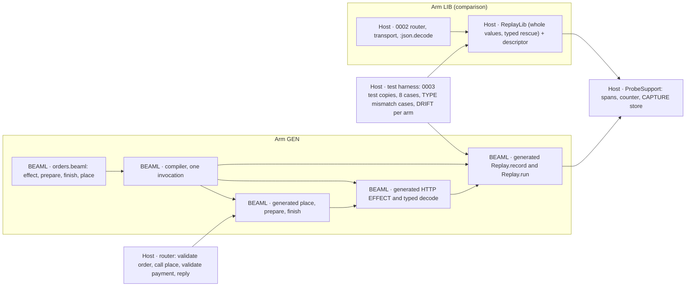

# EXPERIMENT 0004 — Generated REPLAY RUN

**[Requirement]** Can the BEAML compiler generate the flow, the HTTP EFFECT, the decode, the CAPTURE and the REPLAY RUN runner from one BEAML source, so that the host writes no replay code and no transport? Does the generated arm do more than a shared Elixir replay library with a hand-written descriptor? The section [Owner decisions (2026-11-06)](#owner-decisions-2026-11-06) is the authority. It overrides older plan text.

**[Verified]** [EXPERIMENT 0003](../0003-source-linked-replay/README.md#gate-status) passed with a hand-written runner, [`OrdersApi.Replay.run/3`](../0002-http-correlation/apps/orders_api/lib/orders_api/replay.ex), and a hand-written CAPTURE, `capture/3` in [`payment_http.ex`](../0002-http-correlation/apps/orders_api/lib/orders_api/payment_http.ex). The host [router](../0002-http-correlation/apps/orders_api/lib/orders_api/router.ex) owns the order prepare → `authorize/2` → finish. The [0001 compiler](../0001-syntax-to-beam/src/main.rs) parses `interface`, `enum` and `fn` only. Its interfaces are structural and exact.

**[Verified]** The 0003 live tests check the 0002 trace contract in [`query.py`](../0002-http-correlation/query.py): spans `orders.request`, `orders.prepare`, `orders.payment_http`, `orders.finish` and the log `payment_request_prepared`. `ProbeSupport.span/5` sets `outcome: "error"` only when the wrapped function raises.

**[Proposal]** Hypothesis: with the flow, the EFFECT and its failure type in BEAML, a BEAML-only TYPE change (DRIFT) needs fewer manual change sites in the generated arm (GEN) than in the library arm (LIB). GEN also catches a DRIFT that LIB misses.

## Plan history

- **Revision 1.** Generated runner next to a host flow. Plan review: BLOCK (1 critical, 2 high). [plan-review.md](workflow/2026-11-06/plan-review.md)
- **Revision 2.** LIB arm first as a kill switch, typed record fields, DRIFT R/N/Q, pass and reject rule, three syntax options (A, B, C) with owner questions Q1–Q5.
- **Revision 3.** The owner chose option B with `effect`, `!` and `|>`, a generated decode, no kill switch and LIB in parallel. Q1, Q2 and Q5 are answered. Syntax options A and C are closed; [syntax-options.beaml](syntax-options.beaml) stays as history. Use git history for the full revision 2 text. Plan review: BLOCK (1 critical, 2 high).
- **Revision 4.** Repairs the three objections of the revision 3 review: one strongest LIB form, frozen before any GEN result is judged; a complete 0003 change table, checked by a diff test on test copies; asserted TYPE mismatch cases, live and in a REPLAY RUN. [Disposition](workflow/2026-11-06/plan-review.md#disposition-main-agent-2026-11-06-1).
- **Revision 5 (this page).** Adds the [slice 1 verdict](#slice-1-verdict-2026-11-06) and the [slice 2 plan](#slice-2). Slice 1 text above stays unchanged. The slice 1 pass and reject rule does not apply to slice 2.

## Slice 1 scope

- **In [Requirement].** `effect` declarations with `http.post`. One `!` failure type. Pipe `|>` that passes a failure on, with the compile check against the `!` list. A decode generated from the declared TYPE. A generated `record` (CAPTURE) and a generated REPLAY RUN runner. The flow `place` in BEAML. The router calls only generated code.
- **Later [Requirement] (slice 2+).** `with ... else`, the Elixir `name`/`name!` pair, the formatter alignment rule, other EFFECT kinds (db, queue, mail), a second EFFECT, the old-record policy (Q4), the artifact check in the runner (Q3).



## Slice 1 BEAML source (orders)

**[Proposal]** The fixture `orders.beaml` for GEN. The syntax follows the owner example [order-flow.beaml](examples/order-flow.beaml). `payments.beaml` stays unchanged.

```beaml
interface Order { order_id: String }
interface Payment { order_id: String status: String }
interface PaymentError { reason: String }

// Leaves the module. Recorded live, substituted in a REPLAY RUN.
effect payments.authorize Order -> Payment ! PaymentError = http.post("payments/authorize")

fn prepare Order { order_id } -> Order = Order { order_id: order_id + "" }
fn finish Payment { order_id, status } -> Payment = Payment { order_id: order_id + "", status: status }

// The flow lives in BEAML. A failed step stops the pipe and passes PaymentError on.
fn place order: Order -> Payment ! PaymentError =
  order
  |> prepare
  |> payments.authorize
  |> finish
```

**[Proposal]** Generated Elixir, in the one module that 0002 `run.py` renames to `OrdersBeamlSpike`:

- `prepare/1`, `finish/1` as today. `place/1` returns `{:ok, payment}` or `{:error, %OrdersBeamlSpike.PaymentError{reason: r}}`. The `place!/1` half of the pair is slice 2.
- `payments_authorize/1`: the HTTP EFFECT. POST to `/payments/authorize` on `127.0.0.1` and the port from `ProbeSupport.config(:payments_port)`. Trace context injection, `ProbeSupport.increment/0`, Content-Length framing as in 0002. Then `Replay.record/3` with the actual status (revision 4: the record comes before the status check). Then status 200 only, then the typed decode.
- Typed decode of `Payment`: `:json.decode/1`, then an exact key set with String values. A missing key or a non-String value gives `reason: "decode"`. An extra key is accepted and recorded as `unknown_keys` (owner decision: tolerant with a hint). Transport failure gives `reason: "transport"`, another status gives `reason: "status"`.
- Spans through `ProbeSupport.span/5`: `orders.prepare`, `orders.payments.authorize` (client), `orders.finish`. A failure raises inside the span and becomes `{:error, ...}` outside it, so `outcome: "error"` stays. A failed step stops the pipe: no later step and no later span runs.
- One Orders log, revision 4 [Proposal]: inside the span of the pure step directly before an EFFECT, the generated code calls `ProbeSupport.event("<output TYPE, lower case>_request_prepared", "<step>")`. For `place` this is the existing `payment_request_prepared` under `orders.prepare`. So the 0002 `LOGS` contract and the log counts stay unchanged.
- `Replay.record/3` writes the 0003 RESPONSE RECORD format version 1 to `ProbeSupport.Capture.write/2`. `Replay.run/3` takes `(order, trace_id, records)` and returns only `{:ok, payment}` or `{:error, reason}`; the `unknown_keys` hint goes to the replay EFFECT span and the replay report, not to the return value. It runs `place` with the EFFECT step replaced by the record checks, then the same typed decode and `finish`. It returns `{:ok, payment}`, one of the six 0003 atoms, or `{:error, %PaymentError{}}`.

## Fixed inputs and ownership

- **LANGUAGE/COMPILATION.** The 0001 compiler gets `effect`, `!`, `|>` and the emit above. One invocation, one stdout. `payments.beaml` output stays byte-identical.
- **EXECUTION.** Reuse the two 0002 releases, the ports, the HTTP path, RESPONSE RECORD format version 1 and `ProbeSupport` (unchanged SHA-256). The router keeps `orders.request`, `valid_order!/1`, `valid_payment!/2` and the reply. It calls `OrdersBeamlSpike.place/1` and nothing else of the flow.
- **EXECUTION.** Each arm is an overlay, applied by `0004/run.py` to a temporary tree with the repository layout: `experiments/0001-syntax-to-beam` (current compiler), `experiments/0002-http-correlation` (copy plus overlay) and `experiments/0003-source-linked-replay` (`run.py` and copies of `tests/*.py`). The path constants of the copies (`EXPERIMENT`, `REPO`, `HTTP`, `COMPILER`) then need no edit. The overlay holds the edited copies of `query.py` and the 0003 tests. `0003/run.py` runs unchanged in that tree.
- **EXECUTION, control.** The 0002 tree, `0003/run.py` and the original 0003 tests stay unchanged in the repository. They run at their default root as the control. An arm run does not change their SHA-256 values.
- **R&D process.** Follow [implement-step](../../skills/implement-step/SKILL.md). Devil's Advocate at the plan, the RED review and the final review, in the gate ledger only.

## Comparison arm LIB

**[Requirement]** No kill switch. LIB is built in parallel with GEN, as the comparison.

**[Proposal] Revision 4: LIB is the strongest fair library.** The plan fixes its form. The LIB worker does not choose a weaker form.

- **Descriptor.** One Elixir map per EFFECT: operation, attempt, expected status, request function (`&OrdersBeamlSpike.prepare/1`), decode function, finish function. No request or response key list, no field name, no other TYPE fact. Budget: about 10 lines.
- **Whole values.** `ReplayLib.record(descriptor, request, status, bytes)` records the whole request value and the whole body bytes. `run` compares the whole recorded request with the request function result (`request_mismatch`), as 0003 does.
- **Typed rescue (mandatory).** `ReplayLib.run(descriptor, order, trace_id, records)` wraps decode and finish in one `rescue`. It returns `{:error, %ReplayLib.Error{step: "decode" | "finish", reason: <exception module name>}}`, never a raise. The six 0003 atoms and their check order stay. Budget: maximum 60 lines.
- **Live path.** The 0002 router, transport and `payment_request_prepared` log stay. The CAPTURE body in `payment_http.ex` becomes one `ReplayLib.record` call. `replay.ex` is deleted.
- **Fairness.** A fresh worker writes LIB without access to the GEN emitter, the 0004 BEAML fixture or any GEN result. LIB may call the public generated `prepare` and `finish`. It may not read BEAML source or metadata that 0004 adds to the generated module.
- **Freeze.** LIB passes (e) before any GEN result of (d2) or (f) is judged. `0004/run.py` records the SHA-256 of `replay_lib.ex` and the descriptor. DRIFT (f) runs only against that frozen LIB. A repair of LIB after the freeze counts as manual change sites.
- **No weak form.** The plan builds no LIB with a key list or without the `rescue`. The pass and reject rule uses only this LIB.
- **[Inference]** This LIB has no stale descriptor. It probably gives a typed reject for an old record after DRIFT-R and DRIFT-N, and `request_mismatch` after DRIFT-Q. Then the reject rule may apply. That is a valid result of slice 1.

## Slice 1: acceptance cases in order

1. **(a) Parse and check.** The compiler accepts the slice 1 source above, exit 0. Each bad declaration fails with exit ≠ 0, a clear message and no stdout:
   - unknown fn in a pipe (`|> charge`);
   - TYPE mismatch in a pipe (`|> finish` directly after `|> prepare`: `Order` is not `Payment`);
   - undeclared failure in a pipe (`place` without `! PaymentError`); the message names the step `payments.authorize` and the type `PaymentError`;
   - field not in TYPE (`finish` reads `amount`, which `Payment` does not have);
   - unsupported EFFECT kind (`db.get`) in slice 1.
2. **(b) Emit.** One compiler run writes the Elixir module with `place/1`, `payments_authorize/1`, the typed decode, `Replay.record/3` and `Replay.run/3`, the `PaymentError` struct and one `beaml-declaration-v1` comment per declaration. The module compiles with warnings as errors. Template control: compile DRIFT-R; the generated decode must contain `reference`. The 0003 gate 1 test `payments_cli_emits_checked_authorize_reference` still passes.
3. **(c) Live.** The GEN router calls only `OrdersBeamlSpike.place/1`. `payment_http.ex` and `replay.ex` are deleted. `0003/run.py` passes in the GEN tree, all five default steps (compiler reference, trace lookup, trace lookup repair, response capture, replay run). The test `tests/overlay_diff_test.py` passes first: per arm, the line diff of each copy against its original equals `arms/<arm>/assertion-changes.json`, which equals the table below. No other line changes.
4. **(d) Replay.** The 0003 8-case matrix passes against `OrdersBeamlSpike.Replay.run/3`: valid, A1 non-canonical, missing, operation, attempt, request, status, digest. Expected values stay as in 0003. Router, transport and `:gen_tcp.connect/4` count zero in all 8 cases. Live and replay use the same generated decode.
5. **(d2) TYPE mismatch, live and in a REPLAY RUN [Requirement].** In `tests/arms_test.py`, not in the 0003 copies. Replay cases use the 0003 harness with the arm's runner. Live cases use one Orders release against the 0003 loopback stub (`http.server`, Content-Length framing). Cases R1, R2, L1, L2, P1 below.
6. **(e) LIB.** The LIB form above passes the same 8 cases with the same counts, in the LIB tree, with the LIB rows of the table only. Before the freeze, LIB R1 must return `%ReplayLib.Error{step, reason}` with step "decode" or "finish" (asserted). It then runs R2, L1, L2, L3; those outcomes are recorded, not asserted. Then the freeze.
7. **(f) DRIFT.** Starts after the freeze. Per arm, change only BEAML TYPES or signatures; do not touch the LIB descriptor or host replay code. Regenerate and rebuild. Derivatives:
   - **DRIFT-R.** Add `reference: String` to `Payment` in both BEAML files.
   - **DRIFT-N.** Rename the `Payment` field `status` to `state` in both BEAML files.
   - **DRIFT-Q.** Add a field with a literal value to the request TYPE that `prepare` returns, and the matching Payments input.
   For each derivative and arm, record the outcome at build, on a new live record and on the pre-change record. Outcome classes: compile error with a clear message, typed reject, correct accept, false reject, wrong accept, crash without a typed reason. Then repair each arm until (d) or (e) passes again. Count manual change sites per arm.

### Case (d2): TYPE mismatch cases

**[Proposal]** Each case asserts the result, the counts and, live, the spans and records. "finish 0" is the runtime half of the pipe rule: a failed step stops the pipe.

- **R1 Replay, missing key.** Record of the first live call with body `{"order_id":"order-1"}`, `body_length` and `body_sha256` recomputed, status 200. Expect `{:error, %OrdersBeamlSpike.PaymentError{reason: "decode"}}`, `:json.decode/1` 1, `finish/1` 0, `valid_payment!/2` 0, transport 0.
- **R2 Replay, extra key.** The RESPONSE RECORD from L1. Expect the same success as L1 and the same `unknown_keys` hint. Live and replay use the same decode.
- **R3 Replay, wrong field TYPE.** A declared field with the wrong TYPE (`status: 7`). Expect `PaymentError` with reason "decode" and zero `finish` calls.
- **L3 Live, missing key.** The stub returns 200 with a body without `status`. Expect HTTP 502 `downstream_failure`, span `orders.payments.authorize` with `outcome: "error"` and `reason: "decode"`, one RESPONSE RECORD byte-exact, zero `orders.finish`, transport count 1.
- **L1 Live, extra key [Requirement: accept with hint].** The stub returns 200 with an extra key `fraud_score`. Expect HTTP 200, one `orders.finish`, one RESPONSE RECORD with the bytes byte-exact and `unknown_keys == ["fraud_score"]`, and the same attribute on the `orders.payments.authorize` span.
- **L2 Live, status 503.** The stub returns 503 with a valid `Payment` body. Expect HTTP 502, client span `outcome: "error"`, one RESPONSE RECORD with status 503, no `orders.finish` span, transport count 1.
- **P1 Pipe stop.** In an eval VM (0003 harness), `OrdersBeamlSpike.place/1` with a refused port. Expect `{:error, %OrdersBeamlSpike.PaymentError{reason: "transport"}}`, `prepare/1` 1, `finish/1` 0.

**[Unknown]** A recorded live 503 replays as the 0003 `status_mismatch` atom, not as `PaymentError{reason: "status"}`. The 0003 matrix keeps this. Slice 2 can revisit it with D001.

### 0003 lines that change in the arm copies

**[Proposal]** Each GEN change follows from "the router calls only generated code". The copies live in the overlay; the originals stay the control. `overlay_diff_test.py` compares each copy line by line with its original and requires the result to equal this table. Line numbers refer to the original files at the plan commit.

| Arm | File | Line | Original | Copy | Reason |
| --- | --- | --- | --- | --- | --- |
| GEN | 0002 `query.py` | 12 | `CONTRACT` key `orders.payment_http` | `orders.payments.authorize` | Generated span name `<service>.<step>` |
| GEN | 0002 `query.py` | 13 | parent of `payments.request`: `orders.payment_http` | `orders.payments.authorize` | Same rename |
| GEN | 0003 `response_capture_test.py` | 175 | client span filter `orders.payment_http` | `orders.payments.authorize` | Same rename |
| GEN | 0003 `response_capture_test.py` | 213 | observer control span `orders.payment_http` (twice) | `orders.payments.authorize` | Same rename; `outcome: "error"` stays |
| GEN | 0003 `replay_run_test.py` | 32 | `WATCHED` key `OrdersApi.PaymentHttp.authorize/2` | `OrdersBeamlSpike.payments_authorize/1` | The transport is generated |
| GEN | 0003 `replay_run_test.py` | 48 | `HARNESS` watched `{OrdersApi.PaymentHttp, :authorize, 2}` | `{OrdersBeamlSpike, :payments_authorize, 1}` | Same |
| GEN | 0003 `replay_run_test.py` | 56 | `HARNESS` control `OrdersApi.PaymentHttp.authorize(prepare(order), [])` | `OrdersBeamlSpike.payments_authorize(prepare(order))` | Same |
| GEN | 0003 `replay_run_test.py` | 57 | `HARNESS` replay `OrdersApi.Replay.run(order, trace_id, responses)` | `with {:ok, p} <- OrdersBeamlSpike.Replay.run(ProbeSupport.valid_order!(order), ...), do: {:ok, ProbeSupport.valid_payment!(p, order)}` | Domain validation stays host code, as in the router |
| GEN | 0003 `replay_run_test.py` | 292 | control result `{"raised": "MatchError"}` | `{"error": "%OrdersBeamlSpike.PaymentError{reason: \"transport\"}"}` | The EFFECT returns a typed failure; counts stay |
| GEN | 0003 `replay_run_test.py` | 293 | control key `OrdersApi.PaymentHttp.authorize/2` | `OrdersBeamlSpike.payments_authorize/1` | Same as line 32 |
| GEN | 0003 `replay_run_test.py` | 301 | `isolated` key `OrdersApi.PaymentHttp.authorize/2` | `OrdersBeamlSpike.payments_authorize/1` | Same as line 32 |
| LIB | 0003 `replay_run_test.py` | 57 | `HARNESS` replay `OrdersApi.Replay.run(order, trace_id, responses)` | `with {:ok, p} <- ReplayLib.run(OrdersApi.ReplayDescriptor.authorize(), ProbeSupport.valid_order!(order), ...), do: {:ok, ProbeSupport.valid_payment!(p, order)}` | `replay.ex` is deleted; same host validation as GEN |

**[Proposal]** Unchanged in both arms, because the Orders log stays (line text **[Verified]** at the plan commit): `query.py` line 17 (`LOGS`), `trace_lookup_test.py` line 175 (`len(checked["logs"]) == 2 * call`) and line 184 (`"logs": 4`). `trace_lookup_repair_test.py` and `run_test.py` have no changed line. The comment lines 38–39 of `replay_run_test.py` stay as history.

**[Inference]** If GEN cannot emit the log, lines 17, 175 and 184 change. That is a table change: it needs a new plan revision, and the verdict records "no Orders log" as a lost check.

All counts in the 8-case matrix stay as in 0003. The revision 2 SHA-256 check of `router.ex` is removed: the router changes by owner decision.

### Replay lines and manual change sites

- **Replay line.** A host line that exists only for replay: CAPTURE, the `record` call, hook wiring, the runner call site, caller-side validation or artifact checks, the LIB descriptor and library. Count them in both arms. Generated and compiler lines are not host lines; report compiler size as a one-time cost.
- **Manual change site.** One contiguous edited hunk in a hand-written file that an arm needs to pass (d) or (e) after a DRIFT. Exclude the BEAML DRIFT edit. Count domain validation edits (`valid_payment!/2`) and test expectation edits apart; they are equal in both arms.

### Pass and reject rule

- **Comparison arm [Proposal].** Judge every clause below only against the frozen LIB of [Comparison arm LIB](#comparison-arm-lib). No other LIB form enters the verdict.
- **Pass [Proposal].** The language claim holds for slice 1 only if both are true: (1) summed over the DRIFT derivatives, GEN needs fewer manual change sites than LIB; (2) for at least one derivative, GEN gives a compile error, a typed reject or a correct accept, while LIB gives a wrong accept or a crash without a typed reason. GEN has no wrong accept in any derivative.
- **Reject [Proposal].** Reject the claim for this slice if LIB needs the same number or fewer manual change sites, if LIB misses no DRIFT that GEN catches, or if GEN gives a wrong accept. Record the reject in the register.
- **Miss [Requirement].** A crash without a typed reason counts as a missed DRIFT (owner decision).
- **No verdict.** If GEN fails (a)–(d2), or LIB fails (e) or is not frozen before (f), slice 1 fails as an implementation and gives no verdict on the claim.

## Decisions (Decision4)

| Decision | Class | Choice and reason |
| --- | --- | --- |
| Failure TYPE as an interface `PaymentError { reason: String }` with the values `transport`, `status`, `decode` | Repair | The smallest typed struct with a named field. No enum payload rules needed. Q6 can replace it |
| `place/1` returns `{:ok, v}` or `{:error, struct}` only | Repair | It is the `name/n` half of the owner pair; `name!/n` is slice 2 and adds, not changes |
| Generated span names `<service>.<step>` | Repair | Derived, not a literal from 0002. Commits us to the listed assertion changes |
| Keep `payment_request_prepared`: emit `<output TYPE>_request_prepared` in the span of the pure step before an EFFECT (revision 4) | Undo | A local emit rule with no new syntax. Keeps the 0002 `LOGS` contract and the log counts. A BEAML log statement can replace it later |
| Generated code calls `ProbeSupport` for spans, counter, config and CAPTURE store | Repair | The existing 0002 adapter, unchanged. A language runtime contract replaces it later |
| Target from `<namespace>_port` config, host `127.0.0.1` | Repair | Matches 0002 configuration. Real addressing waits for Q7 |
| Transport with `:gen_tcp` and 0002 framing | Repair | Keeps the `:gen_tcp.connect/4` and transport counters of the 0003 observer |
| Host keeps `valid_order!/1` and `valid_payment!/2`; harness calls them around `Replay.run/3` | Repair | Domain validation is host code; keeps the 0003 counts |
| Replay evidence errors stay the six 0003 atoms; flow failures are `PaymentError` | Repair | Keeps the 0003 matrix unchanged. Revisit with D001 |
| Copies of the 0003 tests and `query.py` in the overlay, in a temporary tree with the repository layout; diff checked against the table (revision 4) | Undo | Originals stay the control; no arm switch in the 0003 files; no path edits in the copies |
| Typed decode accepts an extra key and records it as a hint (owner decision, replaces revision 4 reject) | Requirement | Matches the exact 0001 interfaces and the generated `finish` pattern. Relaxing it later is one emit change |
| `Replay.record/3` before the status check; the record holds the actual status (revision 4) | Repair | Case L2 needs one record for a 503. The 0003 matrix still expects status 200 in a valid record |
| LIB form fixed: no key list, mandatory typed `rescue`, frozen before (d2) and (f) are judged; no weak LIB (revision 4) | Repair | The verdict must not depend on a free choice of the LIB worker |
| LIB error shape `%ReplayLib.Error{step, reason}` (revision 4) | Undo | Local to the LIB arm; any typed shape counts |
| Elixir name `payments_authorize/1`, nested `Replay` and `PaymentError` modules | Undo | Local naming inside one generated module |
| Reject non-`http` EFFECT kinds at compile time in slice 1 | Undo | Keeps the slice boundary visible; slice 2 removes the reject |
| LIB worker runs in parallel with GEN, in its own directory; tests serialized | Undo | Owner decision overrides the one-writer rule; no shared build output |
| `http.post("payments/authorize")` as the slice 1 call form | Migrate | Taken from the owner example; source files depend on it. Q7 confirms |

**[Verified]** No decision is Answer: 0004 publishes nothing and makes no external claim.

### Owner questions

- **Q1, Q2, Q5.** Answered by the owner decisions: option B with `effect` and `|>`; BEAML owns the decode; a crash without a typed reason is a miss.
- **Q3. Artifact check (slice 2).** (i) The generated runner rejects a record with another `artifact_id` (`artifact_mismatch`). (ii) The caller keeps the check; it counts as replay lines. Slice 1 uses (ii). Depends on [D002](../../wiki/planning/decisions-to-be-made.md#d002--scope-of-the-replay-artifact-identity).
- **Q4. Old record after a SCHEMA change (slice 2).** (i) Typed reject from a SCHEMA version in the record. (ii) Typed reject from `artifact_id` (needs Q3 (i)). (iii) The generated decode rejects it with `PaymentError` (slice 1 behavior).
- **Q6. Shape of an EFFECT failure TYPE (Migrate, before slice 2).** (i) User-declared interface with `reason: String` (slice 1 default). (ii) User-declared `enum` with fixed variant names per EFFECT kind, for example `Transport`, `Status`, `Decode`. (iii) A built-in `HttpError` TYPE that the user names after `!`.
- **Q7. HTTP call form and target (Migrate, before slice 2).** (i) `http.post("payments/authorize")` with the target from configuration by namespace (slice 1 default). (ii) A named target declaration in BEAML, for example `target payments = env("PAYMENTS_URL")`. (iii) Another form from the owner.

## Evidence and limits

**[Unknown]** No run exists. This page is a plan.

**[Inference]** DRIFT-R and DRIFT-N need a `valid_payment!/2` edit in both arms. It counts apart, not as a replay site.

**[Unknown]** Limits carried from 0003: the body digest is integrity, not tamper protection (R2). The RESPONSE RECORD has no timestamp (D003). The check order of the six reasons is not tested. Two records for one trace give `missing_response` without a test.

**[Unknown]** One EFFECT and three DRIFT derivatives are a small sample. A pass shows an advantage for this slice only.

**[Inference]** An extra key is accepted with a hint, so a Payments service may add a field without breaking Orders. The hint makes such a change visible to observation.

**[Unknown]** Revision 4: the generated client span and `Replay.record/3` in an eval VM without the OpenTelemetry application (case P1 and the observer control) are not tested yet. RED shows whether the harness needs a change; such a change is a table change.

### Out of scope

- Everything in "Later" above.
- Retries, attempts > 1, timeouts, uncertain outcomes (round 3, objection 3).
- A REPLAY CAPSULE format, durable storage, trace sampling (D003).
- Zed/LSP support for the new syntax.
- A BAML comparison and the operator-time value gate. [BAML v1](../../wiki/sources/baml-v1.md#observability) has no replay on its default branch at the pin.

**[Proposal]** Smallest next test after slice 1: a second EFFECT in both arms, with change sites counted the same way.

## Owner decisions (2026-11-06)

- **[Requirement]** BEAML owns the call order. Syntax option B: the flow `place` is written in BEAML. The host router only calls generated code.
- **[Requirement]** BEAML makes the HTTP call itself. No hand-written host transport.
- **[Requirement]** BEAML generates the response decode from the declared type. A response that does not match the type gives a typed error, live and in a REPLAY RUN.
- **[Requirement]** In the comparison, a runtime crash without a typed reason counts as a missed DRIFT.
- **[Requirement]** No kill switch. Start the generated arm directly. Build the library arm in parallel as the comparison.
- **[Requirement]** Long-term direction: applications are written in BEAML. Only a pure interface layer (for example LiveView) stays in Elixir and uses generated event handlers.
- **[Proposal]** Main agent: the generated HTTP code may use a socket or an HTTP library inside. The 0003 live tests run again against the changed router.
- **[Unknown]** Open: the BEAML syntax of the HTTP call itself.
- **[Requirement]** BEAML has a pipe operator `|>`. The flow `place` uses it instead of nested calls.
- **[Requirement]** Formatter rule: consecutive `effect` lines (no blank line between them) align three columns: the input type after the longest name, `->` after the longest input type, `=` after the longest output type. A blank line starts a new block.
- **[Proposal]** `effect` marks every call that leaves the function: HTTP, other apps (also over BEAM messages), database, queue, file, time, randomness. Every `effect` result is recorded; a REPLAY RUN substitutes it. The keyword name is still open.
- **[Requirement]** BEAML allows `with ... do ... else ... end`. `<-` binds the success value of a step that can fail; `=` binds a pure step.
- **[Requirement]** An `effect` or `fn` declares its failure type with `!` after the success type, for example `String -> Order ! LoadError`. `<-` binds only the success type. A failure goes to `else`.
- **[Requirement]** The compiler collects the failure types of all `<-` steps. The `else` branch must cover each of them, or compilation fails.
- **[Requirement]** A function may pass failures on with `!` in its own signature, for example `-> Payment ! LoadError | StockError | PaymentError`.
- **[Requirement]** A pipe step may fail. The pipe stops and passes the failure on. The compiler rejects a pipe step whose failure type is not in the `!` list of the enclosing function, with a message that names the step and the missing type.
- **[Requirement]** `!` in a type stays, although Elixir uses `!` in names for "raises". The owner accepts this.
- **[Requirement]** For each BEAML function that can fail, the Elixir output has two functions: `name/n` returns `{:ok, value}` or `{:error, error}`; `name!/n` returns the value or raises an exception generated from the failure type.
- **[Requirement]** Generated Elixir errors are typed structs with named fields, for example `%Orders.LoadError.NotFound{id: "order-1"}`. Not plain tuples.
- **[Requirement]** Generated decode is tolerant with a hint, as in BAML v1 (`ExtraKey` flag in `coerce_class.rs` at pin `989676dd`). An unknown key is accepted when every declared field is present with its TYPE. Each unknown key name is recorded in the response record and on the EFFECT span. A missing or wrong declared field stays a typed error. This replaces the earlier strict default (same day). A strict `exact interface` form may come later.

## Slice 1 verdict (2026-11-06)

**[Verified]** Final review of slice 1: the implementation passes with notes. The claim is REJECTED under the [slice 1 pass and reject rule](#pass-and-reject-rule). Evidence: the GREEN-2 DRIFT table in [notes.md](workflow/2026-11-06/notes.md#green-2).

- Manual change sites: GEN 0, LIB 0. The rule needs GEN < LIB.
- The build passed in all 6 DRIFT rows (R, N, Q per arm). No compile error caught a DRIFT.
- The only arm difference is DRIFT-Q `new_live`: GEN gives a typed reject, LIB an untyped crash. The cause is the old 0002 transport that LIB keeps (`payment_http.ex:31` matches status 200). The cause is not the TYPE.
- Note 1: the host check raise is labelled typed in rows R and N (`run.py:410-411`).
- Note 2: the LIB freeze was committed only after the runs. The timestamps show a consistent order.

**[Requirement]** OWNER statement: the slice 1 rule measured the wrong thing. The goal is [vertical integration](../../wiki/concepts/vertical-integration.md): the compiler knows the TYPE of stored records, so a breaking TYPE change fails at compile time.

**[Inference]** Why the slice 1 rule is superseded for slice 2. A LIB with no TYPE facts needs no edit after a field change, so a count of manual change sites cannot favor GEN. The count also cannot show a failed build, because no arm had TYPE facts about stored records. Slice 2 therefore uses an absolute rule against stored TYPE VERSIONS. LIB stays as a control.

## Slice 2

### Question and claim

**[Requirement]** Can the compiler refuse a rename of a response field (DRIFT N, `status` → `state`) without a RENAME ALIAS, because stored RESPONSE RECORDS hold the old TYPE VERSION? With a declared RENAME ALIAS, the source compiles and the old RESPONSE RECORDS replay as `correct_accept` through the generated decode.

### How the compiler learns the stored TYPE VERSIONS

**[Verified]** Slice 1 facts in the [0001 compiler](../0001-syntax-to-beam/src/main.rs): the generated `Replay.record/3` writes RESPONSE RECORD format version 1 to `ProbeSupport.Capture.write("responses", …)`, which appends to `<output>/responses.jsonl`. The record holds `artifact_id` (the BEAM hash of the build), not a TYPE fact. The compiler CLI takes exactly one argument, the source path.

**[Verified]** The 0003 test `response_capture_test.py` compares a fixed subset of record keys. Slice 1 added `unknown_keys` and kept format version 1.

**Common part of both options [Proposal].** The generated `record/3` writes one more key, `type`: `{"name": "Payment", "fields": [["order_id", "String"], ["status", "String"]], "fingerprint": "<sha256 of the canonical field list, sorted by name>"}`. This is the TYPE VERSION of the EFFECT output TYPE at the time of the write. The format version stays 1, as with `unknown_keys`. The record names the full field list, so the compiler can name the old field in its message.

**Option A, RECORD SNAPSHOT input [Proposal].** The compiler takes a second input, `--stored PATH`, a RECORD SNAPSHOT (a copy of `responses.jsonl`). It reads the distinct `type` values per `operation`. It reads no body bytes.

- For: the compiler checks against observed stored data. The case "no stored records" is an empty file.
- For: one source of truth. Nothing can claim a TYPE VERSION that no record holds.
- Against: the build reads environment data. A build is reproducible only with the same RECORD SNAPSHOT (`run.py` records its SHA-256).
- Against: a large store needs an index or an export later.

**Option B, TYPE lock file [Proposal].** A file `orders.types.lock` next to the source lists the known TYPE VERSIONS per TYPE. A separate step writes it from the store. The compiler reads only the lock file.

- For: a reviewable file in git. The build reads no environment data.
- Against: a second source that can go stale or lie. The lock can list a TYPE VERSION that no record holds, or miss one that a record holds.
- Against: the case "no stored records" needs a count per TYPE VERSION in the lock.

**[Proposal] Recommendation for slice 2: Option A.** The claim is "the compiler knows the stored records". Option A reads them directly; Option B adds a claim between the store and the compiler. Rejected alternative: infer the stored TYPE from body keys. That mixes a Payments change (an extra key) with a TYPE VERSION of Orders.

**[Proposal]** A source with an `effect` and no `--stored` input fails with `stored TYPE VERSIONS unknown`. An unknown store is not an empty store. A source without an `effect` (`payments.beaml`) needs no input; its output stays byte-identical.

**Migrate [OWNER].** The production source of truth for stored TYPE VERSIONS (RECORD SNAPSHOT, lock file, or a live query of the deployed nodes). It fixes the record format and the deploy workflow of every later environment. Slice 2 uses a fixture file and does not decide it.

### RENAME ALIAS syntax options

**[Proposal]** These are OWNER decisions. The plan does not choose. Each snippet shows the DRIFT N source of `orders.beaml`. `payments.beaml` stores no records and needs no RENAME ALIAS.

**S1. Field suffix.** The alias stays on the field.

```beaml
interface Order { order_id: String }
interface Payment { order_id: String state: String renamed status }
interface PaymentError { reason: String }
```

**S2. Separate declaration.** The TYPE stays clean; the rename is one line below it.

```beaml
interface Payment { order_id: String state: String }
rename Payment.status -> Payment.state
```

**S3. Versioned TYPE.** Follows the sketch in [vertical integration](../../wiki/concepts/vertical-integration.md#type-changes-against-deployed-data). The record then needs a version number in addition to the fingerprint.

```beaml
interface Payment@1 { order_id: String status: String }
interface Payment@2 { order_id: String state: String } from Payment@1 { status -> state }
```

### Check rule and generated decode

**[Proposal] Rename check.** For each `operation` in the RECORD SNAPSHOT, take its EFFECT output TYPE. For each stored TYPE VERSION of that TYPE: a stored field that is not in the current TYPE and a current field that is not in the stored TYPE VERSION, with the same field TYPE, are a rename candidate. A rename candidate without a RENAME ALIAS is a compile error. A RENAME ALIAS whose old field is in no stored TYPE VERSION is a compile error.

**[Proposal] Decode.** The generated decode reads the current field name. If it is missing and the RENAME ALIAS old name is present, it reads the old name. Live and REPLAY RUN use the same decode. The record body and its digest stay unchanged.

**[Proposal] Compile error text** (case C1; the `help` line follows the chosen syntax, here S1). Exit ≠ 0, no stdout:

```text
error: TYPE Payment cannot read 1 stored RESPONSE RECORD of operation payments.authorize
  stored TYPE VERSION: Payment { order_id: String status: String } (fingerprint <first 12 hex>)
  record source: <the --stored path>
  field status: String is in the stored TYPE VERSION, not in the current TYPE
  field state: String is in the current TYPE, not in the stored TYPE VERSION
  help: if state is status renamed, declare: state: String renamed status
```

The tests assert these tokens, not the full text: `Payment`, `status`, `state`, the `--stored` path, and the `help` alias form of the chosen syntax. Compiler action events do not record the path (AGENTS rule).

### Cases with expected outcomes

**[Proposal]** `run.py` builds the slice 2 GEN tree with the `type` key, runs one live call per order, and retains the result as the RECORD SNAPSHOT fixture `v1` (TYPE VERSION `Payment { order_id status }`). DRIFT edits follow slice 1 (both BEAML files). The domain edit of `valid_payment!/2` counts apart, as in slice 1.

| ID | Source | RECORD SNAPSHOT | Build | Old record (REPLAY RUN) | New live call |
| --- | --- | --- | --- | --- | --- |
| C1 | N, no RENAME ALIAS | `v1` | compile error, text above | not run | not run |
| C2 | N, RENAME ALIAS `status` → `state` | `v1` | exit 0 | `correct_accept`: `{:ok, %{order_id, state: <stored status value>}}`, decode 1, `finish/1` 1, transport 0 | `correct_accept`, HTTP 200; the new record holds the new TYPE VERSION |
| C3 | N, RENAME ALIAS | `v1` plus the C2 new records (two TYPE VERSIONS) | exit 0 | both versions `correct_accept` | not run |
| C4 | N, RENAME ALIAS names `statuz` | `v1` | compile error that names `Payment`, `statuz` and the `--stored` path | not run | not run |
| C5 | R (add `reference`), no RENAME ALIAS | `v1` | exit 0 (no rename candidate) | `typed_reject`: `PaymentError{reason: "decode"}`, `finish/1` 0, as in slice 1 | `correct_accept` |
| C6 | N, no RENAME ALIAS | empty file | exit 0 | none stored | `correct_accept` |
| C7 | N, no RENAME ALIAS | `v1` with the `type` key removed from one record (slice 1 format) | compile error `stored RESPONSE RECORD has no TYPE VERSION`, names the `--stored` path and the line number | not run | not run |
| C8 | slice 1 source | no `--stored` input | compile error `stored TYPE VERSIONS unknown` | not run | not run |
| C9 | C6 build (empty snapshot, no RENAME ALIAS) | `v1` record replayed against it (stale snapshot) | exit 0 | `typed_reject`: `PaymentError{reason: "decode"}`, `finish/1` 0, no crash | not run |
| C10 | slice 1 source | `v1` | exit 0 | slice 1 (a)–(d2) pass again; `payments.beaml` output byte-identical; 0003 record key subset passes | as slice 1 |

**[Inference]** C5 has a gap. The build passes, but the old record no longer decodes. This follows from the rename-only scope of slice 2. It conflicts with the OWNER rule "a change of shape needs a migration function". See the open OWNER questions.

**[Inference]** C6 against C1 is the key control. The source is the same; only the stored records differ. The compile error must come from the stored TYPE VERSION, not from the source.

### LIB comparison and pass and reject rule

**[Inference] What a fair LIB can do.** LIB holds no TYPE facts (revision 4 form: no key list, no field name). It cannot fail a build on a TYPE change. It can give a typed reject of the old record in a REPLAY RUN (slice 1: `ReplayLib.Error finish`). A host test that replays all stored records after each build can find the break, but only after the build, as a test failure, with no TYPE name and no alias proposal. A hand-written key fallback in the LIB decode can accept the old record; that is a manual change site.

**[Proposal] LIB run.** Run the frozen LIB of slice 1 on DRIFT N with the `v1` RECORD SNAPSHOT copied into its tree. Expected: build exit 0, old record `typed_reject`. Record the result as a control. LIB is not part of the pass clause.

**[Proposal] Pass.** The claim holds for slice 2 only if all are true:

1. C1 fails at compile time with exit ≠ 0, no stdout, and all asserted tokens.
2. C6 compiles. So the C1 error comes from the stored records.
3. C2 and C3 give `correct_accept` for every old record, and C2 gives `correct_accept` live.
4. C4, C7 and C8 fail at compile time. C5 compiles. C9 gives a typed reject.
5. C10 passes. GEN gives no `wrong_accept` and no untyped crash in any case.

**[Proposal] Reject.** Reject the claim for slice 2 if any of these occurs. Record the reject in the register.

- C1 compiles (exit 0) with old TYPE VERSIONS in the RECORD SNAPSHOT.
- C6 also fails. Then the error comes from the source, not from the stored records.
- C2 or C3 gives anything other than `correct_accept` for an old record.
- Any case gives a `wrong_accept`, for example C2 with `state` empty or taken from the wrong field.
- C5 fails at compile time. Then the check blocks more than renames.

**No verdict.** If C10 fails, slice 2 fails as an implementation and gives no verdict on the claim.

### Out of scope

- Shape-changing migrations (a `migrate` form, a changed field TYPE, an added required field with old records).
- Per-environment levels (an environment with lower priority that does not block).
- More than one environment, mixed-version live traffic and a live query of deployed nodes.
- The lifetime of a RENAME ALIAS after no stored record needs it.
- Everything in slice 1 "Later", except the old-record policy (Q4), which slice 2 answers for renames only.

### Decisions (Decision4, slice 2 plan)

| Decision | Class | Choice and reason |
| --- | --- | --- |
| Slice 1 rule superseded for slice 2 by an absolute rule; LIB is a control | Repair | OWNER statement. Commits slice 2 to the cases above, not to a count |
| `type` key (name, fields, fingerprint) in the RESPONSE RECORD, format version 1 kept | Repair | Over a new format version: `unknown_keys` set the precedent, the 0003 key subset still passes. Commits every later record to the key |
| Recommend Option A (RECORD SNAPSHOT via `--stored`) | Repair | Over Option B: one source of truth, no stale lock. Slice 2 only; production choice is Migrate |
| Production source of truth for stored TYPE VERSIONS | Migrate | OWNER chooses between snapshot, lock file and live query |
| RENAME ALIAS syntax S1, S2 or S3 | Migrate | Source files depend on it. OWNER chooses |
| No `--stored` input for a source with an `effect` is a compile error | Repair | Over "treat as empty": an unknown store is not an empty store. Commits slice 1 CLI tests to pass an empty snapshot |
| Rename check only; R compiles | Repair | OWNER fixed R as a negative control. Leaves the C5 gap, raised as an OWNER question |
| Alias with an old field in no stored TYPE VERSION is a compile error | Undo | V1: any failure blocks. One check to drop later |
| Decode reads the old name as a fallback, live and replay | Repair | Over a decode chosen by the record fingerprint: smaller, one decode for live and replay. Commits live traffic to accept the old name too |
| Fingerprint = SHA-256 of the field list sorted by name | Undo | Local to generated code and the compiler |
| C6 against C1 as the main control | Undo | Same source, different store; shows the error comes from records |

### Open OWNER questions (slice 2)

- **O1.** RENAME ALIAS syntax: S1, S2 or S3?
- **O2.** A source with an `effect` and no RECORD SNAPSHOT: compile error (plan) or treat as empty?
- **O3.** A RENAME ALIAS whose old field is in no stored TYPE VERSION: compile error (plan) or a hint?
- **O4.** DRIFT R with old records: compile (rename-only scope, plan) or compile error "needs a migration"?
- **O5 (Migrate).** Production source of truth for stored TYPE VERSIONS: RECORD SNAPSHOT, lock file or live query of the deployed nodes?
