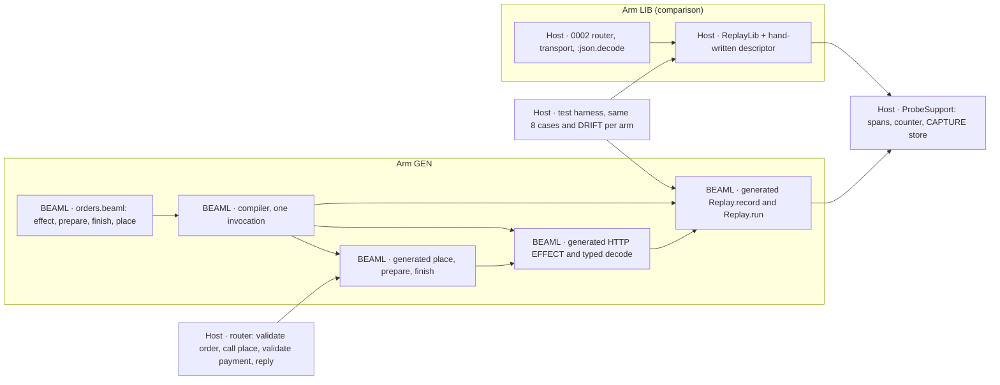

# EXPERIMENT 0004 — Generated REPLAY RUN

**[Requirement]** Can the BEAML compiler generate the flow, the HTTP EFFECT, the decode, the CAPTURE and the REPLAY RUN runner from one BEAML source, so that the host writes no replay code and no transport? Does the generated arm do more than a shared Elixir replay library with a hand-written descriptor? The section [Owner decisions (2026-11-06)](#owner-decisions-2026-11-06) is the authority. It overrides older plan text.

**[Verified]** [EXPERIMENT 0003](../0003-source-linked-replay/README.md#gate-status) passed with a hand-written runner, [`OrdersApi.Replay.run/3`](../0002-http-correlation/apps/orders_api/lib/orders_api/replay.ex), and a hand-written CAPTURE, `capture/3` in [`payment_http.ex`](../0002-http-correlation/apps/orders_api/lib/orders_api/payment_http.ex). The host [router](../0002-http-correlation/apps/orders_api/lib/orders_api/router.ex) owns the order prepare → `authorize/2` → finish. The [0001 compiler](../0001-syntax-to-beam/src/main.rs) parses `interface`, `enum` and `fn` only. Its interfaces are structural and exact.

**[Verified]** The 0003 live tests check the 0002 trace contract in [`query.py`](../0002-http-correlation/query.py): spans `orders.request`, `orders.prepare`, `orders.payment_http`, `orders.finish` and the log `payment_request_prepared`. `ProbeSupport.span/5` sets `outcome: "error"` only when the wrapped function raises.

**[Proposal]** Hypothesis: with the flow, the EFFECT and its failure type in BEAML, a BEAML-only TYPE change (DRIFT) needs fewer manual change sites in the generated arm (GEN) than in the library arm (LIB). GEN also catches a DRIFT that LIB misses.

## Plan history

- **Revision 1.** Generated runner next to a host flow. Plan review: BLOCK (1 critical, 2 high). [plan-review.md](workflow/2026-11-06/plan-review.md)
- **Revision 2.** LIB arm first as a kill switch, typed record fields, DRIFT R/N/Q, pass and reject rule, three syntax options (A, B, C) with owner questions Q1–Q5.
- **Revision 3 (this page).** The owner chose option B with `effect`, `!` and `|>`, a generated decode, no kill switch and LIB in parallel. Q1, Q2 and Q5 are answered. Syntax options A and C are closed; [syntax-options.beaml](syntax-options.beaml) stays as history. Use git history for the full revision 2 text.

## Slice 1 scope

- **In [Requirement].** `effect` declarations with `http.post`. One `!` failure type. Pipe `|>` that passes a failure on, with the compile check against the `!` list. A decode generated from the declared TYPE. A generated `record` (CAPTURE) and a generated REPLAY RUN runner. The flow `place` in BEAML. The router calls only generated code.
- **Later [Requirement] (slice 2+).** `with ... else`, the Elixir `name`/`name!` pair, the formatter alignment rule, other EFFECT kinds (db, queue, mail), a second EFFECT, the old-record policy (Q4), the artifact check in the runner (Q3).



## Slice 1 BEAML source (orders)

**[Proposal]** The fixture `orders.beaml` for GEN. The syntax follows the owner example [order-flow.beaml](examples/order-flow.beaml). `payments.beaml` stays unchanged.

```beaml
interface Order { order_id: String }
interface Payment { order_id: String status: String }
interface PaymentError { reason: String }

// Leaves the module. Recorded live, substituted in a REPLAY RUN.
effect payments.authorize Order -> Payment ! PaymentError = http.post("payments/authorize")

fn prepare Order { order_id } -> Order = Order { order_id: order_id + "" }
fn finish Payment { order_id, status } -> Payment = Payment { order_id: order_id + "", status: status }

// The flow lives in BEAML. A failed step stops the pipe and passes PaymentError on.
fn place order: Order -> Payment ! PaymentError =
  order
  |> prepare
  |> payments.authorize
  |> finish
```

**[Proposal]** Generated Elixir, in the one module that 0002 `run.py` renames to `OrdersBeamlSpike`:

- `prepare/1`, `finish/1` as today. `place/1` returns `{:ok, payment}` or `{:error, %OrdersBeamlSpike.PaymentError{reason: r}}`. The `place!/1` half of the pair is slice 2.
- `payments_authorize/1`: the HTTP EFFECT. POST to `/payments/authorize` on `127.0.0.1` and the port from `ProbeSupport.config(:payments_port)`. Trace context injection, `ProbeSupport.increment/0`, status 200 only, Content-Length framing as in 0002. Then `Replay.record/3`, then the typed decode.
- Typed decode of `Payment`: `:json.decode/1`, then an exact key set with String values. Else `reason: "decode"`. Transport failure gives `reason: "transport"`, another status gives `reason: "status"`.
- Spans through `ProbeSupport.span/5`: `orders.prepare`, `orders.payments.authorize` (client), `orders.finish`. A failure raises inside the span and becomes `{:error, ...}` outside it, so `outcome: "error"` stays.
- `Replay.record/3` writes the 0003 RESPONSE RECORD format version 1 to `ProbeSupport.Capture.write/2`. `Replay.run/3` takes `(order, trace_id, records)`. It runs `place` with the EFFECT step replaced by the record checks, then the same typed decode and `finish`. It returns `{:ok, payment}`, one of the six 0003 atoms, or `{:error, %PaymentError{}}`.

## Fixed inputs and ownership

- **LANGUAGE/COMPILATION.** The 0001 compiler gets `effect`, `!`, `|>` and the emit above. One invocation, one stdout. `payments.beaml` output stays byte-identical.
- **EXECUTION.** Reuse the two 0002 releases, the ports, the HTTP path, RESPONSE RECORD format version 1 and `ProbeSupport` (unchanged SHA-256). The router keeps `orders.request`, `valid_order!/1`, `valid_payment!/2` and the reply. It calls `OrdersBeamlSpike.place/1` and nothing else of the flow.
- **EXECUTION.** Each arm is an overlay on a temporary copy of the 0002 tree, applied by `0004/run.py`. The 0002 tree, the 0003 runner and the 0003 tests at their default root stay the control.
- **R&D process.** Follow [implement-step](../../skills/implement-step/SKILL.md). Devil's Advocate at the plan, the RED review and the final review, in the gate ledger only.

## Comparison arm LIB

**[Requirement]** No kill switch. LIB is built in parallel with GEN, as the comparison.

- **Descriptor.** One Elixir map or module per EFFECT: operation, attempt, status, recorded request and response keys, decode function, finish function. Budget: about 15 lines.
- **Library.** `ReplayLib.record(descriptor, request, status, bytes)` and `ReplayLib.run(descriptor, order, trace_id, records)`. Same six reasons and check order as 0003. A generic `rescue` around `finish` is permitted. Budget: maximum 60 lines.
- **Live path.** The 0002 router and transport stay. The CAPTURE body in `payment_http.ex` becomes one `ReplayLib.record` call. `replay.ex` is deleted.
- **Fairness.** A fresh worker writes LIB without access to the GEN emitter or the 0004 BEAML fixture. LIB may call the public generated `prepare` and `finish`. It may not read BEAML source or metadata that 0004 adds to the generated module.
- **[Inference]** A LIB that records whole values and checks no field list has no stale descriptor. With a generic `rescue` it can detect DRIFT-R and DRIFT-N. Then DRIFT-Q and the change-site count decide. The plan permits that LIB form; the reject rule can then apply.

## Slice 1: acceptance cases in order

1. **(a) Parse and check.** The compiler accepts the slice 1 source above, exit 0. Each bad declaration fails with exit ≠ 0, a clear message and no stdout:
   - unknown fn in a pipe (`|> charge`);
   - TYPE mismatch in a pipe (`|> finish` directly after `|> prepare`: `Order` is not `Payment`);
   - undeclared failure in a pipe (`place` without `! PaymentError`); the message names the step `payments.authorize` and the type `PaymentError`;
   - field not in TYPE (`finish` reads `amount`, which `Payment` does not have);
   - unsupported EFFECT kind (`db.get`) in slice 1.
2. **(b) Emit.** One compiler run writes the Elixir module with `place/1`, `payments_authorize/1`, the typed decode, `Replay.record/3` and `Replay.run/3`, the `PaymentError` struct and one `beaml-declaration-v1` comment per declaration. The module compiles with warnings as errors. Template control: compile DRIFT-R; the generated decode must contain `reference`. The 0003 gate 1 test `payments_cli_emits_checked_authorize_reference` still passes.
3. **(c) Live.** The GEN router calls only `OrdersBeamlSpike.place/1`. `payment_http.ex` and `replay.ex` are deleted. The 0003 live tests and `0003/run.py` pass against the GEN overlay with exactly the assertion changes in the table below. No other assertion changes.
4. **(d) Replay.** The 0003 8-case matrix passes against `OrdersBeamlSpike.Replay.run/3`: valid, A1 non-canonical, missing, operation, attempt, request, status, digest. Expected values stay as in 0003. Router, transport and `:gen_tcp.connect/4` count zero in all 8 cases. Live and replay use the same generated decode.
5. **(e) LIB.** LIB with its descriptor passes the same 8 cases, with the same counts. The unchanged 0003 live tests pass against the LIB overlay.
6. **(f) DRIFT.** Per arm, change only BEAML TYPES or signatures; do not touch the LIB descriptor or host replay code. Regenerate and rebuild. Derivatives:
   - **DRIFT-R.** Add `reference: String` to `Payment` in both BEAML files.
   - **DRIFT-N.** Rename the `Payment` field `status` to `state` in both BEAML files.
   - **DRIFT-Q.** Add a field with a literal value to the request TYPE that `prepare` returns, and the matching Payments input.
   For each derivative and arm, record the outcome at build, on a new live record and on the pre-change record. Outcome classes: compile error with a clear message, typed reject, correct accept, false reject, wrong accept, crash without a typed reason. Then repair each arm until (d) or (e) passes again. Count manual change sites per arm.

### 0003 assertions that change in (c) and (d)

**[Inference]** Each change follows from "the router calls only generated code". The 0003 files get one root parameter (default: the 0002 tree), so the 0003 control run stays unchanged. The GEN overlay carries the changed `query.py` lines.

| File | Assertion | Change | Reason |
| --- | --- | --- | --- |
| 0002 `query.py` | `CONTRACT` span `orders.payment_http`, parent of `payments.request` | `orders.payments.authorize` | Generated span name is `<service>.<step>` |
| 0002 `query.py` | `LOGS` row `payment_request_prepared` under `orders.prepare` | removed | It was a router line; generated code writes spans only |
| 0003 `response_capture_test.py` | client span name (lines 175, 213) | `orders.payments.authorize` | Same span rename; `outcome: "error"` stays |
| 0003 `replay_run_test.py` | `WATCHED` and `isolated` key `OrdersApi.PaymentHttp.authorize/2` | `OrdersBeamlSpike.payments_authorize/1` | The transport is generated |
| 0003 `replay_run_test.py` | `HARNESS` entry `OrdersApi.Replay.run/3` | `OrdersBeamlSpike.Replay.run/3`; the harness calls `valid_order!/1` before and `valid_payment!/2` after | Domain validation stays host code, as in the router |
| 0003 `replay_run_test.py` | observer control result `{"raised": "MatchError"}` | `{"error": "%OrdersBeamlSpike.PaymentError{reason: \"transport\"}"}` | The EFFECT returns a typed failure; the count values stay |
| 0004 revision 2 | SHA-256 check of `router.ex` | removed | The router changes by owner decision |

All counts in the 8-case matrix stay as in 0003.

### Replay lines and manual change sites

- **Replay line.** A host line that exists only for replay: CAPTURE, the `record` call, hook wiring, the runner call site, caller-side validation or artifact checks, the LIB descriptor and library. Count them in both arms. Generated and compiler lines are not host lines; report compiler size as a one-time cost.
- **Manual change site.** One contiguous edited hunk in a hand-written file that an arm needs to pass (d) or (e) after a DRIFT. Exclude the BEAML DRIFT edit. Count domain validation edits (`valid_payment!/2`) and test expectation edits apart; they are equal in both arms.

### Pass and reject rule

- **Pass [Proposal].** The language claim holds for slice 1 only if both are true: (1) summed over the DRIFT derivatives, GEN needs fewer manual change sites than LIB; (2) for at least one derivative, GEN gives a compile error, a typed reject or a correct accept, while LIB gives a wrong accept or a crash without a typed reason. GEN has no wrong accept in any derivative.
- **Reject [Proposal].** Reject the claim for this slice if LIB needs the same number or fewer manual change sites, if LIB misses no DRIFT that GEN catches, or if GEN gives a wrong accept. Record the reject in the register.
- **Miss [Requirement].** A crash without a typed reason counts as a missed DRIFT (owner decision).
- **No verdict.** If GEN fails (a)–(d), slice 1 fails as an implementation and gives no verdict on the claim.

## Decisions (Decision4)

| Decision | Class | Choice and reason |
| --- | --- | --- |
| Failure TYPE as an interface `PaymentError { reason: String }` with the values `transport`, `status`, `decode` | Repair | The smallest typed struct with a named field. No enum payload rules needed. Q6 can replace it |
| `place/1` returns `{:ok, v}` or `{:error, struct}` only | Repair | It is the `name/n` half of the owner pair; `name!/n` is slice 2 and adds, not changes |
| Generated span names `<service>.<step>` | Repair | Derived, not a literal from 0002. Commits us to the listed assertion changes |
| Remove the `payment_request_prepared` log from the contract | Repair | The router line goes away; a generated domain log has no source |
| Generated code calls `ProbeSupport` for spans, counter, config and CAPTURE store | Repair | The existing 0002 adapter, unchanged. A language runtime contract replaces it later |
| Target from `<namespace>_port` config, host `127.0.0.1` | Repair | Matches 0002 configuration. Real addressing waits for Q7 |
| Transport with `:gen_tcp` and 0002 framing | Repair | Keeps the `:gen_tcp.connect/4` and transport counters of the 0003 observer |
| Host keeps `valid_order!/1` and `valid_payment!/2`; harness calls them around `Replay.run/3` | Repair | Domain validation is host code; keeps the 0003 counts |
| Replay evidence errors stay the six 0003 atoms; flow failures are `PaymentError` | Repair | Keeps the 0003 matrix unchanged. Revisit with D001 |
| Root parameter for the 0003 tests; changed `query.py` lines in the GEN overlay | Repair | Keeps 0002 and 0003 as an unchanged control |
| Elixir name `payments_authorize/1`, nested `Replay` and `PaymentError` modules | Undo | Local naming inside one generated module |
| Reject non-`http` EFFECT kinds at compile time in slice 1 | Undo | Keeps the slice boundary visible; slice 2 removes the reject |
| LIB worker runs in parallel with GEN, in its own directory; tests serialized | Undo | Owner decision overrides the one-writer rule; no shared build output |
| `http.post("payments/authorize")` as the slice 1 call form | Migrate | Taken from the owner example; source files depend on it. Q7 confirms |

**[Verified]** No decision is Answer: 0004 publishes nothing and makes no external claim.

### Owner questions

- **Q1, Q2, Q5.** Answered by the owner decisions: option B with `effect` and `|>`; BEAML owns the decode; a crash without a typed reason is a miss.
- **Q3. Artifact check (slice 2).** (i) The generated runner rejects a record with another `artifact_id` (`artifact_mismatch`). (ii) The caller keeps the check; it counts as replay lines. Slice 1 uses (ii). Depends on [D002](../../wiki/planning/decisions-to-be-made.md#d002--scope-of-the-replay-artifact-identity).
- **Q4. Old record after a SCHEMA change (slice 2).** (i) Typed reject from a SCHEMA version in the record. (ii) Typed reject from `artifact_id` (needs Q3 (i)). (iii) The generated decode rejects it with `PaymentError` (slice 1 behavior).
- **Q6. Shape of an EFFECT failure TYPE (Migrate, before slice 2).** (i) User-declared interface with `reason: String` (slice 1 default). (ii) User-declared `enum` with fixed variant names per EFFECT kind, for example `Transport`, `Status`, `Decode`. (iii) A built-in `HttpError` TYPE that the user names after `!`.
- **Q7. HTTP call form and target (Migrate, before slice 2).** (i) `http.post("payments/authorize")` with the target from configuration by namespace (slice 1 default). (ii) A named target declaration in BEAML, for example `target payments = env("PAYMENTS_URL")`. (iii) Another form from the owner.

## Evidence and limits

**[Unknown]** No run exists. This page is a plan.

**[Inference]** DRIFT-R and DRIFT-N need a `valid_payment!/2` edit in both arms. It counts apart, not as a replay site.

**[Unknown]** Limits carried from 0003: the body digest is integrity, not tamper protection (R2). The RESPONSE RECORD has no timestamp (D003). The check order of the six reasons is not tested. Two records for one trace give `missing_response` without a test.

**[Unknown]** One EFFECT and three DRIFT derivatives are a small sample. A pass shows an advantage for this slice only.

### Out of scope

- Everything in "Later" above.
- Retries, attempts > 1, timeouts, uncertain outcomes (round 3, objection 3).
- A REPLAY CAPSULE format, durable storage, trace sampling (D003).
- Zed/LSP support for the new syntax.
- A BAML comparison and the operator-time value gate. [BAML v1](../../wiki/sources/baml-v1.md#observability) has no replay on its default branch at the pin.

**[Proposal]** Smallest next test after slice 1: a second EFFECT in both arms, with change sites counted the same way.

## Owner decisions (2026-11-06)

- **[Requirement]** BEAML owns the call order. Syntax option B: the flow `place` is written in BEAML. The host router only calls generated code.
- **[Requirement]** BEAML makes the HTTP call itself. No hand-written host transport.
- **[Requirement]** BEAML generates the response decode from the declared type. A response that does not match the type gives a typed error, live and in a REPLAY RUN.
- **[Requirement]** In the comparison, a runtime crash without a typed reason counts as a missed DRIFT.
- **[Requirement]** No kill switch. Start the generated arm directly. Build the library arm in parallel as the comparison.
- **[Requirement]** Long-term direction: applications are written in BEAML. Only a pure interface layer (for example LiveView) stays in Elixir and uses generated event handlers.
- **[Proposal]** Main agent: the generated HTTP code may use a socket or an HTTP library inside. The 0003 live tests run again against the changed router.
- **[Unknown]** Open: the BEAML syntax of the HTTP call itself.
- **[Requirement]** BEAML has a pipe operator `|>`. The flow `place` uses it instead of nested calls.
- **[Requirement]** Formatter rule: consecutive `effect` lines (no blank line between them) align three columns: the input type after the longest name, `->` after the longest input type, `=` after the longest output type. A blank line starts a new block.
- **[Proposal]** `effect` marks every call that leaves the function: HTTP, other apps (also over BEAM messages), database, queue, file, time, randomness. Every `effect` result is recorded; a REPLAY RUN substitutes it. The keyword name is still open.
- **[Requirement]** BEAML allows `with ... do ... else ... end`. `<-` binds the success value of a step that can fail; `=` binds a pure step.
- **[Requirement]** An `effect` or `fn` declares its failure type with `!` after the success type, for example `String -> Order ! LoadError`. `<-` binds only the success type. A failure goes to `else`.
- **[Requirement]** The compiler collects the failure types of all `<-` steps. The `else` branch must cover each of them, or compilation fails.
- **[Requirement]** A function may pass failures on with `!` in its own signature, for example `-> Payment ! LoadError | StockError | PaymentError`.
- **[Requirement]** A pipe step may fail. The pipe stops and passes the failure on. The compiler rejects a pipe step whose failure type is not in the `!` list of the enclosing function, with a message that names the step and the missing type.
- **[Requirement]** `!` in a type stays, although Elixir uses `!` in names for "raises". The owner accepts this.
- **[Requirement]** For each BEAML function that can fail, the Elixir output has two functions: `name/n` returns `{:ok, value}` or `{:error, error}`; `name!/n` returns the value or raises an exception generated from the failure type.
- **[Requirement]** Generated Elixir errors are typed structs with named fields, for example `%Orders.LoadError.NotFound{id: "order-1"}`. Not plain tuples.
