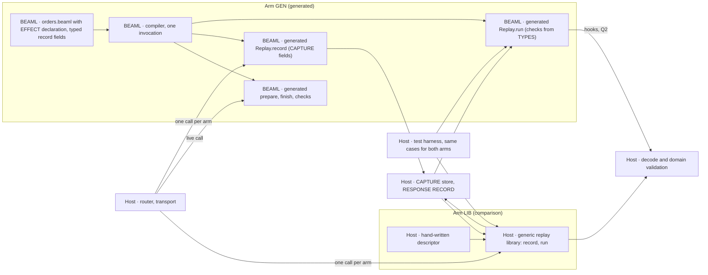

# EXPERIMENT 0004 — Generated REPLAY RUN

**[Proposal]** Can the BEAML compiler generate the REPLAY RUN code for one outbound EFFECT from the BEAML declaration, so that the host writes no replay code? And does the generated code do more than a shared Elixir replay library with a hand-written descriptor?

**[Requirement]** Owner request, 2026-11-06: the compiler generates the REPLAY RUN runner from the declaration, not hand-written host code. Teams must not build and maintain a replay runner for each codebase. The language must supply it.

**[Verified]** [EXPERIMENT 0003](../0003-source-linked-replay/README.md#gate-status) passed with a hand-written runner, [`OrdersApi.Replay.run/3`](../0002-http-correlation/apps/orders_api/lib/orders_api/replay.ex). It hard-codes the operation `payments.authorize`, attempt 1, status 200, the request check against `prepare/1`, the body digest check and six error reasons. It calls the host functions `ProbeSupport.valid_order!/1`, `OrdersApi.PaymentHttp.decode/1` and `ProbeSupport.valid_payment!/2`. [GREEN record](../0003-source-linked-replay/workflow/2026-11-05/replay/notes.md#green)

**[Verified]** The CAPTURE side is also hand-written: `capture/3` in [`payment_http.ex`](../0002-http-correlation/apps/orders_api/lib/orders_api/payment_http.ex) hard-codes `operation`, `attempt`, `version` and the field set. It exists only for replay.

**[Verified]** The current [`orders.beaml`](../0002-http-correlation/apps/orders_api/priv/orders.beaml) declares only `prepare` and `finish`. No source line connects them to the HTTP call. The host [router](../0002-http-correlation/apps/orders_api/lib/orders_api/router.ex) owns the order prepare → `authorize/2` → finish.

**[Verified]** The [0001 compiler](../0001-syntax-to-beam/src/main.rs) parses `interface`, `enum` and `fn` only. It writes one module `BeamlSpike` to stdout, with checked public functions and one `# beaml-declaration-v1 <name> <start> <end>` comment per clause. The 0002 [`run.py`](../0002-http-correlation/run.py) renames the module to `OrdersBeamlSpike` or `PaymentsBeamlSpike`.

**[Inference]** The compiler cannot derive replay code from today's source. Every syntax option must add the link prepare → EFFECT → finish, the operation name and the recorded fields.

**[Inference]** Plan review objection 1 holds: the 0003 runner contains no SCHEMA fact, so a SCHEMA change alone does not separate generated code from a shared library. [Plan review](workflow/2026-11-06/plan-review.md#1-case-e-does-not-separate-the-language-claim-the-0003-hand-written-runner-already-passes-most-of-it)

**[Proposal]** Hypothesis: one added declaration with typed record fields lets the compiler emit the CAPTURE function and the runner. A BEAML-only TYPE or signature change (DRIFT) then needs fewer manual change sites in the generated arm than in a library arm. The generated arm also catches a DRIFT that the library arm misses.



## Fixed inputs and ownership

- **LANGUAGE/COMPILATION.** Use the 0001 compiler and the 0002 BEAML fixtures. Add one EFFECT declaration to `orders.beaml` in the syntax that the owner chooses. Emit the replay code in the same compiler invocation as the Elixir output, on the same stdout. Leave `payments.beaml` output unchanged when it declares no EFFECT.
- **LANGUAGE/COMPILATION.** **[Proposal]** The replay code is a nested module `Replay` inside the generated module, with two functions. `record/3` builds the RESPONSE RECORD from the request, status and bytes. `run/3` (or `/4`, Q2) checks a record and calls `finish`. After the 0002 rename it is `OrdersBeamlSpike.Replay`.
- **LANGUAGE/COMPILATION.** **[Requirement]** Typed record fields (plan review objection 3). Each recorded field names a BEAML TYPE or a field of a TYPE. The compiler checks each one against the declared TYPES of `prepare` and `finish`. A pasted text template cannot pass this check.
- **EXECUTION.** Reuse the two 0002 releases, the ports, the HTTP path and the RESPONSE RECORD format version 1. The host keeps transport, decode and domain validation. CAPTURE fields come from the declaration (GEN) or the descriptor (LIB). The host CAPTURE body becomes one call. The hook contract is owner question Q2.
- **EXECUTION.** Reuse the 0003 replay harness: `bin/orders eval` of the retained Orders release, BEAM call counts, the transport counter, the refused Payments port and the A1 loopback stub. The harness takes an arm parameter (entry function and build).
- **EXECUTION.** **[Proposal]** Each arm is an overlay on a temporary copy of the 0002 tree, applied by `0004/run.py`. The 0002 tree and the 0003 runner stay unchanged as the control.
- **R&D process.** Follow [implement-step](../../skills/implement-step/SKILL.md). Devil's Advocate at the plan, the RED review and the final review. Record them in the gate ledger only.

## Comparison arm LIB

**[Proposal]** A generic Elixir replay library, driven by a hand-written descriptor. This is the "shared helper" baseline of [round 3, objection 4](../../wiki/planning/roasting-rounds.md#4-fixture-replay-can-leave-the-language-claim-untested).

- **Descriptor.** One Elixir map or module per EFFECT: operation, attempt, status, recorded fields (request keys and response keys), decode function, finish function. Budget: about 15 lines.
- **Library.** `ReplayLib.record(descriptor, request, status, bytes)` and `ReplayLib.run(descriptor, order, trace_id, records)`. Same six reasons and check order as 0003. It uses the descriptor fields for CAPTURE and for the response shape check. A generic `rescue` around `finish` is permitted. Budget: about the size of the 0003 runner (48 lines), maximum 60 lines.
- **Fairness.** A fresh worker writes LIB before any compiler change and without access to the GEN emitter. LIB may call the public 0003 generated functions (`prepare`, `finish`). It may not read BEAML source or metadata that 0004 adds to the generated module.
- **Order.** Build LIB and run case (b) and DRIFT on LIB first. This is the plan review's smallest resolving test. If LIB already detects every DRIFT derivative with zero manual change sites, stop before compiler work and apply the reject rule.

## Slice 1: acceptance cases in order

One EFFECT (`payments.authorize`), one function pair (`prepare`, `finish`). Both arms run cases (b) and DRIFT. Case (a) applies to GEN only.

1. **Emit typed replay code (a, GEN).** The compiler reads `orders.beaml` with the EFFECT declaration. One invocation writes the Elixir module and `Replay` with `record` and `run` to stdout. The generated code holds the declared operation, attempt, status and the recorded fields from the TYPES. `payments.beaml` output stays byte-identical. The 0003 gate 1 test `payments_cli_emits_checked_authorize_reference` still passes. Negative cases, each fails compilation with a clear error and no stdout:
   - an unknown function name;
   - a recorded request TYPE that is not the output TYPE of `prepare`;
   - a recorded response TYPE that is not the input TYPE of `finish`;
   - a recorded field that the named TYPE does not have (for example `request.amount` on `Order`);
   - no recorded field.
   Template control: compile a DRIFT variant of `orders.beaml`. The generated `record` and `run` must change in the field set. A text template with fixed literals fails this.
2. **Pass the 0003 replay matrix (b, both arms).** Run the 8 cases of the 0003 replay test against each arm: valid, A1 non-canonical, missing, operation, attempt, request, status, digest. Expected values stay as in 0003. Transport, router, `authorize/2` and `connect/4` count zero in all 8 cases. Live `authorize/2` and the runner call the same decode function. Each arm writes its own valid record on the live path through its `record` function. The GEN overlay deletes `replay.ex`. `router.ex` and `probe_support.ex` keep their SHA-256 in both arms.
3. **DRIFT (both arms, the deciding case).** Change only BEAML TYPES or signatures. Do not touch the LIB descriptor or any host replay code. Regenerate and rebuild both arms. Derivatives:
   - **DRIFT-R.** Add `reference: String` to `Payment` (response) in both BEAML files.
   - **DRIFT-N.** Rename the `Payment` field `status` to `state` in both BEAML files.
   - **DRIFT-Q.** Change the request TYPE that `prepare` returns (for example a new field with a literal value), and the matching Payments input.
   For each derivative and arm, record the outcome at build, on a new live record, and on the pre-change record. Outcome classes: compile error with a clear message, typed reject, correct accept, false reject, wrong accept, untyped runtime crash. Then repair each arm until case (b) passes again. Count manual change sites per arm.
   - **Expected [Inference].** GEN regenerates matching checks or fails at compile time. LIB keeps a stale descriptor. It may false-reject, wrong-accept or crash.

### Replay lines and manual change sites

- **Replay line.** A host line that exists only for replay: CAPTURE, the `record` call, hook wiring, the runner call site, caller-side build or artifact checks, the LIB descriptor and library. Count these lines in both arms (plan review objection 2). Generated lines and compiler lines are not host lines; report compiler size as a one-time cost.
- **Manual change site.** One contiguous edited hunk in a hand-written file that is necessary for an arm to pass case (b) after a DRIFT. Exclude the DRIFT edit in BEAML (equal in both arms). Count domain validation edits (`ProbeSupport.valid_payment!/2` compares an exact two-key map) and test expectation edits separately. They are equal in both arms and not replay sites.

### Pass and reject rule

- **Pass [Proposal].** The language claim holds for slice 1 only if both are true: (1) summed over the DRIFT derivatives, GEN needs fewer manual change sites than LIB; (2) for at least one derivative, GEN gives a compile error, a typed reject or a correct accept, while LIB gives a wrong accept or an untyped runtime crash. GEN has no wrong accept in any derivative.
- **Reject [Proposal].** Reject the language claim for this slice if LIB needs the same number or fewer manual change sites, or if LIB misses no DRIFT that GEN catches, or if GEN gives a wrong accept. Record the reject in the register; do not continue to slice 2 on this claim.
- **No verdict.** If GEN fails case (a) or (b), slice 1 fails as an implementation. It gives no verdict on the claim.
- **[Unknown]** Whether an untyped runtime crash counts as a miss is owner question Q5. The rule above counts it as a miss.

### Reuse of 0003 evidence and tests

| Case | Reuses | New |
| --- | --- | --- |
| 1 (a) | 0003 gate 1 CLI test as regression control | CLI test for `Replay.record` and `Replay.run`; five negative declarations; template control |
| 2 (b) | 0003 `replay_run_test.py`: harness, 8 derivatives, A1 stub, observer, live baseline. The [0003 GREEN run](../0003-source-linked-replay/results/20261106T080316413341Z/result.json) is the baseline of the hand-written runner | Arm parameter (entry and overlay build); LIB library and descriptor; replay line count |
| 3 DRIFT | Harness, A1 stub pattern, 0003 `run.py` (5 steps) per arm build | Three DRIFT derivatives; outcome classes; change-site count |

## Slice 2 (after slice 1 passes)

- **Second EFFECT (old case d).** A second outbound EFFECT with its own operation and TYPES, served from the loopback stub. Zero host replay lines in GEN; count LIB descriptor lines. The harness needs new constants for it (plan review objection 3).
- **Old record after a SCHEMA change (old case e, Q4).** A record from the original build against the new build fails with a typed reason before `finish`. The retained original release still replays the original record.
- **Artifact check (Q3).** Move the check into generated code if Q3 (i) and D002 permit it.

## Syntax options

**[Proposal]** Three options. No option is forced. The owner chooses. All options must now name typed record fields and must let the compiler see a DRIFT. All snippets are also in [syntax-options.beaml](syntax-options.beaml).

### Option A — `effect` block

```beaml
effect authorize_payment {
  operation: "payments.authorize"
  request: prepare
  response: finish
  attempts: 1
  status: 200
  record { request: Order, response: Payment, key: request.order_id }
}
```

- **Commits us to.** A new top-level keyword and block grammar. The host keeps the orchestration. The RESPONSE RECORD fields become a language-level contract (GENERATED ABI).
- **Typed record fields.** Each entry names a TYPE or a field path. The compiler checks `request: Order` against the output of `prepare`, `response: Payment` against the input of `finish`, and `request.order_id` against `Order`.
- **DRIFT.** A TYPE change in `Payment` or `Order` regenerates `record` and `run`. A changed `prepare` output that no longer matches `request: Order` fails at compile time. The block repeats the TYPE names, so a DRIFT can need one BEAML edit in the block. That edit is BEAML, not a host replay site.
- **D001.** Not touched today. A second EFFECT outcome needs a variant TYPE in the block.
- **D002.** The block is in the Orders source, so the SOURCE ID covers it. If the block names host hooks (Q2), the D002 "module-set digest" option is definable.
- **Risk.** Template false pass is now limited by the typed checks and the template control in case (a).

### Option B — `extern fn` and the flow in BEAML

```beaml
extern fn authorize_payment Order -> Payment
  effect "payments.authorize" { attempts: 1, status: 200, record: request, response }

fn place order: Order -> Payment = finish(authorize_payment(prepare(order)))
```

- **Commits us to.** BEAML calls host code. EFFECTS appear in signatures. The orchestration moves from the router into BEAML. The live router changes, so the 0003 live evidence must run again, and `router.ex` loses its SHA-256 check. Largest compiler change.
- **Typed record fields.** The extern signature is the record TYPE: `request` is `Order`, `response` is `Payment`. The existing checker types `place`.
- **DRIFT.** Strongest. Every DRIFT goes through the checked call chain `finish(authorize_payment(prepare(order)))`. A mismatch fails at compile time with the existing TYPE error. The record follows the signature, with no repeated TYPE names.
- **D001.** Direct. The extern return TYPE carries the outcomes, for example `-> AuthorizeOutcome`.
- **D002.** Strongest. The externs list the host functions exactly.

### Option C — attribute on the existing function

```beaml
@effect("payments.authorize", request: prepare, attempts: 1, status: 200, record: { request: Order, response: Payment })
fn finish Payment { order_id, status } -> Payment = Payment { order_id: order_id + "", status: status }
```

- **Commits us to.** An attribute syntax. Smallest grammar change. One attribute per EFFECT.
- **Typed record fields.** The old string form `"request status body"` cannot pass objection 3; the compiler cannot check text. The attribute must take TYPE references. The response TYPE is implicit: the input of the annotated `finish`.
- **DRIFT.** The same checks as A, if the attribute takes TYPE references. A change of the `finish` input TYPE is visible without an attribute edit. A change of `prepare` output needs the attribute TYPE to match.
- **D001.** Not touched. Error reasons stay atoms.
- **D002.** Weakest. Host hooks follow a naming rule, so the module set is not derivable.
- **[Inference]** Risk for objection 4: the attribute is close to a descriptor inside the source. It separates from LIB only through the typed checks, not through the syntax.

## Decisions (Decision4)

| Decision | Class | Choice or question |
| --- | --- | --- |
| Syntax of the EFFECT declaration | Migrate | Q1 |
| Hook contract from runner to host decode and validation | Migrate | Q2 |
| Artifact check in the generated runner (review R1) | Migrate | Q3, slice 2, waits for D002 |
| Old record after a SCHEMA change | Migrate | Q4, slice 2 |
| Runtime crash as a miss in the pass rule | Migrate | Q5 |
| Comparison arm LIB, built first | Repair | Chose a LIB arm before compiler work over a later value gate, because plan review objection 1 shows that no GEN-only case separates the claim. Commits us to equal budgets and a fresh LIB author |
| CAPTURE from the declaration | Repair | Chose a generated `record/3` over a host CAPTURE plus a drift test, because plan review objection 2 counts CAPTURE as replay. Commits us to one changed CAPTURE call in `payment_http.ex` per arm |
| Typed record fields | Repair | Chose TYPE-checked record entries over transport field names, because plan review objection 3 shows a template passes otherwise. Commits us to a resolver for TYPE and field paths |
| Runner location: nested module in the generated output | Repair | Chose nested `Replay` module over a second output file, because 0002 `run.py` reads one stdout and renames one module |
| Arms as overlays on a copy of 0002 | Repair | Chose overlays over edits to the 0002 tree, because both arms and the 0003 control must build from the same base |
| Error reasons as atoms | Repair | The six 0003 atoms for the 8 cases. One new atom `response_type_mismatch` for DRIFT, the same in both arms. Commits us to revisit with D001 |

**[Verified]** No decision is Answer: 0004 publishes nothing and makes no external claim.

### Owner questions

- **Q1. Syntax.** A (`effect` block), B (`extern fn` with flow in BEAML) or C (attribute with TYPE references). All three must carry typed record fields. B gives the strongest DRIFT check at the highest cost. A and C give the same checks with different grammar. See above.
- **Q2. Hook contract.** (i) The declaration names the host functions, for example `decode: OrdersApi.PaymentHttp.decode`. (ii) The runner takes a hooks argument, `run(order, trace_id, records, hooks)`. (iii) A host module implements a generated behaviour. (iv) BEAML owns the decode; the live path calls the generated decode. In all four, hook wiring lines are replay lines and count in both arms. The answer is necessary for slice 1.
- **Q3. Artifact check (R1).** (i) The generated runner rejects a record whose `artifact_id` differs from the loaded module (`artifact_mismatch`). (ii) The caller keeps the check, as in 0003; it counts as replay lines in both arms. Slice 1 uses (ii). The answer is necessary for slice 2. Depends on [D002](../../wiki/planning/decisions-to-be-made.md#d002--scope-of-the-replay-artifact-identity).
- **Q4. Old record after a SCHEMA change (slice 2).** (i) Typed reject from a SCHEMA version in the record. (ii) Typed reject from `artifact_id` (needs Q3 (i)). (iii) No check; the generated `finish` raises.
- **Q5. Crash as a miss.** Does an untyped runtime crash in LIB count as a miss in the pass rule? (i) Yes, only a compile error or a typed reject counts as a catch (plan default). (ii) No, any failure counts as a catch; then only wrong accepts and change sites decide.

## Evidence and limits

**[Unknown]** No run exists. This page is a plan.

**[Inference]** A LIB that records whole values and checks no field list has no stale descriptor fields. It can detect DRIFT-R and DRIFT-N through a generic `rescue` around `finish`. Then DRIFT-Q and the change-site count decide. The plan permits that LIB form; the pass rule can then reject the claim.

**[Inference]** DRIFT-R and DRIFT-N need a domain validation edit in `ProbeSupport.valid_payment!/2` in both arms. It is counted separately, not as a replay site.

**[Unknown]** Limits carried from 0003: the body digest is integrity, not tamper protection (R2). The RESPONSE RECORD has no timestamp (D003). The check order of the six reasons is not tested. Two records for one trace give `missing_response` without a test.

**[Unknown]** One EFFECT and three DRIFT derivatives are a small sample. A pass shows an advantage for this slice only.

### Out of scope

- Retries, attempts > 1, timeouts, uncertain outcomes (round 3, objection 3).
- A REPLAY CAPSULE format, durable storage, trace sampling (D003).
- Zed/LSP support for the new syntax, beyond the discussion file.
- A BAML comparison. [BAML v1](../../wiki/sources/baml-v1.md#observability) has no replay on its default branch at the pin; this is not a test of BAML.
- The operator-time value gate (see below).

### What the value gate still needs

**[Proposal]** Slice 1 covers the change-site part of objection 4's value gate. The operator part is not in 0004. It needs independent operators, one fixed incident artifact, active time to source and to reproduced failure, counterbalanced order, individual times, and a pinned BAML build as a third arm if it fits the workflow.

**[Proposal]** Smallest next test after slice 1: the second EFFECT in both arms (slice 2), with change sites counted the same way.

## Owner decisions (2026-11-06)

- **[Requirement]** BEAML owns the call order. Syntax option B: the flow `place` is written in BEAML. The host router only calls generated code.
- **[Requirement]** BEAML makes the HTTP call itself. No hand-written host transport.
- **[Requirement]** BEAML generates the response decode from the declared type. A response that does not match the type gives a typed error, live and in a REPLAY RUN.
- **[Requirement]** In the comparison, a runtime crash without a typed reason counts as a missed DRIFT.
- **[Requirement]** No kill switch. Start the generated arm directly. Build the library arm in parallel as the comparison.
- **[Requirement]** Long-term direction: applications are written in BEAML. Only a pure interface layer (for example LiveView) stays in Elixir and uses generated event handlers.
- **[Proposal]** Main agent: the generated HTTP code may use a socket or an HTTP library inside. The 0003 live tests run again against the changed router.
- **[Unknown]** Open: the BEAML syntax of the HTTP call itself.
- **[Requirement]** BEAML has a pipe operator `|>`. The flow `place` uses it instead of nested calls.
- **[Requirement]** Formatter rule: consecutive `effect` lines (no blank line between them) align three columns: the input type after the longest name, `->` after the longest input type, `=` after the longest output type. A blank line starts a new block.
- **[Proposal]** `effect` marks every call that leaves the function: HTTP, other apps (also over BEAM messages), database, queue, file, time, randomness. Every `effect` result is recorded; a REPLAY RUN substitutes it. The keyword name is still open.
