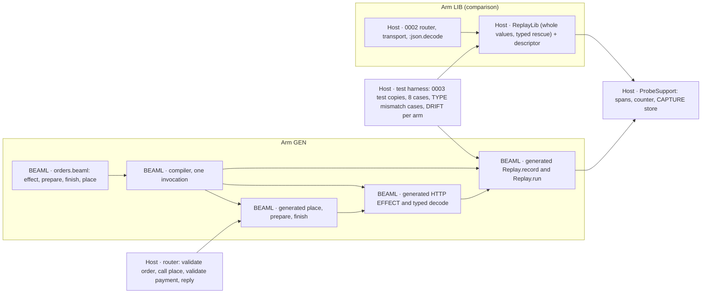

# EXPERIMENT 0004 — Generated REPLAY RUN

**[Requirement]** Can the BEAML compiler generate the flow, the HTTP EFFECT, the decode, the CAPTURE and the REPLAY RUN runner from one BEAML source, so that the host writes no replay code and no transport? Does the generated arm do more than a shared Elixir replay library with a hand-written descriptor? The section [Owner decisions (2026-11-06)](#owner-decisions-2026-11-06) is the authority. It overrides older plan text.

**[Verified]** [EXPERIMENT 0003](../0003-source-linked-replay/README.md#gate-status) passed with a hand-written runner, [`OrdersApi.Replay.run/3`](../0002-http-correlation/apps/orders_api/lib/orders_api/replay.ex), and a hand-written CAPTURE, `capture/3` in [`payment_http.ex`](../0002-http-correlation/apps/orders_api/lib/orders_api/payment_http.ex). The host [router](../0002-http-correlation/apps/orders_api/lib/orders_api/router.ex) owns the order prepare → `authorize/2` → finish. The [0001 compiler](../0001-syntax-to-beam/src/main.rs) parses `interface`, `enum` and `fn` only. Its interfaces are structural and exact.

**[Verified]** The 0003 live tests check the 0002 trace contract in [`query.py`](../0002-http-correlation/query.py): spans `orders.request`, `orders.prepare`, `orders.payment_http`, `orders.finish` and the log `payment_request_prepared`. `ProbeSupport.span/5` sets `outcome: "error"` only when the wrapped function raises.

**[Proposal]** Hypothesis: with the flow, the EFFECT and its failure type in BEAML, a BEAML-only TYPE change (DRIFT) needs fewer manual change sites in the generated arm (GEN) than in the library arm (LIB). GEN also catches a DRIFT that LIB misses.

## Plan history

- **Revision 1.** Generated runner next to a host flow. Plan review: BLOCK (1 critical, 2 high). [plan-review.md](workflow/2026-11-06/plan-review.md)
- **Revision 2.** LIB arm first as a kill switch, typed record fields, DRIFT R/N/Q, pass and reject rule, three syntax options (A, B, C) with owner questions Q1–Q5.
- **Revision 3.** The owner chose option B with `effect`, `!` and `|>`, a generated decode, no kill switch and LIB in parallel. Q1, Q2 and Q5 are answered. Syntax options A and C are closed; [syntax-options.beaml](syntax-options.beaml) stays as history. Use git history for the full revision 2 text. Plan review: BLOCK (1 critical, 2 high).
- **Revision 4.** Repairs the three objections of the revision 3 review: one strongest LIB form, frozen before any GEN result is judged; a complete 0003 change table, checked by a diff test on test copies; asserted TYPE mismatch cases, live and in a REPLAY RUN. [Disposition](workflow/2026-11-06/plan-review.md#disposition-main-agent-2026-11-06-1).
- **Revision 5.** Adds the [slice 1 verdict](#slice-1-verdict-2026-11-06) and the [slice 2 plan](#slice-2). Slice 1 text above stays unchanged. The slice 1 pass and reject rule does not apply to slice 2.
- **Revision 6.** Applies the OWNER answers O1–O4 to [slice 2](#slice-2): a MIGRATE CHAIN replaces the RENAME ALIAS options S1, S2 and S3; the record carries the TYPE version number; the build fails only when a stored TYPE VERSION has no path through the chain; C5 (DRIFT R without a chain) is now a compile error. Only the slice 2 section changes.
- **Revision 7.** Adds the [slice 3 plan](#slice-3): `add` with a constant and `drop` with a TYPE in the MIGRATE CHAIN (DL-042). The slice 1 and slice 2 text stays unchanged.
- **Revision 7.1.** Repairs the slice 3 plan after its fresh check: the `add` constant always wins in a REPLAY RUN (DL-048, D8, new D11b); K checks run before the EFFECT output check, so K2 and K4 are reachable; `drop` takes `String` only (K6, D7, D5c); new help cases D2b and D5b; `unknown_keys == []` stated for D11 and D14. Only the slice 3 section changes.
- **Revision 7.2.** Slice 3 final review repair (DL-054): a REPLAY RUN types the stored body by its own TYPE VERSION before any MIGRATE STEP. Every other key goes to `unknown_keys`. This supersedes the slice 2 rule "the current name wins" (C12) and changes D11b and D11c. New cases D17 and D18. Superseded text stays, struck through.
- **Revision 8.** Adds the [slice 4 plan](#slice-4): the RETIRE LINE for a deleted EFFECT with stored records (DL-055), DEAD LINE warnings and the removal command (DL-056), a chain start above version 1, and OWNER question O6. The slice 1 to slice 3 text stays unchanged.
- **Revision 8.1.** Repairs the slice 4 plan after its fresh check: new cases E1d, E3b, E9c, E11c, E11d, E12c, E15c, E15d and a harness check; a Q4 layout that tests byte preservation (comments, blank line, multi-line block, no final newline, CRLF); the claim holds only with a RECORD SNAPSHOT; the T5 lexer message; the diff and count rules of the removal command. Only the slice 4 section changes.
- **Revision 8.2 (this page).** Hardens the removal command after the slice 4 final review (DL-069, Repair): the completeness rule with the flag `--assume-complete` (contract step 2a), a symlinked or read-only SOURCE (contract step 5), and a unit test for the recheck guard (step 4). New cases E21 to E22b and U1; E18 now passes `--assume-complete`. Only the slice 4 section changes.

## Slice 1 scope

- **In [Requirement].** `effect` declarations with `http.post`. One `!` failure type. Pipe `|>` that passes a failure on, with the compile check against the `!` list. A decode generated from the declared TYPE. A generated `record` (CAPTURE) and a generated REPLAY RUN runner. The flow `place` in BEAML. The router calls only generated code.
- **Later [Requirement] (slice 2+).** `with ... else`, the Elixir `name`/`name!` pair, the formatter alignment rule, other EFFECT kinds (db, queue, mail), a second EFFECT, the old-record policy (Q4), the artifact check in the runner (Q3).



## Slice 1 BEAML source (orders)

**[Proposal]** The fixture `orders.beaml` for GEN. The syntax follows the owner example [order-flow.beaml](examples/order-flow.beaml). `payments.beaml` stays unchanged.

```beaml
interface Order { order_id: String }
interface Payment { order_id: String status: String }
interface PaymentError { reason: String }

// Leaves the module. Recorded live, substituted in a REPLAY RUN.
effect payments.authorize Order -> Payment ! PaymentError = http.post("payments/authorize")

fn prepare Order { order_id } -> Order = Order { order_id: order_id + "" }
fn finish Payment { order_id, status } -> Payment = Payment { order_id: order_id + "", status: status }

// The flow lives in BEAML. A failed step stops the pipe and passes PaymentError on.
fn place order: Order -> Payment ! PaymentError =
  order
  |> prepare
  |> payments.authorize
  |> finish
```

**[Proposal]** Generated Elixir, in the one module that 0002 `run.py` renames to `OrdersBeamlSpike`:

- `prepare/1`, `finish/1` as today. `place/1` returns `{:ok, payment}` or `{:error, %OrdersBeamlSpike.PaymentError{reason: r}}`. The `place!/1` half of the pair is slice 2.
- `payments_authorize/1`: the HTTP EFFECT. POST to `/payments/authorize` on `127.0.0.1` and the port from `ProbeSupport.config(:payments_port)`. Trace context injection, `ProbeSupport.increment/0`, Content-Length framing as in 0002. Then `Replay.record/3` with the actual status (revision 4: the record comes before the status check). Then status 200 only, then the typed decode.
- Typed decode of `Payment`: `:json.decode/1`, then an exact key set with String values. A missing key or a non-String value gives `reason: "decode"`. An extra key is accepted and recorded as `unknown_keys` (owner decision: tolerant with a hint). Transport failure gives `reason: "transport"`, another status gives `reason: "status"`.
- Spans through `ProbeSupport.span/5`: `orders.prepare`, `orders.payments.authorize` (client), `orders.finish`. A failure raises inside the span and becomes `{:error, ...}` outside it, so `outcome: "error"` stays. A failed step stops the pipe: no later step and no later span runs.
- One Orders log, revision 4 [Proposal]: inside the span of the pure step directly before an EFFECT, the generated code calls `ProbeSupport.event("<output TYPE, lower case>_request_prepared", "<step>")`. For `place` this is the existing `payment_request_prepared` under `orders.prepare`. So the 0002 `LOGS` contract and the log counts stay unchanged.
- `Replay.record/3` writes the 0003 RESPONSE RECORD format version 1 to `ProbeSupport.Capture.write/2`. `Replay.run/3` takes `(order, trace_id, records)` and returns only `{:ok, payment}` or `{:error, reason}`; the `unknown_keys` hint goes to the replay EFFECT span and the replay report, not to the return value. It runs `place` with the EFFECT step replaced by the record checks, then the same typed decode and `finish`. It returns `{:ok, payment}`, one of the six 0003 atoms, or `{:error, %PaymentError{}}`.

## Fixed inputs and ownership

- **LANGUAGE/COMPILATION.** The 0001 compiler gets `effect`, `!`, `|>` and the emit above. One invocation, one stdout. `payments.beaml` output stays byte-identical.
- **EXECUTION.** Reuse the two 0002 releases, the ports, the HTTP path, RESPONSE RECORD format version 1 and `ProbeSupport` (unchanged SHA-256). The router keeps `orders.request`, `valid_order!/1`, `valid_payment!/2` and the reply. It calls `OrdersBeamlSpike.place/1` and nothing else of the flow.
- **EXECUTION.** Each arm is an overlay, applied by `0004/run.py` to a temporary tree with the repository layout: `experiments/0001-syntax-to-beam` (current compiler), `experiments/0002-http-correlation` (copy plus overlay) and `experiments/0003-source-linked-replay` (`run.py` and copies of `tests/*.py`). The path constants of the copies (`EXPERIMENT`, `REPO`, `HTTP`, `COMPILER`) then need no edit. The overlay holds the edited copies of `query.py` and the 0003 tests. `0003/run.py` runs unchanged in that tree.
- **EXECUTION, control.** The 0002 tree, `0003/run.py` and the original 0003 tests stay unchanged in the repository. They run at their default root as the control. An arm run does not change their SHA-256 values.
- **R&D process.** Follow [implement-step](../../skills/implement-step/SKILL.md). Devil's Advocate at the plan, the RED review and the final review, in the gate ledger only.

## Comparison arm LIB

**[Requirement]** No kill switch. LIB is built in parallel with GEN, as the comparison.

**[Proposal] Revision 4: LIB is the strongest fair library.** The plan fixes its form. The LIB worker does not choose a weaker form.

- **Descriptor.** One Elixir map per EFFECT: operation, attempt, expected status, request function (`&OrdersBeamlSpike.prepare/1`), decode function, finish function. No request or response key list, no field name, no other TYPE fact. Budget: about 10 lines.
- **Whole values.** `ReplayLib.record(descriptor, request, status, bytes)` records the whole request value and the whole body bytes. `run` compares the whole recorded request with the request function result (`request_mismatch`), as 0003 does.
- **Typed rescue (mandatory).** `ReplayLib.run(descriptor, order, trace_id, records)` wraps decode and finish in one `rescue`. It returns `{:error, %ReplayLib.Error{step: "decode" | "finish", reason: <exception module name>}}`, never a raise. The six 0003 atoms and their check order stay. Budget: maximum 60 lines.
- **Live path.** The 0002 router, transport and `payment_request_prepared` log stay. The CAPTURE body in `payment_http.ex` becomes one `ReplayLib.record` call. `replay.ex` is deleted.
- **Fairness.** A fresh worker writes LIB without access to the GEN emitter, the 0004 BEAML fixture or any GEN result. LIB may call the public generated `prepare` and `finish`. It may not read BEAML source or metadata that 0004 adds to the generated module.
- **Freeze.** LIB passes (e) before any GEN result of (d2) or (f) is judged. `0004/run.py` records the SHA-256 of `replay_lib.ex` and the descriptor. DRIFT (f) runs only against that frozen LIB. A repair of LIB after the freeze counts as manual change sites.
- **No weak form.** The plan builds no LIB with a key list or without the `rescue`. The pass and reject rule uses only this LIB.
- **[Inference]** This LIB has no stale descriptor. It probably gives a typed reject for an old record after DRIFT-R and DRIFT-N, and `request_mismatch` after DRIFT-Q. Then the reject rule may apply. That is a valid result of slice 1.

## Slice 1: acceptance cases in order

1. **(a) Parse and check.** The compiler accepts the slice 1 source above, exit 0. Each bad declaration fails with exit ≠ 0, a clear message and no stdout:
   - unknown fn in a pipe (`|> charge`);
   - TYPE mismatch in a pipe (`|> finish` directly after `|> prepare`: `Order` is not `Payment`);
   - undeclared failure in a pipe (`place` without `! PaymentError`); the message names the step `payments.authorize` and the type `PaymentError`;
   - field not in TYPE (`finish` reads `amount`, which `Payment` does not have);
   - unsupported EFFECT kind (`db.get`) in slice 1.
2. **(b) Emit.** One compiler run writes the Elixir module with `place/1`, `payments_authorize/1`, the typed decode, `Replay.record/3` and `Replay.run/3`, the `PaymentError` struct and one `beaml-declaration-v1` comment per declaration. The module compiles with warnings as errors. Template control: compile DRIFT-R; the generated decode must contain `reference`. The 0003 gate 1 test `payments_cli_emits_checked_authorize_reference` still passes.
3. **(c) Live.** The GEN router calls only `OrdersBeamlSpike.place/1`. `payment_http.ex` and `replay.ex` are deleted. `0003/run.py` passes in the GEN tree, all five default steps (compiler reference, trace lookup, trace lookup repair, response capture, replay run). The test `tests/overlay_diff_test.py` passes first: per arm, the line diff of each copy against its original equals `arms/<arm>/assertion-changes.json`, which equals the table below. No other line changes.
4. **(d) Replay.** The 0003 8-case matrix passes against `OrdersBeamlSpike.Replay.run/3`: valid, A1 non-canonical, missing, operation, attempt, request, status, digest. Expected values stay as in 0003. Router, transport and `:gen_tcp.connect/4` count zero in all 8 cases. Live and replay use the same generated decode.
5. **(d2) TYPE mismatch, live and in a REPLAY RUN [Requirement].** In `tests/arms_test.py`, not in the 0003 copies. Replay cases use the 0003 harness with the arm's runner. Live cases use one Orders release against the 0003 loopback stub (`http.server`, Content-Length framing). Cases R1, R2, L1, L2, P1 below.
6. **(e) LIB.** The LIB form above passes the same 8 cases with the same counts, in the LIB tree, with the LIB rows of the table only. Before the freeze, LIB R1 must return `%ReplayLib.Error{step, reason}` with step "decode" or "finish" (asserted). It then runs R2, L1, L2, L3; those outcomes are recorded, not asserted. Then the freeze.
7. **(f) DRIFT.** Starts after the freeze. Per arm, change only BEAML TYPES or signatures; do not touch the LIB descriptor or host replay code. Regenerate and rebuild. Derivatives:
   - **DRIFT-R.** Add `reference: String` to `Payment` in both BEAML files.
   - **DRIFT-N.** Rename the `Payment` field `status` to `state` in both BEAML files.
   - **DRIFT-Q.** Add a field with a literal value to the request TYPE that `prepare` returns, and the matching Payments input.
   For each derivative and arm, record the outcome at build, on a new live record and on the pre-change record. Outcome classes: compile error with a clear message, typed reject, correct accept, false reject, wrong accept, crash without a typed reason. Then repair each arm until (d) or (e) passes again. Count manual change sites per arm.

### Case (d2): TYPE mismatch cases

**[Proposal]** Each case asserts the result, the counts and, live, the spans and records. "finish 0" is the runtime half of the pipe rule: a failed step stops the pipe.

- **R1 Replay, missing key.** Record of the first live call with body `{"order_id":"order-1"}`, `body_length` and `body_sha256` recomputed, status 200. Expect `{:error, %OrdersBeamlSpike.PaymentError{reason: "decode"}}`, `:json.decode/1` 1, `finish/1` 0, `valid_payment!/2` 0, transport 0.
- **R2 Replay, extra key.** The RESPONSE RECORD from L1. Expect the same success as L1 and the same `unknown_keys` hint. Live and replay use the same decode.
- **R3 Replay, wrong field TYPE.** A declared field with the wrong TYPE (`status: 7`). Expect `PaymentError` with reason "decode" and zero `finish` calls.
- **L3 Live, missing key.** The stub returns 200 with a body without `status`. Expect HTTP 502 `downstream_failure`, span `orders.payments.authorize` with `outcome: "error"` and `reason: "decode"`, one RESPONSE RECORD byte-exact, zero `orders.finish`, transport count 1.
- **L1 Live, extra key [Requirement: accept with hint].** The stub returns 200 with an extra key `fraud_score`. Expect HTTP 200, one `orders.finish`, one RESPONSE RECORD with the bytes byte-exact and `unknown_keys == ["fraud_score"]`, and the same attribute on the `orders.payments.authorize` span.
- **L2 Live, status 503.** The stub returns 503 with a valid `Payment` body. Expect HTTP 502, client span `outcome: "error"`, one RESPONSE RECORD with status 503, no `orders.finish` span, transport count 1.
- **P1 Pipe stop.** In an eval VM (0003 harness), `OrdersBeamlSpike.place/1` with a refused port. Expect `{:error, %OrdersBeamlSpike.PaymentError{reason: "transport"}}`, `prepare/1` 1, `finish/1` 0.

**[Unknown]** A recorded live 503 replays as the 0003 `status_mismatch` atom, not as `PaymentError{reason: "status"}`. The 0003 matrix keeps this. Slice 2 can revisit it with D001.

### 0003 lines that change in the arm copies

**[Proposal]** Each GEN change follows from "the router calls only generated code". The copies live in the overlay; the originals stay the control. `overlay_diff_test.py` compares each copy line by line with its original and requires the result to equal this table. Line numbers refer to the original files at the plan commit.

| Arm | File | Line | Original | Copy | Reason |
| --- | --- | --- | --- | --- | --- |
| GEN | 0002 `query.py` | 12 | `CONTRACT` key `orders.payment_http` | `orders.payments.authorize` | Generated span name `<service>.<step>` |
| GEN | 0002 `query.py` | 13 | parent of `payments.request`: `orders.payment_http` | `orders.payments.authorize` | Same rename |
| GEN | 0003 `response_capture_test.py` | 175 | client span filter `orders.payment_http` | `orders.payments.authorize` | Same rename |
| GEN | 0003 `response_capture_test.py` | 213 | observer control span `orders.payment_http` (twice) | `orders.payments.authorize` | Same rename; `outcome: "error"` stays |
| GEN | 0003 `replay_run_test.py` | 32 | `WATCHED` key `OrdersApi.PaymentHttp.authorize/2` | `OrdersBeamlSpike.payments_authorize/1` | The transport is generated |
| GEN | 0003 `replay_run_test.py` | 48 | `HARNESS` watched `{OrdersApi.PaymentHttp, :authorize, 2}` | `{OrdersBeamlSpike, :payments_authorize, 1}` | Same |
| GEN | 0003 `replay_run_test.py` | 56 | `HARNESS` control `OrdersApi.PaymentHttp.authorize(prepare(order), [])` | `OrdersBeamlSpike.payments_authorize(prepare(order))` | Same |
| GEN | 0003 `replay_run_test.py` | 57 | `HARNESS` replay `OrdersApi.Replay.run(order, trace_id, responses)` | `with {:ok, p} <- OrdersBeamlSpike.Replay.run(ProbeSupport.valid_order!(order), ...), do: {:ok, ProbeSupport.valid_payment!(p, order)}` | Domain validation stays host code, as in the router |
| GEN | 0003 `replay_run_test.py` | 292 | control result `{"raised": "MatchError"}` | `{"error": "%OrdersBeamlSpike.PaymentError{reason: \"transport\"}"}` | The EFFECT returns a typed failure; counts stay |
| GEN | 0003 `replay_run_test.py` | 293 | control key `OrdersApi.PaymentHttp.authorize/2` | `OrdersBeamlSpike.payments_authorize/1` | Same as line 32 |
| GEN | 0003 `replay_run_test.py` | 301 | `isolated` key `OrdersApi.PaymentHttp.authorize/2` | `OrdersBeamlSpike.payments_authorize/1` | Same as line 32 |
| GEN | 0003 `replay_run_test.py` | 141 | compiler call `"--", archived]` | `"--", archived, "--stored", <copy dir>/stored-empty.jsonl]` | Slice 2 (C10): a source with an `effect` needs a RECORD SNAPSHOT; the copy passes the empty one |
| GEN | 0003 `response_capture_test.py` | 92 | compiler call `"--", archived]` | `"--", archived, "--stored", <copy dir>/stored-empty.jsonl]` | Same as `replay_run_test.py` line 141 |
| GEN | 0003 `trace_lookup_test.py` | 51 | compiler call `"--", source]` | `"--", source, "--stored", <copy dir>/stored-empty.jsonl]` | Same as `replay_run_test.py` line 141 |
| LIB | 0003 `replay_run_test.py` | 57 | `HARNESS` replay `OrdersApi.Replay.run(order, trace_id, responses)` | `with {:ok, p} <- ReplayLib.run(OrdersApi.ReplayDescriptor.authorize(), ProbeSupport.valid_order!(order), ...), do: {:ok, ProbeSupport.valid_payment!(p, order)}` | `replay.ex` is deleted; same host validation as GEN |

**[Proposal]** Unchanged in both arms, because the Orders log stays (line text **[Verified]** at the plan commit): `query.py` line 17 (`LOGS`), `trace_lookup_test.py` line 175 (`len(checked["logs"]) == 2 * call`) and line 184 (`"logs": 4`). `trace_lookup_repair_test.py` and `run_test.py` have no changed line. The comment lines 38–39 of `replay_run_test.py` stay as history.

**[Inference]** If GEN cannot emit the log, lines 17, 175 and 184 change. That is a table change: it needs a new plan revision, and the verdict records "no Orders log" as a lost check.

All counts in the 8-case matrix stay as in 0003. The revision 2 SHA-256 check of `router.ex` is removed: the router changes by owner decision.

### Replay lines and manual change sites

- **Replay line.** A host line that exists only for replay: CAPTURE, the `record` call, hook wiring, the runner call site, caller-side validation or artifact checks, the LIB descriptor and library. Count them in both arms. Generated and compiler lines are not host lines; report compiler size as a one-time cost.
- **Manual change site.** One contiguous edited hunk in a hand-written file that an arm needs to pass (d) or (e) after a DRIFT. Exclude the BEAML DRIFT edit. Count domain validation edits (`valid_payment!/2`) and test expectation edits apart; they are equal in both arms.

### Pass and reject rule

- **Comparison arm [Proposal].** Judge every clause below only against the frozen LIB of [Comparison arm LIB](#comparison-arm-lib). No other LIB form enters the verdict.
- **Pass [Proposal].** The language claim holds for slice 1 only if both are true: (1) summed over the DRIFT derivatives, GEN needs fewer manual change sites than LIB; (2) for at least one derivative, GEN gives a compile error, a typed reject or a correct accept, while LIB gives a wrong accept or a crash without a typed reason. GEN has no wrong accept in any derivative.
- **Reject [Proposal].** Reject the claim for this slice if LIB needs the same number or fewer manual change sites, if LIB misses no DRIFT that GEN catches, or if GEN gives a wrong accept. Record the reject in the register.
- **Miss [Requirement].** A crash without a typed reason counts as a missed DRIFT (owner decision).
- **No verdict.** If GEN fails (a)–(d2), or LIB fails (e) or is not frozen before (f), slice 1 fails as an implementation and gives no verdict on the claim.

## Decisions (Decision4)

| Decision | Class | Choice and reason |
| --- | --- | --- |
| Failure TYPE as an interface `PaymentError { reason: String }` with the values `transport`, `status`, `decode` | Repair | The smallest typed struct with a named field. No enum payload rules needed. Q6 can replace it |
| `place/1` returns `{:ok, v}` or `{:error, struct}` only | Repair | It is the `name/n` half of the owner pair; `name!/n` is slice 2 and adds, not changes |
| Generated span names `<service>.<step>` | Repair | Derived, not a literal from 0002. Commits us to the listed assertion changes |
| Keep `payment_request_prepared`: emit `<output TYPE>_request_prepared` in the span of the pure step before an EFFECT (revision 4) | Undo | A local emit rule with no new syntax. Keeps the 0002 `LOGS` contract and the log counts. A BEAML log statement can replace it later |
| Generated code calls `ProbeSupport` for spans, counter, config and CAPTURE store | Repair | The existing 0002 adapter, unchanged. A language runtime contract replaces it later |
| Target from `<namespace>_port` config, host `127.0.0.1` | Repair | Matches 0002 configuration. Real addressing waits for Q7 |
| Transport with `:gen_tcp` and 0002 framing | Repair | Keeps the `:gen_tcp.connect/4` and transport counters of the 0003 observer |
| Host keeps `valid_order!/1` and `valid_payment!/2`; harness calls them around `Replay.run/3` | Repair | Domain validation is host code; keeps the 0003 counts |
| Replay evidence errors stay the six 0003 atoms; flow failures are `PaymentError` | Repair | Keeps the 0003 matrix unchanged. Revisit with D001 |
| Copies of the 0003 tests and `query.py` in the overlay, in a temporary tree with the repository layout; diff checked against the table (revision 4) | Undo | Originals stay the control; no arm switch in the 0003 files; no path edits in the copies |
| Typed decode accepts an extra key and records it as a hint (owner decision, replaces revision 4 reject) | Requirement | Matches the exact 0001 interfaces and the generated `finish` pattern. Relaxing it later is one emit change |
| `Replay.record/3` before the status check; the record holds the actual status (revision 4) | Repair | Case L2 needs one record for a 503. The 0003 matrix still expects status 200 in a valid record |
| LIB form fixed: no key list, mandatory typed `rescue`, frozen before (d2) and (f) are judged; no weak LIB (revision 4) | Repair | The verdict must not depend on a free choice of the LIB worker |
| LIB error shape `%ReplayLib.Error{step, reason}` (revision 4) | Undo | Local to the LIB arm; any typed shape counts |
| Elixir name `payments_authorize/1`, nested `Replay` and `PaymentError` modules | Undo | Local naming inside one generated module |
| Reject non-`http` EFFECT kinds at compile time in slice 1 | Undo | Keeps the slice boundary visible; slice 2 removes the reject |
| LIB worker runs in parallel with GEN, in its own directory; tests serialized | Undo | Owner decision overrides the one-writer rule; no shared build output |
| `http.post("payments/authorize")` as the slice 1 call form | Migrate | Taken from the owner example; source files depend on it. Q7 confirms |

**[Verified]** No decision is Answer: 0004 publishes nothing and makes no external claim.

### Owner questions

- **Q1, Q2, Q5.** Answered by the owner decisions: option B with `effect` and `|>`; BEAML owns the decode; a crash without a typed reason is a miss.
- **Q3. Artifact check (slice 2).** (i) The generated runner rejects a record with another `artifact_id` (`artifact_mismatch`). (ii) The caller keeps the check; it counts as replay lines. Slice 1 uses (ii). Depends on [D002](../../wiki/planning/decisions-to-be-made.md#d002--scope-of-the-replay-artifact-identity).
- **Q4. Old record after a SCHEMA change (slice 2).** (i) Typed reject from a SCHEMA version in the record. (ii) Typed reject from `artifact_id` (needs Q3 (i)). (iii) The generated decode rejects it with `PaymentError` (slice 1 behavior).
- **Q6. Shape of an EFFECT failure TYPE (Migrate, before slice 2).** (i) User-declared interface with `reason: String` (slice 1 default). (ii) User-declared `enum` with fixed variant names per EFFECT kind, for example `Transport`, `Status`, `Decode`. (iii) A built-in `HttpError` TYPE that the user names after `!`.
- **Q7. HTTP call form and target (Migrate, before slice 2).** (i) `http.post("payments/authorize")` with the target from configuration by namespace (slice 1 default). (ii) A named target declaration in BEAML, for example `target payments = env("PAYMENTS_URL")`. (iii) Another form from the owner.

## Evidence and limits

**[Unknown]** No run exists. This page is a plan.

**[Inference]** DRIFT-R and DRIFT-N need a `valid_payment!/2` edit in both arms. It counts apart, not as a replay site.

**[Unknown]** Limits carried from 0003: the body digest is integrity, not tamper protection (R2). The RESPONSE RECORD has no timestamp (D003). The check order of the six reasons is not tested. Two records for one trace give `missing_response` without a test.

**[Unknown]** One EFFECT and three DRIFT derivatives are a small sample. A pass shows an advantage for this slice only.

**[Inference]** An extra key is accepted with a hint, so a Payments service may add a field without breaking Orders. The hint makes such a change visible to observation.

**[Unknown]** Revision 4: the generated client span and `Replay.record/3` in an eval VM without the OpenTelemetry application (case P1 and the observer control) are not tested yet. RED shows whether the harness needs a change; such a change is a table change.

### Out of scope

- Everything in "Later" above.
- Retries, attempts > 1, timeouts, uncertain outcomes (round 3, objection 3).
- A REPLAY CAPSULE format, durable storage, trace sampling (D003).
- Zed/LSP support for the new syntax.
- A BAML comparison and the operator-time value gate. [BAML v1](../../wiki/sources/baml-v1.md#observability) has no replay on its default branch at the pin.

**[Proposal]** Smallest next test after slice 1: a second EFFECT in both arms, with change sites counted the same way.

## Owner decisions (2026-11-06)

- **[Requirement]** BEAML owns the call order. Syntax option B: the flow `place` is written in BEAML. The host router only calls generated code.
- **[Requirement]** BEAML makes the HTTP call itself. No hand-written host transport.
- **[Requirement]** BEAML generates the response decode from the declared type. A response that does not match the type gives a typed error, live and in a REPLAY RUN.
- **[Requirement]** In the comparison, a runtime crash without a typed reason counts as a missed DRIFT.
- **[Requirement]** No kill switch. Start the generated arm directly. Build the library arm in parallel as the comparison.
- **[Requirement]** Long-term direction: applications are written in BEAML. Only a pure interface layer (for example LiveView) stays in Elixir and uses generated event handlers.
- **[Proposal]** Main agent: the generated HTTP code may use a socket or an HTTP library inside. The 0003 live tests run again against the changed router.
- **[Unknown]** Open: the BEAML syntax of the HTTP call itself.
- **[Requirement]** BEAML has a pipe operator `|>`. The flow `place` uses it instead of nested calls.
- **[Requirement]** Formatter rule: consecutive `effect` lines (no blank line between them) align three columns: the input type after the longest name, `->` after the longest input type, `=` after the longest output type. A blank line starts a new block.
- **[Proposal]** `effect` marks every call that leaves the function: HTTP, other apps (also over BEAM messages), database, queue, file, time, randomness. Every `effect` result is recorded; a REPLAY RUN substitutes it. The keyword name is still open.
- **[Requirement]** BEAML allows `with ... do ... else ... end`. `<-` binds the success value of a step that can fail; `=` binds a pure step.
- **[Requirement]** An `effect` or `fn` declares its failure type with `!` after the success type, for example `String -> Order ! LoadError`. `<-` binds only the success type. A failure goes to `else`.
- **[Requirement]** The compiler collects the failure types of all `<-` steps. The `else` branch must cover each of them, or compilation fails.
- **[Requirement]** A function may pass failures on with `!` in its own signature, for example `-> Payment ! LoadError | StockError | PaymentError`.
- **[Requirement]** A pipe step may fail. The pipe stops and passes the failure on. The compiler rejects a pipe step whose failure type is not in the `!` list of the enclosing function, with a message that names the step and the missing type.
- **[Requirement]** `!` in a type stays, although Elixir uses `!` in names for "raises". The owner accepts this.
- **[Requirement]** For each BEAML function that can fail, the Elixir output has two functions: `name/n` returns `{:ok, value}` or `{:error, error}`; `name!/n` returns the value or raises an exception generated from the failure type.
- **[Requirement]** Generated Elixir errors are typed structs with named fields, for example `%Orders.LoadError.NotFound{id: "order-1"}`. Not plain tuples.
- **[Requirement]** Generated decode is tolerant with a hint, as in BAML v1 (`ExtraKey` flag in `coerce_class.rs` at pin `989676dd`). An unknown key is accepted when every declared field is present with its TYPE. Each unknown key name is recorded in the response record and on the EFFECT span. A missing or wrong declared field stays a typed error. This replaces the earlier strict default (same day). A strict `exact interface` form may come later.

## Slice 1 verdict (2026-11-06)

**[Verified]** Final review of slice 1: the implementation passes with notes. The claim is REJECTED under the [slice 1 pass and reject rule](#pass-and-reject-rule). Evidence: the GREEN-2 DRIFT table in [notes.md](workflow/2026-11-06/notes.md#green-2).

- Manual change sites: GEN 0, LIB 0. The rule needs GEN < LIB.
- The build passed in all 6 DRIFT rows (R, N, Q per arm). No compile error caught a DRIFT.
- The only arm difference is DRIFT-Q `new_live`: GEN gives a typed reject, LIB an untyped crash. The cause is the old 0002 transport that LIB keeps (`payment_http.ex:31` matches status 200). The cause is not the TYPE.
- Note 1: the host check raise is labelled typed in rows R and N (`run.py:410-411`).
- Note 2: the LIB freeze was committed only after the runs. The timestamps show a consistent order.

**[Requirement]** OWNER statement: the slice 1 rule measured the wrong thing. The goal is [vertical integration](../../wiki/concepts/vertical-integration.md): the compiler knows the TYPE of stored records, so a breaking TYPE change fails at compile time.

**[Inference]** Why the slice 1 rule is superseded for slice 2. A LIB with no TYPE facts needs no edit after a field change, so a count of manual change sites cannot favor GEN. The count also cannot show a failed build, because no arm had TYPE facts about stored records. Slice 2 therefore uses an absolute rule against stored TYPE VERSIONS. LIB stays as a control.

## Slice 2

### Question and claim

**[Requirement]** Can the compiler refuse a rename of a response field (DRIFT N, `status` → `state`) without a `rename` step in its MIGRATE CHAIN, because stored RESPONSE RECORDS hold the old TYPE VERSION? With the `rename` step, the source compiles and the old RESPONSE RECORDS replay as `correct_accept` through the generated decode.

### How the compiler learns the stored TYPE VERSIONS

**[Verified]** Slice 1 facts in the [0001 compiler](../0001-syntax-to-beam/src/main.rs): the generated `Replay.record/3` writes RESPONSE RECORD format version 1 to `ProbeSupport.Capture.write("responses", …)`, which appends to `<output>/responses.jsonl`. The record holds `artifact_id` (the BEAM hash of the build), not a TYPE fact. The compiler CLI takes exactly one argument, the source path.

**[Verified]** The 0003 test `response_capture_test.py` compares a fixed subset of record keys. Slice 1 added `unknown_keys` and kept format version 1.

**Common part of both options [Proposal], revision 6.** The generated `record/3` writes one more key, `type`: `{"name": "Payment", "version": 1, "fields": [["order_id", "String"], ["status", "String"]], "fingerprint": "<64 hex>"}`. This is the TYPE VERSION of the EFFECT output TYPE at the time of the write. `version` is the newest version number of the MIGRATE CHAIN of the build (1 without a chain). `fields` is sorted by field name. The fingerprint is the lower-case hex SHA-256 of the compact JSON text of `fields`, for example `[["order_id","String"],["status","String"]]` (no spaces, sorted by field name). The TYPE name is not part of the fingerprint. The format version stays 1, as with `unknown_keys`. The record names the full field list, so the compiler can name the old field in its message.

**Option A, RECORD SNAPSHOT input [Proposal].** The compiler takes a second input, `--stored PATH`, a RECORD SNAPSHOT (a copy of `responses.jsonl`). It reads the distinct `type` values per `operation`. It reads no body bytes.

- For: the compiler checks against observed stored data. The case "no stored records" is an empty file.
- For: one source of truth. Nothing can claim a TYPE VERSION that no record holds.
- Against: the build reads environment data. A build is reproducible only with the same RECORD SNAPSHOT (`run.py` records its SHA-256).
- Against: a large store needs an index or an export later.

**Option B, TYPE lock file [Proposal].** A file `orders.types.lock` next to the source lists the known TYPE VERSIONS per TYPE. A separate step writes it from the store. The compiler reads only the lock file.

- For: a reviewable file in git. The build reads no environment data.
- Against: a second source that can go stale or lie. The lock can list a TYPE VERSION that no record holds, or miss one that a record holds.
- Against: the case "no stored records" needs a count per TYPE VERSION in the lock.

**[Proposal] Recommendation for slice 2: Option A.** The claim is "the compiler knows the stored records". Option A reads them directly; Option B adds a claim between the store and the compiler. Rejected alternative: infer the stored TYPE from body keys. That mixes a Payments change (an extra key) with a TYPE VERSION of Orders.

**[Proposal]** A source with an `effect` and no `--stored` input fails with `stored TYPE VERSIONS unknown`. An unknown store is not an empty store. A source without an `effect` (`payments.beaml`) needs no input; its output stays byte-identical.

**Migrate [OWNER].** The production source of truth for stored TYPE VERSIONS (RECORD SNAPSHOT, lock file, or a live query of the deployed nodes). It fixes the record format and the deploy workflow of every later environment. Slice 2 uses a fixture file and does not decide it.

### MIGRATE CHAIN syntax (OWNER answer O1, revision 6)

**[Requirement]** OWNER answer O1. The `interface` is always the newest TYPE VERSION. The TYPE history is a MIGRATE CHAIN in the same source. Each step names the TYPE, two explicit version numbers and its changes. Slice 2 implements the step `rename` only. The DRIFT N source of `orders.beaml` with its chain:

```beaml
interface Payment { order_id: String state: String }
migrate Payment 1 -> 2 { rename status -> state }
```

- The newest version number is the target of the last `migrate` step of the TYPE. Without a chain it is 1.
- The compiler derives each old TYPE VERSION backwards from the newest one. Here: version 2 is `Payment { order_id: String state: String }`; version 1 is `Payment { order_id: String status: String }`.
- The RENAME ALIAS of the plan is now the `rename` step. The options S1, S2 and S3 are closed. The S3 sketch `Payment@1` is not used.
- `payments.beaml` stores no records and needs no chain.

### Check rule and generated decode

**[Requirement] Path check (OWNER answer 2).** For each `operation` in the RECORD SNAPSHOT, take its EFFECT output TYPE. For each stored TYPE VERSION (name, `version`, fingerprint) of that TYPE: it must equal the derived version with the same number. Equal means the same fingerprint, computed by the compiler from the derived field list. Then the chain gives a path from it to the newest version. A stored TYPE VERSION without such a path is a compile error. The build fails only for this reason; an empty RECORD SNAPSHOT gives no error.

**[Proposal]** The compiler reads the field list from the record only for its message. It compares fingerprints.

**[Requirement] Rename step check (OWNER answer O3).** A `rename old -> new` step whose old field is in no stored TYPE VERSION and in no derived version is a compile error. **[Inference]** With the backwards derivation, the old field is always in the derived version before the step. In slice 2 the observable case is C4: a wrong old name (`statuz`) gives a derived version 1 that no stored record has, so the path check fails and names `statuz`.

**[Verified] Decode (revised after the final review).** The generated decode goes by TYPE VERSION. A REPLAY RUN of a record of version n applies the `rename` steps n → newest in order. A live body is the newest version and gets no rename. The record body and its digest stay unchanged. The first form (fall back to an old name when the current name is missing) decoded wrong when a chain reuses a field name; see notes.md, "Slice 2 final review repair".

**[Proposal] Compile error text** (case C1). Exit ≠ 0, no stdout:

```text
error: TYPE Payment cannot read 1 stored RESPONSE RECORD of operation payments.authorize
  stored TYPE VERSION: Payment 1 { order_id: String status: String } (fingerprint <first 12 hex>)
  newest TYPE VERSION: Payment 1 { order_id: String state: String }
  record source: <the --stored path>
  no path from the stored TYPE VERSION to the newest TYPE VERSION
  field status: String is in the stored TYPE VERSION, not in the newest TYPE VERSION
  field state: String is in the newest TYPE VERSION, not in the stored TYPE VERSION
  help: if state is status renamed, declare: migrate Payment 1 -> 2 { rename status -> state }
```

The tests assert these tokens, not the full text: `Payment`, the old field, the new field, the `--stored` path, and the `help` form `migrate Payment <stored> -> <next> { rename <old> -> <new> }`. `<stored>` is the version number of the stored record. `<next>` is the newest version number plus 1. Compiler action events do not record the path (AGENTS rule).

**[Proposal] CLI form.** `beaml-spike SOURCE.beaml --stored SNAPSHOT.jsonl`. The `--stored` input comes after the source path.

### Cases with expected outcomes

**[Proposal]** `run.py` builds the slice 2 GEN tree with the `type` key, runs one live call per order, and retains the result as the RECORD SNAPSHOT fixture `v1` (TYPE VERSION `Payment 1 { order_id status }`). DRIFT edits follow slice 1 (both BEAML files). The domain edit of `valid_payment!/2` counts apart, as in slice 1.

**[Proposal] Revision 6, RED fixtures.** Until GREEN writes the `type` key, RED uses hand-built fixtures in `stored/`: `v1.jsonl` (one slice 1 L0 record plus the `type` key of `Payment 1 { order_id status }`), `v1-v2.jsonl` (C3: the `v1` record and one record of `Payment 2 { order_id state }`) and `empty.jsonl`. The case sources are in `slice2/<derivative>/orders.beaml` (the file stem is the service name). The compile tests also build each case from a template with other TYPE and field names, so that no fixture name in the compiler can pass them.

| ID | Source | RECORD SNAPSHOT | Build | Old record (REPLAY RUN) | New live call |
| --- | --- | --- | --- | --- | --- |
| C1 | N, no chain | `v1` | compile error, text above | not run | not run |
| C2 | N, `migrate Payment 1 -> 2 { rename status -> state }` | `v1` | exit 0 | `correct_accept`: `{:ok, %{order_id, state: <stored status value>}}`, decode 1, `finish/1` 1, transport 0 | `correct_accept`; the new record holds `Payment 2 { order_id state }` with its fingerprint |
| C3 | C2 source | `v1` plus a version 2 record (two TYPE VERSIONS) | exit 0 | both versions `correct_accept` | not run |
| C4 | N, `migrate Payment 1 -> 2 { rename statuz -> state }` | `v1` | compile error (no path) that names `Payment`, `statuz`, `status` and the `--stored` path | not run | not run |
| C5 | R (add `reference`), no chain | `v1` | compile error (no path) that names `Payment`, `reference` and the `--stored` path | not run | not run |
| C6 | N, no chain | empty file | exit 0 | none stored | `correct_accept` |
| C7 | slice 1 source (revision 6: `v1` has a path, so the missing key is the only fault) | `v1` plus one record without the `type` key (slice 1 format), at line 2 | compile error `stored RESPONSE RECORD has no TYPE VERSION`, names the `--stored` path and the line number | not run | not run |
| C8 | slice 1 source | no `--stored` input | compile error `stored TYPE VERSIONS unknown` | not run | not run |
| C9 | C6 build (empty snapshot, no chain) | `v1` record replayed against it (stale snapshot) | exit 0 | `typed_reject`: `PaymentError{reason: "decode"}`, `finish/1` 0, no crash | not run |
| C10 | slice 1 source (no chain, newest version 1) | `v1` for the build; empty file for the slice 1 tests (list below) | exit 0 | slice 1 (a)–(d2) pass again; `payments.beaml` output byte-identical; 0003 record key subset passes | as slice 1 |
| C11 | C2 build | `v1` | exit 0 | hand-built old record, body `{"order_id":"order-1","status":"<status value>","fraud_score":"0.9"}`, `type` key of `v1`, digest recomputed: `correct_accept` with `state: <status value>`, not `"0.9"`; `unknown_keys == ["fraud_score"]` | not run |
| C12 | C2 build | `v1` | exit 0 | hand-built old record with both names, `"state":"settled"` and `"status":"authorized"`: ~~`correct_accept` with `state: "settled"` (the current name wins); `unknown_keys == ["status"]`~~ Superseded by DL-054 (revision 7.2): `correct_accept` with `state: "authorized"` (the version 1 field `status` through the `rename`); `unknown_keys == ["state"]` (`state` is not a field of version 1) | not run |
| C13 | C2 build | `v1` | exit 0 | hand-built old record with neither `state` nor `status`, plus `"fraud_score":"0.9"`: `typed_reject`, `PaymentError{reason: "decode"}`, `finish/1` 0 | not run |
| C14 | N2: `Payment` field `order_id` renamed `order_ref`, `migrate Payment 1 -> 2 { rename order_id -> order_ref }`, `status` unchanged | `v1` | exit 0 | `correct_accept`: `{:ok, %{order_ref: <stored order_id value>, status}}`, `finish/1` 1 | not run |
| C15 | N2, no chain | `v1` | compile error with the C1 tokens for `order_id` and `order_ref` | not run | not run |
| C16 | `bad/unknown_pipe_step.beaml` | no `--stored` input | compile error that names `charge`, not `stored TYPE VERSIONS unknown` | not run | not run |

**[Requirement]** The cases use the MIGRATE CHAIN of OWNER answer O1. The C2 new call runs the generated `place/1` in an eval VM against the Payments stub, not through the router: the host `valid_payment!/2` checks `status` (slice 1 DRIFT N, domain site).

**[Inference]** C11 and C13 kill a decode that falls back to any unknown String key: `fraud_score` sorts before `status`, and C13 must not accept `fraud_score` as `state`. ~~C12 kills a decode that prefers the old name.~~ Revision 7.2 (DL-054): C12 kills a decode that reads the raw body, where the stray new name wins over the typed old field. C14 and C15 kill a check or decode with the names `status` and `state` written into the compiler: the field names must come from the RECORD SNAPSHOT and the MIGRATE CHAIN. The template compile tests with other names do the same for the TYPE name.

**[Proposal] Artifact check for old records.** An old record comes from another build, so its `artifact_id` (BEAM hash) differs from the replay build. The generated runner has no artifact check (slice 1 uses Q3 (ii)). For the cross-build cases C2, C3, C9, C11–C14, the harness skips only the caller artifact check. It asserts that the record `artifact_id` differs from the build `artifact_id` and writes both to the result. The other caller checks stay. C10 and the 0003 8-case matrix keep the artifact check. Q3 and D002 decide artifact identity across builds later.

**[Proposal] Order of the `--stored` check.** The compiler reports parse and TYPE errors first. It reports `stored TYPE VERSIONS unknown` only for a source without such errors (C16).

**[Proposal] Slice 1 tests that change (C10).** Each one passes `--stored` with an empty snapshot file, so the slice 1 outcomes stay:

- `0001-syntax-to-beam/tests/cli.rs`: `orders_cli_accepts_effect_pipe_place`, `orders_cli_emits_flow_effect_decode_and_replay`, `orders_cli_template_control_drift_r_decode_names_reference`, `orders_cli_template_control_drift_n_decode_follows_field_rename`.
- `tests/arms_test.py` (the GEN `generate-orders` build) and `run.py` (the GEN `generate-orders` step, also used by the (f) DRIFT rows of `tests/drift_test.py`).
- Unchanged: the five `bad/*` tests in `cli.rs` (parse and TYPE errors come first), all `payments_cli_*` tests, and the LIB `generate-orders` step (the LIB `orders.beaml` has no `effect`).
- **[Verified] Gap found in RED (revision 6).** Three GEN 0003 copies call the compiler on the GEN `orders.beaml` without `--stored`: `arms/gen/overlay/.../tests/replay_run_test.py:140`, `response_capture_test.py:91`, `trace_lookup_test.py:50`. They pass today. After GREEN (OWNER answer O2) they fail, and with them the arms tests (c) and (d) and the DRIFT repair check. GREEN must add the empty snapshot there. That changes the 0003 change table of slice 1 and the overlay diff test; the RED worker did not change them. **[Verified] GREEN closed the gap.** The changed lines are 141, 92 and 51 (the second line of each call). Each copy passes `--stored` with the empty file `stored-empty.jsonl` of the GEN overlay. The change table above and `overlay_diff_test.py` have the three rows.

**[Proposal] Slice 2 test files (revision 6).** `tests/stored_types_test.py`: compile cases C1–C8, C10, C14, C15, each with the fixture names and with random TYPE and field names. `tests/slice2_replay_test.py`: replay cases C2, C3, C9, C11–C14 and the C2 new call. `tests/cli.rs`: C8 and C16. C3 replays both records on the C2 build; the C3 build with `v1-v2.jsonl` is checked in `stored_types_test.py`.

**[Requirement]** OWNER answer O4 (revision 6). An added field without `migrate ... { add <field>: <TYPE> = <constant> }` leaves the stored records without a path, so C5 is a compile error. With the `add` step the source compiles and old records decode with the constant. Slice 2 implements only `rename`; C5 is the one control for this rule. The old C5 gap is closed.

**[Inference]** C6 against C1 is the key control. The source is the same; only the stored records differ. The compile error must come from the stored TYPE VERSION, not from the source.

### LIB comparison and pass and reject rule

**[Inference] What a fair LIB can do.** LIB holds no TYPE facts (revision 4 form: no key list, no field name). It cannot fail a build on a TYPE change. It can give a typed reject of the old record in a REPLAY RUN (slice 1: `ReplayLib.Error finish`). A host test that replays all stored records after each build can find the break, but only after the build, as a test failure, with no TYPE name and no alias proposal. A hand-written key fallback in the LIB decode can accept the old record; that is a manual change site.

**[Proposal] LIB run.** Run the frozen LIB of slice 1 on DRIFT N with the `v1` RECORD SNAPSHOT copied into its tree. Expected: build exit 0, old record `typed_reject`. Record the result as a control. LIB is not part of the pass clause.

**[Proposal] Pass.** The claim holds for slice 2 only if all are true:

1. C1 fails at compile time with exit ≠ 0, no stdout, and all asserted tokens.
2. C6 compiles. So the C1 error comes from the stored records.
3. C2, C3, C11, C12 and C14 give `correct_accept` for every old record with the expected values, and C2 gives `correct_accept` for a new call with the version 2 record.
4. C4, C5, C7, C8, C15 and C16 fail at compile time with the expected message. C9 and C13 give a typed reject.
5. C10 passes. GEN gives no `wrong_accept` and no untyped crash in any case.

**[Proposal] Reject.** Any unmet pass clause rejects the claim for slice 2. The one exception is a failed C10: it gives no verdict (below). Record the reject in the register. Examples of a reject:

- C1 compiles (exit 0) with old TYPE VERSIONS in the RECORD SNAPSHOT.
- C6 also fails. Then the error comes from the source, not from the stored records.
- C2 or C3 gives anything other than `correct_accept` for an old record.
- Any case gives a `wrong_accept`, for example C2 with `state` empty or taken from the wrong field.
- C5 compiles. Then a stored TYPE VERSION without a path does not block.

**No verdict.** If C10 fails, slice 2 fails as an implementation and gives no verdict on the claim.

### Out of scope

- Every `migrate` step other than `rename`: `add <field>: <TYPE> = <constant>`, `drop`, a changed field TYPE. C5 shows only that an added field without a step is a compile error.
- A record whose `version` and fingerprint disagree with each other, and a chain with gaps or repeated version numbers.
- Per-environment levels (an environment with lower priority that does not block).
- More than one environment, mixed-version live traffic and a live query of deployed nodes.
- The lifetime of a `rename` step after no stored record needs it.
- Everything in slice 1 "Later", except the old-record policy (Q4), which slice 2 answers for renames only.

### Decisions (Decision4, slice 2 plan)

| Decision | Class | Choice and reason |
| --- | --- | --- |
| Slice 1 rule superseded for slice 2 by an absolute rule; LIB is a control | Repair | OWNER statement. Commits slice 2 to the cases above, not to a count |
| `type` key (name, version, fields, fingerprint) in the RESPONSE RECORD, format version 1 kept | Repair | Over a new format version: `unknown_keys` set the precedent, the 0003 key subset still passes. Commits every later record to the key |
| Recommend Option A (RECORD SNAPSHOT via `--stored`) | Repair | Over Option B: one source of truth, no stale lock. Slice 2 only; production choice is Migrate |
| Production source of truth for stored TYPE VERSIONS | Migrate | OWNER chooses between snapshot, lock file and live query |
| MIGRATE CHAIN `migrate T a -> b { rename old -> new }`, `interface` = newest version | OWNER (O1) | Answered 2026-11-06. S1, S2, S3 closed |
| No `--stored` input for a source with an `effect` is a compile error | Repair | Over "treat as empty": an unknown store is not an empty store. Commits slice 1 CLI tests to pass an empty snapshot |
| Build fails only when a stored TYPE VERSION has no path; R without a chain is a compile error | OWNER (answer 2, O4) | Answered 2026-11-06. `add` is out of scope for slice 2 |
| `rename` with an old field in no stored and no derived version is a compile error | OWNER (O3) | Answered 2026-11-06, as planned |
| ~~Decode reads the old name of a `rename` step as a fallback, live and replay~~ Superseded: decode by record version (final review, DL-043) | Repair | The fallback form swapped values when a chain reuses a field name |
| Fingerprint = SHA-256 of the compact JSON of the field list sorted by name, TYPE name not included | Undo | Local to generated code and the compiler until GREEN writes records |
| `--stored` after the source path | Undo | One CLI form in the tests |
| C2 new call through the eval `place/1`, not the router | Repair | Over the slice 1 DRIFT N domain repair of `valid_payment!/2`: the host check is not the TYPE claim. Commits C2 to an eval VM run |
| C6 against C1 as the main control | Undo | Same source, different store; shows the error comes from records |
| Harness skips only the caller artifact check for cross-build old records; asserts the `artifact_id` differs | Repair | Over re-recording `v1` per build: an old record must come from an old build. Commits slice 2 to no artifact identity across builds; Q3 and D002 decide later |
| `--stored` check after parse and TYPE errors | Undo | Keeps the five slice 1 `bad/*` tests unchanged. One check order to change later |
| ~~With a `rename` step, the current name wins; an old name next to it is an unknown key (C12)~~ Superseded by DL-054: the body is typed by its TYPE VERSION first; a key outside that version is an unknown key | Undo, superseded by DL-054 (Repair) | Local to the generated decode. Keeps one hint rule for every unread key |

### OWNER questions (slice 2)

- **O1. Answered 2026-11-06.** A MIGRATE CHAIN in the same source: `migrate Payment 1 -> 2 { rename status -> state }`. The `interface` is the newest version; old versions are derived backwards. S1, S2 and S3 are closed.
- **O2. Answered 2026-11-06.** A source with an `effect` and no RECORD SNAPSHOT is a compile error. An unknown store is not an empty store.
- **O3. Answered 2026-11-06.** A `rename` whose old field is in no stored and no derived version is a compile error.
- **O4. Answered 2026-11-06.** DRIFT R with old records and no `add` step is a compile error (no path). With `migrate ... { add <field>: <TYPE> = <constant> }` it compiles. Slice 2 implements only `rename`.
- **O5 (Migrate), open.** Production source of truth for stored TYPE VERSIONS: RECORD SNAPSHOT, lock file or live query of the deployed nodes?

## Slice 3

**[Requirement]** DL-042 fixes the content: `add` with a constant and `drop` with a TYPE in the MIGRATE CHAIN. The slice 2 text above stays unchanged. Its pass and reject rule does not apply to slice 3. The slice 2 tests must stay green.

### Question and claim (slice 3)

**[Requirement]** Can the compiler refuse an added or a removed response field without an `add` or `drop` MIGRATE CHANGE, because stored RESPONSE RECORDS hold the old TYPE VERSION? With the MIGRATE CHANGE, the source compiles. Old RESPONSE RECORDS then replay as `correct_accept`: an `add` fills its constant, a `drop` removes the field. The decode goes by TYPE VERSION (DL-043), also in a chain that mixes `rename`, `add` and `drop` and reuses a field name.

**[Requirement]** OWNER decisions for slice 3:

- `add <field>: <TYPE> = <constant>`. The constant is an explicit statement about old data (DL-028). A REPLAY RUN of an older record fills the constant.
- `drop <field>: <TYPE>`. The TYPE makes every old TYPE VERSION fully typed (DL-023). A REPLAY RUN of an older record removes the field. The dropped value is not used. In slice 3 the TYPE is `String` (revision 7.1, DL-044).
- The MIGRATE CHANGES of one MIGRATE STEP are separated by commas. Slice 3 implements `rename`, `add` and `drop` only.
- The build fails only when a stored TYPE VERSION has no path (DL-031). A field added without `add` or removed without `drop` leaves no path. The error has a `help` line with the missing MIGRATE CHANGE.

### Syntax (slice 3)

**[Requirement]** Example with all three MIGRATE CHANGES:

```beaml
interface Payment { order_id: String state: String status: String }
migrate Payment 1 -> 2 { rename status -> state, add channel: String = "web" }
migrate Payment 2 -> 3 { drop channel: String, add status: String = "migrated" }
```

**[Proposal]** Grammar of a MIGRATE STEP:

```text
migrate  = "migrate" TYPE NUMBER "->" NUMBER "{" change ( "," change )* "}"
change   = "rename" FIELD "->" FIELD
         | "add" FIELD ":" TYPE "=" constant
         | "drop" FIELD ":" TYPE
constant = STRING_LITERAL
```

- **[Proposal]** A comma is necessary between two MIGRATE CHANGES. A trailing comma is a parse error. The slice 2 parser accepts a missing comma; no slice 2 source or test uses two MIGRATE CHANGES in one step, so this change breaks no slice 2 case.
- **[Proposal]** `add` needs `=` and a constant. There is no default value (DL-028).
- **[Proposal]** In slice 3 the constant is a string literal, and the field of an `add` has the TYPE `String`. The compiler has no `Int` TYPE and no literal form for a record or an `enum` value.
- **[Proposal]** The TYPE of a `drop` is `String` (revision 7.1, DL-044). Any other TYPE, declared (for example `PaymentError`) or unknown (for example `Int`), is a compile error (K6). The generated decode checks `String` values only, so a `drop` of a declared TYPE has no replay case in slice 3.
- **[Proposal]** Any other word in a MIGRATE STEP is an error. A computed assignment such as `amount = Money(amount_cents, currency)` is not supported.

### Derivation backwards (slice 3)

**[Requirement]** The `interface` is the newest TYPE VERSION. The compiler derives version a from version b for each MIGRATE STEP `a -> b`, from the newest step to the oldest:

- `rename old -> new`: the field `new` of version b has the name `old` in version a (slice 2).
- `add f: T = c`: version a is version b without the field `f`.
- `drop f: String`: version a is version b with the field `f: String`.

**[Inference]** Example above: version 3 is `{ order_id state status }`. Version 2 is `{ order_id state channel }`. Version 1 is `{ order_id status }`. The name `status` leaves in step 1 -> 2 and comes back with another meaning in step 2 -> 3. The field `channel` lives only in version 2.

### Consistency checks (slice 3)

**[Proposal]** The compiler checks each MIGRATE STEP against the source alone. It reports these errors before the `--stored` check (as C16). They fail also with an empty RECORD SNAPSHOT.

**[Proposal] Check order (revision 7.1).** The K checks run where the MIGRATE CHAIN is derived (`derive_versions`). The compiler calls it before the EFFECT check that allows `String` output fields only (`main.rs`, `Checker::new` calls `derive_versions` before `effects()`). So K2 and K4 report their own message for the EFFECT output TYPE, not the EFFECT message. In one MIGRATE STEP, K7 and K8 run before the checks of the single MIGRATE CHANGES (K1–K6).

| ID | Source fault | Error, asserted tokens |
| --- | --- | --- |
| K1 | `add f` where `f` is not in version b | `migrate T a -> b`, `add f`, `not in T b` |
| K2 | `add f: X` where `f` has another TYPE Y in version b | `add f`, `X`, `Y` |
| K3 | `add f: String = 5` (the constant is not a string literal) | `add f`, `5`, `String` |
| K4 | `add f: X = "c"` where `X` is not `String` (and `f: X` in version b). Reachable only by the check order above | `add f`, `X`, `String fields only` |
| K5 | `drop f` where `f` is in version b | `drop f`, `still in T b` |
| K6 | `drop f: X` where `X` is not `String`, for example `Int` (unknown) or `PaymentError` (declared) | `drop f`, `X`, `String fields only` |
| K7 | One field name two times in one MIGRATE STEP, for example `{ drop f: String, add f: String = "c" }` or `{ rename f -> g, add f: String = "c" }` | `migrate T a -> b`, `f`, `two times` |
| K8 | Empty MIGRATE STEP `{ }` | `migrate T a -> b`, `at least one rename, add or drop` |
| K9 | Missing comma: `{ add f: String = "c" drop g: String }` | `expected ','` |
| K10 | Trailing comma: `{ drop g: String, }` | `expected rename, add or drop` |
| K11 | `add f: String` without `= constant` | `expected '='` |
| K12 | Computed assignment `{ f = Money(g, h) }` | `unsupported migrate step`, `rename`, `add`, `drop` |

**[Proposal]** K7 counts the old and the new name of a `rename`. With K7 the MIGRATE CHANGES of one step do not depend on their order. A field that leaves and comes back needs two MIGRATE STEPS (case D11, D14).

**[Inference]** Two faults are not visible in the source alone. They fail through the path check, as the misspelled `rename` of slice 2 (DL-036):

- An `add f` for a field that old records already hold. The derived old version lacks `f`; a stored record with `f` has no path (case D15).
- Revision 7.1: a `drop f: X` with a TYPE other than `String` is now a source error (K6, case D7), not a path error.

**[Proposal]** `add` of a field in one step and `drop` of the same field in a later step is legal (field `channel` above). Each MIGRATE STEP is a statement about one pair of versions, and records of the middle version can exist. `drop` and a later `add` of the same name is also legal (name reuse, case D14).

### Generated decode (slice 3)

**[Requirement]** The decode goes by TYPE VERSION (DL-043). A body of version v gets the MIGRATE STEPS v -> v+1 -> ... -> newest in chain order. A live body is the newest version and gets no MIGRATE CHANGE.

**[Proposal]** Each MIGRATE CHANGE of a step, applied to the body:

**[Proposal] Revision 7.2 (DL-054).** Before any MIGRATE STEP, the REPLAY RUN checks the stored body against its own TYPE VERSION. Every field of that version must be present with its TYPE; a missing field or a wrong TYPE gives `PaymentError{reason: "decode"}`. Every other key goes to `unknown_keys`, sorted. The MIGRATE CHANGES below then work on typed data only, so no stray key can reach a step. A live body is the newest version, gets no steps, and keeps the current rule for unknown keys.

- ~~`rename old -> new`: `old` is read as `new` only when the body has no `new` (slice 2, F4 and C12). The `rename` always removes `old` from the working body (DL-048). When the body also holds `new`, the value of `old` is not read, and `old` goes into `unknown_keys`.~~ Superseded by DL-054: `rename old -> new` moves the typed value of `old` to `new`. A stray `new` in the stored body is already in `unknown_keys`.
- `add f: String = c`: the decode always puts `c` (DL-048). ~~When the working body holds a key `f`, its value is not read, and `f` goes into `unknown_keys`.~~ Revision 7.2 (DL-054): a stray key `f` in the stored body is already in `unknown_keys`. A body value never wins over the constant.
- `drop f: String`: the body must hold `f` with a `String` value (revision 7.2: checked by the TYPE VERSION check before the steps). Otherwise the decode gives `PaymentError{reason: "decode"}`. Then the decode removes `f`. A dropped key is consumed; it is not an unknown key.

**[Proposal]** `unknown_keys` holds, sorted and each key once, every key of the stored body that the decode does not read: ~~a key that a `rename` or an `add` removes unread, and every key outside the declared fields at the end. This keeps the slice 2 cases C11 and C12 unchanged.~~ Revision 7.2 (DL-054): in a REPLAY RUN, every key outside the stored TYPE VERSION; for a live body, every key outside the declared fields. C11 stays unchanged; C12 changes.

**[Proposal]** The record body and its digest stay unchanged. The live path never puts a constant. A TYPE without a MIGRATE CHAIN keeps the slice 1 decode (payments output byte-identical).

### Path errors and help lines (slice 3)

**[Proposal]** The path check of slice 2 stays: equal means the same fingerprint as the derived version with the same number. Only the `help` lines change. `<stored>` is the stored version; `<next>` is the newest version plus 1 (slice 2 rule). `<constant>` stays a placeholder: the compiler does not guess a value (DL-028).

| Difference between stored and newest TYPE VERSION | `help` line, asserted |
| --- | --- |
| Only added fields `a: String`, `b: String` | `migrate T <stored> -> <next> { add a: String = <constant>, add b: String = <constant> }` |
| Only removed fields `x: String`, `y: String` | `migrate T <stored> -> <next> { drop x: String, drop y: String }` |
| One removed `x: String`, one added `a: String` (slice 2 rename case) | first line unchanged (`rename x -> a`); second line `migrate T <stored> -> <next> { drop x: String, add a: String = <constant> }` |
| Removed and added fields in other counts | one line with all `drop` MIGRATE CHANGES, then all `add` MIGRATE CHANGES, each group sorted by field name |
| A removed field with a TYPE other than `String` (revision 7.1) | no `drop` form; the line says `drop supports String fields only` |
| The same field name with another TYPE | no `help` line (a changed field TYPE is out of scope) |
| A stored version older than the newest without a path | `help: the MIGRATE CHAIN of T must derive version <stored> with the fields of the stored TYPE VERSION; check its rename, add and drop steps` |

Example (case D5):

```text
error: TYPE Payment cannot read 1 stored RESPONSE RECORD of operation payments.authorize
  stored TYPE VERSION: Payment 1 { order_id: String status: String } (fingerprint <first 12 hex>)
  newest TYPE VERSION: Payment 1 { order_id: String }
  record source: <the --stored path>
  no path from the stored TYPE VERSION to the newest TYPE VERSION
  field status: String is in the stored TYPE VERSION, not in the newest TYPE VERSION
  help: if status is removed, declare: migrate Payment 1 -> 2 { drop status: String }
```

**[Inference] Revision 7.1.** The row "an added field with a TYPE other than `String`" is removed. An added field is in the newest TYPE VERSION, and the EFFECT check rejects a newest field other than `String` before the `--stored` check. No source can reach that row.

**[Proposal]** The tests assert tokens, not the full text: the TYPE name, each named field, the `--stored` path and the asserted `help` form. Compiler action events do not record the path (AGENTS rule).

### Cases (slice 3)

**[Proposal]** Fixture names follow slice 2: TYPE `Payment`, fields `order_id`, `status`, added field `reference`, constant `"pre-v2"`. Sources are in `slice3/<case>/orders.beaml`. `stored/v1.jsonl` is reused; other snapshots are written per test (pattern S15). Every compile and replay case also runs from a template with random TYPE names, field names and constants. A random constant holds a quote, a backslash and a non-ASCII letter, so that a constant written into the compiler or a wrong escape fails. Replay cases use the slice 2 harness mode `replay_plain`. Live calls run the generated `place/1` in an eval VM against the unchanged Payments stub (slice 2, S5). The stub body is `{order_id, status}`.

Sources:

- **R+add.** `interface Payment { order_id: String status: String reference: String }`, `migrate Payment 1 -> 2 { add reference: String = "pre-v2" }`.
- **R2.** `interface Payment { order_id: String status: String reference: String channel: String }` without a chain (two added fields).
- **R.** The R+add interface without a chain (slice 2 C5 source).
- **D+drop.** `interface Payment { order_id: String }`, `migrate Payment 1 -> 2 { drop status: String }`.
- **D.** The D+drop interface without a chain.
- **M.** The example of the syntax section (three versions, `rename`, `add` and `drop`, name reuse of `status`, `channel` only in version 2).
- **Z.** `interface Payment { order_id: String status: String }`, `migrate Payment 1 -> 2 { drop status: String }`, `migrate Payment 2 -> 3 { add status: String = "new" }`. Version 1 and version 3 have the same fields and the same fingerprint.

| ID | Source | RECORD SNAPSHOT | Build | Old record (REPLAY RUN) | Live call |
| --- | --- | --- | --- | --- | --- |
| D1 | R+add | `v1` | exit 0 | `correct_accept` `{order_id, reference: "pre-v2", status}`, `unknown_keys == []`, `finish/1` 1 | not run |
| D2 | R | `v1` | compile error: `Payment`, `reference`, path, help `migrate Payment 1 -> 2 { add reference: String = <constant> }` | not run | not run |
| D2b | R2 | `v1` | compile error: `Payment`, `channel`, `reference`, path, help `migrate Payment 1 -> 2 { add channel: String = <constant>, add reference: String = <constant> }` (sorted by field name) | not run | not run |
| D2c | `interface Payment { order_id: String reference: String }` without a chain (test template) | hand-built `v1` record with `Payment 1 { order_id status channel }` | compile error: `Payment`, `status`, `channel`, `reference`, path, help `migrate Payment 1 -> 2 { drop channel: String, drop status: String, add reference: String = <constant> }` (the "other counts" row: all `drop`, then all `add`, each group sorted) | not run | not run |
| D3 | R | empty | exit 0 | none | not run |
| D4 | D+drop | `v1` | exit 0 | `correct_accept` `{order_id}`, `unknown_keys == []` (`status` consumed), `finish/1` 1 | `correct_accept` `{order_id}`, `unknown_keys == ["status"]`; new record holds `Payment 2 { order_id }` and its fingerprint |
| D5 | D | `v1` | compile error: `Payment`, `status`, `String`, path, help `migrate Payment 1 -> 2 { drop status: String }` | not run | not run |
| D5b | DRIFT N (`interface Payment { order_id: String state: String }`, slice 2 C1 source) | `v1` | compile error: `Payment`, path, help `migrate Payment 1 -> 2 { rename status -> state }` and help `migrate Payment 1 -> 2 { drop status: String, add state: String = <constant> }` | not run | not run |
| D5c | D | hand-built `v1` record with `status: PaymentError` in the TYPE VERSION | compile error: `Payment`, `status`, `PaymentError`, path, `drop supports String fields only`; no `drop status: PaymentError` form | not run | not run |
| D6 | D | empty | exit 0 | none | `correct_accept` |
| D7 | D+drop with `drop status: PaymentError` | `v1` | compile error K6: `drop status`, `PaymentError`, `String fields only`, no stdout | not run | not run |
| D7b | D7 source | empty | the same compile error: a source error, independent of the records | none | not run |
| D8 | R+add build | `v1` | exit 0 | hand-built `v1` record with `"reference":"r-9"` in the body: `correct_accept` with `reference: "pre-v2"`, `unknown_keys == ["reference"]` (DL-048) | not run |
| D9 | D+drop build | `v1` | exit 0 | hand-built `v1` record without `status`: `typed_reject` `decode`, `finish/1` 0. Second record with `"status":7`: the same | not run |
| D10 | R+add build | `v1` | exit 0 | not run | `typed_reject` `decode`, `finish/1` 0: the stub body has no `reference`, and a live body gets no constant. The new record holds version 2 |
| D11 | M | records of version 1, 2 and 3 | exit 0 | v1 `{status: "authorized"}` → `{state: "authorized", status: "migrated"}`, `unknown_keys == []`; v2 `{state: "settled", channel: "app"}` → `{state: "settled", status: "migrated"}`, `unknown_keys == []`; v3 body unchanged, `unknown_keys == []` | not run |
| D11b | M build | records of version 1, 2 and 3 | exit 0 | hand-built v1 record with both keys `{state: "settled", status: "authorized"}` → ~~`{state: "settled", status: "migrated"}`, `unknown_keys == ["status"]`. The old `status` value is only in `unknown_keys` (DL-048)~~ Superseded by DL-054 (revision 7.2): `{state: "authorized", status: "migrated"}`, `unknown_keys == ["state"]`: `state` is not a field of version 1 | not run |
| D11c | RR: `interface Payment { order_id: String state: String status: String }`, `migrate Payment 1 -> 2 { rename status -> state }`, `migrate Payment 2 -> 3 { rename reference -> status }` | records of version 1 `{order_id, status, reference}` | exit 0 | hand-built v1 record `{status: "o-old", state: "t-kept", reference: "x-new"}` ~~→ `{state: "t-kept", status: "x-new"}`, `unknown_keys == ["status"]`: the `rename` removes the old key before a later `rename` to it (DL-048)~~ Superseded by DL-054 (revision 7.2): → `{state: "o-old", status: "x-new"}`, `unknown_keys == ["state"]`: `state` is not a field of version 1, and the typed `status` moves to `state` | not run |
| D17 | SAR: `interface Payment { order_id: String reference: String }`, `migrate Payment 1 -> 2 { drop channel: String }`, `migrate Payment 2 -> 3 { add channel: String = "pre-v2" }`, `migrate Payment 3 -> 4 { rename channel -> reference }` (DL-054) | records of version 1 `{order_id, channel}`, 2 `{order_id}` and 3 `{order_id, channel}` | exit 0 | v1 `{channel: "c-one"}` → `{reference: "pre-v2"}`, `unknown_keys == []`; v1 plus `"reference":"STRAY"` → `{reference: "pre-v2"}`, `unknown_keys == ["reference"]`; v2 plus `"reference":"STRAY"` → the same; v3 `{channel: "c-three", reference: "STRAY"}` → `{reference: "c-three"}`, `unknown_keys == ["reference"]` | not run |
| D18 | RD: `interface Payment { order_id: String }`, `migrate Payment 1 -> 2 { rename status -> state }`, `migrate Payment 2 -> 3 { drop state: String }` (DL-054) | records of version 1 `{order_id, status}` and 2 `{order_id, state}` | exit 0 | v1 `{status: "o-one"}` → `{order_id}`, `unknown_keys == []`; v1 plus `"state":7` → `{order_id}`, `unknown_keys == ["state"]`; v1 `{status: 7, state: "t-stray"}` → `typed_reject` `decode`; v2 plus `"status":"o-stray"` → `{order_id}`, `unknown_keys == ["status"]`; v2 `{state: 7}` → `typed_reject` `decode` | not run |
| D12 | M without `drop channel: String` in step 2 -> 3 | empty | compile error K1: `migrate Payment 1 -> 2`, `add channel`, `not in Payment 2` | not run | not run |
| D13 | M | a version 2 record without `channel` | compile error (no path): `Payment`, `channel`, `derived TYPE VERSION 2`, path | not run | not run |
| D14 | Z | `v1` | exit 0 | `correct_accept` with `status: "new"`, not the stored value, `unknown_keys == []` | live body `{order_id, status}` keeps its `status` value, `unknown_keys == []`; new record holds version 3 |
| D14-v3 | Z build | records of version 1 and 3 (one fingerprint) | exit 0 | hand-built v3 record `{order_id, status: "done"}` → `status: "done"`, `unknown_keys == []`: only the version number picks the MIGRATE STEPS | not run |
| D15 | `interface Payment { order_id: String status: String }`, `migrate Payment 1 -> 2 { add status: String = "x" }` | `v1` | compile error (no path): `Payment`, `status`, `derived TYPE VERSION 1`, path | not run | not run |
| D15b | D15 source | empty | exit 0 | none | not run |
| K1–K12 | per the consistency table, built on the R+add or D+drop source | empty | compile error with the K tokens, no stdout | not run | not run |
| D16 | all slice 1 and slice 2 tests | as before | as before | as before | as before |

**[Inference]** What each control kills:

- D3, D6 and D15b against D2, D5 and D15: the error must come from the stored records, not from the source (as C6 against C1). D7b against D7 shows the opposite: K6 is a source error.
- D10: a decode that puts the constant also into live bodies (a guess on new data).
- D11 v1 and D14: a decode by key presence or by body shape. Both keep the stored `status` value. D14 has the same fingerprint for versions 1 and 3, so only the record version tells the decode which steps to apply.
- D11 v2: a decode that applies the steps of version 1 to a version 2 body, or that does not consume a dropped key.
- D9: a `drop` that removes a field without its TYPE check (DL-023).
- D8 and D11b: a decode that keeps a body value over the constant (decode by key presence, rejected in DL-048). ~~In D11b the stray value comes through a `rename` step with both keys in the body.~~ Revision 7.2 (DL-054): in D11b and D11c the stray new name must not beat the typed old field.
- D17 and D18 (DL-054): a decode that runs the steps on the raw body. In D17 a stray key beats the `add` constant or the typed field that a later `rename` moves. In D18 the old field is not type-checked, and a stray key with a wrong TYPE rejects a valid record.
- D2b and D5b: help lines with one MIGRATE CHANGE only, or in another order.
- D5c: a `drop` help form for a TYPE that `drop` does not take.
- The template runs: a compiler with the fixture names or the fixture constant in it.

**[Proposal] Test files.** `tests/slice3_types_test.py` holds the compile cases D2, D2b, D2c, D3, D5–D7b, D12, D13, D15, D15b, K1–K12 and the builds of D1, D4, D11, D11c, D14, D17 and D18. `tests/slice3_replay_test.py` holds the replay and live cases D1, D4, D8–D11c, D14, D14-v3, D17 and D18. D2c, D11c and D14-v3 are test cases for rules that this section already states (RED repair). New files keep the SHA-256 of all slice 2 test files unchanged; D16 runs them unchanged. Revision 7.2: `tests/slice2_replay_test.py` changes only in C12 (DL-054).

**[Proposal] Compiler change sites.** `Migration` holds a list of MIGRATE CHANGES. The parser reads `rename`, `add` and `drop` with comma separators. `derive_versions` applies the three backward rules and checks K1–K8. The decode generator emits one block per MIGRATE CHANGE. `no_path` emits the new `help` lines.

### Pass and reject rule (slice 3)

**[Proposal] Pass.** The claim holds for slice 3 only if all are true:

1. D2, D2b, D5, D5b and D5c fail at compile time with exit ≠ 0, no stdout and all asserted tokens, with fixture names and with random names.
2. D3 and D6 compile. So the D2 and D5 errors come from the stored records.
3. D1, D4, D8, D11, D11b, D11c, D14, D17 and D18 (accept rows) give `correct_accept` for every old record with exactly the expected values and `unknown_keys`.
4. D7, D7b, D12, D13, D15 and K1–K12 fail at compile time with their tokens. D15b compiles. D9, D10 and the D18 reject rows give `typed_reject` `decode`.
5. D16 passes: every slice 1 and slice 2 test, unchanged.
6. GEN gives no `wrong_accept` and no untyped crash in any case.

**[Proposal] Reject.** Any unmet pass clause rejects the claim for slice 3, except a failed D16 (below). Record the reject in the register. Examples:

- D2 or D5 compiles with the `v1` RECORD SNAPSHOT.
- D3 or D6 also fails.
- D10 accepts: the constant filled a live body.
- D11, D11b or D14 accepts with the stored `status` value instead of the constant (`wrong_accept`).
- D8 accepts with `reference: "r-9"` (`wrong_accept`).
- D9 accepts a version 1 body without the dropped field.
- D17 accepts with `reference: "STRAY"`, or D18 accepts a version 1 body with `status: 7` (DL-054).

**No verdict.** If D16 fails, slice 3 fails as an implementation and gives no verdict on the claim.

### Out of scope (slice 3)

- Computed MIGRATE CHANGES (`amount = Money(...)`), `Unknown`, `enum` matching in a step, PII.
- An `Int` TYPE and constants other than a string literal. `add` or `drop` for a field of a record or `enum` TYPE (revision 7.1: `drop` takes `String` only).
- A changed field TYPE under the same name in one step (K7 rejects `drop f` with `add f` in one step).
- The run of migrations over stored values (DL-027) and rollback windows for a lossy `drop`.
- The lifetime of a MIGRATE STEP after no stored record needs it.
- The LIB arm. Slice 2 shows that LIB holds no TYPE facts; slice 3 adds no LIB run.
- The production source of stored TYPE VERSIONS (O5, open).

### Decisions (Decision4, slice 3 plan)

| Decision | Class | Choice and reason |
| --- | --- | --- |
| `add` with constant, `drop` with TYPE, commas, `rename`/`add`/`drop` only, path rule unchanged, decode by version | OWNER (DL-022, DL-023, DL-028, DL-031, DL-042, DL-043) | Given for slice 3 |
| Comma necessary between MIGRATE CHANGES; trailing comma is an error | Undo | Over optional commas: a missing comma becomes visible (K9, K10). No slice 2 source has two changes in a step |
| `add` only for `String` fields with a string literal constant | Repair | Over adding `Int` and record or `enum` literals: the compiler has only `String` and declared TYPES. Commits slice 3 sources to `String` constants |
| ~~`drop` TYPE is `String` or a declared TYPE~~ Superseded in revision 7.1: `drop` TYPE is `String` only (DL-044) | Repair | Chose `String` only. Over a declared TYPE: the generated decode checks `String` values only, and no case replays a dropped value of a declared TYPE, so the claim would be untested. Because a fresh check found that gap. Commits a record or `enum` `drop` to a later slice with a nested decode |
| One field name at most once per MIGRATE STEP (K7) | Undo | Over order-dependent changes in one step. A field that leaves and comes back takes two steps. A later relaxation breaks no source |
| `add` then a later `drop` of the same field, and `drop` then a later `add`, are legal | Repair | Over a reject: each step is a statement about one version pair, and middle-version records can exist. Commits the decode to version dispatch (D11, D14) |
| `add` of a field that old records hold fails through the path check | Repair | Same reason as DL-036: the source alone cannot show it; with an empty snapshot it compiles. Revision 7.1: a `drop` TYPE other than `String` is a source error (K6) |
| ~~`add` in the decode: the body value wins when the body has the field~~ Superseded by DL-048: the `add` constant always wins in a REPLAY RUN; the body key goes into `unknown_keys`; ~~a `rename` removes the old key from the working body~~ refined by DL-054: the stored body is typed by its TYPE VERSION before any step | Repair (DL-048, DL-054) | Over a body value that wins: a body value read as typed data is decode by key presence (rejected in DL-043), and it overrides the constant, which DL-028 makes a statement about all old records. Commits D8 and D11b |
| A REPLAY RUN types the stored body by its own TYPE VERSION before any MIGRATE STEP; other keys go to `unknown_keys` (revision 7.2) | Repair (DL-054) | Over running the steps on the raw body (C12, DL-048): a stray key could beat an `add` constant that a later `rename` moves, and old fields were not fully typed (DL-023). Commits C12, D11b, D11c, D17 and D18 |
| K checks run before the EFFECT output check; K2 and K4 stay; the help row for an added field with a TYPE other than `String` is removed (revision 7.1) | Repair | Chose the check order that `Checker::new` already has (`derive_versions` before `effects()`). Over dropping K2 and K4: the order costs no extra compiler code and keeps a precise message. Because no source can reach the removed help row. Commits GREEN to keep that order |
| New help cases D2b, D5b, D5c (revision 7.1) | Undo | Test cases for planned help rows; no new rule |
| `drop` in the decode checks the dropped value against its TYPE; a missing or wrong value is a typed `decode` reject | Repair | Over removing without a check: DL-023 says old versions are fully typed. Commits every old body to its full TYPE VERSION (D9) |
| A live body never gets a constant | Repair | DL-028: the constant is a statement about old data only. Commits live traffic to the newest TYPE (D10) |
| `help` lines name the missing `add` or `drop` with a `<constant>` placeholder | Undo | Message text only. The compiler does not guess a constant |
| New test files for slice 3; slice 2 test files unchanged | Undo | Keeps the slice 2 SHA-256 as regression evidence |
| No LIB run in slice 3 | Repair | Over a LIB control per slice: LIB holds no TYPE facts (slice 2). Commits the slice 3 verdict to GEN cases only |
| New GLOSSARY terms MIGRATE STEP and MIGRATE CHANGE | Undo | One name for the `migrate` line and one for its entries; slice 2 text used "step" for both |

### OWNER questions (slice 3)

**[Inference]** No new Migrate question. Every syntax that slice 3 uses is decided (DL-022, DL-023, DL-028). O5 stays open from slice 2.

## Slice 4

**[Requirement]** DL-055 and DL-056 fix the content: a RETIRE LINE for a deleted EFFECT with stored records, and warnings for DEAD LINES with a removal command. The slice 1 to slice 3 text above stays unchanged. Their pass and reject rules do not apply to slice 4. The slice 1 to slice 3 tests must stay green.

### Question and claim (slice 4)

**[Requirement]** When the build gets a RECORD SNAPSHOT (`--stored`), can the compiler refuse a deleted EFFECT while the RECORD SNAPSHOT holds RESPONSE RECORDS of its operation, and accept it with an explicit RETIRE LINE, so that no stored record becomes unreadable without a statement in the source? Can it name each DEAD LINE as a warning, and remove exactly those lines on request, so that the MIGRATE CHAIN does not grow forever and a removed line that a record needs again blocks the build again?

**[Requirement]** OWNER decisions for slice 4:

- DL-055. An `effect` absent from the source while the RECORD SNAPSHOT holds records of its operation blocks the build. The error has a `help` line with `retire <operation> keep <n> days`. With the RETIRE LINE, the build passes. RETIRED RECORDS are not replayable: a REPLAY RUN of one gives a typed reject that names the retirement. `keep 0 days` is allowed.
- DL-056. Warnings, not errors, for DEAD LINES: a RETIRE LINE whose operation has no records in the RECORD SNAPSHOT, and a MIGRATE STEP that no stored version needs. A command removes exactly those lines on request. A removed line that a later record needs blocks the build again (path rule of slice 2).
- A RETIRE LINE for an operation that still has an `effect` in the source is a compile error.
- Deletion after the retention window needs a managed store (O5 open). Slice 4 parses and checks `keep <n> days`, writes it into the generated metadata, and deletes nothing.

**[Verified]** Current rule (DL-040, `check_stored` in [`main.rs`](../0001-syntax-to-beam/src/main.rs)): a stored record of an operation with no `effect` in the source fails with `error: stored RESPONSE RECORD of operation <op> has no effect in the source` and the record line. There is no way out. No test asserts this message today. The compiler accepts one `effect` per source (`slice 1 supports one effect`). A MIGRATE CHAIN must count `1 -> 2 -> 3` without gaps (`derive_versions`). The compiler writes no warnings today; a successful build writes only the Elixir source to stdout. No slice 1 to slice 3 test asserts an empty stderr on success.

### Syntax (slice 4)

**[Requirement]** Example. The source replaced the EFFECT `payments.authorize` with `payments.charge`:

```beaml
effect payments.charge Order -> Payment ! PaymentError = http.post("payments/authorize")
retire payments.authorize keep 30 days
```

**[Proposal]** Grammar of a RETIRE LINE (Repair: slice 4 only, see the decisions table):

```text
retire    = "retire" OPERATION "keep" NUMBER "days"
OPERATION = the form of an EFFECT name: two lowercase segments, namespace.operation
NUMBER    = the NUMBER token of the MIGRATE STEP: digits only, 0 to 4294967295
```

- **[Proposal]** `n` is a non-negative integer literal. `keep 0 days` is allowed. A sign, a decimal point, a missing number or a number above the `u32` range is an error.
- **[Proposal]** The unit is `days` only in slice 4. Any other word (`weeks`, `day`, `hours`) is an error that names `days`.
- **[Proposal]** A RETIRE LINE is a top-level declaration, as `migrate`. Its position in the file has no meaning.
- **[Proposal]** The RETIRE LINE names the operation (the `operation` key of the RESPONSE RECORD), not a TYPE. The TYPE of a retired operation may also leave the source.

### Check rules (slice 4)

**[Proposal] Source checks.** They run with the other source checks, before the `--stored` check (as C16 and the K checks). They fail also with an empty RECORD SNAPSHOT.

| ID | Source fault | Error, asserted tokens |
| --- | --- | --- |
| T1 | RETIRE LINE for an operation that has an `effect` in the source | `retire <op>`, `still declares effect <op>` |
| T2 | Two RETIRE LINES for the same operation | `retire <op>`, `two times` |
| T3 | Invalid operation name, for example `retire Payments.Authorize keep 1 days` or `retire authorize keep 1 days` | `invalid operation name`, `namespace.operation` |
| T4 | Missing `keep`: `retire payments.authorize 30 days` | `expected keep` |
| T5 | Missing or invalid number: `keep days`, `keep -1 days`, `keep 1.5 days` | `keep days`: `expected number of days`. `-1` and `1.5`: the lexer rejects `-` and `.` before the parser; the test asserts exit 1, no stdout and `unsupported token` (revision 8.1: the lexer text has no `keep`, observed) |
| T6 | Number above the `u32` range: `keep 4294967296 days` | `number too large` |
| T7 | Other unit: `keep 3 weeks`, `keep 1 day` | `keep supports days only` |

**[Proposal] `--stored` input.** A source with an `effect` or a RETIRE LINE needs `--stored`. Without it the error stays `stored TYPE VERSIONS unknown`. A source with neither keeps the slice 2 rule: no input needed, output byte-identical (`payments.beaml`).

**[Requirement] Record check (DL-055, supersedes the DL-040 rule).** For each line of the RECORD SNAPSHOT:

1. The line must parse with its `type` key, as in slice 2 (C7). This holds also for RETIRED RECORDS.
2. The operation has an `effect`: the slice 2 and slice 3 path check runs, unchanged.
3. The operation has a RETIRE LINE: the record is a RETIRED RECORD. The path check does not run for it. Its TYPE may be absent from the source.
4. Neither: compile error (R1 below). All records of the operation are counted in one message.

**[Proposal] Error text R1** (case E1). Exit 1, no stdout. The first line keeps the DL-040 text:

```text
error: stored RESPONSE RECORD of operation payments.authorize has no effect in the source
  record source: <the --stored path>:<line> (line <line>)
  stored RESPONSE RECORDS of operation payments.authorize: 1
  help: if the effect is deleted on purpose, declare: retire payments.authorize keep <n> days
```

Asserted tokens: the first line as above, the operation name, `has no effect in the source`, the `--stored` path, `help:`, the form `retire <op> keep <n> days` with the literal placeholder `<n>`, and the count line `stored RESPONSE RECORDS of operation <op>: <count>` (revision 8.1: E1 asserts `1`, E1d asserts `2` and one message). The compiler does not guess a retention window (as `<constant>`, DL-028).

**[Requirement] DEAD LINE rules (DL-056).**

- **W1, dead RETIRE LINE.** A RETIRE LINE whose operation has no record in the RECORD SNAPSHOT.
- **W2, dead MIGRATE STEP.** A MIGRATE STEP `T a -> b` is dead when no stored record of an operation whose `effect` outputs T has a version ≤ a. RETIRED RECORDS do not count: no REPLAY RUN reads them through a chain.

**[Proposal] W2 exception: the last MIGRATE STEP of a TYPE is never dead.** It carries the newest version number of the TYPE (slice 2 rule: the target of the last step). Without it the newest number would fall back to 1, and the next live record would write version 1 with the fingerprint of another version. The source has no other place for that number. This is OWNER question O6 below. Without O6, a chain shrinks to at least one MIGRATE STEP, which is bounded.

**[Inference]** Dead MIGRATE STEPS are always a prefix of the chain: if no record has a version ≤ a, then no record has a version ≤ a' for every earlier step a' < a. So the removal leaves a chain without gaps.

**[Proposal] Chain start (changes the slice 2 rule).** A MIGRATE CHAIN may start at any version k ≥ 1: its first MIGRATE STEP is `k -> k+1`, and the steps then count without gaps. The derived versions are k to the newest. A stored version below k has no derived version, so the slice 2 path check fails for it (case E17). The error for a chain with a gap in the middle stays. Its text changes from `must count 1 -> 2 -> 3 without gaps` to `must count without gaps from its first MIGRATE STEP`. No test asserts the old text (verified by search).

**[Proposal] Help line for a version below the chain start** (new row of the slice 3 help table):

```text
  help: the MIGRATE CHAIN of Payment starts at version 3; the stored TYPE VERSION 1 is older. Restore the removed MIGRATE STEPS from version control
```

Asserted tokens: the TYPE name, `starts at version <k>`, `TYPE VERSION <stored>`, `version control`.

### Warning texts (slice 4)

**[Proposal]** A warning goes to stderr. It never changes the exit code and never empties stdout. One warning per DEAD LINE, in source line order, after the build succeeds. An error build writes no warnings.

W1 (case E9):

```text
warning: DEAD LINE: retire payments.authorize keep 30 days
  at <SOURCE>:<line>
  record source: <the --stored path>: no stored RESPONSE RECORD of operation payments.authorize
  help: remove DEAD LINES with: beaml-spike <SOURCE> --stored <the --stored path> --remove-dead
```

W2 (case E12):

```text
warning: DEAD LINE: migrate Payment 1 -> 2
  at <SOURCE>:<line>
  record source: <the --stored path>: no stored RESPONSE RECORD of TYPE Payment has version 1 or older
  help: remove DEAD LINES with: beaml-spike <SOURCE> --stored <the --stored path> --remove-dead
```

Asserted tokens, W1: `warning: DEAD LINE`, `retire <op> keep <n> days`, `<SOURCE>:<line>`, the `--stored` path, `no stored RESPONSE RECORD of operation <op>`, `--remove-dead`. W2: `warning: DEAD LINE`, `migrate <T> <a> -> <b>`, `<SOURCE>:<line>`, the `--stored` path, `version <a> or older`, `--remove-dead`. The test also asserts the number of `warning:` lines.

**[Proposal] Warning against error.** A warning: exit 0, stdout holds the Elixir source, stderr starts with `warning:`. An error: exit 1, empty stdout, stderr starts with `error:`. There is no flag that turns warnings into errors in slice 4. The compiler action event records `warnings: <count>` on every successful build, also `warnings: 0`, not the source path or the text (AGENTS rule).

### Removal command (slice 4)

**[Proposal] CLI form.** `beaml-spike SOURCE.beaml --stored SNAPSHOT.jsonl --remove-dead [--assume-complete]`. `--remove-dead` comes after the `--stored` input. `--assume-complete` comes only directly after `--remove-dead` (revision 8.2). Any other order, a `--remove-dead` without `--stored`, or an `--assume-complete` without `--remove-dead` is a usage error. The usage text names `--remove-dead` and `--assume-complete`.

**[Proposal] Contract.**

1. The command first runs the full build check (parse, TYPE, source checks, `--stored`). On any error it writes nothing, prints the error to stderr, prints nothing to stdout, and exits 1. The source file stays byte-identical.
2. It finds the DEAD LINES (W1, W2). A DEAD LINE is the range from its keyword to its end (`days` or the closing `}`), with its line ends. Each line in that range must hold only the DEAD LINE and white space. Otherwise it writes nothing and exits 1 with `error: cannot remove <line form>: line <n> holds other text`.
2a. **Completeness rule (revision 8.2, DL-069).** An empty or partial RECORD SNAPSHOT makes needed lines look dead (O5). Without `--assume-complete` the command refuses a DEAD LINE when the snapshot gives no evidence for it:
    - a dead MIGRATE STEP `T a -> b` is refused when the snapshot holds no record of an operation whose `effect` outputs T (the records that W2 counts; RETIRED RECORDS do not count);
    - a dead RETIRE LINE is refused when the snapshot holds no record at all (no non-blank line). A RETIRE LINE is dead exactly when its operation has no record, so only an empty snapshot is suspect.

   The check runs after step 1 and before step 2. One refused DEAD LINE stops the whole command: it writes nothing, prints nothing to stdout, and exits 1. stderr holds one message per refused DEAD LINE, in source order:

   ```text
   error: removal refused: migrate Payment 1 -> 2
     record source: <the --stored path>: no stored RESPONSE RECORD of TYPE Payment; an empty or partial RECORD SNAPSHOT makes needed lines look dead
     help: if the --stored file holds every stored RESPONSE RECORD, run again with --assume-complete
   error: removal refused: retire payments.authorize keep 30 days
     record source: <the --stored path>: no stored RESPONSE RECORD of any operation (operation payments.authorize); an empty or partial RECORD SNAPSHOT makes needed lines look dead
     help: if the --stored file holds every stored RESPONSE RECORD, run again with --assume-complete
   ```

   Asserted tokens: `error: removal refused: <line form>` once per refused DEAD LINE, `TYPE <T>` (MIGRATE STEP) or `operation <op>` (RETIRE LINE), the `--stored` path, `--assume-complete`; no `warning:`. With `--assume-complete` the command skips this check and continues as before. The plain build and its W1 and W2 warnings do not change: a warning is not an edit.
3. It removes exactly those lines. Every other byte of the file stays unchanged, including comments, blank lines and the line end style.
4. It builds the new text against the same RECORD SNAPSHOT. The build must pass with zero warnings. Otherwise it writes nothing and exits 1 with `error: removal check failed` and the build error. **[Inference]** By the prefix rule this is unreachable; the check guards the rewrite. **Revision 8.2:** the Rust unit test U1 forces both failures (a build error and a remaining DEAD LINE) through a recheck parameter of the removal function, and asserts the error, the same bytes, inode and modification time, and no temporary file.
5. It writes the new text through a temporary file in the same directory and a rename. Test proxy (revision 8.1): after a removal the file has a new inode and the directory holds no other new file; after a run that writes nothing the inode and the modification time stay the same. **Revision 8.2 (DL-069):** the command first resolves SOURCE to the real file (all symbolic links). The temporary file goes into the directory of the real file, and the rename replaces the real file. A symbolic link stays a link to the same target. When the process cannot open the real file for writing, the command writes nothing and exits 1 with `error: cannot write <SOURCE>: the file is not writable`. The file mode stays. Only a run that removes lines needs a writable file; step 7 does not.
6. stdout: exactly the zero-context unified diff of the old and the new text, both labelled with SOURCE as given on the command line. The test compares it to Python `"".join(difflib.unified_diff(old.splitlines(keepends=True), new.splitlines(keepends=True), SOURCE, SOURCE, n=0))`: the header lines end with LF, and each removed line keeps its own line end (CRLF in a CRLF file). stdout is read as bytes, with no newline translation. stderr: `removed <count> DEAD LINES from <SOURCE>` (`DEAD LINE` for one). `<count>` is the number of DEAD LINE declarations, not of text lines: a multi-line `migrate { }` block counts one. Exit 0.
7. Idempotence: when the build has no DEAD LINE, the command writes nothing, stdout is empty, stderr is `no DEAD LINE in <SOURCE>`, exit 0. A second run after a removal is this case.
8. The command writes no Elixir source. The action event records `action: "remove-dead"`, `result`, and `removed: <count>` (DEAD LINE declarations). It does not record the path or the line text.

Example (case E15, Q4 layout of revision 8.1). Source line 5 and the block on lines 7 to 9 are the dead steps. The comments on lines 4 and 10 and the blank line 6 stay:

```text
--- slice4/Q4/orders.beaml
+++ slice4/Q4/orders.beaml
@@ -5 +4,0 @@
-migrate Payment 1 -> 2 { rename status -> state }
@@ -7,3 +5,0 @@
-migrate Payment 2 -> 3 {
-  add channel: String = "web"
-}
```

### Generated code (slice 4)

**[Proposal]** With at least one RETIRE LINE, the generated `Replay` module gains:

- `retired/0`: the list `[%{operation: "<op>", keep_days: <n>}]`, sorted by operation. This is the generated metadata for a later deploy step. Nothing reads it in slice 4 except the tests.
- `Retired`: a typed struct with the fields `operation` and `keep_days`.
- In `run/3`, directly after `select(records, trace_id)` and before the operation check: a record of a retired operation gives `{:error, %<Module>.Replay.Retired{operation: "<op>", keep_days: <n>}}`. No body digest check, no decode, no transport, no `finish/1`.

**[Proposal]** A source with a RETIRE LINE and no `effect` gets a `Replay` module with `retired/0`, `Retired` and `run(_a0, trace_id, records)`. That `run/3` gives the `Retired` reject for a RETIRED RECORD, `{:error, :missing_response}` for no record, and `{:error, :operation_mismatch}` otherwise. A source without a RETIRE LINE keeps its output byte-identical.

**[Proposal]** `keep_days` is metadata only. No generated code deletes or filters stored records.

### Cases (slice 4)

**[Proposal]** Fixture names follow slices 2 and 3: TYPE `Payment`, fields `order_id`, `status`, `state`, `channel`, `reference`; the retired operation `payments.authorize`, the new operation `payments.charge`, `keep 30 days`. Sources are in `slice4/<case>/orders.beaml`. `stored/v1.jsonl` (operation `payments.authorize`) is reused; other snapshots are written per test. Every case also runs from a template with random names: random operation names (two lowercase segments), a random `n` (including 0 and 4294967295), random TYPE and field names and random constants (slice 3 rule: a quote, a backslash and a non-ASCII letter). Replay cases use the harness mode `replay_plain` and the eval VM of slices 2 and 3. The harness passes the record unchanged to `Replay.run/3`.

Sources:

- **B.** The slice 1 source (`effect payments.authorize`, no chain).
- **G.** B with the EFFECT renamed to `payments.charge` (the HTTP path stays `payments/authorize`, so the stub still answers).
- **G+r.** G plus `retire payments.authorize keep 30 days`. **G+r0.** The same with `keep 0 days`.
- **B+r.** B plus `retire payments.authorize keep 30 days`.
- **P.** No `effect`, no flow: the interfaces `Order`, `Payment` and `fn finish` only. **P+r.** P plus `retire payments.authorize keep 30 days`.
- **Q4.** `interface Payment { order_id: String state: String reference: String }`, `migrate Payment 1 -> 2 { rename status -> state }`, `migrate Payment 2 -> 3 { add channel: String = "web" }`, `migrate Payment 3 -> 4 { drop channel: String, add reference: String = "pre-v4" }`. Versions: v1 `{order_id status}`, v2 `{order_id state}`, v3 `{order_id state channel}`, v4 `{order_id state reference}`. **Layout (revision 8.1):** a `//` comment directly above `1 -> 2`, a blank line between `1 -> 2` and `2 -> 3`, `2 -> 3` as a multi-line block (`{`, the change, `}` on three lines), a `//` comment directly below that block and above `3 -> 4`, and no newline at the end of the file.
- **Q4-crlf.** Q4 with CRLF line ends (no final line end). **Q4s-crlf.** The expected file after E15d.
- **Q4-oneline.** Q4 with `2 -> 3` and `3 -> 4` on one line (E19b).
- **Q4g+r.** Q4 with the EFFECT renamed to `payments.charge` (as G) plus `retire payments.authorize keep 30 days`.
- **Q4s.** Q4 without the line `1 -> 2` and the block `2 -> 3` (the expected file after E15). Chain start 3.
- **[Proposal] Template rule (revision 8.1).** Every source is a list of segments. A fixture file in `slice4/` equals the template with the fixture names byte for byte (guard test). The expected file after a removal is the join of the segments without the removed DEAD LINES; it does not come from the compiler.
- **C2.** The slice 2 source with `migrate Payment 1 -> 2 { rename status -> state }`.

| ID | Source | RECORD SNAPSHOT | Build or command | Expected |
| --- | --- | --- | --- | --- |
| E1 | G | `v1` | build | exit 1, no stdout, R1 tokens with `payments.authorize` and `retire payments.authorize keep <n> days` |
| E1b | P | `v1` | build | the same R1 error: no `effect` at all |
| E1c | G | empty | build | exit 0, no warning: the error of E1 comes from the records (control, as C6) |
| E1d | G | `v1` two times (two records, other trace ids) | build | exit 1, one R1 message with the count line `stored RESPONSE RECORDS of operation payments.authorize: 2` (revision 8.1) |
| E2 | G+r | `v1` | build | exit 0, stderr has no `warning:`; `Replay.retired/0 == [%{operation: "payments.authorize", keep_days: 30}]` |
| E3 | G+r build | `v1` | REPLAY RUN of the `v1` record | `typed_reject` `Retired{operation: "payments.authorize", keep_days: 30}`; decode 0, transport 0, `finish/1` 0, no crash |
| E3b | G+r build | `v1` | REPLAY RUN of a `payments.charge` record of `Payment 1` | `correct_accept` `{order_id, status}`; decode 1, transport 0, `finish/1` 1: a live-operation record beside a RETIRE LINE replays (revision 8.1) |
| E4 | G+r build | `v1` | live call through the eval `place/1` | `correct_accept`; the new record has `operation: "payments.charge"` and `Payment 1` |
| E5 | G+r | `v1` plus a `payments.charge` record of `Payment 1` | build | exit 0, no warning |
| E5b | G+r | `v1` plus a `payments.charge` record of `Payment 1 { order_id state }` (another fingerprint) | build | exit 1, slice 2 no-path error for `payments.charge`: the path check still runs beside a RETIRE LINE |
| E5c | G+r | `v1` plus a `payments.authorize` record whose TYPE `Ghost` is in no source | build | exit 0: a RETIRED RECORD is not path-checked |
| E5d | G+r | `v1` plus one `payments.authorize` line without the `type` key | build | exit 1, `stored RESPONSE RECORD has no TYPE VERSION`, line number: the C7 rule holds for RETIRED RECORDS |
| E6 | B+r | `v1` | build | exit 1, T1 tokens |
| E6b | B+r | empty | build | the same T1 error: a source error, independent of the records |
| E7 | G+r0 | `v1` | build, then REPLAY RUN | exit 0; `retired/0` has `keep_days: 0`; replay gives `Retired{keep_days: 0}`; nothing deleted, the snapshot file byte-identical |
| E8 | T2–T7 sources on G+r | empty | build | exit 1, no stdout, the T tokens |
| E9 | G+r | empty | build | exit 0, stdout non-empty, exactly one W1 warning with its tokens |
| E9b | G+r | `v1` | build | exit 0, no warning (negative control for E9) |
| E9c | G+r | only a `payments.charge` record of `Payment 1` | build | exit 0, exactly one W1 warning: a non-empty snapshot without records of the retired operation (revision 8.1) |
| E10 | P+r | `v1` | build, then REPLAY RUN | exit 0, no warning; replay gives `Retired`; a record of another operation gives `operation_mismatch` |
| E10b | P+r | no `--stored` | build | exit 1, `stored TYPE VERSIONS unknown` |
| E10c | P | no `--stored` | build | exit 0; the output has no `Replay` module and no `retired/0` (control: no RETIRE LINE, no new rule) |
| E11 | Q4 | records of v1 only | build | exit 0, no warning (every step needed) |
| E11b | Q4 | records of v2 only | build | exit 0, exactly one W2 warning, for `migrate Payment 1 -> 2` |
| E11c | Q4 | `[v3, v1]`, the v1 record last | build | exit 0, no warning (revision 8.1) |
| E11d | Q4 | `[v3, v2]` | build | exit 0, exactly one W2 warning, for `1 -> 2` (revision 8.1) |
| E12 | Q4 | records of v3 only | build | exit 0, exactly two W2 warnings, for `1 -> 2` and `2 -> 3`, in source order; no warning for `3 -> 4` (chain shortening) |
| E12b | Q4 | empty | build | exit 0, exactly two W2 warnings (`1 -> 2`, `2 -> 3`); `3 -> 4` is the last step |
| E12c | Q4 | records of v4 only (the newest version) | build | exit 0, exactly two W2 warnings (`1 -> 2`, `2 -> 3`); none for `3 -> 4` (revision 8.1) |
| E13 | C2 | records of v2 only | build | exit 0, no warning: `1 -> 2` is the last step (W2 exception) |
| E14 | Q4g+r | `payments.charge` records of v3 plus one `payments.authorize` record of v1 | build | the E12 warnings: RETIRED RECORDS do not keep a step alive |
| E15 | Q4 | records of v3 only | `--remove-dead` | exit 0; stdout equals the difflib diff (example above); stderr `removed 2 DEAD LINES`; the file equals Q4s byte for byte; comments, blank line and the missing final newline stay |
| E15c | Q4g+r | only `payments.charge` records of v3 | `--remove-dead`, then build the result | W1 and W2 in one run: exit 0, `removed 3 DEAD LINES`, the RETIRE LINE and both dead steps removed, every other byte unchanged; the result builds with no warning (revision 8.1) |
| E15d | Q4-crlf | records of v3 only | `--remove-dead` | as E15; the file equals Q4s-crlf byte for byte; the diff lines keep CRLF (revision 8.1) |
| E15b | Q4s | records of v3 only | build, then REPLAY RUN of each v3 record on the Q4 build and on the Q4s build | exit 0, no warning; both builds give the same `correct_accept` value `{order_id, state, reference: "pre-v4"}` and the same `unknown_keys` |
| E16 | Q4s (after E15) | records of v3 only | `--remove-dead` again | exit 0, stdout empty, stderr `no DEAD LINE`, file byte-identical (idempotence) |
| E17 | Q4s | records of v3 plus one v1 record (for example from a backup) | build | exit 1, no-path error with `Payment`, `starts at version 3`, `TYPE VERSION 1`, `version control`, the `--stored` path: the removed line blocks again. Control: Q4s with records of v3 only compiles with no warning |
| E17b | Q4s build | records of v3 | REPLAY RUN of a hand-built v1 record (stale snapshot, as C9) | `typed_reject` `decode`, `finish/1` 0, no crash |
| E18 | G+r (E9 setup) | empty | `--remove-dead --assume-complete` (revision 8.2), then build the result with `v1` | removal: exit 0, the RETIRE LINE removed, the file equals G byte for byte. Build with `v1`: the E1 error again |
| E19 | G | `v1` | `--remove-dead` | exit 1, the R1 error, no stdout, file byte-identical |
| E19b | Q4 with a dead step and a needed step on one line | records of v3 | `--remove-dead` | exit 1, `cannot remove`, `holds other text`, file byte-identical |
| E19c | Q4 | none | `--remove-dead` without `--stored`, and `--remove-dead` before `--stored` | exit 1, usage text names `--remove-dead`; file byte-identical |
| E21 | Q4 | empty | `--remove-dead` | exit 1, no stdout, two `error: removal refused` messages (`1 -> 2`, `2 -> 3`) in source order with `TYPE Payment`, the `--stored` path and `--assume-complete`; file byte-identical, same inode and modification time (revision 8.2) |
| E21b | Q4g+r | one `payments.authorize` record of v1 (RETIRED RECORDS only) | `--remove-dead` | as E21: a non-empty snapshot without a record of TYPE `Payment` from its `effect` is refused; the RETIRE LINE is not dead (revision 8.2) |
| E21c | G+r | empty | `--remove-dead` | exit 1, one `error: removal refused: retire payments.authorize keep 30 days` with `operation payments.authorize`, the `--stored` path and `--assume-complete`; file unchanged (revision 8.2) |
| E21d | Q4 | empty | `--remove-dead --assume-complete` | exit 0, the E15 contract, the file equals Q4s byte for byte (revision 8.2) |
| E21e | Q4 | `v3` | `--assume-complete` without `--remove-dead`, and `--assume-complete` before `--remove-dead` | exit 1, usage text names `--assume-complete`; file unchanged (revision 8.2) |
| E22 | Q4 through a relative symbolic link in another directory | records of v3 only | `--remove-dead` on the link | exit 0, the E15 diff with the link path as label; the link stays a link with the same target; the real file equals Q4s and has a new inode; no new file in either directory (revision 8.2) |
| E22b | Q4, mode 0444 | records of v3 only | `--remove-dead` | exit 1, no stdout, `not writable` and SOURCE; file byte-identical, same inode, modification time and mode (revision 8.2) |
| U1 | Rust unit test in `0001/src/main.rs` | empty, `--assume-complete` | the removal function with a recheck that fails (an error, then a remaining DEAD LINE) | `error: removal check failed` with the forced text; file byte-identical, same inode and modification time; no temporary file (revision 8.2) |
| E20 | all slice 1 to slice 3 tests | as before | as before | as before (regression) |
| H1 | every GEN tree of the harness | — | harness check | every GEN tree has a RECORD SNAPSHOT, and every Orders build of the run passed `--stored` (revision 8.1; E1b shows why) |

**[Inference]** What each control kills:

- E1c against E1, and E9b against E9: the error and the warning must come from the records, not from the source.
- E6b: a T1 check that runs only with records.
- E5b: a RETIRE LINE that switches off the path check for the whole snapshot. E5c: a path check that still runs for RETIRED RECORDS. E5d: a RETIRE LINE that skips the record format check.
- E3 and E10: a RETIRED RECORD that reaches the decode or the transport, or that gives `operation_mismatch` instead of the typed `Retired` reject. E3b: a `run/3` that rejects every record as `Retired` when `retired/0` is not empty.
- E9c: a W1 rule that warns only when the RECORD SNAPSHOT is empty. E11c: a W2 rule that reads the first record or only the newest stored version. E11d: a W2 rule that takes the newest stored version. E12c: a W2 rule without the last-step exception when only the newest version is stored.
- E1d: an R1 message per record, or a count that is not counted.
- E12 and E14 against E11 and E11b: a W2 rule that counts the wrong versions, or that counts RETIRED RECORDS. E12b and E13: a W2 rule without the last-step exception.
- E15 and E16: a removal that touches other bytes, or that is not idempotent. E15 (layout) and E15d: a removal that drops an adjacent comment or blank line, adds a final newline, or rewrites CRLF as LF. E15c: a removal that handles W1 and W2 in separate runs only. E15b: a removal that changes the replay result of a needed record. E17: a removal that hides a version that a record needs again.
- E19 to E19c: a removal that writes on an error or on an unknown store.
- E21 to E21c: a removal that trusts an empty snapshot (E21, E21c) or a snapshot of RETIRED RECORDS only (E21b). E21d and E15c are the controls: the flag and a snapshot with records still remove. E22: a rename that replaces a link, or that leaves the target with its DEAD LINES. E22b: a rename that rewrites a read-only file. U1: a recheck that only logs, or that runs after the write.
- The template runs: a compiler with the fixture operation names, `30`, or the fixture TYPE names in it.

**[Proposal] Test files.** `tests/slice4_retire_test.py` holds the build and command cases E1–E1d, E2 (build), E5–E9c, E10b, E10c, E11–E16, E17, E18–E19c, E21–E22b (revision 8.2). `tests/slice4_replay_test.py` holds the replay and live cases E2 (`retired/0`), E3, E3b, E4, E7, E10, E15b, E17b and H1. New files keep the SHA-256 of every slice 1 to slice 3 test file unchanged; E20 runs them unchanged.

**[Proposal] Compiler change sites.** The parser reads `retire`. The `Program` holds RETIRE LINES with their source ranges; `Migration` gains its source range. `derive_versions` accepts a chain start k ≥ 1. `check_stored` splits records by `effect`, RETIRE LINE or neither, and counts versions per TYPE for W1 and W2. `no_path` gains the chain start help row. `main` reads `--remove-dead`. The emitter writes `retired/0`, `Retired` and the retired clause in `run/3`.

### Pass and reject rule (slice 4)

**[Proposal] Pass.** The claim holds for slice 4 only if all are true, with fixture names and with random names:

1. E1, E1b and E1d fail at compile time with exit 1, no stdout and all R1 tokens, with the right count. E1c compiles.
2. E2, E5, E5c, E7, E9b, E10, E10c and E13 compile without a warning.
3. E3, E7 and E10 give the typed `Retired` reject with the right operation and `keep_days`, with decode, transport and `finish/1` at 0. E3b and E4 give `correct_accept`. E17b gives the typed `decode` reject with `finish/1` at 0.
4. E6, E6b, E8, E5b, E5d, E10b and E17 fail at compile time with their tokens.
5. E9, E9c, E11b, E11d, E12, E12b, E12c and E14 give exactly the expected warnings with exit 0 and a non-empty stdout. E11 and E11c give none.
6. E15, E15c, E15d, E16, E18, E21d and E22 meet the removal contract byte for byte. E15b gives the same value on both builds. E19 to E19c, E21 to E21c, E21e and E22b leave the file byte-identical (revision 8.2). U1 passes.
7. E20 and H1 pass. GEN gives no `wrong_accept` and no untyped crash in any case.

**[Proposal] Reject.** Any unmet pass clause rejects the claim for slice 4, except a failed E20 (below). Record the reject in the register. Examples:

- E1 compiles: a deleted EFFECT with stored records does not block.
- E1c fails: the block comes from the source, not from the records.
- E3 accepts the RETIRED RECORD, or rejects it with `operation_mismatch` or a crash.
- E12 has no warning for `2 -> 3`, or warns about `3 -> 4`.
- E15 changes a byte outside the two dead lines, or E16 changes the file.
- E17 compiles: a removed MIGRATE STEP that a record needs again does not block.

**No verdict.** If E20 fails, slice 4 fails as an implementation and gives no verdict on the claim.

### Out of scope (slice 4)

- Deletion of RETIRED RECORDS after the retention window, and the deploy report for `keep 0 days` (needs a managed store, O5 open).
- Units other than `days`, and a retention window per environment.
- A flag that turns warnings into errors.
- A RETIRE LINE for a single TYPE VERSION (only whole operations retire).
- More than one `effect` per source (slice 1 limit). A retired and a live operation together are tested with one `effect` and one RETIRE LINE.
- A removal command that restores removed lines. Version control does that.
- The LIB arm (as slice 3).

**[Inference] Limit.** A source with no `effect` and no RETIRE LINE needs no `--stored` input (slice 2 rule). A build that deletes the last EFFECT and also omits `--stored` therefore compiles (E10c). Only the harness and a later deploy check (DL-031: the deploy repeats the check) close this. Slice 4 does not change it, because `payments.beaml` must stay byte-identical without the input. **Revision 8.1:** the slice 4 claim therefore holds only for a build with a RECORD SNAPSHOT. The harness check H1 asserts that every GEN build of the tests passes `--stored`; E1b shows that a source with no `effect` blocks only with it.

### Decisions (Decision4, slice 4 plan)

| Decision | Class | Choice and reason |
| --- | --- | --- |
| Block a deleted EFFECT with stored records until a RETIRE LINE; RETIRED RECORDS give a typed reject; `keep 0 days` allowed; deletion out of scope | OWNER (DL-055) | Given for slice 4 |
| DEAD LINE warnings and a removal command; a needed removed line blocks again | OWNER (DL-056) | Given for slice 4 |
| A RETIRE LINE for an operation with an `effect` is an error | OWNER | Given for slice 4 |
| Grammar `retire <operation> keep <n> days`, `n` a `u32` NUMBER token, unit `days` only | Repair | Chose the NUMBER token of the MIGRATE STEP and one unit. Over more units now: deletion is out of scope, so a unit has no tested meaning yet. Commits every slice 4 source to `days`; a later unit adds a form, no source breaks |
| RETIRE LINE names the operation, not the EFFECT signature or a TYPE | Repair | Chose the record key `operation`. Over a TYPE name: records are grouped by operation, and the TYPE may leave the source. Commits RETIRED RECORDS to their operation name |
| R1 keeps the DL-040 first line and adds a `help` line with `<n>` | Undo | Message text only. The compiler does not guess a retention window |
| RETIRED RECORDS must still parse with a `type` key (E5d) | Undo | Over skipping the line: one record format rule. Local to `check_stored` |
| RETIRED RECORDS are not path-checked and do not keep a MIGRATE STEP alive | Repair | Chose "not replayable means not read". Over counting them for W2: no REPLAY RUN reads them through a chain. Commits a later un-retire to restore steps from version control |
| The last MIGRATE STEP of a TYPE is never dead (W2 exception) | Repair | Chose a bounded chain of at least one step. Over removing it: the newest version number would fall back to 1, and a live record would write a wrong version. Commits slice 4 to O6 below |
| A MIGRATE CHAIN may start at any version k ≥ 1 | Repair | Chose a chain start rule. Over a new anchor line: no new syntax, and dead steps are always a prefix. Relaxes the slice 2 source check; the path check still blocks every version below k (E17). Commits the version index in the compiler to an offset |
| Removal CLI `--remove-dead` after `--stored`; stdout is the zero-context unified diff; stderr the count; exit 0 or 1; file unchanged on any error; atomic rename; recheck before write | Repair | Over a separate tool or a dry-run flag: one binary, the plain build already lists the warnings. Commits tests to the difflib format |
| A DEAD LINE that shares a line with other text is not removed (exit 1) | Undo | Over editing inside a line: "never touch other lines". Local to the command |
| Warnings to stderr, exit 0, no warnings-as-errors flag | Repair | Over an error: DL-056 says warning. Commits CI to read stderr if it wants to fail on DEAD LINES |
| Generated `retired/0`, `Retired` struct, retired clause first in `run/3`; a no-EFFECT source with a RETIRE LINE gets a small `Replay` module | Repair | Over `operation_mismatch`: DL-055 needs a reject that names the retirement. Commits the generated `Replay` API to `retired/0` |
| `--stored` needed for a source with an `effect` or a RETIRE LINE; a source with neither keeps the slice 2 rule (limit stated) | Repair | Over requiring `--stored` for every source: `payments.beaml` must stay byte-identical without the input |
| New GLOSSARY terms RETIRE LINE, RETIRED RECORD, DEAD LINE | Undo | One name each; added before use |
| New test files for slice 4; slice 1 to slice 3 tests unchanged | Undo | Keeps their SHA-256 as regression evidence |
| Rev 8.1: new cases E1d, E3b, E9c, E11c, E11d, E12c, E15c, E15d, the E17 control, H1; E10c and E17b in the pass rule | Undo | Test cases only; they kill the shortcuts of the fresh plan check |
| Rev 8.1: Q4 layout with comments, a blank line, a multi-line block, no final newline; CRLF and one-line variants | Undo | Fixtures only; byte preservation is now tested, not assumed |
| Rev 8.1: the claim holds only with a RECORD SNAPSHOT; H1 checks that every GEN build passes `--stored` | Repair | Chose to narrow the claim. Over requiring `--stored` for every source: `payments.beaml` must stay byte-identical. Commits the deploy check (DL-031) to close the gap later |
| Rev 8.1: diff over `splitlines(keepends=True)`, stdout as bytes; removed lines keep CRLF; `<count>` counts declarations; event field `removed` | Repair | Chose the Python reference form. Over a normalised LF diff: the file keeps CRLF, so the diff shows it. Commits GREEN to write the original line ends to stdout |
| Rev 8.1: T5 for `-1` and `1.5` asserts the lexer text `unsupported token`, not `keep` | Undo | Observed: the lexer runs first and its text has no `keep`. No lexer change in slice 4 |
| Rev 8.1: the action event records `warnings: 0` on a clean build | Undo | One event shape for every successful build; local to `action` |
| Rev 8.2: `--remove-dead` refuses a dead MIGRATE STEP with no record of its TYPE, and a dead RETIRE LINE with an empty snapshot, unless `--assume-complete` (DL-069) | Repair | Chose evidence per DEAD LINE. Over a refusal for any partial snapshot: the compiler cannot see a partial snapshot. Because an empty snapshot removed two needed steps with exit 0. Commits an agent with a full store export to pass the flag; a partial snapshot with one record of the TYPE still removes (O5) |
| Rev 8.2: resolve SOURCE to the real file before the rename; refuse a SOURCE that the process cannot open for writing | Repair | Chose the real file and an open test. Over a mode-bit test: the open test also covers files of other owners. Because a link was replaced and a 0444 file rewritten. Commits the command to edit the link target |
| Rev 8.2: a recheck parameter on the removal function, for unit test U1 only | Undo | Smallest seam; `main` passes the normal build |

### OWNER questions (slice 4)

- **O6 (Migrate), new syntax.** When only the newest TYPE VERSION is stored, the last MIGRATE STEP is dead in its changes but carries the newest version number. Options: (a) keep the W2 exception: a chain never shrinks below one MIGRATE STEP (slice 4 default, no new syntax); (b) a version anchor line, for example `migrate Payment 3` without changes, that the removal command writes in place of the last dead step; (c) a version number on the `interface` line, for example `interface Payment 4 { ... }`, which changes every existing source. (b) and (c) change the grammar and the removal contract ("never touch other lines"). Which form?
- **O5 (Migrate), open.** Production source of truth for stored TYPE VERSIONS. Slice 4 W1 and W2 trust the RECORD SNAPSHOT: an incomplete snapshot makes needed lines look dead. E17 is the guard after a removal; revision 8.2 adds the completeness rule before a removal (step 2a). A partial snapshot that holds at least one record of the TYPE still passes step 2a.
