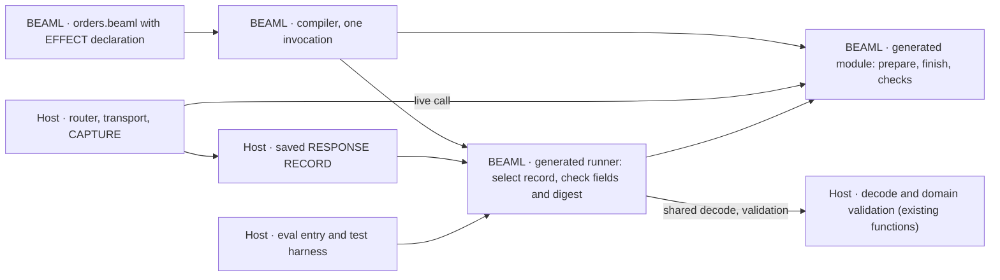

# EXPERIMENT 0004 — Generated REPLAY RUN

**[Proposal]** Can the BEAML compiler generate the REPLAY RUN runner for one outbound EFFECT from the BEAML declaration, so that the host writes no replay code?

**[Requirement]** Owner request, 2026-11-06: the compiler generates the REPLAY RUN runner from the declaration, not hand-written host code. Teams must not build and maintain a replay runner for each codebase. The language must supply it.

**[Verified]** [EXPERIMENT 0003](../0003-source-linked-replay/README.md#gate-status) passed with a hand-written runner, [`OrdersApi.Replay.run/3`](../0002-http-correlation/apps/orders_api/lib/orders_api/replay.ex). It hard-codes the operation `payments.authorize`, attempt 1, status 200, the request check against `prepare/1`, the body digest check and six error reasons. It calls the host functions `ProbeSupport.valid_order!/1`, `OrdersApi.PaymentHttp.decode/1` and `ProbeSupport.valid_payment!/2`. [GREEN record](../0003-source-linked-replay/workflow/2026-11-05/replay/notes.md#green)

**[Verified]** The current [`orders.beaml`](../0002-http-correlation/apps/orders_api/priv/orders.beaml) declares only `prepare` and `finish`. No source line connects them to the HTTP call. The host [router](../0002-http-correlation/apps/orders_api/lib/orders_api/router.ex) owns the order prepare → `authorize/2` → finish.

**[Verified]** The [0001 compiler](../0001-syntax-to-beam/src/main.rs) parses `interface`, `enum` and `fn` only. It writes one module `BeamlSpike` to stdout, with checked public functions and one `# beaml-declaration-v1 <name> <start> <end>` comment per clause. The 0002 [`run.py`](../0002-http-correlation/run.py) renames the module to `OrdersBeamlSpike` or `PaymentsBeamlSpike`.

**[Inference]** The compiler cannot derive the runner from today's source. Every syntax option must add the link prepare → EFFECT → finish, the operation name and the recorded fields.

**[Proposal]** Hypothesis: one added declaration lets the compiler emit the runner with the existing Elixir output. The generated runner passes the 8 replay cases of 0003 unchanged. A second EFFECT and a SCHEMA change need zero new host replay lines.



## Fixed inputs and ownership

- **LANGUAGE/COMPILATION.** Use the 0001 compiler and the 0002 BEAML fixtures. Add one EFFECT declaration to `orders.beaml` in the syntax that the owner chooses. Emit the runner in the same compiler invocation as the Elixir output, on the same stdout. Leave `payments.beaml` output unchanged when it declares no EFFECT.
- **LANGUAGE/COMPILATION.** **[Proposal]** The runner is a nested module `Replay` inside the generated module. After the 0002 rename it is `OrdersBeamlSpike.Replay`. Its BEAM is part of the generated build. Error reasons stay the six 0003 atoms.
- **EXECUTION.** Reuse the two 0002 releases, the ports, the HTTP path, the CAPTURE in `payment_http.ex` and the RESPONSE RECORD format version 1. The host keeps transport, CAPTURE, decode and domain validation. The runner calls the existing host decode and validation functions. The hook contract is owner question Q2.
- **EXECUTION.** Reuse the 0003 replay harness: `bin/orders eval` of the retained Orders release, BEAM call counts, the transport counter, the refused Payments port and the A1 loopback stub. Only the runner entry changes.
- **R&D process.** Follow [implement-step](../../skills/implement-step/SKILL.md). Devil's Advocate at the plan, the RED review and the final review. Record them in the gate ledger only.

## Acceptance cases in order

1. **Emit the runner (a).** The compiler reads `orders.beaml` with the EFFECT declaration. One invocation writes the Elixir module and the runner to stdout. The runner holds the declared operation name, attempt, status and recorded fields. A declaration that names an unknown function, a TYPE mismatch between request and `prepare`, or no recorded field fails compilation with no stdout. `payments.beaml` output stays byte-identical. The 0003 gate 1 test `payments_cli_emits_checked_authorize_reference` still passes.
2. **Pass the 0003 replay matrix (b).** Run the 8 cases of the 0003 replay test against the generated runner: valid, A1 non-canonical, missing, operation, attempt, request, status, digest. Expected values stay as in 0003. Transport, router, `authorize/2` and `connect/4` count zero in all 8 cases. Live `authorize/2` and the runner call the same decode function (decode count 1 in valid cases, 0 in invalid cases).
3. **Delete the hand-written runner (c).** Delete `apps/orders_api/lib/orders_api/replay.ex`. The host diff for replay is that deletion only. `router.ex`, `payment_http.ex` and `probe_support.ex` keep their SHA-256. The full 0003 `run.py` (5 steps) passes on the changed build.
4. **Derivation gate, second EFFECT (d).** Declare a second outbound EFFECT with its own operation name and request and response TYPEs. **[Proposal]** Serve it from the 0003 loopback stub, not a new release. The host adds only the live transport and CAPTURE for it. The generated runner for it passes the same 8-case matrix. The host diff contains zero replay lines. Measure: no host module or function that only the runner calls; every host function that the runner calls is also called on the live path (call count > 0 in the live baseline).
5. **SCHEMA change (e).** Add one field to the response TYPE (for example `reference: String` on `Payment`) in both BEAML files. Regenerate. Make zero edits to generated files and to replay code. The 8 cases pass on new records. A record from the original build against the new build fails with a typed reason before `finish` (owner question Q4). The retained original release still replays the original record.

### Reuse of 0003 evidence and tests

| Case | Reuses | New |
| --- | --- | --- |
| 1 (a) | 0003 gate 1 CLI test as regression control | CLI test for the Orders runner; negative declaration cases |
| 2 (b) | 0003 `replay_run_test.py`: harness, 8 derivatives, A1 stub, observer, live baseline. The [0003 GREEN run](../0003-source-linked-replay/results/20261106T080316413341Z/result.json) is the baseline of the hand-written runner | Runner entry parameter only |
| 3 (c) | 0003 `run.py` with all 5 steps, unchanged | SHA-256 check of host files |
| 4 (d) | Harness and A1 stub pattern | Second EFFECT fixture, host-diff check |
| 5 (e) | Harness | SCHEMA-change derivative, old-record case, retained original release |

## Syntax options

**[Proposal]** Three options. No option is forced. The constraint is common to all: the source must name the prepare → EFFECT → finish link. The owner chooses. All snippets are also in [syntax-options.beaml](syntax-options.beaml).

### Option A — `effect` block

```beaml
effect authorize_payment {
  operation: "payments.authorize"
  request: prepare
  response: finish
  attempts: 1
  status: 200
  record { request, status, body }
}
```

- **Commits us to.** A new top-level keyword and block grammar. The host keeps the orchestration. The RESPONSE RECORD fields become a language-level contract (GENERATED ABI).
- **D001.** Not touched today. A second EFFECT outcome (for example `Declined`) needs a variant TYPE in the block: `enum` or `type`.
- **D002.** The block is in the Orders source, so the SOURCE ID covers it. The runner is in the generated BEAM. If the block names host hooks (Q2), the compiler knows the host module set. That makes the D002 "module-set digest" option definable.

### Option B — `extern fn` and the flow in BEAML

```beaml
extern fn authorize_payment Order -> Payment
  effect "payments.authorize" { attempts: 1, status: 200, record: request, status, body }

fn place order: Order -> Payment = finish(authorize_payment(prepare(order)))
```

- **Commits us to.** BEAML calls host code. EFFECTS appear in signatures. The orchestration moves from the router into BEAML. The compiler derives the runner from the call graph: every fn that calls an extern gets a REPLAY RUN. The live router changes, so the 0003 live evidence must run again. Largest compiler change.
- **D001.** Direct. The extern return TYPE carries the outcomes, for example `-> AuthorizeOutcome`. The enum or type form is in every EFFECT signature.
- **D002.** Strongest. The externs list the host functions exactly. The orchestration is in the generated BEAM. Only the host transport, decode and validation stay outside the hash.

### Option C — attribute on the existing function

```beaml
@effect("payments.authorize", request: prepare, attempts: 1, status: 200, record: "request status body")
fn finish Payment { order_id, status } -> Payment = Payment { order_id: order_id + "", status: status }
```

- **Commits us to.** An attribute syntax with literal values. Smallest grammar change. The compiler must still check the names in the attribute. One attribute per EFFECT.
- **D001.** Not touched. Error reasons stay atoms.
- **D002.** Weakest. Host hooks follow a naming rule, so the module set is not derivable. Keeps the "BEAML module hash" option only.
- **[Inference]** Risk for objection 4: the attribute is close to a descriptor file inside the source. A hand-written Elixir helper with the same descriptor can match it.

## Decisions (Decision4)

| Decision | Class | Choice or question |
| --- | --- | --- |
| Syntax of the EFFECT declaration | Migrate | Q1 |
| Hook contract from runner to host decode and validation | Migrate | Q2 |
| Artifact check in the generated runner (review R1) | Migrate | Q3, waits for D002 |
| Old record after a SCHEMA change | Migrate | Q4 |
| Runner location: nested module in the generated output | Repair | Chose nested `Replay` module over a second output file, because 0002 `run.py` reads one stdout and renames one module. Commits us to one generated BEAM set per source |
| Test reuse: 0003 harness with an entry parameter | Repair | Chose a parameter over a copied test, because the 8 expected values must stay identical. Commits us to keep the 0003 test importable |
| Error reasons as atoms | Repair | Chose the six 0003 atoms over a generated enum, because case (b) compares them unchanged. Commits us to revisit with D001 |
| Operation name source in CAPTURE | Repair | Chose a drift check (CAPTURE literal equals declared name) over a CAPTURE change, because case (c) allows no host change. Commits us to a test that reads both |

**[Verified]** No decision is Answer: 0004 publishes nothing and makes no external claim.

### Owner questions

- **Q1. Syntax.** A (`effect` block), B (`extern fn` with flow in BEAML) or C (attribute). See above.
- **Q2. Hook contract.** (i) The declaration names the host functions, for example `decode: OrdersApi.PaymentHttp.decode`. Couples BEAML source to Elixir names. (ii) The runner takes a hooks argument, `run(order, trace_id, records, hooks)`. No host change; the caller passes hooks. (iii) A host module implements a generated behaviour. Adds host lines, so case (c) needs a stated exception. (iv) BEAML owns the decode. The live path calls the generated decode. Moves A3 into the hash, but changes `payment_http.ex`.
- **Q3. Artifact check (R1).** (i) The runner rejects a record whose `artifact_id` differs from the loaded generated module (`artifact_mismatch`, a ninth case). (ii) The caller keeps the check, as in 0003. Depends on [D002](../../wiki/planning/decisions-to-be-made.md#d002--scope-of-the-replay-artifact-identity).
- **Q4. Old record after a SCHEMA change.** (i) Typed reject (`schema_mismatch`) from a SCHEMA version in the record. Adds a field to the RESPONSE RECORD. (ii) Typed reject from `artifact_id` (needs Q3 (i)). (iii) No check; the generated `finish` raises. Case (e) then has no typed reason.

## Evidence and limits

**[Unknown]** No run exists. This page is a plan.

**[Inference]** A shared Elixir replay library with a hand-written descriptor can also meet cases (b), (c) and (d). Teams then maintain the descriptor, not a runner. Case (e) is the case that separates the language claim: the compiler derives the checks from the checked declaration and SCHEMA. Without (e), 0004 answers an EXECUTION question only. [Round 3, objection 4](../../wiki/planning/roasting-rounds.md#4-fixture-replay-can-leave-the-language-claim-untested)

**[Inference]** Case (e) still has a manual host edit: `ProbeSupport.valid_payment!/2` compares an exact two-key map. That is domain validation, not replay. Count it as a manual change site.

**[Unknown]** Limits carried from 0003: the body digest is integrity, not tamper protection (R2). The RESPONSE RECORD has no timestamp (D003). The check order of the six reasons is not tested. Two records for one trace give `missing_response` without a test.

### Out of scope

- CAPTURE generation. The host writes the RESPONSE RECORD as in 0003.
- Retries, attempts > 1, timeouts, uncertain outcomes (round 3, objection 3).
- A REPLAY CAPSULE format, durable storage, trace sampling (D003).
- Zed/LSP support for the new syntax, beyond the discussion file.
- A BAML comparison. [BAML v1](../../wiki/sources/baml-v1.md#observability) has no replay on its default branch at the pin; this is not a test of BAML.

### What the value gate still needs

**[Proposal]** Objection 4's value gate is not part of 0004. It needs:

- An Elixir baseline with a shared replay helper and the same descriptor, built with an equal engineering budget.
- Independent operators, one fixed incident artifact, active time to source and to reproduced failure, counterbalanced order, individual times.
- Manual change sites for the case (e) SCHEMA change in each arm.
- A pinned BAML build as a third arm if it fits the workflow.

**[Proposal]** Smallest next test after 0004: the case (e) SCHEMA change in the Elixir helper baseline. Count manual change sites against BEAML.
