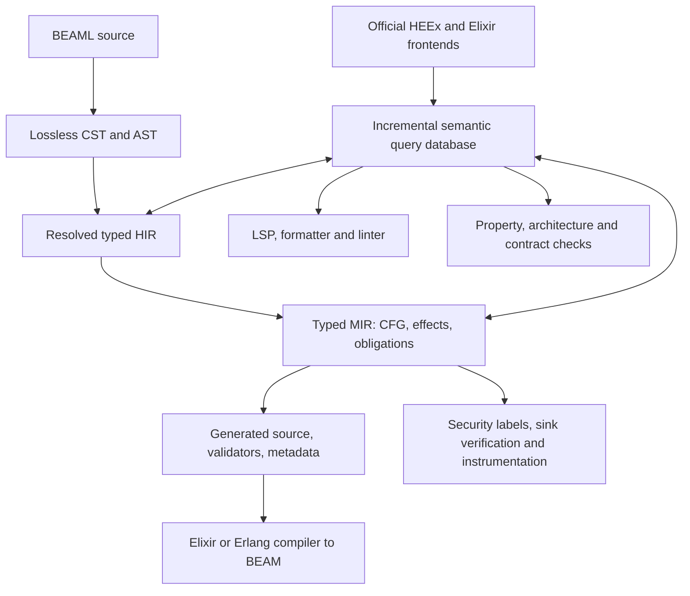

**[Requirement]** This page describes proposed behavior from the supplied specification; it does not establish implementation.

# BEAML product contract

BEAML proposes a statically typed language for model interaction and workflow orchestration on the BEAM, with a Rust compiler and Elixir/OTP runtime. Its compiler semantics are intended to drive editing, validation, testing, architecture rules and observability. The supplied specification is a design baseline with two extensions, not evidence of an implemented language. [Spec pp.1-2 §§1-4](../sources/engineering-spec-v0.5.md)

## Who owns what

| BEAML | Elixir / Phoenix / deployment |
|---|---|
| Domain types, application commands, effects, validators, contracts, optional UI contract descriptors | LiveView callbacks, HEEx markup/components, routes, Ecto adapters, OTP infrastructure |
| Rust frontends, semantic queries, typed IR, source maps, diagnostics, generated API | Mix invokes standalone compiler; Elixir/Erlang compiler produces BEAM modules |
| Static checks and generated boundary guards within declared scope | Foreign code, persistent transactions, distributed consistency, infrastructure/secret management and operational guarantees |

The first backend generates source compatible with Erlang/Elixir; direct bytecode is excluded. BEAML is not a replacement for Erlang, Elixir, Gleam or HEEx. Optional domain/UI constructs should not become mandatory boilerplate. This ownership split is specified; exact ABI and supported versions still need decisions. [Spec p.1 §1; p.2 §4; p.8 §21; p.11 §31](../sources/engineering-spec-v0.5.md)

## One compiler model, several consumers



The diagram is a synthesis of the specified dependencies, not a finalized pass order: §43 inserts label inference before MIR, control-flow propagation/sink verification after MIR, and instrumentation/redaction before codegen. Stable IDs/source maps span lowering and enable references, rename, diagnostics and runtime navigation. Incremental queries track dependencies/cycles and versioned interface/schema capabilities; editor plugins reuse facts instead of independently reimplementing types. [Spec pp.2-3 §§4-5; p.9 §25; p.14 §43](../sources/engineering-spec-v0.5.md)

## Trust transitions are explicit

```text
Untrusted<Json> -> Parsed<T>
Parsed<T> -> Result<Validated<T>, ValidationError>
Validated<T> -> Result<Refined<T,P>, Error>

RawFormParams -> ParsedInput -> Validated
```

The first chain is model/schema validation; the second is browser/form validation. Neither parsing nor a plain Elixir struct is enough to establish trusted BEAML status. Generic model output requires a Schema witness. Schema-valid output can still be factually false. Server validation, explicit provider/network errors, checked refinement conversions, and validated public entry points are central constraints. Browser `phx-value-*` strings cannot acquire nominal ID type without decoding. Partial forms report field errors without certifying the aggregate. [Spec p.2 §3; pp.8-9 §§21-26; p.11 §32](../sources/engineering-spec-v0.5.md)

Pure code may not call effects outside its permitted set. Foreign Elixir, macros, NIFs, reflection and untracked libraries have explicit trusted/checked/unknown boundaries. Safe-core claims cannot be generalized to arbitrary foreign runtime effects. Tests must show rejected input causes no domain command effects. [Spec pp.2-3 §§3-4; p.10 §§27-28](../sources/engineering-spec-v0.5.md)

## Security and observability are part of the contract

Sensitive values retain labels through derived values, containers, errors and interpolation. A confidentiality/category/purpose-recipient lattice joins restrictions; a program-counter label accounts for secret-dependent branches. Sink policy checks apply to telemetry, browser, model and HTTP egress. Only an authorized declassification capability may relax labels; ordinary casts or annotations may not. Authorized user-scoped display is narrower than making a value globally public. [Spec pp.12-13 §§33-37](../sources/engineering-spec-v0.5.md)

Compiler instrumentation feeds a Phoenix/OTP adapter, local redaction/policy, and an OTel Collector. Production defaults are fail-closed for unclassified sensitive egress, payload capture off, no implicit declassification. Observatory is intended to link source/types/contracts, workflow and OTP process topology, model metrics, privacy reports and release audits. Local and self-hosted use require no remote exporter. Reference storage separates traces/events (ClickHouse), application metadata (Postgres), and optional encrypted replay (S3-compatible); small/P0 deployments can start with Postgres traces. [Spec pp.13-14 §§39-45](../sources/engineering-spec-v0.5.md)

Routine telemetry must use bounded buffers and remain nonblocking through collector outage; durable security audit is a separate explicit policy. Replay means permitted fixtures/recorded provider responses, never an automatic promise to reproduce arbitrary BEAM scheduling. No blanket secrecy, memory-erasure or side-channel proof is claimed. [Spec p.5 §10; pp.12-14 §§33,35,38,41](../sources/engineering-spec-v0.5.md)

## Evidence must say what it proves

The baseline distinguishes static proof, runtime enforcement, sampled testing, inconclusive analysis and violations. Later extensions rename two statuses without a canonical schema. Preserve those original labels in source notes until resolved. Unknown dynamic syntax must never become a success result; compiler/HEEx/security results must expose scope and evidence. Versioned contract manifests carry obligation/checker/source/evidence/runtime-hook information; security output adds manifest and source map. [Spec pp.4-5 §9; p.10 §27; p.14 §§43,46](../sources/engineering-spec-v0.5.md)

All timing, throughput, fuzz and security counts are proposed fixture gates. None are measured achievements. Formal semantics, complete grammar, supported HEEx subset, ABI, security rules and test evidence are required before stability claims. See the [source inventory and exact phase/acceptance tables](../sources/engineering-spec-v0.5.md) and [unresolved decisions](../planning/specification-gaps.md).
