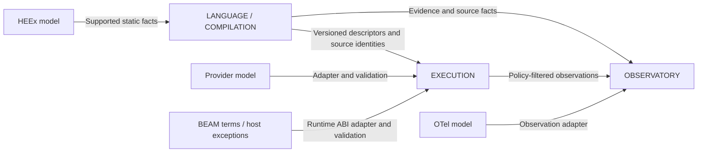

# Candidate bounded contexts

**[Proposal]** BEAML can use BOUNDED CONTEXTS and one [glossary](../../GLOSSARY.md). Boundaries should follow model meaning and invariants. They do not require separate services, databases, repositories or teams. Start with three candidates. Revise them when real contracts reveal a different boundary.

**[Requirement]** The [product contract](../concepts/product-contract.md) calls for one authoritative compiler semantic model used by tooling, checks and generated boundaries. The map below must preserve that rule. **[Inference]** A compiler frontend, HIR, MIR and backend are stages of that model. Splitting them into independent semantic authorities would create conflicting type rules. [Compiler/tooling](../concepts/compiler-and-tooling.md)

## Candidate ownership

| Candidate context | Owned model and invariants | Published interfaces | Why a boundary helps |
|---|---|---|---|
| LANGUAGE/COMPILATION | TYPE, SCHEMA, symbols, SEMANTIC FACTS, EFFECTS, OBLIGATIONS and source identity. Derived answers refer to exact source and semantic versions. Unsupported analysis stays unknown. | Semantic queries, diagnostics, generated code, versioned descriptors and EVIDENCE STATUS records. | Source meaning and static evidence must stay coherent across all consumers. |
| EXECUTION | WORKFLOW RUN, PROVIDER ATTEMPT, validated inputs/results, cancellation and execution outcomes. Parsing is not validation. Rejected inputs cause no domain effects. Duplicate delivery does not imply a new logical operation. | Validated generated entry points, provider adapters, run-control API and runtime observations. | Runtime attempts and failures have identities and uncertainty that static analysis cannot replace. |
| OBSERVATORY | OBSERVATION EVENTS, permitted source/run views, AUDIT RECORDS and access/retention decisions. Observation does not establish business success. Routine telemetry and durable audit have separate policies. | Ingestion/export adapters, authorized query views, source navigation and audit access. | Sampling, redaction, partial delivery and retention differ from domain execution semantics. |

These owners describe BEAML platform concepts. A user's invoice, account or order model belongs to that user's application context. EXECUTION hosts its calls; it does not redefine every user's business vocabulary. A DOMAIN EVENT can be produced tentatively by a pure transition. Committed publication is a separate outcome. An OBSERVATION EVENT may describe an attempted action that never committed. [Domain contracts](../concepts/domain-modeling-and-contracts.md), [Observatory](../concepts/observability-and-replay.md)

The arrows show model contracts and translation. They are not a process topology or a claim that the interfaces exist.

## One semantic authority, several consumers

**[Proposal]** LSP, tests, architecture checks and AUTHORING AGENTS consume LANGUAGE/COMPILATION queries. They do not implement another type checker. EXECUTION uses generated validators and versioned descriptors. Runtime guards enforce the published contract at the actual boundary; they do not silently reinterpret source rules. OBSERVATORY displays source/evidence versions rather than inferring proof from a successful run. It can have authorized retention and administration actions. Replay or execution controls must call explicit EXECUTION contracts with checked authority; a trace carrier grants none.

IFC is a cross-cutting capability here. LANGUAGE/COMPILATION owns static propagation and sink-check semantics. EXECUTION enforces runtime boundaries under an explicit policy version. OBSERVATORY applies that policy to ingestion, access and export. This is one coordinated rule set with different enforcement points, not three invented security models. The exact authority, policy format and static/runtime split remain open. [Security scope](../concepts/information-flow-security.md)

An AUTHORING AGENT is a consumer role. It can propose source edits or invoke compiler tools. Accepted source and the compiler's authoritative rules determine meaning. A runtime agent feature would need its own decision about state, permissions, attempts and effects. Its name alone does not justify a fourth BOUNDED CONTEXT.

## Concrete translation boundaries

**[Proposal]** Use an ANTI-CORRUPTION LAYER when meanings differ. An ordinary versioned internal API is enough when they agree. The layer may be an in-process adapter; do not add one per compiler pass. Each ANTI-CORRUPTION LAYER belongs to the receiving model. It records supported versions, rejected or unknown cases, and source identity where needed.

| Foreign input | Translation | Receiving contract and failure case |
|---|---|---|
| Provider JSON, tokens, finish reasons and transport errors | Keep provider status separate from parse/validation status. Decode using the exact SCHEMA; validate before making a VALIDATED VALUE. | EXECUTION sees a PROVIDER ATTEMPT result. A provider's successful HTTP response is not a validated business result. Partial output cannot silently become final. |
| BEAM terms, host exports and exceptions | Check GENERATED ABI version, decode nominal/error representations and validate public entry points. | The typed API exposes declared outcomes. Unknown layouts fail before domain effects; host exceptions do not become valid typed results by wrapping them. |
| HEEx syntax, component metadata and string form values | Extract only supported structural facts with source mappings. Normalize and validate form input separately. | LANGUAGE/COMPILATION receives static facts, not arbitrary macro execution. Unknown syntax stays unknown; strings do not become nominal IDs by annotation. |
| OTel spans, events and transport outcomes | Map allowed fields to OBSERVATION EVENTS with tenant, source/run version and capture policy. | OBSERVATORY does not turn a span or exporter acknowledgement into a DOMAIN EVENT, durable AUDIT RECORD or proof of business completion. |

These are translations of meaning, not only renamed fields. The BEAM case spans compiled descriptors and runtime enforcement; the HEEx case spans static facts and form validation. A shared adapter implementation can serve both seams without merging their authority. [Provider/stream distinctions](../concepts/structured-output-and-streaming.md), [typed BEAM boundary](../concepts/beam/typed-language-boundaries.md), [UI boundaries](../concepts/ui/typed-forms-and-events.md)

## Shared vocabulary is smaller than shared runtime state

**[Proposal]** Keep one registry keyed by context and term. Its definitions can link to the owning query, descriptor or policy. Consumers share identifiers and contract versions only when the meaning is the same. Use qualified terms when it differs. A SOURCE ID may be carried by an OBSERVATION EVENT without sharing the whole compiler database.

A possible small shared contract includes source/artifact identity, schema version and an evidence envelope. It is not adopted yet. Each field needs an owner, compatibility rule and reason to cross the boundary. Avoid a universal MODEL, EVENT or STATUS object. SCHEMA, DOMAIN EVENT, OBSERVATION EVENT and EVIDENCE STATUS answer different questions. Keep UNKNOWN and TESTED visible when a metadata projection omits details. A lossy observation view must state its omissions; translation grants no validation or declassification authority. [Evolution rules](../concepts/schema-and-api-evolution.md)

## Optional transport and adoption decisions

**[Proposal]** Kafka or Broadway may later implement an event-transport adapter. They are not selected dependencies or new semantic authorities. Keep event identity, ordering scope, delivery uncertainty, retry and idempotency in the contract. Durable domain commit/outbox publication is separate from routine telemetry and durable audit. Transport choice does not settle those guarantees.

Before adopting this map, decide the minimum exported descriptors, version/invalidation rules, boundary failures, runtime identity model and policy ownership. Validate one complete path: foreign input → rejected or validated value → allowed effect → policy-safe observation with source navigation. Include rejected input, stale descriptor and duplicate-attempt cases. No architecture implementation or validation result is claimed here.

## Evidence and limits

**[Inference]** The [local strategy-wiki research](../sources/agentic-strategy-wiki.md) supports the glossary/map/translation pattern. The already researched [public DDD reference](../sources/domain-contracts-and-evolution.md) explains context and consistency boundaries. BEAML's [specification](../sources/engineering-spec-v0.5.md) supplies product constraints. The three candidates and role assignments above are our proposal. They are not imported policy, an adopted architecture or certified controlled-language compliance.
