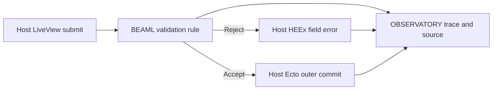

# BEAML research and development

**[Requirement]** The owner requested an R&D repository with recorded experiments and domain ownership.
The [source note](../sources/syntax-spike-requirement.md) records scope and origin.
The [glossary](../../GLOSSARY.md) and [context map](context-map.md) supply working terms and candidate boundaries.
Track open R&D choices in [Decisions to be made](decisions-to-be-made.md).

## Experiment flow

**[Requirement]** Initial compilation route: BEAML → generated Elixir source → Elixir/OTP compiler → BEAM module → BEAM VM.
The owner adopted this route after EXPERIMENT 0001. [Decision source](../sources/syntax-spike-requirement.md)
Direct bytecode emission is not a committed destination. A later backend change needs a concrete reason and separate evidence.

**[Proposal]** Use this small file-based process. It requires no service or workflow engine.

1. State the question, hypothesis and context ownership.
2. Define a small supported subset, exclusions and observable acceptance criteria.
3. Keep code, fixtures and a repeatable command under `experiments/NNNN-name/`.
4. Run the experiment. Retain a new result directory with commands, toolchain versions, hashes and test output.
5. Record pass, fail or inconclusive against the criteria. Preserve failed runs and their reasons.
6. State what the result establishes and what remains unknown. Propose the next decision separately.

A passed EXPERIMENT is scoped evidence. It does not adopt a production architecture or prove the complete language safe.
A new run does not replace an earlier result. A new experiment can supersede a decision with an explicit reason.
Tests are evidence about fixtures. Requirements and choices remain visible apart from test output.

## Experiment register

| ID | Question | Candidate owners | State and evidence |
|---|---|---|---|
| [0001: syntax to BEAM](../../experiments/0001-syntax-to-beam/README.md) | Can the selected interface and nested-pattern subset compile and execute with exact boundary checks? | LANGUAGE/COMPILATION; EXECUTION | **[Verified]** [Passed run](../../experiments/0001-syntax-to-beam/results/20261105T202319485083Z/result.json). Scoped probe; see exclusions. |
| [0002: HTTP correlation](../../experiments/0002-http-correlation/README.md) | Can one order locate causally connected spans and logs across two independent HTTP services? | LANGUAGE/COMPILATION; EXECUTION; OBSERVATORY | **[Verified]** [Independent final verification](../../experiments/0002-http-correlation/workflow/2026-11-05/result.json) passed all seven repair assertions. The [final EXPERIMENT RUN](../../experiments/0002-http-correlation/results/20261105T221134010042Z/result.json) passed H01–H05. Scope is local HTTP correlation. |
| [0003: source-linked replay](../../experiments/0003-source-linked-replay/README.md) | Can one function summary link an observed call to the source that ran and to an isolated Orders REPLAY RUN? | LANGUAGE/COMPILATION, EXECUTION, OBSERVATORY | **[Verified]** Complete. All four behavior gates passed independent TEST and review: the [compiler reference gate](../../experiments/0003-source-linked-replay/workflow/2026-11-05/result.json), the [live lookup gate with repair](../../experiments/0003-source-linked-replay/workflow/2026-11-05/lookup/repair-test-result.json), the [CAPTURE and transport observer gate](../../experiments/0003-source-linked-replay/workflow/2026-11-05/capture/test-result.json) and the [REPLAY RUN and invalid replay record gate](../../experiments/0003-source-linked-replay/workflow/2026-11-05/replay/test-result.json). The repeatable command `python3 experiments/0003-source-linked-replay/run.py` runs all gates in series; the [latest runner run](../../experiments/0003-source-linked-replay/results/20261106T082750423575Z/result.json) passed 5/5 steps. **[Unknown]** The runner directory has no own output hashes and stores absolute step paths. |
| [0004: generated replay](../../experiments/0004-generated-replay/README.md) | Can the compiler generate the flow, the HTTP EFFECT, the decode, the CAPTURE and the REPLAY RUN runner from one BEAML source, and does a TYPE change fail where it must? | LANGUAGE/COMPILATION, EXECUTION | **[Verified]** Slice 1: implementation passes with notes; the claim is REJECTED under its rule (manual change sites GEN 0 = LIB 0; the build passed in all 6 DRIFT rows; the only arm difference comes from the old 0002 transport in LIB, not from the TYPE). [Verdict](../../experiments/0004-generated-replay/README.md#slice-1-verdict-2026-11-06). **[Requirement]** The OWNER supersedes the slice 1 rule for slice 2: it counted hand edits, but the goal is [vertical integration](../concepts/vertical-integration.md). **[Proposal]** [Slice 2](../../experiments/0004-generated-replay/README.md#slice-2): a rename without a RENAME ALIAS fails at compile time against stored TYPE VERSIONS. Not run. |
| [0004 slice 3: add and drop](../../experiments/0004-generated-replay/README.md#slice-3) | Can the compiler refuse an added or removed response field without an `add` or `drop` MIGRATE CHANGE against stored TYPE VERSIONS, and replay old records with the constant or without the dropped field, by TYPE VERSION? | LANGUAGE/COMPILATION, EXECUTION | **[Proposal]** Plan only (DL-042): cases D1–D16 and K1–K12, falsifiable pass and reject rule, slice 2 tests unchanged. Not run. |
| [0004 slice 4: retire and dead code](../../experiments/0004-generated-replay/README.md#slice-4) | Can the compiler block a deleted EFFECT with stored RESPONSE RECORDS until a RETIRE LINE, reject RETIRED RECORDS in a REPLAY RUN with a typed reason, warn about each DEAD LINE and remove exactly those lines on request? | LANGUAGE/COMPILATION, EXECUTION | **[Proposal]** Plan only (DL-055, DL-056): cases E1–E20, warning texts, removal command contract, falsifiable pass and reject rule, slice 1 to slice 3 tests unchanged. OWNER question O6 open (version number when the last MIGRATE STEP is dead). Not run. |
| [0004 slice 5: type keyword and version marks](../../experiments/0004-generated-replay/README.md#slice-5) | After a SQUASH, can the source keep the newest TYPE VERSION number as a VERSION MARK on the type line, so that every DEAD LINE of a MIGRATE CHAIN can go, the number never falls back, and an older stored record still blocks the build with the missing MIGRATE STEPS named? Can `type` replace `interface` and `v1 -> v2` replace `1 -> 2` with no change of generated behaviour? | LANGUAGE/COMPILATION, EXECUTION | **[Proposal]** Plan only (DL-061, DL-070, DL-071, DL-072; DL-058 superseded): cases F1–F29, U2, P1, A1–A3, a mechanical rewrite of the slice 1 to slice 4 sources and tests with an audit, a one-line re-snapshot of the `payments.beaml` output (declaration offsets −10 bytes), falsifiable pass and reject rule. OWNER question O7 open (VERSION MARK beside a complete chain or without a chain). Not run. |

## Domain boundaries

**[Proposal]** LANGUAGE/COMPILATION owns parsing, TYPE rules, exact interface shapes, pattern coverage and code generation.
EXECUTION owns validation at generated entry points and observed BEAM outcomes.
The generated map/tuple format is an experimental GENERATED ABI between these models.
It has no stability or upgrade promise. An order fixture is an application example, not a new platform BOUNDED CONTEXT.
Local test and action records do not implement OBSERVATORY, durable audit or full typed replay.
[Replay scope](../concepts/typed-errors-and-replay.md)

## Next evidence

**[Requirement]** Prioritize [EXPERIMENT 0003](../../experiments/0003-source-linked-replay/README.md) for HTTP trace correlation, source lookup and isolated replay.
Its proposal selects two loopback applications, one function summary and one captured HTTP response.

The [distributed order proposal](distributed-order-probe.md) extends the owner target to REST-separated applications, joined search and scoped replay.
It is not yet an adopted or registered EXPERIMENT.

The [product-benefit probe](product-benefit-probe.md) proposes a fair Elixir comparison with equivalent evidence and a change test.
It remains unadopted and unexecuted; it is not an additional registered EXPERIMENT.

The [roasting rounds](roasting-rounds.md) retain the scope challenge and a proposed zero-effects-before-validation test.
The second round is a pending proposal, not a registered or executed EXPERIMENT.

**[Unknown]** The first probe does not establish a benefit over an Elixir library for an actual user workflow.
It does not settle generic schema evidence, effects, information flow, modules, LSP or production runtime behavior.
Use its result to select the next small experiment. Do not expand the pipeline before a concrete experiment needs more machinery.

## Later candidate — Ecto and LiveView

**[Requirement]** Retain an Ecto and LiveView integration slice for later R&D. Its order among follow-up candidates is open.

**[Proposal]** Test one LiveView form, one BEAML Flow submit action and one mapped database table. Can a trace link each submission to the validation rule, database outcome and exact source?

- **LANGUAGE/COMPILATION.** Generate an Ecto schema from a domain CONTRACT and an explicit persistence mapping. Generate a reviewable migration from one explicitly declared additive version change. The host reviews and applies it to the prior version of the fixture database. Exclude inferred DDL and automatic migration. [Ecto schema](https://ecto.hexdocs.pm/Ecto.Schema.html), [Ecto SQL migrations](https://ecto-sql.hexdocs.pm/Ecto.Migration.html)
- **EXECUTION.** The Flow supplies a UI descriptor, submit action, server validation and TYPED ERRORS. The host handles LiveView callbacks, chooses its HEEx markup and owns application storage and the outer Ecto transaction. [Product ownership](../concepts/product-contract.md#who-owns-what), [Typed forms](../concepts/ui/typed-forms-and-events.md), [Phoenix form component](https://phoenix-live-view.hexdocs.pm/Phoenix.Component.html#form/1)
- **OBSERVATORY.** Use one correlation ID per submission. Link the UI EVENT, the rule outcome and any observed database EFFECT to the trace and the exact SOURCE ID and build. Retain outcome metadata. Exclude form values, SQL text and parameters.

**[Proposal]** Submit one invalid input. Verify the rendered field error, zero write attempts on the fixture path and unchanged database state. Submit one valid input that uses the added field. Observe a successful outer transaction commit. Verify the expected row from a separate connection after commit. Remove the commit observation and source artifact in separate copies of the evidence. Verify that the trace reports which evidence is missing. [Ecto transaction and nesting](https://ecto.hexdocs.pm/Ecto.Repo.html#transact/2)

**[Unknown]** The candidate has no EXPERIMENT ID, implementation or run. It leaves database replay, rollout and crash durability outside the fixture.
