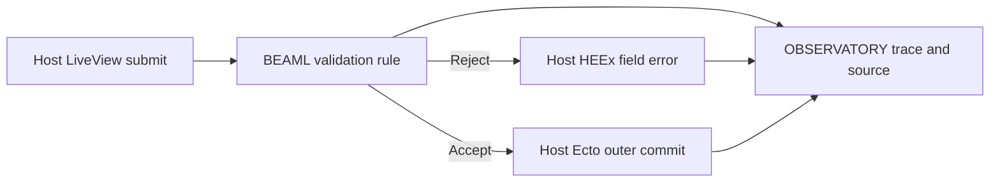

# BEAML research and development

**[Requirement]** The owner requested an R&D repository with recorded experiments and domain ownership.
The [source note](../sources/syntax-spike-requirement.md) records scope and origin.
The [glossary](../../GLOSSARY.md) and [context map](context-map.md) supply working terms and candidate boundaries.
Track open R&D choices in [Decisions to be made](decisions-to-be-made.md).

## Experiment flow

**[Requirement]** Initial compilation route: BEAML → generated Elixir source → Elixir/OTP compiler → BEAM module → BEAM VM.
The owner adopted this route after EXPERIMENT 0001. [Decision source](../sources/syntax-spike-requirement.md)
Direct bytecode emission is not a committed destination. A later backend change needs a concrete reason and separate evidence.

**[Proposal]** Use this small file-based process. It requires no service or workflow engine.

1. State the question, hypothesis and context ownership.
2. Define a small supported subset, exclusions and observable acceptance criteria.
3. Keep code, fixtures and a repeatable command under `experiments/NNNN-name/`.
4. Run the experiment. Retain a new result directory with commands, toolchain versions, hashes and test output.
5. Record pass, fail or inconclusive against the criteria. Preserve failed runs and their reasons.
6. State what the result establishes and what remains unknown. Propose the next decision separately.

A passed EXPERIMENT is scoped evidence. It does not adopt a production architecture or prove the complete language safe.
A new run does not replace an earlier result. A new experiment can supersede a decision with an explicit reason.
Tests are evidence about fixtures. Requirements and choices remain visible apart from test output.

## Experiment register

| ID | Question | Candidate owners | State and evidence |
|---|---|---|---|
| [0001: syntax to BEAM](../../experiments/0001-syntax-to-beam/README.md) | Can the selected interface and nested-pattern subset compile and execute with exact boundary checks? | LANGUAGE/COMPILATION; EXECUTION | **[Verified]** [Passed run](../../experiments/0001-syntax-to-beam/results/20261105T202319485083Z/result.json). Scoped probe; see exclusions. |
| [0002: HTTP correlation](../../experiments/0002-http-correlation/README.md) | Can one order locate causally connected spans and logs across two independent HTTP services? | LANGUAGE/COMPILATION; EXECUTION; OBSERVATORY | **[Verified]** [Independent final verification](../../experiments/0002-http-correlation/workflow/2026-11-05/result.json) passed all seven repair assertions. The [final EXPERIMENT RUN](../../experiments/0002-http-correlation/results/20261105T221134010042Z/result.json) passed H01–H05. Scope is local HTTP correlation. |
| [0003: source-linked replay](../../experiments/0003-source-linked-replay/README.md) | Can one function summary link an observed call to the source that ran and to an isolated Orders REPLAY RUN? | LANGUAGE/COMPILATION, EXECUTION, OBSERVATORY | **[Verified]** Complete. All four behavior gates passed independent TEST and review: the [compiler reference gate](../../experiments/0003-source-linked-replay/workflow/2026-11-05/result.json), the [live lookup gate with repair](../../experiments/0003-source-linked-replay/workflow/2026-11-05/lookup/repair-test-result.json), the [CAPTURE and transport observer gate](../../experiments/0003-source-linked-replay/workflow/2026-11-05/capture/test-result.json) and the [REPLAY RUN and invalid replay record gate](../../experiments/0003-source-linked-replay/workflow/2026-11-05/replay/test-result.json). The repeatable command `python3 experiments/0003-source-linked-replay/run.py` runs all gates in series; the [latest runner run](../../experiments/0003-source-linked-replay/results/20261106T082750423575Z/result.json) passed 5/5 steps. **[Unknown]** The runner directory has no own output hashes and stores absolute step paths. |
| [0004: generated replay](../../experiments/0004-generated-replay/README.md) | Can the compiler generate the flow, the HTTP EFFECT, the decode, the CAPTURE and the REPLAY RUN runner from one BEAML source, and does a TYPE change fail where it must? | LANGUAGE/COMPILATION, EXECUTION | **[Verified]** Slice 1: implementation passes with notes; the claim is REJECTED under its rule (manual change sites GEN 0 = LIB 0; the build passed in all 6 DRIFT rows; the only arm difference comes from the old 0002 transport in LIB, not from the TYPE). [Verdict](../../experiments/0004-generated-replay/README.md#slice-1-verdict-2026-11-06). **[Requirement]** The OWNER supersedes the slice 1 rule for slice 2: it counted hand edits, but the goal is [vertical integration](../concepts/vertical-integration.md). **[Verified]** [Slice 2](../../experiments/0004-generated-replay/README.md#slice-2): implemented, tests green. A rename without a RENAME ALIAS fails at compile time against stored TYPE VERSIONS. `run.py` [run `20261107T052837751458Z`](../../experiments/0004-generated-replay/results/20261107T052837751458Z/result.json): all 15 steps exit 0 (`stored-types` 33, `slice2-replay` 21 tests per the [ledger](../../experiments/0004-generated-replay/workflow/2026-11-06/notes.md)). Newest replay output: [`20261107T055221327114Z`](../../experiments/0004-generated-replay/results/20261107T055221327114Z/commands.jsonl). O5 answered (DL-094): live query of deployed nodes first. |
| [0004 slice 3: add and drop](../../experiments/0004-generated-replay/README.md#slice-3) | Can the compiler refuse an added or removed response field without an `add` or `drop` MIGRATE CHANGE against stored TYPE VERSIONS, and replay old records with the constant or without the dropped field, by TYPE VERSION? | LANGUAGE/COMPILATION, EXECUTION | **[Verified]** Implemented, tests green (DL-042): cases D1–D16 and K1–K12. [run `20261107T052837751458Z`](../../experiments/0004-generated-replay/results/20261107T052837751458Z/result.json): `slice3-types` 69 and `slice3-replay` 31 tests pass ([ledger](../../experiments/0004-generated-replay/workflow/2026-11-06/notes.md)). |
| [0004 slice 4: retire and dead code](../../experiments/0004-generated-replay/README.md#slice-4) | Can the compiler block a deleted EFFECT with stored RESPONSE RECORDS until a RETIRE LINE, reject RETIRED RECORDS in a REPLAY RUN with a typed reason, warn about each DEAD LINE and remove exactly those lines on request? | LANGUAGE/COMPILATION, EXECUTION | **[Verified]** Implemented, tests green (DL-055, DL-056): cases E1–E20. [run `20261107T052837751458Z`](../../experiments/0004-generated-replay/results/20261107T052837751458Z/result.json): `slice4-retire` 87 and `slice4-replay` 27 tests pass ([ledger](../../experiments/0004-generated-replay/workflow/2026-11-06/notes.md)). O6 answered (DL-070, DL-071). **[Unknown]** Deletion after `keep <n> days` needs a managed store; slice 4 deletes nothing. |
| [0004 slice 5: type keyword and version marks](../../experiments/0004-generated-replay/README.md#slice-5) | After a SQUASH, can the source keep the newest TYPE VERSION number as a VERSION MARK on the type line, so that every DEAD LINE of a MIGRATE CHAIN can go, the number never falls back, and an older stored record still blocks the build with the missing MIGRATE STEPS named? Can `type` replace `interface` and `v1 -> v2` replace `1 -> 2` with no change of generated behaviour? | LANGUAGE/COMPILATION, EXECUTION | **[Verified]** Implemented, tests green (DL-061, DL-070, DL-071, DL-072; DL-058 superseded): cases F1–F29, U2, P1, A1–A3 and the audited rewrite of slice 1 to slice 4. [run `20261107T052837751458Z`](../../experiments/0004-generated-replay/results/20261107T052837751458Z/result.json): `slice5-syntax` 60, `slice5-squash` 24, `slice5-replay` 12 and `slice5-rewrite` 5 tests pass ([ledger](../../experiments/0004-generated-replay/workflow/2026-11-06/notes.md)). O7 answered (DL-080). **[Proposal]** `beaml fmt` writes the default mark form (DL-081), not built. |
| [0004 slice 6a: grammar for the decided forms](../../experiments/0004-generated-replay/README.md#slice-6a) | Can the tree-sitter grammar parse and highlight the forms of DL-082 to DL-093 with 0 ERROR nodes and no change to old tests? | LANGUAGE/COMPILATION (editor tooling) | **[Verified]** Implemented, tests green: 23/23 corpus, 4/4 highlight files with `test --rebuild` ([test result](../../experiments/0004-generated-replay/workflow/2026-11-07/slice6-grammar/test-result.json), [ledger](../../experiments/0004-generated-replay/workflow/2026-11-07/slice6-grammar/notes.md)). [Review](../../experiments/0004-generated-replay/workflow/2026-11-07/slice6-grammar/review.md): pass, three medium notes. **[Unknown]** The committed `beaml.wasm` and the shared `#match?` are not checked in Zed. |
| [0004 slice 6b step 6a: RESPONSE RECORD version 2](../../experiments/0004-generated-replay/README.md#slice-6b-step-6a-response-record-version-2) | Can every RESPONSE RECORD hold the typed projection instead of the raw body, with a digest check in the REPLAY RUN and a `--stored` block for older record versions, while DRIFT keeps a GEN repair check? | LANGUAGE/COMPILATION, EXECUTION | **[Verified]** Implemented, tests green after one repair (RV6A-1): 13 record keys, `value_sha256` (D6B-58), `--stored` version error (D6B-59); GEN against LIB comparison ended (DL-110); DRIFT GEN rows only with the D6B-96 repair check (DL-118). [Full suite](../../experiments/0004-generated-replay/results/20261107T161752613981Z/result.json) 14 of 14, [DRIFT](../../experiments/0004-generated-replay/results/20261107T161820272952Z/drift.json) R, N, Q status 200 and host `ok`, slice 6 files 146 of 146 ([review](../../experiments/0004-generated-replay/workflow/2026-11-07/slice6b-records-v2/review.md)). **[Unknown]** `run.py` runs no slice 6 file and does not read `repaired_all` (RV6A-2, RC1, medium, open). **[Verified]** Limit (2026-11-07, [RED TEAM 01](../../experiments/0004-generated-replay/workflow/2026-11-07/red-team-01/report.md), D10): the full suite covers slices 1 to 5 only; the slice 6 counts ran apart (slice 6 files 146 of 146 and `drift_test.py` 5 of 5). **[Verified]** Update 2026-11-07 ([RED TEAM 01 repairs](../../experiments/0004-generated-replay/README.md#red-team-01-repairs-c1-b3-c3-c4), DL-135): the full `run.py` run now covers every slice 6 file and `drift_test.py`, and the DRIFT status pins the outcome classes ([34 of 34, 1058 s](../../experiments/0004-generated-replay/results/20261107T220212948306Z/result.json)). The D10 limit above held for the runs it names; it is closed for later runs. RV6A-2 and RC1 closed: `drift_status` reads `repaired_all`. |
| [0004 slice 6b step 11: host structs and `T.new/1`](../../experiments/0004-generated-replay/README.md#slice-6b-step-11-host-structs-and-tnew1) | Are constructor TYPES structs at the host, built only through `T.new/1` with one atom-key map, and do the public wrappers require the struct, also nested and in enum payloads? | LANGUAGE/COMPILATION, EXECUTION | **[Verified]** Implemented, tests green (DL-106, DL-117; D6B-97 to D6B-101 as Repair by DL-123): [full suite](../../experiments/0004-generated-replay/results/20261107T165145154357Z/result.json) 14 of 14, slice 6 files 149 of 149, cargo clean ([review](../../experiments/0004-generated-replay/workflow/2026-11-07/slice6b-host-structs/review.md): pass, N1 and N2 medium). **[Verified]** Limit: a deliberate struct literal or a forged `__struct__` map passes (DL-106). **[Unknown]** A struct from an older build is untested; the full suite holds no step 11 evidence (N1). **[Verified]** Limit (2026-11-07, [RED TEAM 01](../../experiments/0004-generated-replay/workflow/2026-11-07/red-team-01/report.md), D10): the full suite covers slices 1 to 5 only; the slice 6 counts ran apart (slice 6 files 149 of 149). **[Verified]** Update 2026-11-07 ([RED TEAM 01 repairs](../../experiments/0004-generated-replay/README.md#red-team-01-repairs-c1-b3-c3-c4), DL-135): the full `run.py` run now covers every slice 6 file and `drift_test.py`, and the DRIFT status pins the outcome classes ([34 of 34, 1058 s](../../experiments/0004-generated-replay/results/20261107T220212948306Z/result.json)). The D10 limit above held for the runs it names; it is closed for later runs. |
| [0004 slice 6b steps 12 and 12b: EFFECT path spans and a pure constructor](../../experiments/0004-generated-replay/README.md#slice-6b-steps-12-and-12b-spans-on-the-effect-path-and-a-pure-constructor) | Does a step get a span only when it is or reaches an EFFECT, transitively, and does a constructor that reaches an EFFECT fail to compile? | LANGUAGE/COMPILATION, EXECUTION, OBSERVATORY | **[Verified]** Implemented, tests green (DL-108, DL-119 S, DL-120): reach map as a fixpoint, pure steps are plain calls, the prepared event is its own `_ =` clause (D6B-114), the DL-120 reject with the shortest path (D6B-112, D6B-113); `event/2` with no open span writes `"none"` ids (D6B-127). 40 of 71 sources change; slice 5 PIN moved to `237a4578` with a diff proof. [Full suite](../../experiments/0004-generated-replay/results/20261107T180401517724Z/result.json) 14 of 14, slice 6 files 172 of 172 ([review](../../experiments/0004-generated-replay/workflow/2026-11-07/slice6b-effect-reach/review.md): pass, N1 and N2 medium). **[Unknown]** The span input is the pipe head, not the step input (N2); no 0002 test of `event/2` without a span (N1). **[Requirement]** A declared entry gives the root span (DL-128). **[Verified]** Limit (2026-11-07, [RED TEAM 01](../../experiments/0004-generated-replay/workflow/2026-11-07/red-team-01/report.md), D10): the full suite covers slices 1 to 5 only; the slice 6 counts ran apart (slice 6 files 172 of 172 and `drift_test.py` 5 of 5). **[Verified]** Update 2026-11-07 ([RED TEAM 01 repairs](../../experiments/0004-generated-replay/README.md#red-team-01-repairs-c1-b3-c3-c4), DL-135): the full `run.py` run now covers every slice 6 file and `drift_test.py`, and the DRIFT status pins the outcome classes ([34 of 34, 1058 s](../../experiments/0004-generated-replay/results/20261107T220212948306Z/result.json)). The D10 limit above held for the runs it names; it is closed for later runs. |
| [0004 slice 6b step 13: stored check through Elixir](../../experiments/0004-generated-replay/README.md#slice-6b-step-13-stored-check-through-elixir) | Does the `--stored` check run the generated Elixir constructor over the stored values after a static pass, block a lost ENUM LITERAL without printing it, and never pass without Elixir? | LANGUAGE/COMPILATION | **[Verified]** Implemented, tests green (DL-121, DL-122, DL-124): one `elixir -e` driver, strict result protocol (D6B-121), time limit 60 s with `BEAML_STORED_ELIXIR_LIMIT_S` (D6B-119), event `stored-elixir` with `ms` and `calls`; about 0.4 to 0.6 s per build with calls. P11 closed. [Full suite](../../experiments/0004-generated-replay/results/20261107T180401517724Z/result.json) 14 of 14, `slice6_stored_elixir` 15 of 15 ([review](../../experiments/0004-generated-replay/workflow/2026-11-07/slice6b-stored-elixir/review.md): pass, N1 and N2 medium). **[Unknown]** The default limit and a bad limit value have no automated test (N1); a bad value is read only when Elixir starts (N2). **[Verified]** Limit (2026-11-07, [RED TEAM 01](../../experiments/0004-generated-replay/workflow/2026-11-07/red-team-01/report.md), D10): the full suite covers slices 1 to 5 only; the slice 6 counts ran apart (`slice6_stored_elixir` 15 of 15). **[Verified]** Update 2026-11-07 ([RED TEAM 01 repairs](../../experiments/0004-generated-replay/README.md#red-team-01-repairs-c1-b3-c3-c4), DL-135): the full `run.py` run now covers every slice 6 file and `drift_test.py`, and the DRIFT status pins the outcome classes ([34 of 34, 1058 s](../../experiments/0004-generated-replay/results/20261107T220212948306Z/result.json)). The D10 limit above held for the runs it names; it is closed for later runs. |
| [0004 slice 6b step 6b: redacted fields](../../experiments/0004-generated-replay/README.md#slice-6b-step-6b-redacted-fields) | Does a `redacted` field stay out of the record, the span and the event, reach the wire only with `with`, and block a stored value under a field that is now redacted? | LANGUAGE/COMPILATION, EXECUTION | **[Verified]** Implemented, tests green after one review repair (O1 slice 5 PIN to `461d024e`, O2 DL-116 walk below an enum payload or a constructor TYPE; DL-059, DL-089, DL-105, DL-111, DL-113, DL-115, DL-116): `slice6_redacted_test` 20 of 20, [full suite](../../experiments/0004-generated-replay/results/20261107T200526124175Z/result.json) 14 of 14 with `slice5-syntax` 60 OK, repair byte check 0 of 2036 sources differ ([review](../../experiments/0004-generated-replay/workflow/2026-11-07/slice6b-redacted-fields/review.md): re-check pass, O3 medium). **[Verified]** Limits: the DL-116 text names the field, not the enum or the constructor TYPE above it, and gives no reason for the reject (D6B-184); no accept case for a redacted Int or nested output field (D6B-156); a dotted `with` name is a parse error, not a rule text (D6B-31); release path not run (L1); the full suite covers slices 1 to 5 only, the slice 6 files ran apart (D10). **[Verified]** Update 2026-11-07 ([RED TEAM 01 repairs](../../experiments/0004-generated-replay/README.md#red-team-01-repairs-c1-b3-c3-c4), DL-135): the full `run.py` run now covers every slice 6 file and `drift_test.py`, and the DRIFT status pins the outcome classes ([34 of 34, 1058 s](../../experiments/0004-generated-replay/results/20261107T220212948306Z/result.json)). The D10 limit above held for the runs it names; it is closed for later runs. |
| [0004 slice 6b step 6c: redacted copies](../../experiments/0004-generated-replay/README.md#slice-6b-step-6c-redacted-copies) | Does the build reject a direct copy of a redacted value into a field that is not redacted, a variant payload or a failure body, everywhere (DL-105, DL-112)? | LANGUAGE/COMPILATION | **[Verified]** Implemented, tests green: `slice6_redacted_failure_test` 8 tests OK (13 RED subtests, 5 guards g1 to g5, 8 limits l1 to l8), [full suite](../../experiments/0004-generated-replay/results/20261107T200526124175Z/result.json) 14 of 14, byte check 13 of 2044 sources differ, exactly the RED fixtures ([review](../../experiments/0004-generated-replay/workflow/2026-11-07/slice6b-redacted-failure/review.md): pass, O1 to O3 medium). **[Verified]** Limits: the rule is syntactic, one hop, one-parameter fns only (l1 to l8; O2); a derived copy through an accessor, a record-building fn and an EFFECT reaches `responses.jsonl` and the span in plain form, inside the DL-112 limit (O1, DL-029 target); `o \|> holder \|> Holder` builds like l2; `fmt` does not run the check and is not a validity check (D6B-191); the full suite covers slices 1 to 5 only (D10). **[Verified]** Hygiene: `results/20261107T200257991414Z` has no `result.json`; it is no complete run. **[Verified]** Update 2026-11-07 ([RED TEAM 01 repairs](../../experiments/0004-generated-replay/README.md#red-team-01-repairs-c1-b3-c3-c4), DL-135): the full `run.py` run now covers every slice 6 file and `drift_test.py`, and the DRIFT status pins the outcome classes ([34 of 34, 1058 s](../../experiments/0004-generated-replay/results/20261107T220212948306Z/result.json)). The D10 limit above held for the runs it names; it is closed for later runs. |
| [0004 slice 6d: the ENTRY LINE (inbound EFFECT)](../../experiments/0004-generated-replay/README.md#slice-6d-the-entry-line-inbound-effect) | Can a UI event enter BEAML through a declared inbound EFFECT that generates the decode, the root span, one host function `ui_<event>/1`, a `Rejected` struct and an ENTRY RECORD, and does `--stored` check the accepted ENTRY RECORDS? | LANGUAGE/COMPILATION, EXECUTION, OBSERVATORY | **[Verified]** Implemented, tests green after one TEST repair (DL-128, DL-130 to DL-134, DL-138, DL-141, DL-142): drift rule, 16 reject rows, 14 ENTRY RECORD keys, count line, DL-040 parity block and RETIRE LINE; N13 keeps 122 sources byte-equal. [Full run](../../experiments/0004-generated-replay/results/20261107T220212948306Z/result.json) 34 of 34 at `35c7e3bf`, before the TEST repair (`slice6-entry` 18 tests). TEST repair `f9b9083c` (O1: a nested enum or constructor field is a compile error), `slice6_entry_test.py` 19 OK; re-check `545dded0` PASS, 5 of 5 entry runs OK ([review](../../experiments/0004-generated-replay/workflow/2026-11-07/slice6d-inbound-effect/review.md)). **[Verified]** Limits: no full run after the TEST repair; nested enum or constructor fields not supported; duplicate helper defs when input and output share a TYPE; no DL-103 notes; `elixirc --warnings-as-errors` is no gate (R6D-11). **[Unknown]** One of 12 entry-test runs failed once, cause unknown; R1 and the entry digest gap open (D035). Built defaults G6D-03, G6D-04, G6D-12 (default, open). |
| [0004 record format v3 (0005 P2)](../../experiments/0004-generated-replay/README.md#record-format-v3-one-record-core-for-every-effect-stream) | Can the RESPONSE RECORD and the ENTRY RECORD share one 14-key RECORD CORE with transport extras, and does `--stored` read only that shape and skip records rejected at capture? | LANGUAGE/COMPILATION, EXECUTION | **[Verified]** Implemented, TEST PASS (DL-143, DL-136 half, DL-138): GREEN `ca09d361`, pin `b1879fa8`; `record_v3_test.py` 26 OK (V18 retired); 15 fixtures rewritten once; six pin sites moved. [Full run](../../experiments/0004-generated-replay/results/20261107T230714580577Z/result.json) 36 of 38 steps at `b3e75b6e`; the two failing steps are the open db REDs `slice6-db` and `slice6-db-stored`, counts equal to their RED records (expected) ([review](../../experiments/0004-generated-replay/workflow/2026-11-07/record-format-v3/review.md)). **[Inference]** Limits: digest does not cover `outcome`; converted 200 records are `accepted`; the REPLAY RUN reads no `version`; DL-136 digest half open (P2b, D035). Built defaults QV3-1 to QV3-8 (default, open). |
| [0004 several EFFECTS per source and the module name (0005 P3, P5)](../../experiments/0004-generated-replay/README.md#several-effects-per-source-and-the-module-name) | Can one source hold several EFFECTS and ENTRY LINES with shared defs once, a REPLAY RUN by operation and a host module named from the file stem? | LANGUAGE/COMPILATION, EXECUTION | **[Verified]** Implemented, TEST PASS (D6B-197 to D6B-213): GREEN `ce190054`, pin `b3e75b6e`; `slice6_multi_test.py` 14 OK, `slice6_entry_test.py` 20 OK; 2092 sources without an ENTRY LINE byte-equal. [Full run](../../experiments/0004-generated-replay/results/20261107T230714580577Z/result.json) 36 of 38 steps at `b3e75b6e`; the two failing steps are the open db REDs `slice6-db` and `slice6-db-stored`, counts equal to their RED records (expected) ([review](../../experiments/0004-generated-replay/workflow/2026-11-07/multi-effect-module/review.md)). **[Verified]** Limits: one EFFECT per flow; stem name only for ENTRY LINE sources; reserved list misses `System` (TEST O1, P4 GREEN); text-keyed dedupe; two `Replay` shapes. Built defaults Q6E-1 to Q6E-4 (default, open). |
| [0004 database transports (0005 P4)](../../experiments/0004-generated-replay/README.md#database-transports-dbput-dbget-dblist-and---stored-over-rows) | Can `db.put`, `db.get` and `db.list` EFFECT lines over one `records` table write and read typed ROW CORES through a host `BeamlDb` with JSON binaries, replay from their records without the host, and does `--stored` check a ROW SNAPSHOT (`rows.jsonl`, `snapshot-meta.json`) like stored records? | LANGUAGE/COMPILATION, EXECUTION | **[Verified]** Implemented, TEST PASS (DL-127, DL-129, DL-134, DL-137, DL-141 to DL-143): GREEN `060a075d`, pin `b332b12c`, TEST `9f1fad53`; `slice6_db_test.py` 16 OK (N2c skipped), `slice6_db_stored_test.py` 41 OK (N28b, N30, N30b skipped); `[T]` LIST TYPE, two ROW TYPES, Note v1 to v2 chain on read; `System` and `BeamlDb` reserved. [Full run](../../experiments/0004-generated-replay/results/20261108T000131342068Z/result.json) status `pass`, 38 of 38 steps in 1035 s; the full run now has 38 steps, with `slice6-db` and `slice6-db-stored` green ([review](../../experiments/0004-generated-replay/workflow/2026-11-07/db-transport/review.md)). **[Verified]** Limits: no DL-101 shape check over rows (TEST O1, Migrate, P4c); RETIRE LINE for rows built but its meaning is M5 (O2); N27 row ids can hit timestamp digits (O3, false fail only); N13 guards skip db sources by a text filter; fake `BeamlDb` only, real `jsonb` in 0005. Built defaults QDB-1 to QDB-8 and the GREEN defaults (default, open). |

## Domain boundaries

**[Proposal]** LANGUAGE/COMPILATION owns parsing, TYPE rules, exact interface shapes, pattern coverage and code generation.
EXECUTION owns validation at generated entry points and observed BEAM outcomes.
The generated map/tuple format is an experimental GENERATED ABI between these models.
It has no stability or upgrade promise. An order fixture is an application example, not a new platform BOUNDED CONTEXT.
Local test and action records do not implement OBSERVATORY, durable audit or full typed replay.
[Replay scope](../concepts/typed-errors-and-replay.md)

## Next evidence

**[Requirement]** Prioritize [EXPERIMENT 0003](../../experiments/0003-source-linked-replay/README.md) for HTTP trace correlation, source lookup and isolated replay.
Its proposal selects two loopback applications, one function summary and one captured HTTP response.

The [distributed order proposal](distributed-order-probe.md) extends the owner target to REST-separated applications, joined search and scoped replay.
It is not yet an adopted or registered EXPERIMENT.

The [product-benefit probe](product-benefit-probe.md) proposes a fair Elixir comparison with equivalent evidence and a change test.
It remains unadopted and unexecuted; it is not an additional registered EXPERIMENT.

The [roasting rounds](roasting-rounds.md) retain the scope challenge and a proposed zero-effects-before-validation test.
The second round is a pending proposal, not a registered or executed EXPERIMENT.

**[Unknown]** The first probe does not establish a benefit over an Elixir library for an actual user workflow.
It does not settle generic schema evidence, effects, information flow, modules, LSP or production runtime behavior.
Use its result to select the next small experiment. Do not expand the pipeline before a concrete experiment needs more machinery.

## Later candidate — Ecto and LiveView

**[Requirement]** Retain an Ecto and LiveView integration slice for later R&D. Its order among follow-up candidates is open.

**[Proposal]** Test one LiveView form, one BEAML Flow submit action and one mapped database table. Can a trace link each submission to the validation rule, database outcome and exact source?

- **LANGUAGE/COMPILATION.** Generate an Ecto schema from a domain CONTRACT and an explicit persistence mapping. Generate a reviewable migration from one explicitly declared additive version change. The host reviews and applies it to the prior version of the fixture database. Exclude inferred DDL and automatic migration. [Ecto schema](https://ecto.hexdocs.pm/Ecto.Schema.html), [Ecto SQL migrations](https://ecto-sql.hexdocs.pm/Ecto.Migration.html)
- **EXECUTION.** The Flow supplies a UI descriptor, submit action, server validation and TYPED ERRORS. The host handles LiveView callbacks, chooses its HEEx markup and owns application storage and the outer Ecto transaction. [Product ownership](../concepts/product-contract.md#who-owns-what), [Typed forms](../concepts/ui/typed-forms-and-events.md), [Phoenix form component](https://phoenix-live-view.hexdocs.pm/Phoenix.Component.html#form/1)
- **OBSERVATORY.** Use one correlation ID per submission. Link the UI EVENT, the rule outcome and any observed database EFFECT to the trace and the exact SOURCE ID and build. Retain outcome metadata. Exclude form values, SQL text and parameters.

**[Proposal]** Submit one invalid input. Verify the rendered field error, zero write attempts on the fixture path and unchanged database state. Submit one valid input that uses the added field. Observe a successful outer transaction commit. Verify the expected row from a separate connection after commit. Remove the commit observation and source artifact in separate copies of the evidence. Verify that the trace reports which evidence is missing. [Ecto transaction and nesting](https://ecto.hexdocs.pm/Ecto.Repo.html#transact/2)

**[Unknown]** The candidate has no EXPERIMENT ID, implementation or run. It leaves database replay, rollout and crash durability outside the fixture.
